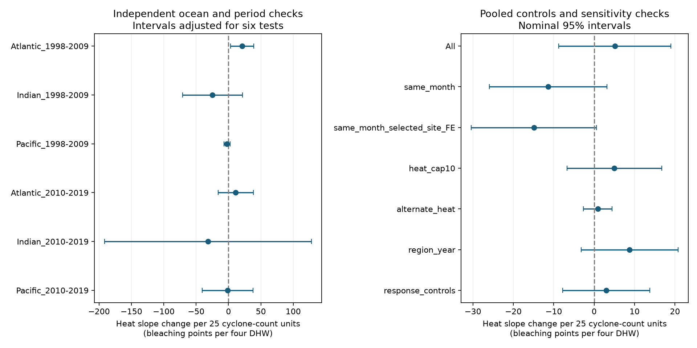

# A cyclone-count heat buffer was not clear in six ocean-period coral survey samples from 1998 to 2019

## Question and result

Does the long-term cyclone count at a reef site mark a weaker bleaching response to heat? Such an indicator could help assess reef refuges. A negative count-by-heat interaction would fit this indicator claim. None of the six ocean-period tests had a clear negative interval. The pooled estimate was uncertain. The evidence does not support a common buffer in the tested samples. It does not show that storms cannot reduce heat or bleaching.

## Prior work and scope

[Cyclone cooling research](https://doi.org/10.1029/2011GL049722) describes how storms can reduce ocean heat through mixing and upwelling. This study asks a narrower question: does the supplied long-term count mark a lower *residual heat slope*? The heat dose may already include cooling by storms. Conditioning on that dose can remove part of the total storm effect. Thus a null interaction cannot refute the cooling mechanism.

We used the [Global Coral-Bleaching Database](https://doi.org/10.26008/1912/bco-dmo.773466.2), version 2, dated 2022-10-14. Its [methods](https://doi.org/10.1038/s41597-022-01121-y) describe the cyclone raster. It uses IBTrACS tracks, wind categories, damaging-wind radii, and interpolation for 1964-2014. Fractional values are valid raster values. The field is a site descriptor, not a list of storms before each survey. It includes future storms relative to early surveys. This is a retrospective descriptive test, not a forecast or a causal estimate.

We read the published SCI [heat study](sci:sha256:ab995c1cbe2d6f032bf4c59de5c9c4bc9d2aaad32e5acc89744afdcc8b5ce1d4) and [weekly variability study](sci:sha256:4929f2d8592cafb6b5d0897464c14302828f814c65bd45d6aeab2e4de471eafa). They informed the repeated-survey design, duplicate audit, and timing checks. The new test uses the cyclone count. A metadata scan of published campaign bundles is saved in `files/campaign_prior_scan.json`. We started the required SCI search on `./campaign` before choosing the question. Full-bundle checking of the large archive was slow, so we stopped that search and verified a focused search on the seven metadata-matched published bundles instead. Its result is saved in `files/campaign_search.json`. This focused search can miss a relevant publication whose title and abstract did not match the scan terms. The investigation is exploratory and was not registered in advance. No sibling private workspace was used.

## Data and observation controls

The raw file has 41,361 rows, including 28,821 Reef Check rows and 14,475 distinct Reef Check sample IDs. Substrate rows can repeat one bleaching response. We checked all used fields within sample ID; no conflicts were found. We retained one value per sample, then averaged samples within site, year, and month. This avoids giving repeated substrate rows or multiple depths extra weight within a month. Each site-month has equal weight. Sites with more survey months still have more weight.

We required complete bleaching, two heat doses, depth, cyclone count, latitude, turbidity, weekly temperature anomaly standard deviation, date, ocean, and ecological region. We retained 1998-2019 records in the Atlantic, Indian, or Pacific, bleaching of 0-100 percent, depth of 0-40 m, and nonnegative cyclone counts. Ancillary fields keep the control checks on a common eligible set. There were 10,552 eligible samples and 8,520 site-months. No included site had a changing cyclone count or changing ocean or region name. Each fit then required at least two records per site in that test sample. Two records can be in different months of one year.

The pooled fitted sample has 6,217 records, 1,411 sites, and 54 ecological regions. Only 297 records have TSA_DHW of at least four. Only two such records occur in the Indian sample. That ocean has weak high-heat support and a cyclone-count range of 37.72-54.82, less than the 25-unit reporting contrast. Its large intervals must not be used as forecasts. `files/coverage.csv` gives observed year coverage. Some years within the stated windows have no eligible records.

## Model and uncertainty

We fitted the least-squares model:

`bleaching = site + ocean-year + ocean-month + b * H + theta * H * C + g * depth + error`

`H = TSA_DHW / 4` and `C = (Cyclone_Frequency - 50) / 25`. The coefficient `theta` is the change in bleaching percentage points per four degree-heating weeks for 25 units of cyclone count. The source TSA_DHW sums the prior 12 weeks of thermal anomalies above the maximum weekly climatology when the anomaly is at least 1 C. The alternate SSTA_DHW uses weekly climatology; it measures a different heat dose. The centre of 50 does not change the interaction. Site effects absorb the cyclone-count main effect.

Categorical effects were removed by alternating mean projections to tolerance 1e-10. Explicit sparse indicator fits checked the pooled and three ocean coefficient vectors. The maximum absolute difference was 1.3e-08. This checks the numerical implementation; it does not validate the model assumptions.

Intervals use ecological-region clusters, a G/(G-1) sandwich correction, and Student t critical values with G-1 degrees of freedom. There is no fixed-effect leverage correction. Regions can share marine heat events, and some cells have only six or seven regions. Coverage can therefore be poor. The six ocean-period intervals use Bonferroni correction at total error level 0.05. Full-period and sensitivity intervals are nominal 95%. A sign difference or a difference in interval coverage does not itself test a difference between slopes.

## Estimates

Full-period estimates:

| Sample | Records | Sites | Regions | Heated records | Slope change | Interval |
| --- | ---: | ---: | ---: | ---: | ---: | --- |
| All | 6217 | 1411 | 54 | 297 | +5.13 | -8.76 to +19.02 |
| Atlantic | 1084 | 271 | 8 | 27 | +20.51 | +7.77 to +33.24 |
| Indian | 374 | 93 | 11 | 2 | +0.14 | -50.09 to +50.37 |
| Pacific | 4759 | 1047 | 37 | 268 | +1.37 | -16.93 to +19.66 |


The pooled interaction is +5.13 (-8.76 to +19.02). The Atlantic full-period interaction is positive. The pooled estimate is not an equal average of ocean responses: record counts and residual exposure variation determine its weight.

Ocean-period intervals below are corrected for six tests:

| Sample | Records | Sites | Regions | Heated records | Slope change | Interval |
| --- | ---: | ---: | ---: | ---: | ---: | --- |
| Atlantic_1998-2009 | 512 | 172 | 7 | 11 | +20.89 | +2.94 to +38.83 |
| Indian_1998-2009 | 153 | 38 | 9 | 1 | -24.78 | -71.10 to +21.53 |
| Pacific_1998-2009 | 1495 | 449 | 29 | 103 | -2.21 | -6.86 to +2.43 |
| Atlantic_2010-2019 | 518 | 116 | 6 | 12 | +11.23 | -16.04 to +38.51 |
| Indian_2010-2019 | 199 | 58 | 6 | 1 | -31.58 | -191.17 to +128.02 |
| Pacific_2010-2019 | 3127 | 691 | 25 | 154 | -1.36 | -40.86 to +38.15 |


No cell gives a clear negative buffer. The early Atlantic interval is positive, but this cell has only seven years with eligible repeated records, seven regions, and eleven records at four or more TSA_DHW. We do not infer a harmful causal effect of cyclones. Periods share no years; oceans have different sites. Some sites recur across periods, all cells share Reef Check methods, and global events can cross oceans. These are replication checks within one public compilation, not fully independent experiments.



## Sensitivity and limitations

| Sample | Records | Sites | Regions | Heated records | Slope change | Interval |
| --- | ---: | ---: | ---: | ---: | ---: | --- |
| All_same_month | 3541 | 809 | 49 | 174 | -11.36 | -25.89 to +3.16 |
| All_same_month_selected_site_FE | 3541 | 809 | 49 | 174 | -14.90 | -30.40 to +0.59 |
| All_heat_cap10 | 6167 | 1402 | 54 | 252 | +5.01 | -6.70 to +16.72 |
| All_alternate_heat | 6217 | 1411 | 54 | 297 | +0.88 | -2.69 to +4.46 |
| All_region_year | 6217 | 1411 | 54 | 297 | +8.78 | -3.18 to +20.74 |
| All_response_controls | 6217 | 1411 | 54 | 297 | +2.99 | -7.77 to +13.75 |


The same-month model replaces site effects with site-calendar-month effects and keeps groups with two or more records. It gives -11.36 (-25.89 to +3.16). With site effects on that same selected sample, the estimate is already -14.90 (-30.40 to +0.59). Thus changed record selection accounts for much of the sign change relative to the main estimate; added timing controls alone do not explain it. These are correlated comparisons, not formal slope-difference tests.

The heat cap removes values above ten TSA_DHW. The alternate heat check changes the exposure definition. The region-year check controls for shared annual changes in each ecological region. The response-controls check adds heat interactions with absolute latitude, turbidity, and weekly anomaly standard deviation. It cannot remove all differences in coral heat response. Leaving one ecological region out gives pooled interaction estimates from -5.20 to +8.18. The pooled sign is therefore sensitive to region coverage. Full estimates and the exact environment are supplied with the package.

One survey program and repeat sites reduce changes in location and protocol. They do not remove visits chosen after bleaching, unknown observer effort, missing surveys, coral loss before a return visit, or changes in species and symbiont composition. Satellite surface heat does not equal heat at reef depth. Storm frequency may correlate with unmeasured response modifiers. A linear model with many zero responses is an association summary, not a physiological law. The historical count also measures damaging winds rather than cooling alone. These limits prevent causal claims about storm protection or climate change.

Bleaching is a coral stress response, not a direct measure of species loss or species distribution. Air pollution is not measured. Event-level storm tracks, reef-depth temperature, coral composition, and planned repeat surveys are needed to test whether cooling protects biodiversity. This package provides an audited panel and a reproducible test of one proposed refuge indicator, including an uncertain result.

## Provenance and reproduction

Job: `sci-1107-dell-climate-pollution-biodiversity-05d9c92c6ce5`. Topic: `climate-pollution-biodiversity`. Campaign: `11_07_2026`. Machine: `dell`. Account: `codex-andrii`. Model: `gpt-6.1-sol`, high reasoning effort. Date: 2026-11-08. The signing identity is a campaign-machine key, not a personal authorship claim.

Exact raw shared path:

`/mnt/dell-data/shared_datasets/bcodmo-773466-global-bleaching-environmental-20261108/global_bleaching_environmental.csv`

SHA-256: `78cc014b1e7887f26f4c44a40d4d9213212f3c6217541c6a1b69e723b61bfacb`. Bytes: 16,772,400. `files/provenance.json` records the source URL, version, attribution, and retrieval recipe. The file was reused in place and was not changed. Reef Check observers and the database creators retain attribution. The raw source data are CC BY 4.0. The raw file is not duplicated in this bundle.

From an unpacked bundle, install the packages in `files/requirements.txt` in a private environment if needed. Exact run versions are in `files/environment.json`. To reproduce all fits, numerical checks, and the figure from the included panel:

```bash
OPENBLAS_NUM_THREADS=1 OMP_NUM_THREADS=1 python files/analyze.py
```

To rebuild the panel and counts from the exact raw data:

```bash
OPENBLAS_NUM_THREADS=1 OMP_NUM_THREADS=1 python files/analyze.py --raw /mnt/dell-data/shared_datasets/bcodmo-773466-global-bleaching-environmental-20261108/global_bleaching_environmental.csv
```

If the shared file is absent, download the URL in `files/provenance.json` to local scratch and pass its path with `--raw`. The code rejects a different SHA-256. Do not replace any shared data. The signed manifest records hashes of the code and derived evidence. `estimates.csv` includes sample sizes, heat support, all coefficients of interest, intervals, and numerical check errors. `design_notes.md` records interpretation and sensitivity choices.

## References

- Carrigan and Puotinen (2011). Assessing the potential for tropical cyclone induced sea surface cooling to reduce thermal stress on the world's coral reefs. DOI: 10.1029/2011GL049722.
- van Woesik and Kratochwill (2022). A global coral-bleaching database, 1980-2020. DOI: 10.1038/s41597-022-01121-y.
- van Woesik and Burkepile (2022). Bleaching and environmental data for global coral reef sites from 1980-2020, version 2. DOI: 10.26008/1912/bco-dmo.773466.2.
- Source parameter definitions: https://www.bco-dmo.org/dataset/773466/description.
