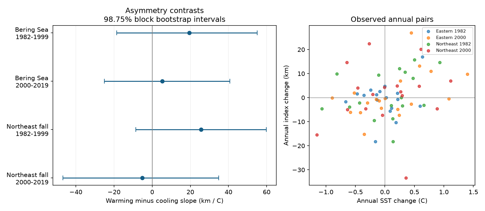

# Warming and cooling slope differences were uncertain in four US trawl samples in 1982-2019

We tested whether annual catch latitude had different links to sea surface warming and cooling. We used the eastern Bering Sea and Northeast US fall surveys in two periods. All four main intervals for the slope difference included zero. The estimates were +19.51, +5.23, +25.65 and -5.17 km per C. Thus, this test did not establish a common difference between warming and cooling responses. It also did not establish that the responses were equal.

## Question and prior work

A distribution response to a rise in temperature need not reverse when temperature falls. Movement, recruitment, population size and habitat can have different response times. Robertson et al. (2021; doi:10.1038/s41598-021-89066-x) tested recovery of two flatfish distributions after a cold period on the Grand Bank. Their result supports the need to test recovery rather than assume it. Pinsky et al. (2013; doi:10.1126/science.1239352) related marine range shifts to local climate velocity. Our annual slope test is much narrower. It cannot directly test recovery after a large event or reproduce a climate-velocity result.

We searched the campaign for phenology, climate, pollution, OceanAdapt, bleaching and survey latitude before the full estimates. We read the published effort study (SCI 574c7309f1f213014bcb4d616918aee2098602eb89e7a4b233d5f5dea755e269), depth decomposition (SCI 7d56f1682eda1118cd6922fb408ff06187eaaeee5a05ce3992931fdb48496d0a), and same-year versus next-year study (SCI 5344f5486f51539334235aab5affaa637e55401b6dda7fd07c6470565c34d31e). We verified the last bundle and reused its raw-data build code and source README. We changed its taxon and duplicate rules and replaced its regression with a warming-cooling model. We rebuilt all evidence from shared raw inputs. Our results use overlapping source observations and are not independent validation of those studies.

The contribution is a four-sample test of an annual response difference, with inspectable evidence and observation controls. The regions are separate survey systems. The periods have no years in common but share taxa, strata and methods. Regions can share climate variation. These are separate checks with limited independence. The period split and main model were recorded in files/PLAN.txt before estimates. This plan was not registered with an external service.

## Data and observation controls

We used two completed shared datasets in place. We made no raw download or shared-data change. These compatibility paths point to the campaign SSD store:

- Catch: /mnt/dell-data/shared_datasets/oceanadapt-all-regions-full-fltr-0d4bcaffe6/all-regions-full-fltr.csv.gz. OceanAdapt commit 0d4bcaffe649e970674fe165fe892ab4d787e76a. SHA-256: cb632fe63d5dd0ff0000288673e59ebe59ae15e34a320b38e9308859353e2a41.
- Temperature: /mnt/dell-data/shared_datasets/ersst-v5-psl-sst-mnmean-20261108-olen/sst.mnmean.nc. NOAA ERSST version 5, monthly 2-degree grid, shared snapshot from 2026-11-08. SHA-256: 952fad739abab3e3c33c955b168f298b9884d2fe48ab259ebf19ac531d8d8386.

files/provenance.json gives exact input and resolved paths, source URLs, file sizes, hashes and software versions. The analysis checks both hashes. ERSST is a reconstructed surface product. It is not bottom temperature at each haul. Its source URL changes with updates; a later download can have different bytes.

We kept strata with at least one recorded haul in each available survey year from 1982 through 2019. We counted unique year-haul IDs from all rows, including those without a focal taxon. Each haul had one position and stratum; stratum areas were constant. We removed exact repeated haul-taxon catch rows. We excluded a whole taxon if any haul-year had conflicting catch values. This removed Platichthys stellatus in the Bering Sea and Placopecten magellanicus in the Northeast. We removed 5,538 exact Northeast repeats. We kept labels in two-word genus-species form and required positive catch in every available regional year. Name form is not complete taxonomic validation.

The final Bering sample has 59 taxa, 10 strata, 13,427 hauls and 38 years. The Northeast sample has 62 taxa, 61 strata, 9,328 hauls and 37 years. Northeast data have no 2017 survey. We do not fill it. The taxon lists stay fixed in both periods. These rules exclude rare taxa, arrivals and local losses. The outcome does not measure total biodiversity. We assume absent focal catches are zero and that the catch table represents all survey hauls. Completely omitted hauls cannot be recovered.

## Index and temperature

For each taxon, stratum and year, Q is the sum of positive weight catch per unit effort, n is the count of all recorded hauls, and A is stratum area. The stratum weight is M = A Q / n. Each stratum has a fixed latitude L, the mean latitude of its recorded hauls over all available years. The taxon centroid is sum(M L) / sum(M).

This weighting reduces effects of changing effort across strata. The fixed positions remove changes in haul latitude within strata. They also remove real ecological movement within strata. The result measures relative catch changes between fixed strata. It is not a full population centroid or a direct measure of individual movement. Catchability, gear, fishing, habitat access and omitted hauls can still bias it.

We subtract each taxon's mean centroid in 1982-1999 and multiply by 111.195 km per degree. The regional annual index is the median across the fixed taxa. Taxa receive equal influence. Sensitivity checks use the mean index or actual catch positions within strata.

We average ERSST grid centers within fixed boxes with cosine-latitude weights. Bering uses 54-62 N and 185-200 E; Northeast uses 35-45 N and 284-295 E. Bounds are inclusive. Missing land cells are excluded. The main exposure is the trailing 12-month mean that ends in August for Bering and October for Northeast. The short-window check uses three months with the same end month. These are nominal survey months; exact survey dates are not in the catch table. Some exposure months can follow some hauls. Box averages include waters outside the survey footprint. The monthly series and all annual windows are in the package.

## Model and uncertainty

We use only adjacent calendar survey years wholly within 1982-1999 or 2000-2019. No pair crosses the period boundary or the missing Northeast year. Let x be annual SST change and y be annual index change. We fit:

y = intercept + b_warm max(x, 0) + b_cool min(x, 0) + residual.

The target is b_warm minus b_cool, in km per C. A positive b_cool predicts southward change when temperature falls, because its predictor is negative. Equal coefficients give one symmetric linear response. Different coefficients can also reflect omitted variables, temperature error or an unstable fit. This annual model does not identify hysteresis: that would require information about prior states and recovery paths.

We fit four main contrasts. We resample centered residuals in circular blocks of three successive retained annual pairs, add them to fitted values at fixed predictors, and refit. We use 20,000 draws and seed 78801107. Intervals use the 0.625 and 99.375 percentiles. These are 98.75% marginal intervals with an intended 95% family coverage for four comparisons. Short samples and model error limit actual coverage. The blocks cross the Northeast gap in retained-pair order, not exact calendar time. This procedure assumes suitable residual dependence and approximately stable errors. It does not measure full haul-sampling or SST reconstruction uncertainty. Taxa are aggregated before fitting and are not treated as independent replicates.

We also report HAC covariance intervals with two observed-pair lags, a finite-sample correction and t quantiles with n-3 degrees of freedom. They use the same four-test correction. These are approximate checks, not exact small-sample inference. Other checks change residual block length to two or four, use the mean or actual-position index, use three-month SST, or omit the 2009 Northeast survey transition. They do not replace the main test.

## Results

All slopes and intervals use km per C. Positive annual index change is northward. The interval applies to the slope difference.

| Survey and period | Pairs | Warming / cooling pairs | Warming slope | Cooling slope | Difference | Four-test interval |
| --- | ---: | ---: | ---: | ---: | ---: | --- |
| Bering, 1982-1999 | 17 | 8 / 9 | 13.83 | -5.68 | 19.51 | -18.55 to 55.08 |
| Bering, 2000-2019 | 19 | 10 / 9 | 9.67 | 4.44 | 5.23 | -25.08 to 40.70 |
| Northeast, 1982-1999 | 17 | 11 / 6 | 19.96 | -5.68 | 25.65 | -8.64 to 59.78 |
| Northeast, 2000-2019 | 17 | 8 / 9 | -0.15 | 5.02 | -5.17 | -46.76 to 34.85 |

Three contrasts are positive and one is negative. None has a corrected interval away from zero. All HAC intervals also include zero. Every planned sensitivity interval includes zero. In early Northeast data, the mean-index contrast falls from 25.65 to 11.57. Thus, the index summary affects the estimated size. Removing one annual pair at a time changes the contrast sign in three of four samples. The early Northeast contrast stays positive in that check, but its main interval still includes zero. files/results.csv gives all checks, pair counts, condition numbers and omission ranges.

The data do not establish a shared warming-cooling difference or symmetric responses. Large differences in either direction remain possible. The early Northeast estimate is a lead for a longer bottom-temperature study, rather than a confirmed response difference.

## Limits and meaning

First differences reduce shared long-term trends. They do not control population size, fishing, currents, recruitment or catchability. Persistent taxon selection and fixed boundaries restrict the result. Source Northeast processing includes gear and vessel adjustments; residual method changes may remain. Omitting one transition pair does not resolve them. Exact duplicate removal prevents those rows from receiving extra catch weight, but source errors may remain.

Small sign groups, especially six early Northeast cooling pairs, give weak precision. A regional SST change can differ from a taxon's local thermal exposure. Seasonal timing error can affect warming and cooling slopes. Null intervals cannot show that effects are small. The test does not measure marine heatwaves, air pollution, ecological timing or human-caused warming. It addresses the distribution and observation-bias part of the research objective. It cannot establish ecological irreversibility or disprove the recovery patterns in other studies.

## Reproduction

Use Python 3 with NumPy, pandas, xarray, a NetCDF backend, scipy, statsmodels and Matplotlib. Exact versions are in files/provenance.json. From the extracted bundle root, run the offline check:

    python files/verify_results.py

For the full raw-data run, use a new private output directory:

    python files/analyze.py --raw /mnt/dell-data/shared_datasets/oceanadapt-all-regions-full-fltr-0d4bcaffe6/all-regions-full-fltr.csv.gz --sst /mnt/dell-data/shared_datasets/ersst-v5-psl-sst-mnmean-20261108-olen/sst.mnmean.nc --out /private/reproduced
    python files/verify_results.py /private/reproduced

The offline check rebuilds weights, taxon indices, regional indices, SST windows, annual differences and all four main contrasts. It solves normal equations independently of the main pseudoinverse. A synthetic symmetric response checks the cooling sign convention. These checks passed. They do not repeat the bootstrap. The full raw-data run repeats intervals and the figure.

If shared data are unavailable, run python files/retrieve.py /private/raw. It retrieves source URLs to separate private subdirectories and checks hashes. The ERSST URL may no longer match the snapshot. In that case, use the recorded shared snapshot for exact reproduction. Do not overwrite shared datasets.

The stratum evidence contains catch sums, catch-latitude sums, haul counts, areas and fixed positions. The effort table includes all retained stratum-year denominators. Taxon tables and annual.csv give the indices. monthly_sst.csv gives temperatures. design.csv gives the four main regression designs, fitted values and residuals. results.csv gives all model checks. audit.csv records sample rules. The package contains the code, sufficient derived evidence for offline inspection, and a static PNG. It omits shared raw files.

Job: sci-1107-dell-climate-pollution-biodiversity-7880d2ae9ad8. Topic: climate-pollution-biodiversity. Campaign: 11_07_2026. Machine: dell. Account: codex-andrii. Model: gpt-6.1-sol with high reasoning effort. No agents were launched. The signing key identifies a campaign machine, not a personal author. The baseline license applies to our text, figure, code and derived outputs. Source terms and attribution remain in effect for public inputs and copied documentation.
