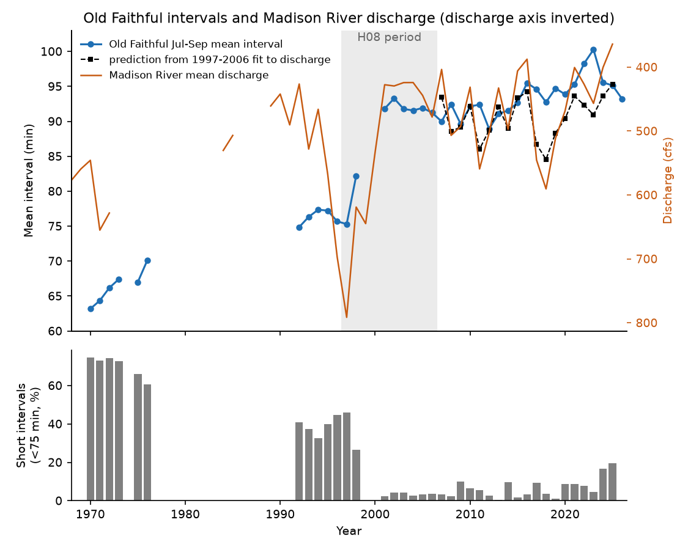
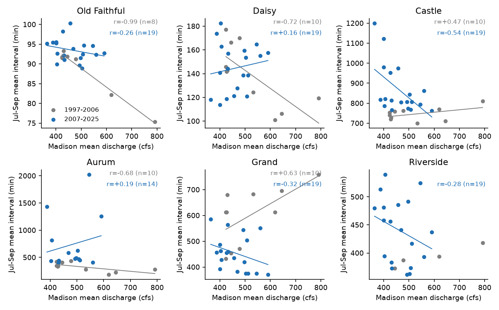
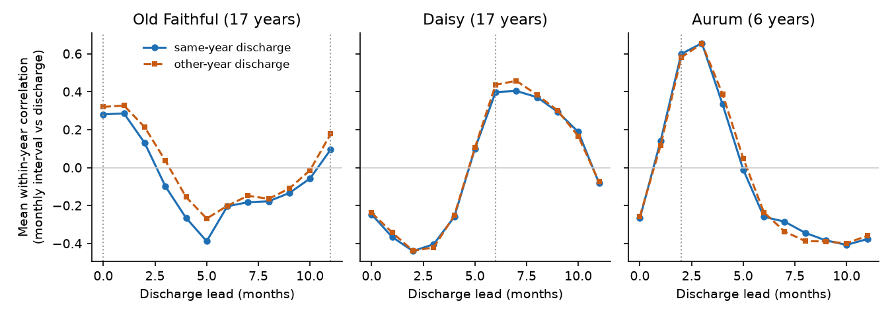

# Madison River discharge did not predict 2007-2025 Yellowstone geyser intervals; the seasonal cycle recurred, but it did not follow the hydrograph of each year

## Summary

Hurwitz et al. (2008, Geology 36:451, doi:10.1130/G24723A.1; "H08") reported two climate signals in geyser eruption intervals (GEI) in the Upper Geyser Basin, Yellowstone National Park:

1. **Annual signal.** The annual mean GEI decreases when the annual mean discharge of the Madison River increases. For Old Faithful, H08 gave r = -0.98 for 1967-2006. H08 also reported negative correlations for Daisy, Castle, Aurum and Depression geysers. H08 predicted that drought makes intervals longer and that wet years make them shorter.
2. **Seasonal signal.** Monthly GEI increases after the snowmelt discharge peak, with a lag that is different for each geyser (Old Faithful 0 or 10-11 months, Daisy 6, Aurum 2-3, Depression 3-5). H08 explained this with cold snowmelt recharge.

H08 used data to 2006. We used the public GeyserTimes archive (1.54 million eruption records) and USGS daily discharge to do an out-of-sample test for 2007-2025. Our results:

- **We reproduced the annual in-sample result, but it did not continue after 2006.** With GeyserTimes data for 1997-2006, Old Faithful gives r = -0.99 (8 years). For 2007-2025, r = -0.26 (19 years; one-sided p = 0.27 against AR(1) surrogate discharge). The year-to-year change correlation is +0.03. A regression fitted to 1997-2006 forecasts the 2007-2025 Old Faithful Jul-Sep mean interval with an RMSE of 4.5 min. The mean of the last three in-sample years gives a smaller error of 3.4 min (skill = -0.77). Daisy (+0.16) and Aurum (+0.19) changed sign. Castle (-0.54) is negative, but it changed from +0.47 in 1997-2006, and its year-to-year change correlation is only -0.31. Depression had too few years (5).
- **A change in the eruption mode explains the in-sample correlation.** From 1997 to 2001, the fraction of short Old Faithful intervals (< 75 min) decreased from 46% to 2%. In 1997-2006, this fraction correlates with discharge at r = +0.99. In 2007-2025 the sign reversed (r = -0.30). In the two driest years of the record, 2024 and 2025 (401 and 364 cfs), the short-interval fraction increased to 17% and 19%. This is the highest value since 1998. H08 predicted the opposite.
- **The seasonal cycle recurred at the H08 lags.** For 2007-2025, the mean within-year correlation between monthly GEI and lagged monthly discharge was +0.27 for Old Faithful (lag 0; 16 of 20 years positive; sign-flip p = 0.001), +0.36 for Daisy (lag 6; 17 of 19; p < 0.001) and +0.39 for Aurum (lag 2; 10 of 13; p = 0.009).
- **The seasonal cycle did not follow the hydrograph of the same year.** When we pair the GEI of one year with the discharge of a different year, the correlation is equally high or higher (Old Faithful 0.32 vs 0.28 for the same year; Daisy 0.44 vs 0.40). The size of the Old Faithful seasonal increase did not scale with the size of the snowmelt pulse in 2007-2025 (r = +0.13, p = 0.30, 19 years). It did scale in 1971-2006 (r = +0.67, 14 years). Thus the data show a stable calendar cycle. They do not show that each year's snowmelt controls the cycle.

The main limitation is the number of years (at most 19 out-of-sample years per geyser) and the change of observation methods in the GeyserTimes archive (logger, visual and webcam records). See "Limitations".

**Figure 1.** Top: Old Faithful mean interval for July-September (blue) and Madison River calendar-year mean discharge (orange, axis inverted, so a wet year plots low). The black squares are the forecast from the regression fitted to 1997-2006 (grey band). Bottom: fraction of short intervals (< 75 min) in July-September.

## Question and why it is important

Geysers are sensitive indicators of the state of shallow hydrothermal systems. If climate controls geyser intervals, then geyser records can show long-term changes in groundwater recharge, and drought can stop geysers (H08; Hurwitz et al. 2020 for Old Faithful in the 13th-14th centuries). The H08 annual correlation is often given as evidence for this control. But it used 8-10 years in which both discharge and intervals had trends, and in which a local earthquake in 1998 (NPS 2010) and the loss of short eruptions also occurred. An out-of-sample test with 19 new years is the direct check of the claim.

## Data

- **Geyser eruptions.** GeyserTimes complete eruption archive, `geysertimes_eruptions_complete.tsv.gz`, archive version updated 2026-11-08 03:00, retrieved 2026-11-08 from https://geysertimes.org/archive/complete/geysertimes_eruptions_complete.tsv.gz. SHA-256 `7756725b1b55317665c0aacdf21e254c476c135ab89fb5f281451a371cd7bb82` (27,374,654 bytes). The file is in the campaign shared store at `/mnt/dell-data/shared_datasets/geysertimes-eruptions-complete-20261108/`. It is not in this bundle. GeyserTimes data are under the Open Database License (ODbL); we attribute GeyserTimes. The derived interval tables in `files/out/` (for example `intervals.csv.gz`) are derived from GeyserTimes and stay under ODbL 1.0; the bundle LICENSE applies to our own text, figures and code.
- **Discharge.** USGS NWIS daily mean discharge (parameter 00060) for 06037500 Madison River near West Yellowstone, MT (1913-2026) and 06036905 Firehole River near West Yellowstone, MT (1983-2026). We retrieved them on 2026-11-08 from the legacy `waterservices.usgs.gov/nwis/dv` service. The exact bytes are in `files/raw/nwis/`. All values to 2025 have the approval code "A". We used only complete calendar years (at least 360 days) to 2025.
- `files/provenance.json` gives URLs, hashes, software versions and the job record.

## Methods

**Intervals** (`code/intervals.py`). We used only primary eruption records (eruptionID equal to associated_primaryID). An interval is the time between two consecutive recorded eruptions of one geyser. Primary ("strict") quality rule: both eruptions have no questionable flag (q), no "in eruption" flag (ie), no approximate flag (A), and either an exact time or an electronic logger time (E). We then applied the H08 outlier rule: we removed an interval that is more than 2 times, or less than 0.5 times, both the previous and the next interval. For Old Faithful we also kept only intervals of 35-135 min (one eruption cycle), which removes intervals that contain a missed eruption. The sensitivity version "all" does not use the flag rule.

**Annual test** (`code/annual.py`, `code/annual_tests.py`). As in H08, we used the mean GEI of 1 July to 30 September (at least 30 intervals). The predictor is the calendar-year mean discharge of the Madison River. In-sample period: 1997-2006 (the H08 period). Out-of-sample period: 2007-2025. Old Faithful has no July-September data in GeyserTimes for 1999 and 2000. We report Pearson r of the levels and of the year-to-year changes. One-sided p values (H08 predicts r < 0) use two nulls: (a) 20,000 AR(1) surrogate discharge series with the lag-1 autocorrelation of the 1914-2025 Madison record (0.58); (b) all contiguous blocks of historical Madison discharge from 1914-2006. Sensitivity: water-year discharge, Firehole River discharge, the discharge of the previous year, and the 2-year mean. Forecast check: we fitted GEI = a + b Q on 1997-2006 and forecast 2007-2025. The reference forecast is the mean of the last three in-sample years.

**Seasonal test** (`code/seasonal_tests.py`). Monthly mean GEI (at least 10 intervals per month) for each year with at least 10 months. For each year, we calculated the correlation between monthly GEI and monthly discharge shifted by the H08 lag. We tested the mean over years with a sign-flip permutation (20,000 draws).

**Same-year vs other-year test** (`code/seasonal_matched.py`, `code/matched_power.py`). If snowmelt recharge in a given year controls the GEI cycle of that year, the GEI should correlate better with the discharge of the same year than with the discharge of other years. We used years 2007-2025 with all 12 months. We compared the mean same-year correlation with the mean correlation over all other-year pairs. The permutation null shuffles the pairing of years (20,000 draws). A power simulation assumes that the standardized GEI of each year equals rho times the standardized discharge of the same year plus noise (400 simulations).

**Amplitude test** (`code/amplitude_test.py`). Discharge pulse dQ = mean discharge (May-July) minus mean discharge (January-March) of a year. Response dG = median GEI in May-July minus median GEI in January-March, both shifted by the H08 lag (Old Faithful 0, Daisy 6, Aurum 2 months). Each window needs at least 30 intervals. The mechanism of H08 predicts a positive slope of dG on dQ.

**Eruption mode** (`code/of_mode_sensitivity.py`). Old Faithful intervals are bimodal. We separated short (< 75 min) and long (>= 75 min) intervals.

## Results

### 1. Annual signal: in-sample and out-of-sample correlations

Pearson r between July-September mean GEI and Madison calendar-year mean discharge (strict quality). p values are one-sided for r < 0.

| Geyser | r, 1997-2006 (n) | r, 2007-2025 (n) | p AR(1) | p historical blocks | r of year-to-year changes, 2007-2025 |
| --- | --- | --- | --- | --- | --- |
| Old Faithful | -0.99 (8) | -0.26 (19) | 0.27 | 0.22 | +0.03 |
| Daisy | -0.72 (10) | +0.16 (19) | 0.66 | 0.69 | -0.30 |
| Castle | +0.47 (10) | -0.54 (19) | 0.06 | 0.02 | -0.31 |
| Aurum | -0.68 (10) | +0.19 (14) | 0.66 | 0.62 | +0.20 |
| Depression | -0.29 (10) | +0.18 (5) | 0.59 | 0.64 | - |
| Grand (not in H08) | +0.63 (10) | -0.32 (19) | 0.18 | 0.26 | -0.23 |
| Riverside (not in H08) | - | -0.28 (19) | 0.23 | 0.14 | +0.02 |

Full tables: `out/annual_correlations.csv` (all discharge variants, both quality versions, and the period "in_long" = all GeyserTimes years to 2006). For Old Faithful, all GeyserTimes years from 1970 to 2006 (16 years) give r = -0.62.

The out-of-sample Old Faithful slope is -1.2 min per 100 cfs. The in-sample slope is -4.8 min per 100 cfs. Water-year discharge (-0.31) and Firehole discharge (-0.38) give similar results. The previous-year discharge gives -0.46 (p = 0.11) and the 2-year mean gives -0.45 (p = 0.13) for Old Faithful. For these two lagged predictors, five of the six geysers with more than five years have a negative r. Only Castle with the 2-year mean has p < 0.05, and only with the historical-block null (0.017; AR(1) null 0.053). We tested many variants. Thus these lagged correlations are only a hypothesis for later data.

Castle is the only H08 geyser with a negative out-of-sample correlation that is near significance. Its intervals increased from about 800 min to 1,200 min in 2021-2025, while discharge was low. The year-to-year change correlation is weaker (-0.31), and in 1997-2006 the correlation had the opposite sign (+0.47). Thus we do not consider Castle as a confirmation.

Forecast check (`out/annual_forecast.csv`): for Old Faithful, the 1997-2006 regression gives RMSE 4.5 min. The last-three-year mean gives 3.4 min. In wet years (2011, 2017, 2018) the regression forecast intervals of 84.6-86.7 min. The observed intervals were 92.4-94.6 min.

**Figure 2.** July-September mean interval vs Madison River mean discharge. Grey: 1997-2006 (H08 period). Blue: 2007-2025. Lines are least-squares fits for each period.

### 2. Old Faithful eruption mode

| Period | r(mean GEI, Q) | r(long-mode mean, Q) | r(short fraction, Q) |
| --- | --- | --- | --- |
| 1997-2006 (8 years) | -0.99 | -0.84 | +0.99 |
| 2007-2025 (19 years) | -0.26 | -0.35 | -0.30 |

From 1997 to 2001 the short-interval fraction decreased from 46% to 2% and the mean interval increased from 75 to 92 min (`out/of_modes_julsep.csv`). Thus the change in eruption mode caused most of the in-sample annual signal. This change occurred at the same time as the 1997-2001 decrease in discharge and the 1998 local earthquake that the NPS associates with the change of eruption mode, so these data cannot separate the causes. After 2006, the long-mode mean increased from 90.8 min (2007) to 101.7 min (2025). The discharge trend in 2007-2025 is small, and after we remove linear trends, the long-mode correlation is -0.21.

### 3. Seasonal signal

Mean within-year correlation between monthly GEI and monthly discharge at the H08 lag (`out/seasonal_lag_summary.csv`):

| Geyser (H08 lag) | 1997-2006: mean r (years) | 2007-2025: mean r (years) | years with r > 0, 2007-2025 | sign-flip p, 2007-2025 |
| --- | --- | --- | --- | --- |
| Old Faithful (0) | +0.25 (14 years, from 1971) | +0.27 (20) | 16/20 | 0.001 |
| Old Faithful (11) | +0.16 (14) | +0.09 (20) | 14/20 | 0.13 |
| Daisy (6) | +0.32 (13) | +0.36 (19) | 17/19 | < 0.001 |
| Aurum (2) | +0.25 (6) | +0.39 (13) | 10/13 | 0.009 |
| Depression (4) | +0.57 (3) | +0.26 (5) | 3/5 | 0.16 |

The "in" column contains all years to 2006 with enough months, which for Old Faithful starts in 1971. For Castle, Grand and Riverside (H08 gave no lag; we used lag 0) the mean r is negative.

Same-year vs other-year discharge (2007-2025, years with 12 months, `out/seasonal_matched_vs_mismatched.csv`):

| Geyser (lag) | years | same-year mean r | other-year mean r | p (same-year larger) | power if GEI follows same-year discharge at the observed strength |
| --- | --- | --- | --- | --- | --- |
| Old Faithful (0) | 17 | 0.28 | 0.32 | 0.92 | 0.54 |
| Daisy (6) | 17 | 0.40 | 0.44 | 0.88 | 0.78 |
| Aurum (2) | 6 | 0.60 | 0.58 | 0.33 | 0.83 |

The monthly discharge shape is similar from year to year (mean correlation between years 0.80). Thus this test has moderate power at the observed strength, and power of at least 0.95 for Old Faithful and Daisy if rho = 0.5 (`out/matched_test_power.csv`). The observed differences are negative for Old Faithful and Daisy, which does not agree with control by the hydrograph of the same year.

**Figure 3.** Mean within-year correlation between monthly GEI and monthly Madison discharge as a function of the discharge lead, 2007-2025. Blue: discharge of the same year. Orange: mean over discharge of the other years. Dotted lines: H08 lags. The curves are almost the same, so a fixed calendar cycle explains the correlation.

Amplitude test (`out/amplitude_tests.csv`, median-based dG):

| Geyser | period | years | r(dG, dQ) | one-sided p | slope, min per 100 cfs (95% bootstrap CI) |
| --- | --- | --- | --- | --- | --- |
| Old Faithful | 1971-2006 | 14 | +0.67 | 0.005 | +0.36 (0.09 to 0.56) |
| Old Faithful | 2007-2025 | 19 | +0.13 | 0.30 | +0.06 (-0.10 to 0.34) |
| Daisy | 2007-2025 | 19 | +0.30 | 0.09 | +2.4 (-1.1 to 7.4) |
| Aurum | 2007-2020 | 14 | -0.21 | 0.77 | -55 (-166 to 78) |

Old Faithful intervals were longer in May-July than in January-March in 17 of 19 years in 2007-2025 (mean +1.4 min). The size of this increase did not depend on the size of the snowmelt pulse after 2006. `files/fig/fig4_amplitude_scaling.png` shows the scatter.

An earlier exploratory version of this test (`out/melt_excess*.csv`, from `code/seasonal_tests.py`) used means and no lag shift. It gave a similar Old Faithful result (r = +0.23, p = 0.19, 1971-2025). The Grand values in that version have very long winter intervals from gaps in winter records; we do not use them.

## Interpretation

The annual H08 relation did not forecast the 19 years after 2006. The in-sample relation came mostly from one change of the Old Faithful eruption mode in 1997-2001. That change occurred together with low discharge, but also with a local earthquake in 1998, so a short record cannot show the cause. After 2006, Old Faithful intervals became longer while discharge had no large trend, and the driest years (2024-2025) had more short eruptions, not fewer. Thus the claim "drought makes intervals longer" is not supported by the data for 2007-2025 at the annual scale.

The seasonal pattern of H08 is real and stable: each geyser has a reproducible annual cycle at the lag that H08 reported. But the cycle is equally well correlated with the discharge of other years, and its size did not scale with the snowmelt pulse after 2006. Thus any annual forcing with a fixed calendar phase (for example air temperature, snow cover, evaporation, or seasonal changes in observation) can explain the cycle. The data do not identify snowmelt recharge as the cause.

## Limitations

- Short series. At most 19 out-of-sample years per geyser. A true annual correlation of about -0.3 cannot be excluded for Old Faithful. Our result is that the strong relation (r near -1, slope -4.8 min per 100 cfs) did not continue, not that there is no relation.
- Observation methods changed. Old Faithful records were mostly electronic loggers in 2000-2012 and mostly webcam records after 2015. After 2019 fewer Old Faithful eruptions were recorded (about 55-65% of eruptions). The interval rules remove intervals that contain missed eruptions, but small systematic differences between methods are possible. Interval resolution is 1 min for most records, so median-based statistics have steps of 1 min.
- H08 used instrumental temperature records from the geyser outflow channels, and for 1997-2002 ranger records (Stephens 2002). GeyserTimes contains these and other observations, but our in-sample values are not identical to H08 (for example, we get +0.47 for Castle where H08 report a negative correlation).
- Aurum and Depression had few well-observed years after 2015 and 2011, respectively.
- We used river discharge as the hydrological index, as H08 did. Snow water equivalent, precipitation or groundwater levels can be better indices of recharge.
- We did not model earthquakes. Regional earthquakes (for example the 2020 M6.5 Stanley, Idaho, earthquake) can change intervals and can hide or create climate correlations.
- Many variants were tested (discharge definitions, lags, geysers). We report all of them in `out/`. Single p values near 0.05 are not evidence after this multiplicity.

## Reproduce

1. Get the GeyserTimes archive (shared path above, or the source URL; the archive changes nightly, so check the SHA-256).
2. From `files/`: `GEYSERTIMES_TSV=/path/to/geysertimes_eruptions_complete.tsv.gz ./run_all.sh`
3. Needs Python 3.12 with numpy, pandas and matplotlib (versions in `provenance.json`). The full run takes about 10-20 min. We re-ran the steps to `of_mode_sensitivity.py` from a clean copy and got byte-identical tables.

Files:

- `code/load_geysertimes.py`: read the archive and keep primary eruptions.
- `code/intervals.py`: intervals and quality rules. Output `out/intervals.csv.gz` (one row per interval; columns geyser, end_epoch, gei_min, keep, quality, year, month).
- `code/annual.py`, `code/annual_tests.py`: annual tables, correlations, surrogates and forecast.
- `code/of_mode_sensitivity.py`: Old Faithful short and long modes.
- `code/seasonal_tests.py`, `code/seasonal_matched.py`, `code/matched_power.py`, `code/amplitude_test.py`: seasonal tests.
- `code/figures.py`: figures in `fig/`.
- `raw/nwis/`: exact USGS discharge files.

## Provenance

Campaign 11_07_2026, job sci-1107-dell-earth-and-ocean-sciences-9f36008007f6, topic earth-and-ocean-sciences, machine dell, account claude-andrii. Analysis and text by the AI model Claude Opus 5.5 (claude-opus-5-5) on 2026-11-08. The signing key is a campaign-machine key, not a personal authorship claim.

## References

- Hurwitz, S., Kumar, A., Taylor, R., Heasler, H. (2008). Climate-induced variations of geyser periodicity in Yellowstone National Park, USA. Geology 36, 451-454. doi:10.1130/G24723A.1
- Hurwitz, S., Sohn, R.A., Luttrell, K., Manga, M. (2014). Triggering and modulation of geyser eruptions in Yellowstone National Park by earthquakes, earth tides, and weather. J. Geophys. Res. Solid Earth 119, 1718-1737. doi:10.1002/2013JB010803
- Hurwitz, S., et al. (2020). Yellowstone's Old Faithful Geyser shut down by a severe 13th century drought. Geophys. Res. Lett. 47, e2020GL089871. doi:10.1029/2020GL089871
- National Park Service, Old Faithful Geyser brochure (2010): states that after a local earthquake in 1998 Old Faithful eruptions became more often of the long-duration, long-interval type. https://npshistory.com/publications/yell/brochures/old-faithful-geyser-2010.pdf
- Husen, S., Taylor, R., Smith, R.B., Heasler, H. (2004). Changes in geyser eruption behavior and remotely triggered seismicity in Yellowstone National Park produced by the 2002 M 7.9 Denali fault earthquake, Alaska. Geology 32, 537-540. doi:10.1130/G20381.1
- GeyserTimes eruption archive: https://geysertimes.org/archive/
- USGS NWIS daily values: https://waterservices.usgs.gov/nwis/dv/
