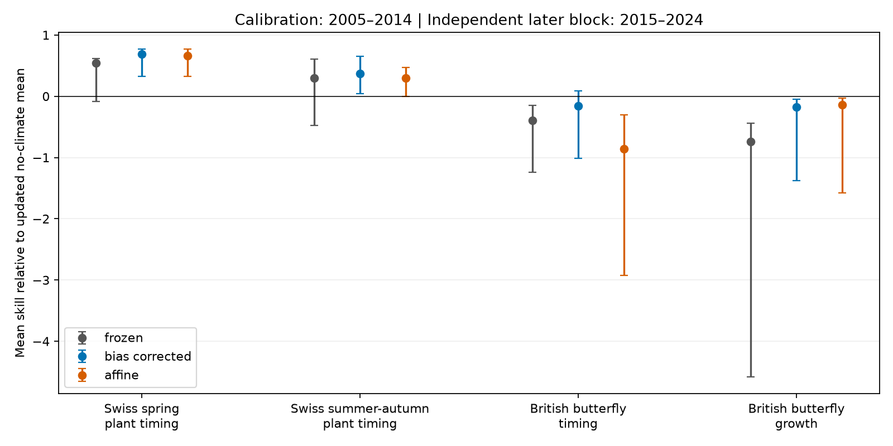

# Mean-corrected climate forecasts had positive plant timing skill and negative butterfly timing and growth skill in 2015-2024

We tested whether simple updates repair old climate forecasts. We used signed annual forecast statistics for Swiss plant dates and British butterfly dates and growth. Original models used data through 2004. We estimated corrections in 2005-2014 and tested 2015-2024. The comparison model used the same recent observations to update its mean, with no climate term. Mean skill after a mean-bias correction was 0.691 for 19 spring plant phases, 0.369 for 8 later plant phases, -0.156 for 43 butterfly timing species and -0.173 for 36 butterfly growth species. Two-year block intervals excluded zero for both plant classes and growth. Independent-year intervals included zero for both plant classes. A fixed half-strength climate signal gave small uncertain positive butterfly gains. A recent mean reduced butterfly timing error more than the frozen climate model when both were compared with the old baseline: 28% versus 8%. Thus, the timing-versus-growth claim needs a limit: butterfly timing gain depends on the comparison model. Mean drift alone did not explain the growth forecast failure. This is a retrospective reuse of published statistics, not new field evidence. Short test periods, changing source coverage, observed weather inputs and conditional uncertainty limit inference.



## Question and contribution

Can mean drift or a change in slope explain the reported climate forecast failure for population growth? Does the same repair preserve the timing advantage? We test a second transfer step: fit corrections on the first ten years after deployment and score a later decade. Both the climate model and the comparison model get the same recent observations. This separates the value of the old climate signal from the value of a recent mean.

SCI 10c822d24e2a5e24f228a2e2b35d7c32bba2e6913dc993c132fd547174c7cc69 supplied the statistics. Its original models fit site effects and climate windows through 2004. It reported strong plant timing skill, weak butterfly timing skill and negative growth skill. It already tested a trend baseline. SCI 12078975f0f7fea39497746d3d0aebc037d9c6e89bdb71d8feb576b5858c6fec found that a time term changed weather gains for one butterfly species. Our contribution is a recent-mean benchmark and a common correction test across 106 response units. We do not claim that statistical recalibration is a new method. Climate forecast post-processing has long used it (doi:10.1175/JCLI-D-15-0868.1). Parameter uncertainty is a known problem with short calibration sets (doi:10.1002/qj.2716).

We searched the campaign for phenology abundance, shrinkage forecast timing, recalibration butterfly and bias correction butterfly before the final analysis. Search results and the prior study made these data partly known. The study is retrospective. No test data enter the correction fits, but the test decade was not hidden from the research community. We did not tune the half-slope value or choose a best method from test losses.

## Data and sample

The only numerical input is the verified aggregate table `files/results/year_series_train2004.csv` in the source SCI bundle. Its SHA-256 is `d6189f56aeeabf6c442f0d3b68dab50b74b89636496247b8dd56050825e4ccef`. It is 504113 bytes. The local source bundle is `campaign/10c822d24e2a5e24f228a2e2b35d7c32bba2e6913dc993c132fd547174c7cc69.zip`, through the shared campaign link. No shared raw dataset was opened or downloaded for this study. We use its annual statistics in local scratch only. The source combines MeteoSwiss dates, UKBMS 2024 releases and E-OBS temperature and rain. Source versions, URLs, raw hashes and historical shared paths are recorded in `files/upstream_provenance.txt`. Those are inherited provenance, not a claim that we rechecked each raw file.

For timing, observed anomaly is an annual site-mean date minus its old site mean. For growth, it is annual mean log population change minus the old density-only model. The growth forecast anomaly is the difference between a joint climate-density model and the density-only model. Thus it can include a changed density coefficient, not just a climate slope. We test that complete forecast increment. Weather is observed, not forecast. Growth also uses observed prior abundance.

We require all years 2005-2024. This keeps 19 spring phases, 8 later plant phases, 43 butterfly timing species and 36 growth species. We exclude the combined Thymelicus lineola/sylvestris growth unit with 17 years. We exclude managed hay timing from the four biological classes. The fixed-window checks use the same rule. Annual samples within each source unit can change. We cannot repair that from the aggregate statistics.

## Methods

For each unit, let o be the observed annual anomaly and p the original forecast anomaly. Let overbars denote means in 2005-2014. We fit these models with no test data:

* Frozen climate forecast: p.
* Updated comparison: mean(o), with no climate forecast increment.
* Primary mean correction: p + mean(o - p).
* Affine correction: mean(o) + b [p - mean(p)], with ordinary least-squares b from calibration years.
* Fixed half slope: mean(o) + 0.5 [p - mean(p)]. This reduces the forecast signal without estimating a slope.
* Old comparison: zero anomaly, the original no-climate forecast.

We score 2015-2024. Unit skill is 1 - mean squared model error / mean squared updated-comparison error. Class skill is the equal-unit average of these ratios. Each year has equal weight. This is not a ratio of pooled errors and is not a site-level score. All comparisons use identical records within a unit. The half slope is a sensitivity test, not an optimal shrinkage claim.

Primary uncertainty uses 10000 circular bootstrap draws of test years in blocks of two. We keep the same sampled years for all units in a class. The four primary intervals use percentiles 0.625 and 99.375, a nominal Bonferroni allocation across four classes. Models and calibration means remain fixed. We recompute unit denominators in each draw. This can give long negative tails when sampled comparison errors are small. We do not treat species as independent field replications. We also use blocks of one and three, omit each test year, change the calibration end to 2012 or 2016, and replace selected weather windows with the source fixed windows. Checks outside the primary four do not have joint coverage across all reported methods. Bootstrap coverage is approximate with only ten test years and possible nonstationarity.

## Results

| Response | Units | Mean skill | 98.75% block interval |
|---|---:|---:|---:|
| butterfly growth | 36 | -0.173 | -1.375 to -0.052 |
| butterfly timing | 43 | -0.156 | -1.014 to 0.086 |
| plant spring timing | 19 | 0.691 | 0.320 to 0.775 |
| plant summer-autumn timing | 8 | 0.369 | 0.043 to 0.651 |


For butterfly timing, the frozen model has mean skill 0.083 against the old comparison. The updated no-climate mean has 0.283 against that same old comparison. The corrected climate model has 0.147. These values show why a positive gain against an old comparison does not establish added climate value after recent data become available. Ratios use different unit denominators when the comparison changes; these class scores must not be subtracted as if denominators were common.

The affine model has mean skills 0.660, 0.300, -0.858 and -0.135 for spring plants, later plants, butterfly timing and growth, respectively. Free slope fitting therefore does not repair the butterfly forecasts in this test. A fixed half slope gives 0.530, 0.343, 0.043 and 0.022. Both butterfly half-slope intervals include zero. A negative full-signal result is not proof that the climate signal has no information. It can mean that the signal is too large or too unstable to offset its error.

In 36 butterfly species shared between complete timing and growth panels, mean corrected timing-minus-growth skill is -0.025. This descriptive comparison does not support a broad timing advantage after the baseline update. It is not a formal equivalence test. The unpaired class difference differs because the timing panel has seven more species.

## Robustness and limits

Mean-corrected skill retains its sign after each omitted test year. The ranges are 0.635 to 0.739 for spring plants, 0.271 to 0.433 for later plants, -0.264 to -0.050 for butterfly timing and -0.409 to -0.129 for growth. This rules out a single omitted year as the sole cause of the point signs, but does not guarantee population coverage.

The independent-year bootstrap intervals for plant classes cross zero: -0.425 to 0.804 for spring and -0.111 to 0.647 for later phases. In contrast, blocks of two and three give intervals above zero. The plant point results are stable under single-year removal but their interval evidence is method-sensitive. Growth intervals are below zero for block lengths one, two and three. Butterfly timing intervals cross zero for all three lengths. We therefore avoid a claim of uniform statistical separation between classes.

With calibration ends 2012, 2014 and 2016, mean-corrected spring point skill is 0.724, 0.691 and 0.723. Butterfly timing is 0.050, -0.156 and -0.227. Growth is -0.175, -0.173 and -0.140. Growth's 2016-cutoff interval crosses zero. With fixed weather windows at the main cutoff, spring skill is 0.592, later plant skill 0.030, butterfly timing -0.060 and growth -0.107. Only the spring fixed-window interval excludes zero. These checks overlap in years and records; they are not independent replications.

The old forecast functions remain fixed. We do not refit site responses, test nonlinear development or fit a demographic state-space model. Annual averages hide site-level errors and record turnover. Timing and growth have different measurement errors. Changes in detection, seasonal flight mixtures, habitat, rain and temperature windows can all matter. We cannot identify the biological cause from these aggregate forecasts. No pollution effect is tested. This study does not establish no climate effect, a causal mechanism, or universal superiority of the recent mean.

The operational lesson is narrower: claims of climate forecast skill should be tested against an updated comparison given the same recent outcomes. For this dataset, ten years of mean correction did not recover positive full-signal butterfly growth skill. It also removed the clear claim that butterfly timing reliably adds value. Spring plant timing remains the most stable positive point result. The result refines the timing-versus-abundance distinction rather than treating it as a universal biological rule.

## Reproduction and rights

Install Python with NumPy, pandas and Matplotlib. Obtain the source SCI bundle by its exact ID from a local campaign copy or its future archive. From an extracted copy of this publication, run:

```sh
bash files/reproduce.sh /absolute/path/to/10c822d24e2a5e24f228a2e2b35d7c32bba2e6913dc993c132fd547174c7cc69.zip /absolute/path/to/scratch
```

The script verifies the source, extracts the input to scratch, checks its expected hash, rebuilds tables and the PNG, and runs independent loss checks. It writes outside the signed publication. Source observations and source annual anomaly tables are not bundled. Our own loss statistics, calibration estimates, code, figure and text are included. `files/checks.json` records the independent checks. `files/environment.json` records software versions. `files/EXTERNAL_DATA_NOTICE.md` gives attribution and terms for external materials. The exact baseline LICENSE applies to the material in this bundle.

## Identity

Job: sci-1107-dell-climate-pollution-biodiversity-b49b879b6943. Topic: climate-pollution-biodiversity. Campaign: 11_07_2026. Machine: dell. Account: codex-myxtap. Model: gpt-6.1-sol, high reasoning effort, through T3 Code and Codex. Date: 2026-11-10. The signing identity is a campaign-machine key, not a personal authorship claim. No other agents were used. The publication was signed and verified locally; this job did not upload it.
