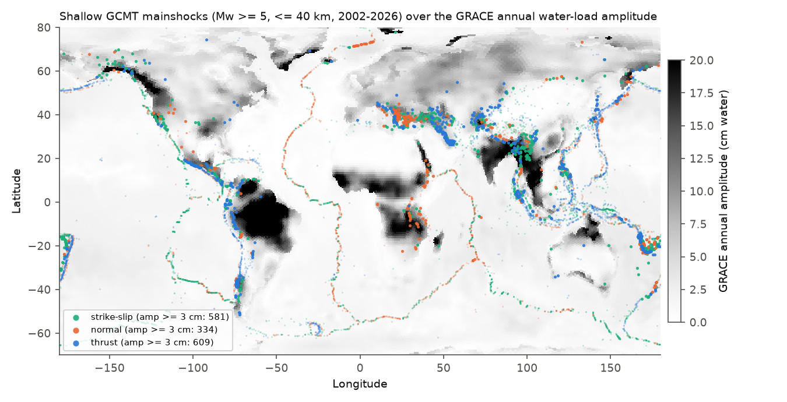
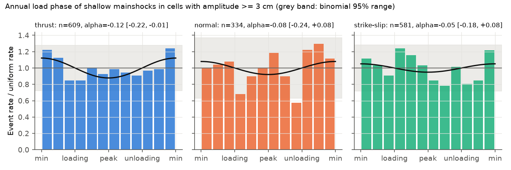
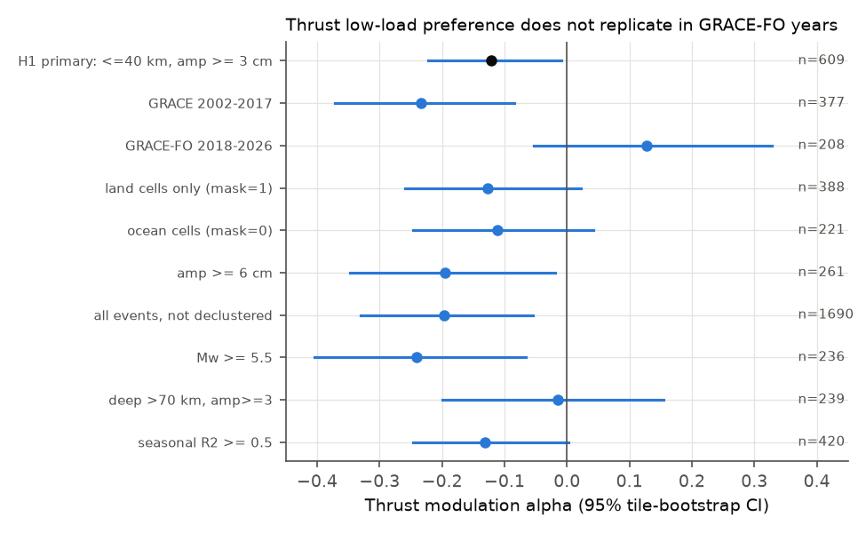

# Seasonal water load from GRACE gave a weak thrust-earthquake timing signal that did not replicate, and no fault-type sign contrast, in global shallow GCMT mainshocks, 2002-2026

Job: `sci-1107-dell-earth-and-ocean-sciences-e3ffc647778e` | Topic: earth-and-ocean-sciences | Campaign: 11_07_2026 | Machine: dell | Account: claude-andrii | Model: Claude Opus 5.5 (`claude-opus-5-5`) | Date: 2026-11-08.
The signing key is a campaign-machine key. It is not a personal authorship claim.

## Summary

Question: does the annual cycle of surface water mass modulate the timing of moderate earthquakes worldwide? Coulomb theory predicts a sign for each fault type. A vertical surface load decreases the Coulomb stress on thrust faults. Thus thrust events should occur more often at low load. The same load weakly increases the Coulomb stress on normal faults.

Data: 15,140 declustered GCMT mainshocks (Mw 5.0 and higher, April 2002 to June 2026). We used the CSR RL06.3 GRACE/GRACE-FO mascon water storage at the centroid of each event. For each grid cell we fitted a quadratic trend plus annual and semiannual harmonics. We then calculated the annual load phase (theta) of each event relative to the load peak of its cell. The modulation is alpha = 2 x mean cos(theta). A rate of 1 + alpha cos(theta) gives alpha < 0 when events occur more often at low load.

Main results:

1. **Primary test (written before analysis, `files/code/PLAN.md`).** We used 609 shallow (centroid depth 40 km or less) thrust mainshocks in cells with annual amplitude of 3 cm or more. They had alpha = -0.12 (95% tile-bootstrap CI -0.22 to -0.01). The tile phase-randomisation p was 0.043. This sign agrees with Coulomb theory. A post hoc null that keeps the calendar distribution of the catalog gave p = 0.067.
2. **The signal did not replicate.** In GRACE years (2002 to June 2017), thrust alpha was -0.23. In GRACE-FO years (June 2018 to 2026), thrust alpha was +0.13 (CI -0.05 to +0.33). The difference between the two eras is significant (difference in mean cos(theta) -0.18, CI -0.31 to -0.05). When we removed the 5 tiles with the largest contribution, mean cos(theta) went from -0.061 to -0.024. These tiles are central Chile, southern Mexico (2 tiles), Hokkaido and the Zagros.
3. **No sign contrast between fault types.** Normal events also leaned to low load (alpha -0.08, CI -0.24 to +0.08). Theory predicts the opposite sign. The normal-minus-thrust difference in mean cos(theta) was +0.02 (CI -0.07 to +0.11; within-tile label permutation p = 0.66). A combined statistic signed by the Coulomb sensitivity of each event was +0.031 (CI -0.003 to +0.067, p = 0.083).
4. **No clear dose-response.** The thrust slope of cos(theta) on load amplitude was -0.005 per cm (CI -0.013 to +0.003). The point estimates were more negative at 6 cm or more, but the CIs overlap zero (Figure 3).
5. **Size bound.** For thrust events in cells of 3 cm or more, the median annual load amplitude is 0.49 kPa. The median Coulomb stress amplitude on the fault is 0.26 kPa. At that stress, the data exclude a thrust modulation stronger than about 22% (alpha < -0.22) and any positive alpha above about +0.01. If the GRACE-FO era is used alone, positive values up to +0.33 remain possible.

Conclusion: within the tested scope, there is no robust global evidence that the GRACE seasonal water load modulates the timing of Mw 5 and higher shallow mainshocks. The primary test only just passed the 0.05 level. It failed a calendar-preserving null, it did not repeat in the second satellite era, and it did not show the predicted fault-type contrast. Regional studies (Himalaya, California, New Madrid, Japan) report modulation for smaller earthquakes and denser catalogs. This study does not test those claims.



**Figure 1.** Shallow GCMT mainshocks over the GRACE annual load amplitude (0.5-degree subsample of the 0.25-degree mascon grid). Large dots are events in cells with amplitude of 3 cm or more.



**Figure 2.** Relative event rate in 12 annual-phase bins for events in cells with amplitude of 3 cm or more. The black curve is 1 + alpha cos(theta). The grey band is the 95% binomial range for one bin when the rate is uniform.


**Figure 3.** Alpha by load amplitude bin and fault type. Bars are 95% tile-bootstrap CIs. Most events in the <1 cm bin are in ocean cells. These cells are a low-dose control.



**Figure 4.** Thrust alpha in the primary subset and in the replication and control subsets.

## Methods

**Earthquakes.** We used the GCMT catalog: `jan76_dec20.ndk` plus the monthly files `NEW_MONTHLY` from January 2021 to June 2026 (66 files). We read the centroid time, centroid position, centroid depth, Mw (from the scalar moment, Mw = 2/3 (log10 M0 - 16.1), M0 in dyne-cm), the principal-axis plunges and both nodal planes. We removed duplicate event names. Fault type follows the plunge rules of Frohlich (1992): thrust if the T-axis plunge is 50 degrees or more, normal if the P-axis plunge is 60 degrees or more, strike-slip if the B-axis plunge is 60 degrees or more, and oblique otherwise.

**Declustering.** We applied Gardner-Knopoff (1974) space-time windows to all Mw 5.0 and higher events from 1995 onward, at all depths. We processed the events in order of decreasing magnitude. An event is dependent if it falls inside the window of a larger or equal event, before or after it. Of 41,230 events, 18,715 are mainshocks. Of these, 15,140 are in the GRACE time span.

**Water load.** The CSR GRACE/GRACE-FO RL06.3 mascon file has 260 monthly solutions (April 2002 to 2026) on a 0.25-degree grid. We used the nearest grid cell to each centroid. The CSR land mask (RL06 v02) marks land and ocean cells. For each cell, we used least squares to fit a constant, a linear and a quadratic trend, and annual and semiannual cosine and sine terms. All available months were used. The months in the 2017-2018 gap are missing, and the harmonic fit spans them. Annual amplitude A = sqrt(a^2 + b^2). The phase theta of an event is its annual angle minus the angle of the annual peak of its cell.

**Coulomb sensitivity.** For a load that is broad compared with the depth, we used a laterally confined elastic half-space. The vertical stress is -p. The horizontal stress is -p nu/(1-nu), with nu = 0.25. Coulomb stress change = shear stress in the slip direction + mu' x normal stress (tension positive), with mu' = 0.4. The result is the mean of the two nodal planes. Sign checks: thrust (dip 30, rake 90) -0.62; normal (dip 60, rake -90) +0.09; vertical strike-slip -0.13 (Pa per Pa of load). 1 cm of water is 0.098 kPa.

**Inference.** The cluster unit is a 5 x 5 degree tile. CIs are percentile intervals from 10,000 tile bootstrap draws. The phase-randomisation null adds one uniform random phase offset to all events in each tile (10,000 draws). This keeps clustering inside a tile. The fault-type contrast uses label permutation inside each tile (5,000 draws). The post hoc calendar null replaces each event time with a random shallow-mainshock time from the same year (5,000 draws). This keeps any calendar seasonality of the global catalog. Separately, the day-of-year Rayleigh test of the catalog was not significant (R = 0.009, n = 10,630, p = 0.42).

**Pre-specified versus post hoc.** `files/code/PLAN.md` has the primary test (H1) and the secondary tests S1 to S5. We wrote it before we calculated any outcome statistic. The calendar null, the era-difference bootstrap and the tile-leverage analysis (`robustness.py`) are post hoc. We added them after we saw the H1 result.

## Results tables

| Subset (shallow, mainshocks) | n | alpha | 95% CI | phase-null p |
| --- | --- | --- | --- | --- |
| thrust, amp >= 3 cm (H1) | 609 | -0.12 | -0.22 to -0.01 | 0.043 |
| normal, amp >= 3 cm | 334 | -0.08 | -0.24 to +0.08 | 0.33 |
| strike-slip, amp >= 3 cm | 581 | -0.05 | -0.18 to +0.08 | 0.41 |
| oblique, amp >= 3 cm | 319 | -0.14 | -0.31 to +0.02 | 0.11 |
| thrust, GRACE 2002-2017 | 377 | -0.23 | -0.37 to -0.08 | 0.003 |
| thrust, GRACE-FO 2018-2026 | 208 | +0.13 | -0.05 to +0.33 | 0.17 |
| thrust, amp >= 6 cm | 261 | -0.19 | -0.35 to -0.02 | 0.056 |
| thrust, Mw >= 5.5 | 236 | -0.24 | -0.40 to -0.07 | 0.012 |
| thrust, not declustered | 1690 | -0.20 | -0.33 to -0.05 | 0.007 |
| thrust, deep (> 70 km) control | 239 | -0.01 | -0.20 to +0.16 | 0.88 |

The full tables are in `files/data/results.json`, `replication.csv`, `dose_response.csv` and `robustness.json`. The subsets in rows 5 to 9 overlap with H1, and they are not independent tests. With about 30 subset tests, some p values below 0.05 are expected by chance. A test that used the detrended anomaly of the event month (not the harmonic) gave no thrust signal: the mean percentile minus 0.5 was -0.004 (CI -0.026 to +0.019).

## Limitations

- GRACE resolution is about 300 km. A load at the centroid cell is not the same as the stress at depth on a particular fault. Offshore subduction thrusts sit in ocean cells, which have small loads, even when the land load near the coast is large.
- The Coulomb model is a uniform confined load with a single friction value. It does not include pore-pressure diffusion, poroelastic effects, or the flexure of a load of finite size. These can change the sign or delay the response.
- Rate-and-state theory permits a phase lag. We tested only the in-phase (cos) term as the primary statistic. The unloading-rate (sin) term for thrust events was also near zero (+0.007, CI -0.053 to +0.066).
- Mw 5 and higher events are few in high-load cells (1,843 shallow mainshocks). The power is low for modulation below about 10%. Regional studies of small earthquakes are more sensitive.
- Gardner-Knopoff declustering is approximate. Residual aftershock clusters can make a few tiles dominate (for example, central Chile after the 2010 Maule earthquake). The tile bootstrap partly corrects for this.
- GCMT monthly files after 2020 are "quick" solutions. They can change after review.

## Reproduce

1. Inputs (shared campaign store, read-only):
   - `datasets/gcmt-ndk-jan76-dec20-20261107/jan76_dec20.ndk`, sha256 `baed5ad29a69b57344c6025b27769b1012858aa6b5c807f984696d573c0f0eb4`, source https://www.ldeo.columbia.edu/~gcmt/projects/CMT/catalog/jan76_dec20.ndk
   - `datasets/csr-grace-rl0603-mascon-all-corrections-20261108/CSR_GRACE_GRACE-FO_RL0603_Mascons_all-corrections.nc`, sha256 `d4bd8b7364fb34d871198001563c70d344792cb7b0a577c04f8b91c713741292`, source https://download.csr.utexas.edu/outgoing/grace/RL0603_mascons/ (file label RL0603rc24cE, created 2026-10-07)
   - `datasets/csr-grace-rl06-v02-landmask-20261108/CSR_GRACE_GRACE-FO_RL06_Mascons_v02_LandMask.nc`, sha256 `65ddd8f3c7f7633c3a34f904e196307f71e4994e11ceb64f9337275908ff2f3b`, doi:10.15781/cgq9-nh24
   - GCMT monthly files January 2021 to June 2026. They are archived in `files/raw/gcmt_monthly_2021_2026.tar.gz` (sha256 `f706b68a15917423925340fed8ecedec70f2f998a91914fbc15018449163e593`) with the per-file `SHA256SUMS` and `urls.txt`. They were downloaded on 2026-11-08 from `https://www.ldeo.columbia.edu/~gcmt/projects/CMT/catalog/NEW_MONTHLY/<yyyy>/<mon><yy>.ndk`.
2. Environment: Python 3.12, numpy 2.5.4, pandas 3.1.1, xarray 2026.9.0, netCDF4 1.7.5.1, matplotlib 3.11.2. Set the thread variables to 1 (`OMP_NUM_THREADS=1` and others). Peak memory is about 1.5 GB, because the full mascon array is loaded.
3. Run:
   ```
   tar -xzf files/raw/gcmt_monthly_2021_2026.tar.gz -C raw/
   python -I files/code/build_events.py <jan76_dec20.ndk> raw/gcmt_monthly <mascon.nc> <landmask.nc> out
   python -I files/code/analyze.py out
   python -I files/code/robustness.py out
   python -I files/code/figures.py out <mascon.nc> figs
   ```
   Random seeds are fixed (20261108 and 7). `files/data/events_grace.csv.gz` is the event table that `build_events.py` makes (gunzip it to `out/events_grace.csv` to skip step 1). The run time is less than 1 minute per script.

## Prior work

- Regional studies: Johnson, Fu and Bürgmann (2017, Science, doi:10.1126/science.aak9547) on seasonal hydrologic loads and California seismicity; Bettinelli et al. (2008, EPSL, doi:10.1016/j.epsl.2007.11.021) on the Himalaya; Craig et al. (2017, Nat. Commun., doi:10.1038/s41467-017-01696-w) on the New Madrid Seismic Zone; Heki (2003, EPSL, doi:10.1016/s0012-821x(02)01148-2) on snow load in Japan.
- Campaign publications: a body-tide b-value null for GCMT (sci:sha256:311a95aeb912b60cbe8a3b98fb829fa9a0332d16fe2002f66ffc010628e5ce13) and GCMT pair clustering studies. This is the first campaign study that uses the GRACE mascons.
