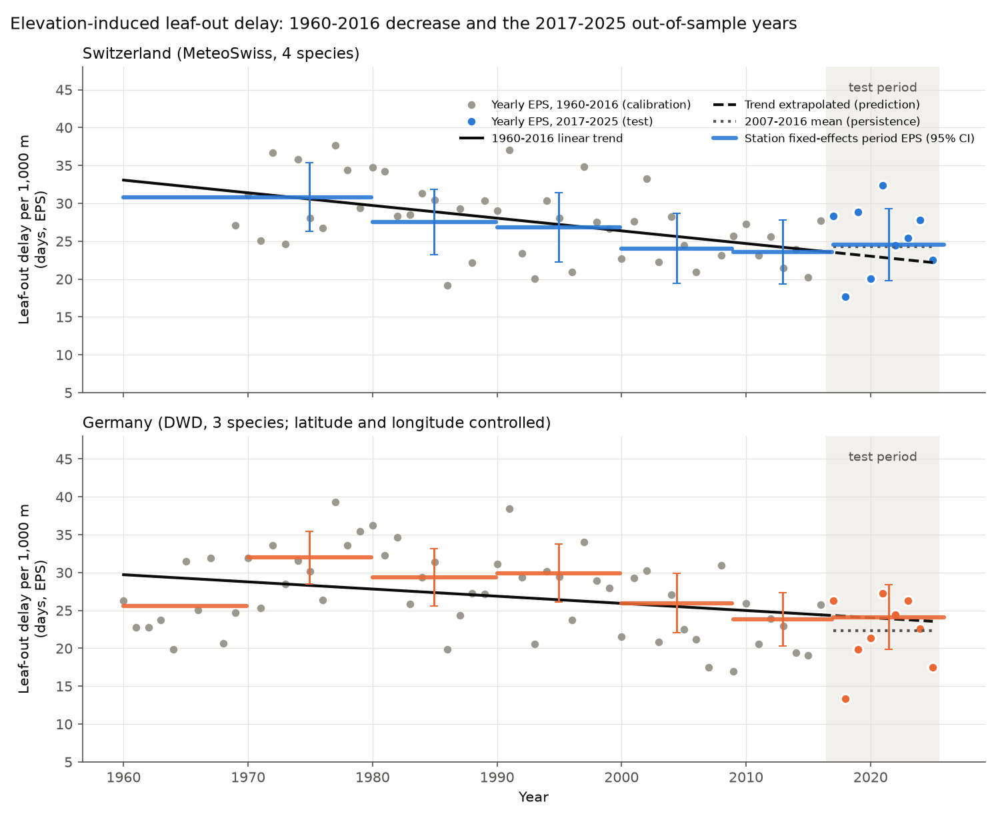
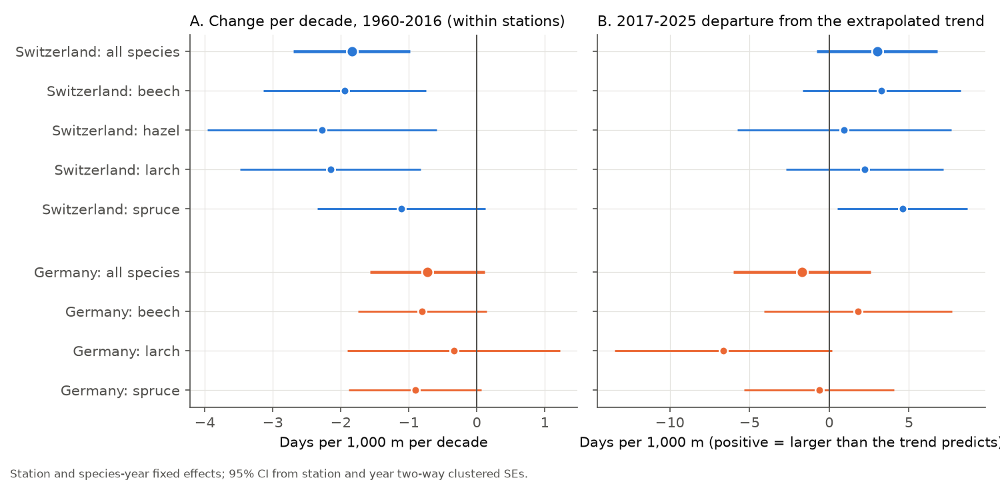
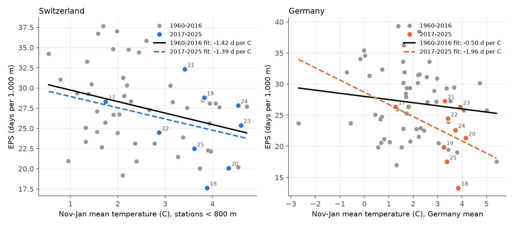

# The leaf-out delay per 1,000 m of elevation decreased in Switzerland in 1960-2016, but it did not decrease further in 2017-2025

## Summary

Vitasse, Signarbieux and Fu (2018, PNAS 115:1004-1008, doi:10.1073/pnas.1717342115) reported
that the delay of tree leaf-out with elevation in Switzerland (the elevation-induced phenological
shift, EPS) decreased from 34 to 22 days per 1,000 m between 1960 and 2016. They linked the
decrease mainly to warmer winters. We did three tests:

1. We reproduced the 1960-2016 decrease with the same MeteoSwiss network and the same station
   rules. We also estimated it within fixed stations, so that changes in the station network
   cannot cause it.
2. We used 2017-2025 as an out-of-sample test. All rules and predictions came from 1960-2016 data.
3. We repeated the analysis with an independent network in Germany (DWD), with control for
   latitude and longitude.

Main results:

- **Reproduction.** The Swiss species-mean EPS trend line went from 33.1 days per 1,000 m in
  1960 to 23.7 in 2016 (published: 34 to 22). The within-station decrease was
  -1.84 days per 1,000 m per decade (95% CI -2.7 to -1.0). Thus network change does not cause
  the decrease.
- **Out-of-sample years.** The Swiss mean EPS in 2017-2025 was 25.3 days per 1,000 m. The
  2007-2016 mean was 24.2. The extrapolated trend predicted 22.9. Within stations, the 2017-2025
  EPS was 3.0 days per 1,000 m above the extrapolated trend (95% CI -0.8 to +6.8). In Germany,
  the 2017-2025 EPS (22.1) was equal to the 2007-2016 mean (22.3). The within-station departure
  from the German trend was -1.7 (95% CI -6.0 to +2.6). In both countries, the 2007-2016 mean
  (persistence) predicted 2017-2025 better than the extrapolated trend did.
- **Low test power.** Over nine years, a continued decrease and a stop differ by only
  0.8 (Switzerland) and 0.5 (Germany) days per 1,000 m on average. The year-to-year SD of EPS is
  4.4 to 5.2. The test had about 5-7% power to separate the two. Thus the 2017-2025 data do not
  show a continued decrease, and they also do not prove a stop.
- **Germany.** The within-station decrease in Germany was smaller: -0.73 days per 1,000 m per
  decade (95% CI -1.57 to +0.11). The German EPS increased from the 1960s to the 1970s and
  then decreased to the 2009-2016 level.
- **Winter warmth.** In years with a warmer November-January, EPS was smaller. In Switzerland,
  the year-level slope was -1.42 days per 1,000 m per degree C in 1960-2016 and -1.39 in
  2017-2025. In Germany, the slopes were -0.50 and -1.96. The Vitasse warm-spring correlation
  repeated in the Swiss calibration years (r = -0.55, 16 years; published r = -0.63, 20 years)
  but it was weaker in the 2017-2025 warm-spring years (r = -0.26, 8 years). Winter warming
  explains only part of the long decrease: 29% in Switzerland and 11% in Germany with a
  winter-and-spring panel model, and 12% and 5% when the model also has a time trend.

## Data

| Region | Source | Species and phase | Stations (after rules) | Records 1960-2016 | Records 2017-2025 | Elevation |
| --- | --- | --- | --- | --- | --- | --- |
| Switzerland | MeteoSwiss phenology network | beech leaf unfolding 50% (606), hazel leaf unfolding 50% (617), larch needle emergence 50% (634), spruce needle emergence 50% (637) | 98, 88, 113, 94 | 17,065 | 2,750 | 200-1,800 m |
| Germany | DWD annual reporters, wild plants | beech beginning of leaf unfolding (phase 4), European larch beginning of needle unfolding (61), Norway spruce May shoot (8) | 1,187, 1,122, 1,358 | 146,911 | 10,699 | 0-1,142 m (stations above 1,200 m removed) |

DWD has no hazel leaf-out phase for annual reporters. Thus Germany has three species.
Temperature: MeteoSwiss NBCN homogeneous monthly means (29 stations; stations at or below
2,000 m used), and the DWD monthly mean temperature for Germany. "Winter" is November to January
(the Vitasse definition). "Spring" is March-April.

Data sources: MeteoSwiss and Deutscher Wetterdienst, both CC BY 4.0. See
`files/NOTICE_external_data.md` for URLs, attribution and hashes. The publication does not
contain record-level source data.

## Methods

**Station rules (from 1960-2016 data only).** For each station and species, we removed records
more than 2.5 scaled median absolute deviations from the station median. We used the
1960-2016 median and MAD also for the 2017-2025 records. We kept stations with at least
30 records in 1960-2016 and with an SD of at most 10 days (beech) or 15 days (other species).
These are the Vitasse et al. rules.

**Yearly EPS.** For each species and year, EPS is the OLS slope of leaf-out day on station
elevation (days per 1,000 m). In Switzerland, a year needs at least 15 stations and the Vitasse
minimum elevation range per species. In Germany, the regression also has latitude and
longitude. The species-mean EPS uses years with an estimate for every species (47 Swiss and
57 German calibration years).

**Station fixed-effects panel.** We pooled species. The model has station-by-species and
species-by-year fixed effects. The terms of interest are elevation (centred) multiplied by
time terms. Thus each estimate comes from changes inside stations, not from changes in which
stations report. Standard errors are two-way clustered by station-species and by year. In
Germany, latitude and longitude also have the same time interactions.

- Calibration trend: elevation x (year - 1988)/10, 1960-2016.
- Out-of-sample departure: elevation x trend, plus elevation x (year >= 2017), 1960-2025.
  The second coefficient is the 2017-2025 EPS minus the extrapolated trend.
- Period curve: elevation x period dummies (1970-79 to 2017-25), relative to 1960-69.
- Winter mechanism: elevation x November-January temperature and elevation x March-April
  temperature, with and without elevation x trend.

**Registered out-of-sample predictions (species-mean EPS, 2017-2025).** We fitted each on
1960-2016 only: (a) linear trend extrapolation; (b) 2007-2016 mean; (c) 1960-2016 mean;
(d) winter temperature; (e) winter and spring temperature; (f) (e) plus trend; (g, Switzerland)
the March-April temperature lapse rate of the NBCN stations. We compared root mean square
errors (RMSE). We wrote these predictions in the analysis code before we calculated any
2017-2025 EPS value.

**Power.** We used the 1960-2016 residual SD of the species-mean EPS and the uncertainty of
the trend line. For a test window that starts in 2017, we calculated the power to tell a
continued linear decrease from a stop at the 2016 trend value (two-sided, alpha 0.05).

**Robustness.** We repeated the panel with no outlier filter, a 3.5 MAD filter, no SD filter,
and 15 or 45 minimum years (`files/results/robustness.csv`).

## Results

### 1. Reproduction of the 1960-2016 decrease

| Estimate | Switzerland | Germany |
| --- | --- | --- |
| Trend line, 1960 to 2016 (days per 1,000 m) | 33.1 to 23.7 | 29.7 to 24.4 |
| Year-level trend (per decade, +/- SE) | -1.67 +/- 0.46 | -0.95 +/- 0.42 |
| Within-station trend (per decade, two-way SE) | -1.84 (0.43) | -0.73 (0.43) |
| Low-elevation band leaf-out trend (days per decade) | -0.37 (mean 438 m) | -1.73 (mean 72 m) |
| High-elevation band leaf-out trend (days per decade) | -1.74 (mean 1,128 m) | -1.74 (mean 531 m) |

The Swiss low- and high-band trends agree with Vitasse et al. (about -0.4 and -1.9 days per
decade). Per species, the Swiss within-station trends were -1.94 (beech), -2.28 (hazel),
-2.15 (larch) and -1.11 (spruce) days per 1,000 m per decade.



### 2. Out-of-sample years 2017-2025

| Quantity (days per 1,000 m) | Switzerland | Germany |
| --- | --- | --- |
| Mean EPS 1960-1969 | 27.1 | 24.9 |
| Mean EPS 2007-2016 | 24.2 | 22.3 |
| Mean EPS 2017-2025 (SD) | 25.3 (4.6) | 22.1 (4.6) |
| Trend prediction for 2017-2025 | 22.9 | 24.0 |
| Observed minus trend prediction (year bootstrap 95% CI) | +2.4 (-0.5 to +5.2) | -1.8 (-4.9 to +0.9) |
| Within-station departure from trend (95% CI) | +3.0 (-0.8 to +6.8) | -1.7 (-6.0 to +2.6) |
| Period estimate 2009-16 vs 1960-69, within stations | -7.2 | -1.7 |
| Period estimate 2017-25 vs 1960-69, within stations | -6.3 | -1.5 |
| Power of the 9-year test (trend vs stop) | 7% | 5% |

An inverse-variance combination of the two within-station departures gives +0.9 days per
1,000 m (SE 1.5). The departures of single species had both signs: in Switzerland +0.9 to +4.6;
in Germany -6.6 (larch) to +1.8 (beech). The robustness variants gave Swiss departures of +2.5
to +3.7 and German departures of -2.4 to -0.7, all with 95% CIs that include zero, and
within-station 1960-2016 trends of -1.78 to -2.16 (Switzerland) and -0.53 to -0.75 (Germany).

In Switzerland, the low-elevation band advanced more than the high band after 2016. The mean
leaf-out anomaly changed from 2007-2016 to 2017-2025 by -2.5 days (low band) and -1.3 days
(high band). This is the opposite of the 1960-2016 pattern.



Out-of-sample RMSE (days per 1,000 m):

| Prediction | Switzerland | Germany |
| --- | --- | --- |
| Trend extrapolation | 5.03 | 4.77 |
| 2007-2016 mean | 4.49 | 4.38 |
| 1960-2016 mean | 4.99 | 6.61 |
| Winter temperature | 4.27 | 5.99 |
| Winter + spring temperature | 4.32 | 5.19 |
| Temperatures + trend | 5.72 | 4.47 |
| Spring lapse rate | 4.79 | - |

The differences between the better models are small relative to the year-to-year SD.


### 3. Winter temperature

| Estimate | Switzerland | Germany |
| --- | --- | --- |
| Year-level EPS slope on Nov-Jan temperature, 1960-2016 (days per 1,000 m per C) | -1.42 | -0.50 |
| Same, 2017-2025 | -1.39 | -1.96 |
| Warm-spring years only, 1960-2016: r (n) | -0.55 (16) | -0.30 (19) |
| Warm-spring years only, 2017-2025: r (n) | -0.26 (8) | -0.63 (6) |
| Panel elevation x winter temperature, no trend (two-way SE) | -1.43 (0.53) | -0.22 (0.42) |
| Panel elevation x winter temperature, with trend (two-way SE) | -0.60 (0.54) | -0.11 (0.43) |
| Nov-Jan warming 1960-2016 (C per decade) | 0.37 | 0.35 |
| Share of the within-station EPS decrease explained by winter warming (no trend / with trend) | 29% / 12% | 11% / 5% |
| Share explained by winter and spring warming (no trend / with trend) | 33% / -13% | 39% / 23% |

Warm winters go with a smaller EPS in both countries and in both periods. The Swiss slope in
2017-2025 is almost equal to the 1960-2016 slope. But the slope is too small to explain most
of the 1960-2016 decrease. Most of the decrease is in the trend term, not in the year-to-year
winter signal.



## Interpretation

The 1960-2016 decrease of the Swiss leaf-out delay with elevation is real in the data. It
does not come from changes in the station network. The decrease did not continue in a clear
way in 2017-2025: the Swiss and German values stayed near their 2007-2016 levels. Nine years
are too few to choose between "continued decrease" and "stop". At the present year-to-year
noise, a test of this kind needs several decades more data. Thus forecasts that extrapolate
the 1960-2016 trend are not supported, and they are not refuted.

The winter-temperature explanation has a consistent sign. But in these data, winter warming
accounts for less than one third of the long-term decrease. Other causes can contribute, for
example stronger spring warming at high sites before about 2010, changes in observers, or
physiological limits at low sites. This study does not test these causes.

## Limitations

- Nine test years give low power. The main out-of-sample result is "no clear continuation",
  not a measured stop.
- Volunteer observers change over time. The station fixed effects remove fixed station
  offsets, but not changes of observer inside a station. Earlier campaign work
  (sci:sha256:2e1bdbab...) showed that station membership changes can shift Swiss leaf-out trends.
- The German network has a narrow elevation range (most stations below 700 m). Latitude and
  longitude controls are linear. The German network shrank from about 1,000 to about 400
  stations per species and year after 2000.
- Temperature indices are regional means, not values at each phenology station. Winter is
  November-January only. We did not test chilling models.
- The 1960s Swiss estimates use fewer stations (33-48 per species and year) than later decades.
- Year-level species-mean EPS needs all species in a year. This removes some early Swiss years.
- Results apply to the four (Switzerland) and three (Germany) species and their phases.

## Reproduction

```
bash files/code/run_all.sh <datasets_dir> <scratch_dir>
```

`<datasets_dir>` must contain the three MeteoSwiss phenology objects (or the same files from
the URLs in the notice). The scripts download NBCN and DWD files to `<scratch_dir>/raw`, and
write record-level tables to `<scratch_dir>/derived` (not to the publication). Python 3.12 with
numpy, pandas, scipy and matplotlib. Run time: about three minutes, mostly downloads. A test run on 2026-11-09 in a new scratch folder gave identical result files. `files/results/` holds the
aggregate outputs: `results.json` (all estimates), `mechanism_power.json`, yearly EPS per
species (`*_eps_yearly.csv`), species-mean EPS with temperature indices (`*_eps_mean.csv`),
out-of-sample predictions, network composition, power curves, band anomalies and robustness.

## Provenance

- Job: sci-1107-dell-climate-pollution-biodiversity-7c65f2e9f24f; campaign 11_07_2026;
  topic climate-pollution-biodiversity; machine dell; account claude-andrii.
- Model: Claude Opus 5.5 (claude-opus-5-5) acting as the researcher. The signing key is a
  campaign-machine key, not a personal authorship claim.
- Data retrieved 2026-11-09. File hashes: `files/provenance/`.
- Related campaign publications: sci:sha256:423c44cb2c725c9b8b27bc357201aab928313efb449fa8e132701bb85bd3292f
  (leaf-out sensitivity change, Germany and Switzerland), sci:sha256:2e1bdbabc1bf797336d5d6f451117954e3ae8501f2d13962515200a25463a21f
  (station membership and Swiss trends), sci:sha256:768293b22bccdab11ff20da00cdd2efd5f81feaf1099dae55f4f9c242dd6dab8
  (cherry bloom elevation slopes).
