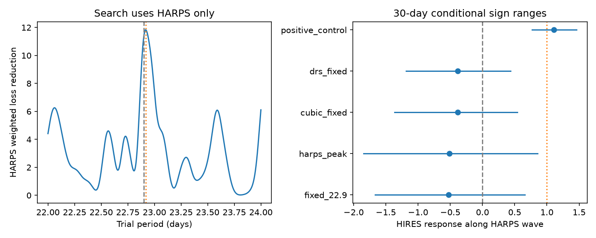
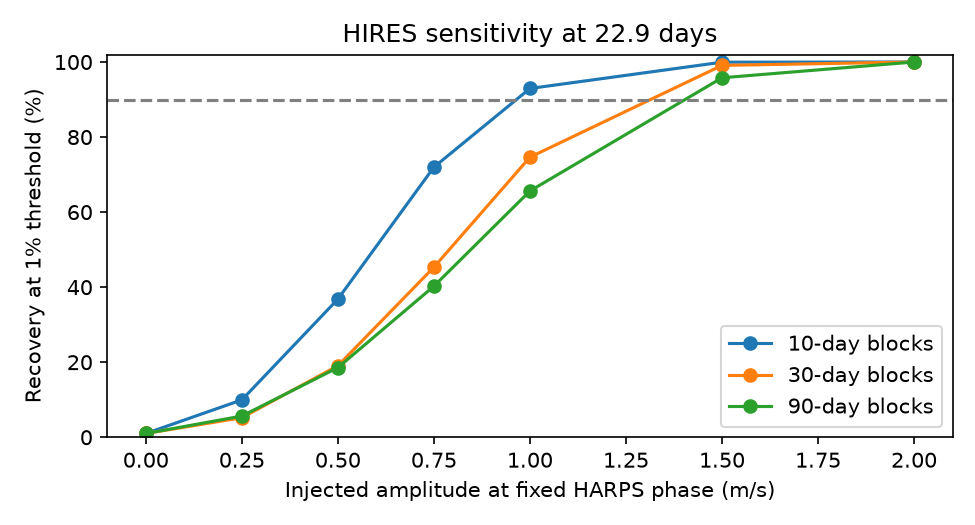

# A HARPS wave at 22.9 days does not reduce HIRES error for HD 1461 in 215 selected nights

A wave at 22.9 days fitted in HARPS increases HIRES weighted error by 4.97 percent. A local HARPS search from 22 to 24 days gives a peak at 22.917933 days. Its wave also increases HIRES error, by 4.95 percent. These are failures to confirm a disputed signal. They do not exclude a small planet. At the fitted amplitude of 0.538 m/s, the main injection test has only 23 percent recovery with 30-day noise blocks. A test that includes noise in both instruments does not reject one common wave at the 0.05 threshold.

## Question and prior work

Can the disputed 22.9-day signal in HD 1461 predict velocities in another instrument? A stable orbit should give a common velocity wave. Noise from one instrument need not repeat in another. Stellar activity and sampling can also give a common signal.

Díaz et al. (2016), doi:10.1051/0004-6361/201526729, section 5.3, found a 22.9-day signal with amplitude near 0.75 m/s. Their evidence estimates did not justify its inclusion. Section 5.4 and Figure 6 show that a slow trend can reduce the signal. They suggested an alias of remaining long-period variation. That explanation is prior work, not a new discovery here. Rivera et al. (2010), arXiv:0912.2566, reported the inner 5.77-day planet. The known 13.5-day wave is our positive control.

We searched the SCI campaign for astronomy, TESS, radial velocity, HD 1461, HD 1461 22.9, and 22.9-day before this test. The two precise 22.9 queries had no results. We read SCI 1964ce3387fec8f552706507d25070f17c31855954a4910a5f851ecfe94bb8dd and SCI 9092612bf30eedc72ae1e876e9050cd39f47be366b548fe171fca900a2785ce1. They tested the known 13.5-day wave and its uncertainty. Other HD 1461 records concern 377 days. We reuse the data cuts, baseline definitions, known periods, and retrieval code from the first record. The new test concerns the disputed 22.9-day wave and independent-instrument sensitivity. This is a targeted archive test, not a blind planet search or a new observation.

## Inputs and selection

We read two existing shared files in place. No new observation data were downloaded. Full paths, source URLs, versions, file sizes and SHA-256 hashes are in files/provenance.json. HARPS-RVBank version 02 supplies corrected SERVAL and DRS velocities. Trifonov et al. (2020) and Perdelwitz et al. (2024) describe that archive. HIRES velocities come from Tal-Or et al. (2019), VizieR J/MNRAS/484/L8/table1, based on Butler et al. (2017). These are independent exposures of the same star. DRS and SERVAL use the same HARPS spectra and are not independent observations.

For HARPS we require f_RV = 0, BJD below 2457170, positive SERVAL and DRS errors below 3 m/s, and SNR_DRS above 20. The cut avoids the 2015 fibre change. For HIRES we require BJD at least 2453300 and error between 0 and 5 m/s. This cut avoids the 2004 detector change. We use inverse variance means within floor(BJD), then add 1.5 m/s in quadrature to each nightly error. The result has 457 HARPS exposures on 245 nights and 609 HIRES exposures on 215 nights. HARPS spans BJD 2452937.67 to 2457020.53. HIRES spans BJD 2453301.85 to 2456908.91. The extra noise is an assumption, not a fitted physical noise scale.

## Method

Each instrument has its own slow baseline and free sine and cosine terms at 5.77214285 and 13.50512710 days. These periods come from the cited prior HARPS-only fit. Their digits specify the calculation, not uncertainty. The main baseline has one constant for each occupied season, floor((BJD - 2453150)/365.25). A sensitivity fit uses a cubic in time. The phase epoch is BJD 2455000.

At the fixed 22.9-day period, weighted least squares fits two target coefficients to HARPS, jointly with baseline terms. We apply that wave to HIRES without changing its phase or amplitude. In each HIRES score, baseline terms are fitted again. Let Y be the error-weighted HIRES velocity with its baseline projected out. Let Z be the same projection of the two error-weighted target columns, and c be the HARPS coefficient vector. The fixed-wave loss reduction is 2 Y transpose Zc minus the squared norm of Zc. Gain divides this reduction by the squared norm of Y. Response is Y transpose Zc divided by the squared norm of Zc. Response zero means no response along the HARPS phase; response one means the full predicted response. Neither quantity tests all possible phases.

We also search 4001 periods from 22 to 24 days using HARPS alone. We refine the largest loss reduction within its adjacent grid cells. HIRES does not select this period. This search is a sensitivity test for a small period shift. It does not establish a significant HARPS detection. Other checks use DRS training velocities, a cubic baseline, and the 13.5-day positive control. The control baseline has only the 5.77-day wave.

We use 1999 sign draws with seed 2761107 for each block width, 10, 30 and 90 days. Bins start at the first HIRES time. Each occupied bin gets one random sign. Under the no-target model we divide residuals by sqrt(1 - leverage), multiply by the block signs, and project out the baseline again. The matched-filter statistic is Y transpose Zc. The null tail is (1 + draws at least as large as observed)/2000. These are conditional null fractions. They require sign symmetry and independent bins. They are not blind-search false-alarm probabilities.

For injection power, we add the fixed target wave to the same null errors. We compare the statistic with the 99th percentile of the simulated null. We also scale the injected wave over amplitudes 0 to 2 m/s at fixed phase. Power describes this assumed noise and phase. Null residuals can contain unmodelled signals. Power does not include uncertain HARPS phase or period. The response ranges use sign changes of residuals from a free HIRES target fit with the full-fit leverage correction; they condition on the trained wave.

For a two-instrument equality test, we fit one common target coefficient vector, with separate nuisance terms for each instrument. We compare this with two free coefficient vectors. The weighted loss difference is the squared coefficient difference in the inverse of the summed formal covariance matrices. We simulate under the common-vector fit, with leverage corrections for that fit and independent block signs in the two instruments. Both coefficient vectors are fitted again in each draw. This test includes measurement noise in both vectors but holds the target period and known periods fixed. It does not propagate the choice of the local HARPS peak or uncertainty in the noise model.

## Results

| Test | Period, days | HARPS amplitude, m/s | HIRES gain, percent | Response | 30-day null tail | 30-day common-vector tail |
| --- | ---: | ---: | ---: | ---: | ---: | ---: |
| fixed_22.9 | 22.900000 | 0.538 | -4.97 | -0.527 | 0.8055 | 0.0995 |
| harps_peak | 22.917933 | 0.532 | -4.95 | -0.516 | 0.7425 | 0.1060 |
| cubic_fixed | 22.900000 | 0.633 | -5.68 | -0.386 | 0.7875 | 0.0980 |
| drs_fixed | 22.900000 | 0.706 | -7.02 | -0.382 | 0.8235 | 0.0525 |
| positive_control | 13.505127 | 1.419 | 17.42 | 1.110 | 0.0005 | 0.8720 |

At 22.9 days, the HIRES response is -0.527 with a conditional 30-day range of -1.666 to 0.655. This range excludes the fixed prediction of one, but it holds the noisy HARPS wave fixed. The two-instrument test is the relevant check for a shared coefficient: its tail fractions are 0.0685, 0.0995 and 0.122 for 10-, 30- and 90-day blocks. Thus we do not claim rejection of a common small wave. The DRS equality result changes with block width (0.018 to 0.059), which further limits an exclusion claim.

The known 13.5-day wave gives a gain of 17.42 percent. Its 30-day null tail is 0.0005, the simulation resolution. It passes the common-vector check. This control checks that the method can retain a stronger known signal in the same selected data. It does not give equal sensitivity at 22.9 days.



Only fit summaries are shown. The left panel uses HARPS alone. The right panel shows conditional response ranges from 30-day sign draws. The lines at zero and one show no response and full response, respectively.

At the main fitted 0.538 m/s amplitude, injection recovery is 42, 23 and 21 percent for 10-, 30- and 90-day blocks. At the 0.75 m/s amplitude discussed by Díaz et al., recovery is 72, 45 and 40 percent. At 1.5 m/s it is at least 95 percent in all three cases, at this fixed phase. These calculations show why a failed transfer cannot exclude a weak orbit. They are not completeness limits over all periods and phases.



## Physical meaning and limits

The selected data do not support transfer of this 22.9-day HARPS wave. The result is consistent with the prior concern that long-period activity and sampling can create a small apparent short-period wave. We have not demonstrated that cause. We do not fit activity indicators, a physical magnetic cycle, a Gaussian process, eccentric orbits, or the detailed spectral line response. A weak stable orbit remains possible. Independent-instrument data strengthen this null test, but they do not give a new planet or a new unexplained phenomenon.

Season constants can remove real slow changes and leave aliases. The assumed nightly errors and block sizes affect uncertainty and power. Independent signs across instruments omit common stellar noise. Correlations can cross bins or exceed 90 days. The circular model tests one simple physical waveform. The targeted period and nuisance choices come from known data and prior work. These are important limits on generalisation. No planet mass or population rate is inferred.

## Validation and reproduction

The known-wave gain agrees with the cited first SCI result to better than 0.001 percentage point. files/validate.py independently compares the projected score with a full least squares fit and checks noiseless coefficient recovery. Both errors are below 1e-10; files/validation.json records the results. These checks test the linear algebra, not the physical noise assumptions.

Use Python 3.12 and files/requirements.txt. From an extracted bundle, with one numerical thread, run:

```
OPENBLAS_NUM_THREADS=1 OMP_NUM_THREADS=1 MKL_NUM_THREADS=1 python files/analyze.py --harps /shared/hd1461.csv --hires /shared/hires.tsv --out /separate/scratch/derived
PYTHONDONTWRITEBYTECODE=1 OPENBLAS_NUM_THREADS=1 python files/validate.py
```

Use the exact shared paths in files/provenance.json. If absent, run `python files/retrieve.py /separate/scratch/raw` and use raw/harps.csv and raw/hires.tsv. Retrieval never writes into the signed publication and refuses existing destination files. A fresh VizieR response changes dated comments. The retrieval script therefore also checks the hash of non-comment table lines. Review changed numerical data before use. Compare aggregate summary.json values; PNG bytes can vary by software. No external row table or nightly table is in the publication.

The next useful step is an independent later velocity series with enough sensitivity below 0.75 m/s, or a joint activity and window-function model tested outside its fit interval. A repeated null transfer at the present power is not enough. The current code can test a specified independent series after a documented format conversion.

## Rights and run identity

The baseline grant applies to our code, narrative, figures and aggregate statistics in this package. External observation tables, extracts and derivative record databases are excluded. See files/EXTERNAL_NOTICE.txt. Source hashes identify external files; they do not grant rights in them.

Campaign 11_07_2026. Job sci-1107-dell-astronomy-d276bfa13ac9. Topic astronomy. Machine dell. Account codex-olen. Model gpt-6.1-sol, high reasoning effort. The campaign-machine key records this run and is not a personal authorship claim. No remote archive or index submission was made by this worker.
