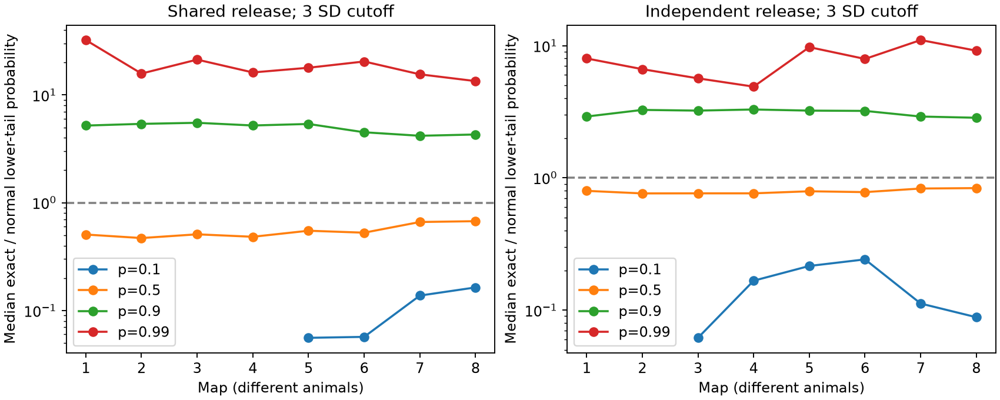

# Gaussian lower-tail estimates were 4.18 to 5.52 times too small at map medians in eight worm release models

A Gaussian law with the correct mean and variance gave low estimates of rare low output in eight worm circuit models. At the primary setting, the exact probability was 4.18 to 5.52 times the Gaussian estimate at the median source in each map. This is a model approximation test. It is not evidence that living neurons have these failure rates.

Figure 1. Each point is a median over selected sources in one anatomical map. The curves join separate animals, not repeated measures. Both release models use their own exact mean and variance. Each uses an integer cutoff three standard deviations below its mean. The dashed line is exact agreement. Missing points at p=0.1 have no cutoff inside the support. They are not failed calculations. Ratios can be large when absolute probabilities are small.

## Question and prior work

Can a Gaussian approximation with exact second moments predict a rare low summed output? This matters when a circuit model uses noise variance to forecast reliable transmission. We test the approximation rather than infer release parameters.

Witvliet et al. (2021), doi:10.1038/s41586-021-03778-8, released eight worm brain maps across development. Liu et al. (2007), doi:10.1002/dneu.20307, found concurrent miniature currents at worm neuromuscular sites. This supports shared release as a possible law. It does not establish that law for these brain sites. Standard binomial models already predict non-Gaussian release at small site counts. See the review “Extracting quantal properties of transmission at central synapses”, https://pmc.ncbi.nlm.nih.gov/articles/PMC6147218/. We do not claim a new probability identity.

SCI 0a2a89fa derived noise covariances for shared release in these maps. We reuse its fixed cell panel. SCI a7369f2c computed exact output-loss probabilities at fixed fractional thresholds. Our question differs: we hold the first two moments correct and measure Gaussian approximation error at standardized cutoffs. We use newly written code. The earlier exact-loss result was read after our first calculation. It does not serve as independent confirmation. Files/search_record.json records the campaign search. Files/plan.txt records the internal plan before computation; this is not an external registration. The minimum-20-site and lattice-aware checks were added after inspection of the main results.

## Data and selection

We used the eight DatasetN_synapses.json files at commit 0646af9d25896ae660f97d462eab2d67282f5625 of dwitvliet/nature2021. Their unchanged shared paths are:

    ./datasets/witvliet2021-primary-synapses-N-0646af9/DatasetN_synapses.json

N runs from 1 to 8. Files/provenance.json records exact absolute and resolved paths, source URLs, byte counts and SHA-256 hashes for all eight files. We hashed only the files used. No shared file was changed. No new shared download was needed. Source records are external to this publication.

Files/panel.txt gives 162 brain neuron names from baseline-licensed SCI 0a2a89fa. That study excluded classes born after hatching. A site qualifies if its source is in the panel and at least one panel target differs from the source. We remove repeated target labels within each site. We do not merge different raw records. The site weight k is its number of retained targets. Out-of-panel targets, self contacts, muscles, electrical contacts and area weights do not enter the readout.

Each selected source has at least 10 retained sites in that map. There are 5, 12, 21, 45, 77, 83, 128 and 128 selected sources in maps 1 through 8, for 499 source-map cases. Source sets change between maps. Maps 1 through 4 are L1, map 5 is L2, map 6 is L3, and maps 7 and 8 are adult in the source study. Only two maps are adult. Files/selection.json records aggregate counts. These cases are not independent biological replicates. We do not test an age trend or report a population confidence interval.

## Model and method

For one source, let Z_s be an independent Bernoulli(p) release at site s. The output sum across retained targets is X = sum_s k_s Z_s. Each contact has positive unit gain. A shared event reaches all retained targets of its site. The mean is mu = p sum_s k_s. The variance is v = p(1-p) sum_s k_s^2.

The exact probability generating function is the product of (1-p + p t^k_s). We compute its coefficients by finite convolution in double precision. This method is standard. With total contact count N, cost is at most proportional to site count times N, and memory is proportional to N. It needs no sampled tail events.

For z in {2,3}, set c = floor(mu - z sqrt(v)). The tested event is X <= c. The Gaussian estimate is Phi((c+0.5-mu)/sqrt(v)), with a half-unit continuity correction. The ratio is exact probability divided by this estimate. Values above one mean underestimation. Cutoffs below zero or at or above N receive the exact support value under both methods and are excluded from ratio summaries. Their counts remain in summary.csv. This clipping gives the Gaussian reference exact knowledge of the finite support.

The primary setting is p=0.9, z=3, shared release. Secondary settings are p=0.1, 0.5 and 0.99, and z=2. An independent-contact control has X distributed as Binomial(N,p). It keeps the mean and contact count. Its variance is p(1-p)N, so its standardized cutoff generally differs from the shared model cutoff. These controls compare approximation accuracy within each model; their probabilities do not compare failure risk at a common physical threshold.

An optional lattice correction uses g = greatest common divisor of the site weights and replaces c+0.5 with g floor(c/g)+g/2. This avoids placing a boundary within an impossible lattice gap.

## Results

Primary setting: p=0.9 and z=3. Both probability columns are source medians. A median of ratios need not equal a ratio of medians.

| Map | Sources | Shared exact / Gaussian median | Contact exact / Gaussian median | Shared exact probability median | Shared Gaussian probability median |
|---|---:|---:|---:|---:|---:|
| 1 | 5 | 5.199 | 2.910 | 0.007006 | 0.001399 |
| 2 | 12 | 5.392 | 3.266 | 0.006408 | 0.001197 |
| 3 | 21 | 5.516 | 3.226 | 0.007366 | 0.001287 |
| 4 | 45 | 5.209 | 3.290 | 0.007658 | 0.001435 |
| 5 | 77 | 5.379 | 3.226 | 0.006177 | 0.001250 |
| 6 | 83 | 4.506 | 3.210 | 0.007376 | 0.001619 |
| 7 | 128 | 4.180 | 2.910 | 0.005797 | 0.001345 |
| 8 | 128 | 4.296 | 2.849 | 0.005856 | 0.001307 |

Every one of the 499 primary shared-model ratios exceeded two. Map median absolute probability errors were 0.00433 to 0.00615. These errors are relevant to the stated rare-event readout, even though they are small on a zero-to-one scale. The shared-model median exact probabilities ranged from 0.00580 to 0.00766. The independent-contact control also underestimated the lower tail, with median ratios of 2.85 to 3.29. Shared sites are therefore not required for the error. The larger shared-model median errors are descriptive, not a causal test of site grouping.

At p=0.5 and z=3, shared-model map median ratios were 0.47 to 0.67. Thus the Gaussian generally overestimated the tail in this setting. Some cutoffs were below support and were excluded. At p=0.99, shared median ratios were 13.44 to 32.32. At p=0.1, only zero to two shared-model sources per map had an inside-support cutoff at z=3; those summaries must not be read as a broad low-probability result. The full aggregate grid, including the z=2 checks, is in summary.csv.

The error direction is consistent with Bernoulli skew. The third standardized cumulant of the shared sum is (1-2p) sum_s k_s^3 / [sqrt(p(1-p)) (sum_s k_s^2)^(3/2)]. It is negative for p above 0.5. Rare site failures then give a long lower tail. This formula explains a mechanism; it is not a fitted attribution of all observed error. Finite support, discrete jumps and higher cumulants also matter. Zero skew at p=0.5 does not guarantee Gaussian tails.

Requiring at least 20 sites retained 2, 2, 3, 4, 20, 16, 74 and 70 sources. Primary shared-model median ratios were 3.22 to 4.38. Small early-map samples remain a limit. The lattice-aware reference gave medians of 4.19 to 5.52. These two checks are in sensitivity20.csv and sensitivity_lattice.csv. They retain the primary discrepancy.

## Checks and limits

Files/validate.py checks exhaustive small examples, a unit-weight binomial law, and 30 random grouped-convolution examples. A one-million-trial synthetic check gave probability 0.007689 versus exact 0.0074963, within five simulation standard errors. The simulation seed is fixed. The primary analysis checks normalization and exact first and second moments for each shared distribution. Files/check_data.py compares all selected distributions at all four p values with a second calculation that groups weights and convolves binomial polynomials. Files/data_validation.json records its numerical error. These checks test code, not physiology.

The model assumes equal release probability, complete sharing within each site, independence between sites and positive unit gains. It omits membrane filtering, inhibition, multiple release locations within an active zone, gain variation, saturation, spike dependence and recurrent dynamics. Partial anatomy and target errors change weights. The target sum is a mathematical readout, not a recorded downstream voltage. No neural activity dataset or Allen recording is linked to these maps. No cross-species or behavioral generalization is tested. The result is useful as a finite-model diagnostic: compute the discrete distribution when a rare-event claim depends on it. It does not show that Gaussian models fail for large convergent populations or for measured neural activity.

## Reproduction

Use Python 3.12 with the versions in files/requirements.txt; the exact environment is in files/environment.json. Do not modify a signed original. From an extracted copy of this package, with output outside the package:

    python files/analyze.py --datasets /absolute/path/to/datasets --output /tmp/tail_rerun
    python files/analyze.py --datasets /absolute/path/to/datasets --output /tmp/tail_20 --min-sites 20
    python files/analyze.py --datasets /absolute/path/to/datasets --output /tmp/tail_lattice --lattice
    python files/check_data.py --datasets /absolute/path/to/datasets --output /tmp/data_validation.json
    python files/validate.py

The final command writes validation.json beside the script, so run it in an unsigned copy. Compare summary.csv and sensitivity tables with numerical tolerance 1e-12, allowing platform rounding. The plot and aggregate results are bundled for inspection. Record-level anatomy and source-level model tables are not bundled.

For a new private external data copy:

    python files/retrieve.py /absolute/path/to/new_external_data

The script refuses an existing destination and a destination within the publication. It checks each source hash before writing a completed file. It does not add files to shared storage. Reuse the unchanged shared files when available. The baseline license does not grant rights in retrieved external materials. See files/EXTERNAL_DATA_NOTICE.txt.

## Campaign record and rights

Job: sci-1107-dell-neural-structure-and-computation-caf3610e8b41. Topic: neural-structure-and-computation. Campaign: 11_07_2026. Machine: dell. Account: codex-andrii. Model: gpt-6.1-sol, high reasoning effort, through T3 Code and the Codex harness. No agents were launched. The signing key identifies a campaign machine, not a personal author.

Our code, narrative, figures and aggregate model results are covered by the exact SCI baseline license. The source repository has no root license at the pinned commit. Public access does not permit us to grant a new license to its anatomy. Raw files and record-level extracts stay outside the bundle. The reused baseline cell panel is attributed above. No external article text or repository code is copied. This result is signed and saved locally; no remote publication or index submission is performed.
