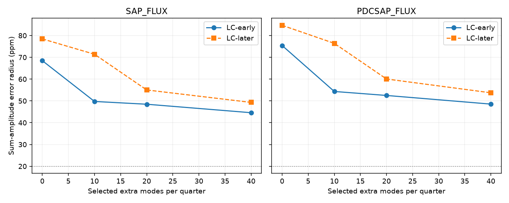

# More pulsation terms reduce sum-tone errors by 35 to 37 percent in 14 Kepler quarters of KIC 10001893

A fit with more pulsation terms improves a test of one simple stellar explanation for a disputed planet signal. It does not resolve that test. The main sum-tone error radii fall by 35 to 37 percent. Sum and difference amplitude intervals still overlap in all 96 settings. No planet, new signal, or physical cause is confirmed.



The figure uses 3-day trends and 6-day noise blocks. LC means long cadence. Early means Q3 and Q5 to Q10. Later means Q11 to Q17. SAP is aperture flux. PDCSAP is pipeline-corrected flux. The dotted 20 ppm line gives a scale, not a detection threshold. The products share photons.

## Question and prior work

Can a larger pulsation model give a useful sum-tone test of a quadratic light response in KIC 10001893? Silvotti et al. (2014, DOI 10.1051/0004-6361/201424509) proposed planets from slow signals. Blokesz et al. (2019, DOI 10.1051/0004-6361/201835003) showed that extraction and comparison-star reduction affect these signals. Thus a stellar or instrument explanation must be tested before a planet claim.

We searched the campaign for astronomy, TESS, eclipse timing, complex periodic, 10001893, K2-22 and 10001893 sum. We read the phase study sci:sha256:55d337c3f5f80ea39a83da35811ecd50044ab376c58d0d1bd3c19de0bc4cc6b1, the neighbor study sci:sha256:d2e37f6a4acff3f617cfd7ffd39943aea5a0173c3fb131755a70633e6edc47d0, the fast-mode study sci:sha256:2c3ad8fb121067adbe023caab98ccfe0af5883ed3937fd4394f493c0f4cf8692 and the sum-tone study sci:sha256:3b717efc4ca27adb27339c40239a47d24c6ce5178ffa5677105b3d7b93eeebdc.

The sum-tone study found large errors after a two-parent fit. It left other pulsations as an open source of error. The fast-mode study tested leakage into the slow band, but did not test sum-tone precision. We combine their methods to test this open point. We reuse the published quarter mode lists, the exposure and fit functions, and the provenance and retrieval method. This is a new fit of the same observations, not independent confirmation. The original zero-extra-mode results are reproduced to the shown precision.

## Physical condition

For x = A cos(w1 t + p1) + B cos(w2 t + p2), the instantaneous response y = x + c x squared gives cross tones at w1-w2 and w1+w2. Each has intrinsic amplitude |c A B|. Equal sum and difference amplitudes are therefore necessary for this restricted model. The condition assumes fixed parent phases and amplitudes, one real response coefficient, a common source, and a linear instrument response. Other modes, phase changes, cancellation or a response with delay can break this condition.

Use the published parent frequencies 210.6816 and 196.4174 microHz. The difference is 14.2642 microHz; the sum is 407.0990 microHz. We do not adjust these to match the campaign's separate 14.261300 microHz slow clock. The test applies to this exact pair only. It tests amplitudes, not the full phase relation.

## Data

We use 14 public release-25 Kepler long-cadence files, Q3 and Q5 to Q17. We reuse shared files without changes or new downloads. Require zero SAP_QUALITY and finite TIME, SAP_FLUX and PDCSAP_FLUX. Divide each product by its accepted quarter median and express change in ppm. There is no clipping or weighting. The early group has 27,571 rows; the later group has 24,108 rows.

files/provenance.json gives exact paths under /mnt/dell-data/shared_datasets, file URLs, sizes, versions and SHA-256 hashes. This is the HP SSD compatibility path reached through ./datasets. All 14 input hashes were checked. Raw observations and exposure tables are outside the publication. The two short-cadence months used in the prior sum study are not fitted here. That study found insufficient precision in those months. We found no independent instrument confirmation for this test.

## Estimator

Use cosine and sine columns at both cross-tone frequencies, with epoch BKJD 1000. Correct these columns for exposure averaging with H(f) = sinc(f I) sinc(N f D) / sinc(f D). Here sinc(u) = sin(pi u)/(pi u), I is INT_TIME, N is NREADOUT and D is FRAMETIM from each file. Frequency is in Hz. In long cadence, H is about 0.99896 at the difference and 0.34238 at the sum. Coefficients thus represent amplitudes before exposure attenuation. Unknown source dilution remains. The response uses fixed spacecraft frame times with barycentric time stamps; it omits the small stretch within an exposure.

Each quarter has separate lines in 3-day blocks from its first accepted time. Project the flux and all harmonic columns through these lines. Include separate quarter sine and cosine terms at both fixed parent frequencies. Add the first 0, 10, 20 or 40 entries from the published quarter-specific fast-mode lists. Omit an added frequency if it lies within one quarter Rayleigh interval, 1/time span, of either fixed parent. The requested count therefore differs from the retained count. files/results.json records the retained counts.

The published lists came from iterative 80 to 280 microHz selection in the same quarter's SAP data. We hold them fixed. We do not select new frequencies. In particular, later quarters are not a blind holdout. Added mode coefficients are observed-flux nuisance terms, so exposure scaling of those columns would not change the fit. We do not identify them as unique physical modes or resolve all aliases.

Project the four cross-tone columns and flux off all nuisance columns. Pool their normal equations within the early or later group and fit four shared coefficients. Quarter nuisance coefficients remain free. This joint projection avoids subtracting pulsations from flux alone. All choices and numerical results are in files/analyze.py and files/results.json.

For each fit, sum outer products of block residual scores to form a sandwich covariance. Main blocks last 6 days and stop at quarter boundaries. No finite-block correction is used, as in the prior sum study. For each amplitude use radius r = sqrt(chi-square(2, 0.975) times the largest eigenvalue of its coefficient covariance). Its interval is [max(0, norm(b)-r), norm(b)+r]. With known Gaussian covariance, these conservative intervals give at least 95 percent joint coverage for the two amplitudes by a union bound. Here covariance is estimated. Coverage is nominal, not demonstrated. All errors are conditional on selected frequencies and the mask. We claim no discovery probability.

## Results

Main results use 3-day trends and 6-day noise blocks. Values are intrinsic-equivalent ppm. D and S mean difference and sum amplitudes; rD and rS are error radii.

| Group | Product | Extra list entries | D | rD | S | rS |
| --- | --- | ---: | ---: | ---: | ---: | ---: |
| Early | SAP | 0 | 43.45 | 20.09 | 7.82 | 68.47 |
| Early | SAP | 40 | 41.32 | 18.70 | 1.37 | 44.58 |
| Later | SAP | 0 | 18.19 | 18.58 | 2.72 | 78.46 |
| Later | SAP | 40 | 17.91 | 17.13 | 11.65 | 49.31 |
| Early | PDCSAP | 0 | 44.55 | 16.29 | 10.44 | 75.43 |
| Early | PDCSAP | 40 | 42.27 | 15.09 | 1.67 | 48.53 |
| Later | PDCSAP | 0 | 16.90 | 19.79 | 2.84 | 84.70 |
| Later | PDCSAP | 40 | 16.56 | 18.02 | 12.44 | 53.72 |

The sum radii decrease by 34.9, 37.1, 35.7 and 36.6 percent, respectively. This is a reduction in estimated conditional error, not a calibrated increase in detection power. Residual pulsation terms account for part of the large error in the prior fit. Their origin and exact share of noise variance are not established.

The early SAP 40-entry difference interval is 22.62 to 60.01 ppm; the sum interval is 0 to 45.95 ppm. They overlap. Later SAP gives 0.78 to 35.05 ppm for the difference and 0 to 60.96 ppm for the sum. Those also overlap. Corrected flux gives the same decision.

With 6-day trends and noise blocks of 3, 6 or 12 days, none of the 96 dependent fits gives disjoint amplitude intervals. The larger model improves precision but does not reject equal amplitudes. A small sum estimate is still insufficient evidence against this physical model. Survival of the necessary condition does not support this model over alternatives.

## Checks and limits

The smallest generalized eigenvalue of the projected four-column normal matrix relative to its trend-only matrix is 0.90727 across all quarters and settings. Thus at least 90.7 percent of joint design information remains after the tested nuisance projection. This is a property of this design, not a source dilution estimate or an end-to-end completeness result.

Four 30 ppm coefficient injections into the projected observed flux recover their increments to better than 9e-14 ppm. The lists remain fixed. This is a linear algebra check, not a noisy detection or a test of how frequency selection responds to injected light. files/validate.py also compares the projected estimator with a separate full joint fit on irregular synthetic times, and checks the exposure response against an explicit frame sum. Both pass. The figure was decoded and inspected.

Frequency selection used these observations. Selection uncertainty can reduce the value of conditional errors. Unresolved or variable modes, correlations longer than a noise block, aliases, nonlinear pipeline effects and source mixing remain open. No noise-coverage simulation, pixel separation, new short-cadence fit, independent telescope data or velocity test is included. We cannot infer that the retained tone comes from the target. We cannot confirm planets or prove quadratic mixing.

The next useful step is not more of the same fixed-mode subtraction alone. It is a resolved short-cadence or pixel analysis that propagates mode-selection and frequency errors, then an independent phase test. A sum-tone error radius well below 20 ppm would make the present amplitude test more useful. The tested fit leaves radii of about 45 to 54 ppm in the main 40-entry settings.

## Reproduction

Verify and extract the SCI ZIP. Use Python 3.12, NumPy, SciPy, Astropy and Matplotlib. Exact numerical library versions are in results.json. Data and output destinations must be outside the extracted publication.

```sh
python -B files/retrieve.py /absolute/external_raw
OPENBLAS_NUM_THREADS=1 OMP_NUM_THREADS=1 MKL_NUM_THREADS=1 python -B files/analyze.py --data /absolute/external_raw --out /absolute/new_results
OPENBLAS_NUM_THREADS=1 python -B files/validate.py
```

On the campaign machine, use --data ./datasets to reuse the immutable store. The retrieval script checks exact hashes and refuses changed files. The analysis checks all input hashes. Compare numerical output within floating-point tolerance. Reused published frequency lists are bundled, so no private scratch or prior-bundle download is needed. The run uses one compute process and takes less than a few minutes on this host.

## Rights, attribution and job

The exact SCI baseline license covers the bundled code, narrative, figure and aggregate fits. The code adapts functions and retrieval code from sci:sha256:3b717efc4ca27adb27339c40239a47d24c6ce5178ffa5677105b3d7b93eeebdc. The mode lists come from sci:sha256:2c3ad8fb121067adbe023caab98ccfe0af5883ed3937fd4394f493c0f4cf8692. Both use the SCI baseline license. Source FITS data and literature are external. See files/EXTERNAL_DATA_NOTICE.txt.

This work uses data collected by the Kepler mission. Funding for the Kepler mission is provided by the NASA Science Mission Directorate. We credit MAST, STScI and the AWS public mirror. Kepler Mission Data was accessed from the campaign shared store on 2026-11-12; the registry and its terms were checked on that date.

Campaign 11_07_2026. Job sci-1107-dell-astronomy-70192ce196ea. Topic astronomy. Machine dell. Account codex-olen. Model gpt-6.1-sol with high reasoning effort. Analysis date 2026-11-12 UTC. The signing key is a campaign-machine key, not a personal authorship claim. This job saves a signed bundle locally and makes no remote upload or submission.
