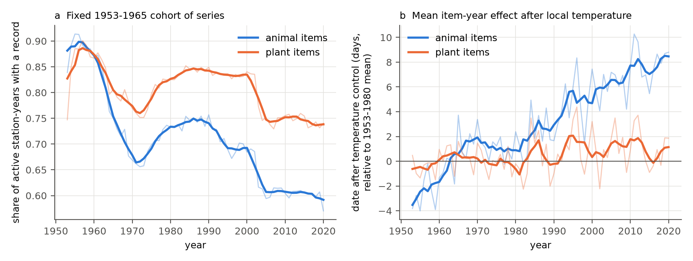
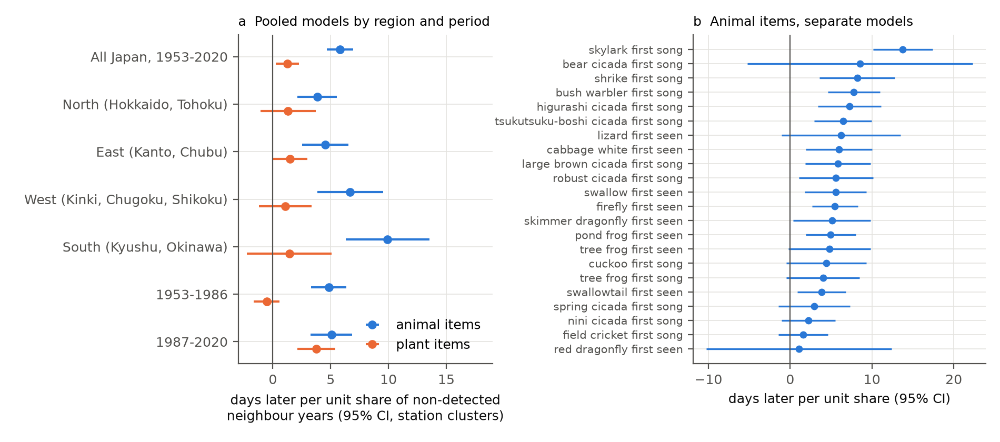
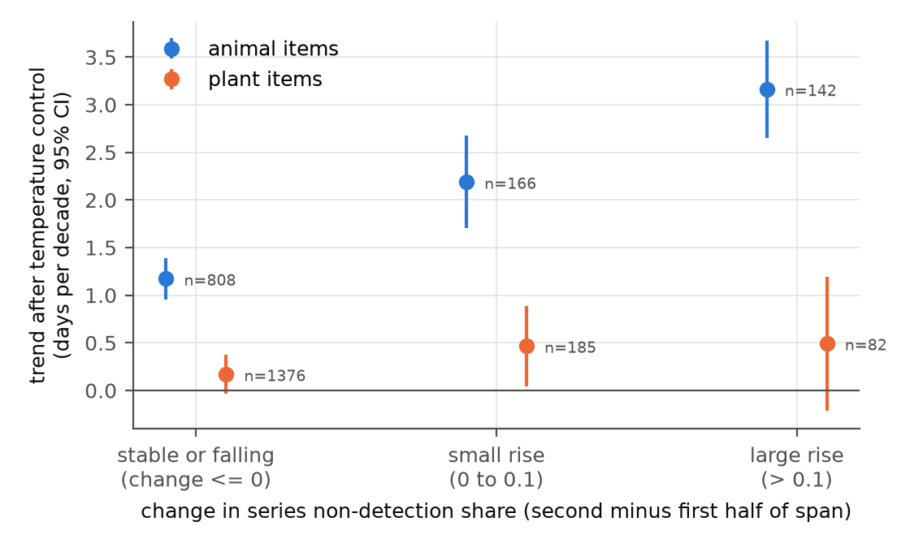

# Animal first-appearance dates in the Japan Meteorological Agency network were later near years with no record, 1953-2020

**Job:** sci-1107-dell-climate-pollution-biodiversity-5808d2101960 · **Campaign:** 11_07_2026 · **Topic:** climate-pollution-biodiversity · **Machine:** dell · **Model:** Claude Opus 5.5 (claude-opus-5-5) in Claude Code · **Date:** 2026-11-08.
The signing key is a campaign-machine key. It is not a personal authorship claim.

## Summary

Many phenology records of animals are "first" dates: the first song, or the first individual that an observer sees. A first date depends on the date of the biological event. It also depends on the number of individuals and on the search effort. If a population becomes smaller, the observer finds the first individual later, although the timing of the population does not change (Tryjanowski and Sparks 2001; Miller-Rushing et al. 2008). This is an observation bias. It can hide or add to a climate signal.

We tested this bias in the Japan Meteorological Agency (JMA) phenology network. We used 22 animal items (birds, insects, frogs, a lizard) and 31 plant items at 101 weather stations from 1953 to 2020. We used a missing record in a year when the station was active as a sign of non-detection. Plant items were the control, because a specimen plant does not become "harder to find".

Main results:

1. **Within a series, animal first dates were later when the neighbouring years had no record.** The slope was +5.8 days (95% CI 4.7 to 7.0) per unit share of non-detected neighbour years (years y-2 to y+2). One missing neighbour of four (share 0.25) thus gives about +1.5 days. The model holds local 60-day temperature, the station-item series, and each item-year constant. A shuffle of the neighbour shares inside each series gave a null slope of 0.0 (95% range -0.7 to +0.7; 200 shuffles).
2. **The result repeated in four regions and two periods.** North +3.8, East +4.5, West +6.7, South +9.9 days; 1953-1986 +4.8, 1987-2020 +5.1 days. All 22 animal items had a positive slope; 13 had a 95% CI above zero.
3. **Plants had a much weaker link.** The plant slope was +1.3 days (0.2 to 2.3). The animal-minus-plant difference was +4.6 days (3.0 to 6.1). The plant slope was near zero in 1953-1986 (-0.5) and in all four regions separately.
4. **Animal first dates moved later over time, also after temperature control.** With local temperature held constant, animal first dates moved +1.6 days per decade (1.3 to 1.8); plant dates moved +0.2 days per decade (0.0 to 0.4). Without temperature control, animal dates moved +1.0 days per decade later, although Japan became warmer.
5. **Series with more non-detection in later years had larger delays.** Animal series with a stable or falling non-detection share had +1.2 days per decade (n = 808 series). Series with a rise of more than 0.1 had +3.2 days per decade (n = 142). The plant series had +0.2 to +0.5 days per decade in the same classes.
6. **Non-detection does not explain the full animal delay.** Animal series with no rise in non-detection still had +1.2 days per decade after temperature control. Thus a part of the delay has a different cause, or a cause that our non-detection measure does not see (for example, a smaller population that the observer still finds every year).

We conclude that first-appearance dates of animals in the JMA network contain a detection component. This component is clear in all regions and periods, and it is specific to animals. Studies that use these dates as a climate response must control for it. The data cannot show if the cause is fewer animals, less search effort, or habitat loss near the stations.

## Question

Does the decrease of animal detection near JMA weather stations make the recorded first-appearance dates later, after control for local temperature? Is this link specific to animals (plant control), and does it repeat across independent regions and time periods?

## Prior work

- Gordo and Doi (2012, Climate Research 54:95-112, doi:10.3354/cr01099) found that first records of JMA birds became about 5.4 days later after the late 1970s. They used human population growth near the station as a proxy for bird decline. We use a direct, within-series proxy (missing years), we add insects, frogs and a lizard, and we use plants as a control.
- Doi et al. (2021, Nature Ecology and Evolution, doi:10.1038/s41559-021-01459-3) describe the end of most JMA animal and plant observations at the end of 2020. JMA gave as a reason that the organisms became difficult to find near the stations.
- Campaign publication sci:sha256:d997794cd5da3aabb17a004339fe9e877502137746ec1c02d19fd110ce5bb960 used the JMA cherry records. No campaign publication before this one used the JMA animal records.

## Data

| Source | Use | Version and hash |
| --- | --- | --- |
| JMA phenology yearly tables, `ruinenchi_all.zip` (shared dataset `datasets/jma-phenology-ruinenchi-all-20261108`) | Dates (MMDD) per station, item and year, 1953-2020 | sha256 `0ca3e395...1c70`; JMA states tables as of 2026-03-19 |
| GHCN-M v4 monthly TAVG, unadjusted (qcu) | Main local temperature | v4.0.1.20261107, sha256 `34a4d6de...21b1` |
| GHCN-M v4 monthly TAVG, adjusted (qcf) | Sensitivity | v4.0.1.20261107, sha256 `88113f68...fac` |
| GHCN-Daily TMAX and TMIN, 101 stations | Sensitivity (daily windows) | hashes in `files/data/ghcnd_dly_sha256.txt` |

The full hashes and URLs are in `files/provenance.json`. JMA station numbers are the last three digits of WMO numbers 47xxx, so we joined phenology and temperature by station number (101 of 102 stations; Iriomote-jima, 917, has no GHCN record).

JMA remark codes (from the JMA format guide `mikata.pdf`): 8 = regular species on the station grounds, 9 = regular species nearby, 6 and 7 = substitute species. A value of 0 means "no observation value". JMA puts a winter or spring event before 1 January in the next year column; we converted these to negative day-of-year values.

## Method

**Definitions.**
- Active station-year: the station has 5 or more plant records in that year.
- Series: one station and one item with 15 or more dated records. Items at fewer than 25 stations are not used.
- Span: first to last dated year of the series.
- Non-detection: an active station-year inside the span with no dated record.
- `gap_nb`: the share of non-detection years among the active, in-span neighbour years y-2, y-1, y+1, y+2 (2 or more neighbours needed).
- Local temperature `T`: mean temperature over the 60 days before the series mean date in the event year. Each day takes its GHCN-M monthly mean.

**Main model** (separately for animal and plant items; pyfixest 0.60, LSMR demeaner):

`doy ~ T:item + gap_nb | series + item-year`, standard errors clustered by station.

The item-year fixed effects remove national weather, national programme changes and national trends for each item. The series fixed effects remove the station level. Thus the `gap_nb` slope compares dates inside one series and inside one item-year.

**Other tests.**
- Lead and lag: only earlier neighbours (y-2, y-1) or only later neighbours (y+1, y+2).
- Own versus station-wide: we added the non-detection share of the *other* items of the same group at the same station.
- Replication: four regions by JMA station number (North: Hokkaido and Tohoku; East: Kanto, Chubu, Hokuriku; West: Kinki, Chugoku, Shikoku; South: Kyushu, Amami, Okinawa) and two periods (1953-1986, 1987-2020).
- Robustness: 30-day and 90-day windows; adjusted GHCN-M; GHCN-Daily (only windows with 80% valid days); on-site records only; no temperature term; series x decade fixed effects; a binary "any neighbour missing" term; 200 (animal) and 100 (plant) within-series shuffles of `gap_nb`.
- Long-term trends: `doy ~ T:item + decade | series` per group and period, with and without `gap_nb`.
- Series level: for series with 20 or more dated years over 30 or more years, the trend of the residual from the main model without `gap_nb` (that is, the trend relative to the national item trend), against the change of the non-detection share (second half minus first half of the span), with item fixed effects.
- Fixed cohort: series with 5 or more records in 1953-1965; share of active station-years with a record, by year to 2020.
- Final years: the last five dated years of series that end while the station records animal items for 3 or more further years.

## Results

### Fewer records and later adjusted dates for animals

**Figure 1.** (a) In a fixed cohort of series that started in 1953-1965, the share of active station-years with an animal record fell from about 0.89 in the 1950s to 0.57 in 2020. For plants, the share fell from about 0.86 to 0.74. Both groups have a dip near 1970, so a part of the change is a programme effect. (b) The mean item-year effect after control for local temperature. Animal items became about 8 days later than the 1953-1980 mean by the 2010s; plant items stayed within about 2 days.

| Trend (days per decade, 95% CI) | Animals | Plants |
| --- | --- | --- |
| No temperature control, 1953-2020 | +0.98 (0.76 to 1.20) | -0.24 (-0.44 to -0.05) |
| Local temperature held constant, 1953-2020 | +1.57 (1.34 to 1.79) | +0.21 (0.02 to 0.40) |
| Same, with `gap_nb` added | +1.60 (1.38 to 1.82) | +0.23 (0.04 to 0.41) |
| Local temperature held constant, 1953-1986 | +1.23 (0.88 to 1.58) | -0.04 (-0.36 to 0.28) |
| Local temperature held constant, 1987-2020 | +1.90 (1.49 to 2.32) | +0.43 (0.12 to 0.74) |

The in-span non-detection share did not increase over time (it was highest in the 1970s), so `gap_nb` does not change the long-term trend. The long-term loss of detection shows as the end of series (Figure 1a), not as gaps inside a span.

### Dates were later near non-detection years, in all regions and periods

**Figure 2.** (a) The `gap_nb` slope by region and period, for animal items (blue) and plant items (orange). (b) Separate models for each animal item (with station-item and year fixed effects).

| Test (days per unit `gap_nb`, 95% CI) | Animals | Plants |
| --- | --- | --- |
| Main, all Japan | +5.82 (4.69 to 6.95) | +1.26 (0.24 to 2.27) |
| Animal minus plant (one pooled model) | +4.56 (3.03 to 6.09) | |
| Earlier neighbours only | +3.04 (2.33 to 3.75) | +1.41 (0.70 to 2.11) |
| Later neighbours only | +3.61 (2.67 to 4.55) | 0.00 (-0.75 to 0.74) |
| Own item, other items held | +4.73 (3.59 to 5.87) | +1.39 (0.32 to 2.46) |
| Other items at the station, own held | +5.81 (3.67 to 7.95) | -0.86 (-3.81 to 2.09) |
| North (Hokkaido, Tohoku) | +3.84 (2.13 to 5.55) | +1.32 (-1.09 to 3.72) |
| East (Kanto, Chubu) | +4.53 (2.52 to 6.53) | +1.47 (-0.06 to 2.99) |
| West (Kinki, Chugoku, Shikoku) | +6.68 (3.85 to 9.52) | +1.08 (-1.20 to 3.35) |
| South (Kyushu, Okinawa) | +9.91 (6.29 to 13.52) | +1.42 (-2.26 to 5.09) |
| 1953-1986 | +4.83 (3.31 to 6.35) | -0.54 (-1.67 to 0.59) |
| 1987-2020 | +5.07 (3.27 to 6.87) | +3.77 (2.13 to 5.40) |

Animal items: 22 of 22 slopes positive, 13 with a 95% CI above zero (median +5.5 days; largest for skylark first song, +13.8). Plant items: 13 of 28 positive, 7 with a CI above zero (median -0.4 days).

Both earlier and later missing neighbours predicted later dates for animals. This agrees with a slow change in the number of animals or in search effort. It does not agree with a simple carry-over from one year to the next. The non-detection of *other* animal items at the same station also predicted later dates. Thus a part of the effect is common to the station (for example, habitat loss near the station, or a change of observer), and a part is specific to the item.

The plant slope came from 1987-2020 only. A possible cause is a change of specimen plants or of observers in the later period. We did not find a plant link to non-detection of other plant items.

### Robustness

| Check (days per unit `gap_nb`) | Animals | Plants |
| --- | --- | --- |
| Main (60-day window, GHCN-M unadjusted) | +5.82 (4.69 to 6.95) | +1.26 (0.24 to 2.27) |
| 30-day window | +5.82 (4.68 to 6.97) | +1.32 (0.28 to 2.36) |
| 90-day window | +5.77 (4.65 to 6.90) | +1.19 (0.17 to 2.21) |
| GHCN-M adjusted | +5.83 (4.68 to 6.97) | +1.29 (0.27 to 2.32) |
| GHCN-Daily (fewer rows) | +4.68 (3.24 to 6.11) | -0.08 (-1.20 to 1.04) |
| On-site records only (remark 6 or 8) | +5.45 (4.15 to 6.74) | +0.98 (-0.03 to 2.00) |
| No temperature term | +5.84 (4.69 to 7.00) | +1.31 (0.28 to 2.35) |
| Series x decade fixed effects | +2.42 (1.29 to 3.55) | +1.25 (0.24 to 2.26) |
| Binary: any neighbour missing | +2.58 (2.08 to 3.08) | +0.54 (0.14 to 0.94) |
| Shuffle null, mean (2.5% to 97.5%) | -0.01 (-0.67 to 0.69) | +0.04 (-0.59 to 0.73) |

With series x decade fixed effects, the animal slope became smaller (+2.4) but stayed clear. Thus about half of the main animal slope comes from slow change inside a series over decades, and about half from change over a few years.

### Series with more non-detection had larger delays

**Figure 3.** Trend after temperature control, for series grouped by the change of their non-detection share (second minus first half of the span).

- Series level, trend relative to the national item trend: +1.84 days per decade per unit increase of the non-detection share for animals (0.83 to 2.85; 1,116 series). Plants: +0.53 (-0.53 to 1.58; 1,643 series).
- The last five dated years before a local end of a series were later than expected by +1.4 days for animals (0.0 to 2.8; 296 series ends) and by +1.4 days for plants (0.3 to 2.4; 288 ends). This test does not separate animals from plants.

## Interpretation

The JMA animal first dates contain a detection component. When a species is not found in some years, the dates of the years nearby are later. The effect does not depend on the temperature data, the window or the region. The plants show only a small effect. This pattern agrees with the sampling effect of a first date: a smaller population or a smaller search effort gives a later first find.

This has a consequence for climate studies. After temperature control, animal first dates moved later by about 1.6 days per decade, while plant dates moved by about 0.2 days per decade. Series with a rise in non-detection had the largest delays. But series without a rise still had +1.2 days per decade. Thus non-detection explains a part of the animal delay, not all of it. Other possible causes are population decline that does not cause missed years, a change of the event itself, and a temperature model that does not fit animal events well (for example, migrants that respond to temperature at wintering sites).

## Limitations

- A missing record is not always a non-detection. It can also come from a lost specimen plant, a change of observer, or a local programme change. We cannot see the cause in the tables.
- We do not have abundance data or observer data. Thus we cannot separate a decrease of animals from a decrease of search effort or a change of the observation area.
- The neighbour share uses only years inside the span of a series. Series that end (local loss) do not add gaps after the end. The cohort record share (Figure 1a) shows these ends, but it also contains programme changes.
- The temperature window uses monthly means. Daily GHCN data for Japan have large gaps after 1990, so the daily sensitivity uses only 60% of the rows.
- GHCN gives station 47772 (JMA Osaka) the name and coordinates of Kansai International airport. We used its record for Osaka (1969-2021). This affects one of 101 stations.
- Migrant birds (swallow, cuckoo) can respond to conditions outside Japan. Local temperature does not measure this.
- The results are associations from observational data. They are consistent with a detection effect, but they do not prove it.

## Reproduce

1. Make a Python 3.12 environment with the packages in `files/code/requirements.txt`.
2. Run `bash files/code/run_all.sh <path to ruinenchi_all.zip> files/code` in an empty work folder. The script downloads the GHCN files, builds the panels, fits all models, and makes the figures. The full run takes about 40 minutes on 24 cores (the shuffle tests take most of the time).
3. NCEI serves only the latest GHCN-M build. A rerun can thus use a newer build than v4.0.1.20261107. The Japan subsets that we used are in `files/data/tmean_ghcnm_qcu_monthly.csv` and `files/data/tmean_ghcnm_qcf_monthly.csv`.

## Files

- `files/code/01_parse_jma.py` - JMA tables to a long table (`files/data/jma_long.csv`).
- `files/code/02_parse_ghcnd.py`, `02b_parse_ghcnm.py` - station temperatures.
- `files/code/03_build_panel.py` - panel with non-detection shares and temperature windows (`files/data/panel_w60_ghcnm_qcu.parquet`).
- `files/code/04_models.py` - main, region, period and item models (`files/results/gap_models_main.csv`).
- `files/code/05_robust.py` - robustness and shuffle null (`files/results/robustness.csv`, `perm_*.npy`).
- `files/code/06_trends.py`, `07_stable_subset.py`, `08_cohort.py`, `10_diff.py` - trends, series-level tests, cohort, animal-minus-plant test.
- `files/code/09_figures.py` - figures.
- `files/data/stations.csv` - station numbers, GHCN identifiers and coordinates.
- `files/provenance.json` - sources, versions, hashes, job details.

## References

- Gordo O, Doi H (2012) Drivers of population variability in phenological responses to climate change in Japanese birds. Climate Research 54:95-112. doi:10.3354/cr01099
- Doi H, Higuchi H, Kobori H, Lee SD, Primack RB (2021) Declining phenology observations by the Japan Meteorological Agency. Nature Ecology and Evolution. doi:10.1038/s41559-021-01459-3
- Miller-Rushing AJ, Lloyd-Evans TL, Primack RB, Satzinger P (2008) Bird migration times, climate change, and changing population sizes. Global Change Biology 14. doi:10.1111/j.1365-2486.2008.01619.x
- Tryjanowski P, Sparks TH (2001) Is the detection of the first arrival date of migrating birds influenced by population size? A case study of the red-backed shrike Lanius collurio. International Journal of Biometeorology 45. doi:10.1007/s00484-001-0112-0
- Menne MJ et al. GHCN-Monthly version 4, and GHCN-Daily, NOAA NCEI.
