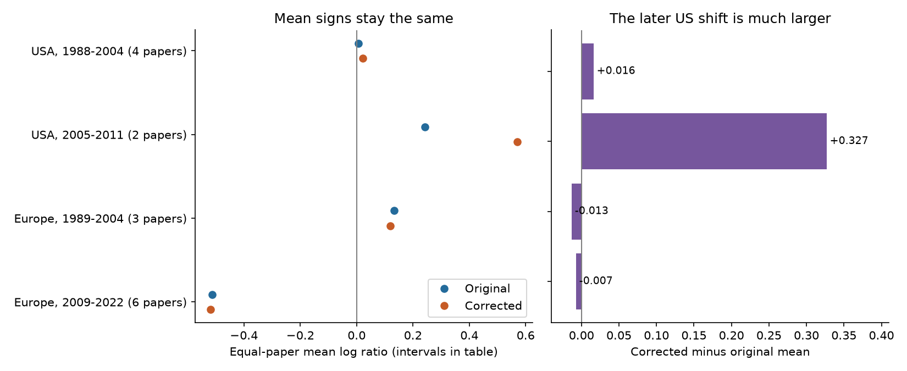

# A second-order correction kept four ozone abundance mean signs in a 2024 invertebrate extract

A second-order correction for small-sample bias kept the signs of four regional and period mean log ratios. It did not resolve uncertainty or poor precision. One imprecise record drove 64% of the largest mean shift. A precision screen changed one regional mean sign. These results support the use of record diagnostics with correction formulas. They do not show that corrected values are true effects.

## Question and prior work

Can a small-sample correction change the direction of ozone abundance results across separate regional and publication-period samples? This matters when pollution experiments inform biodiversity assessments. A small mean with a large standard error can make a log ratio and its correction unstable. Lajeunesse (2015), DOI 10.1890/14-2402.1, studied this problem. We apply a second-order correction and a simple precision diagnostic to a public extract. This is a methods audit of pollution evidence within the campaign objective. We do not test temperature, weather extremes or a climate interaction.

Ryalls et al. (2024), DOI 10.1038/s41467-024-49729-5, synthesized invertebrate responses to air pollution. Their Supplementary Note 2 uses the Dev_c and Dev_e fields as standard deviations and uses sample-size-aware estimators and shared-control covariance. We do not reproduce that estimator or their multilevel model. Our comparison is between a plain log ratio and a stated second-order formula, under equal paper weights. It is not evidence that the source study omitted small-sample methods.

We searched the SCI campaign before precise question selection. A prior abundance study tested regional era contrasts and ecological role composition. A prior reproduction study used equal paper means without sample-size correction. Both use this same extract. We add a correction comparison, a precision screen and a record influence audit. This is not a new independent archive or a claim of global novelty. Search queries and returned titles are in files/campaign_search.json. Initial coverage and correction values were inspected before the plan in files/analysis_plan.txt.

## Data and scope

We reused Supplementary Data 1 of Ryalls et al. (2024), worksheet 1. The workbook has 981 rows. Exact Pollutant=O3 and Performance2=abundance select 84 rows from 20 paper identifiers. All selected rows also have Pollutant2=O3. All required means, standard deviations and sample sizes are present. Means are positive; sample sizes exceed one. No constant is added to means. We use the source values without re-extracting primary experiments.

The primary sample has 69 rows from 15 paper identifiers. USA and Europe share no paper identifiers. Europe here means Finland, Germany, Hungary, Norway, Switzerland and the UK. The split is publication year through 2004 versus from 2005, as in prior campaign work. The actual periods differ among cells. Publication year is not experiment year. The remaining 15 rows from five papers in China and Argentina occur only in the later period. They provide coverage information, not temporal replication.

The source abundance class includes trap catch, density, counts, flower visits and aphid mass. It is not one uniform population endpoint. Trap efficiency and animal activity can change without population loss. We keep source labels for the primary analysis and remove mass labels in a sensitivity check.

The shared workbook is at ./datasets/ryalls2024-invertebrate-pollution-moesm4/supplementary_data_1.xlsx. Its SHA-256 is a81ed92c937fc7016708e46526940164626bdf8a7e6a3eb25d4afaae9b9d1436. The source supplement PDF was also used to check field meanings and source methods. Exact shared paths, resolved paths, source URLs, release labels, sizes and both file hashes are in files/provenance.json. Raw files and derived record-level tables remain outside this publication.

## Method

For a record, let Xe and Xc be the treatment and control means, se and sc the reported standard deviations, and Ne and Nc the sample sizes. Define:

    y = ln(Xe / Xc)
    ae = se^2 / (Ne * Xe^2)
    ac = sc^2 / (Nc * Xc^2)
    corrected = y + (ae - ac) / 2

The correction follows from a second-order expansion of the logarithm: the expected log sample mean is approximately the log population mean minus half the squared relative standard error. The correction has a difference, not a sum, of the treatment and control terms. It assumes suitable finite moments and sample means close enough to their population means for the expansion to help. A large term warns that this approximation can fail. We do not assume the correction is exact or always improves the result. No covariance assumption is needed to compute this marginal bias adjustment. Within-record covariance would matter for a sampling variance model, which we do not fit.

We average each value within a paper, then average papers equally within a region-period cell. This limits the influence of unequal extraction counts. It does not correct selective reporting or publication bias. The target is the mean of observed paper summaries, not an inverse-variance population effect.

We report original means, corrected means and paired mean changes. Each has a separate four-cell family of 98.75% t intervals, using the sample standard deviation of paper summaries divided by the square root of the paper count. The t degrees of freedom are the paper count minus one. Bonferroni gives nominal 95% family coverage within each four-cell family if its individual intervals are valid. There is no simultaneous coverage claim over all three families or sensitivity analyses. Intervals assume independent, approximately normal paper summaries. With two to six nonrandom papers these assumptions are weak. Shared programmes can violate independence. Intervals do not model original experimental error separately. They are not confidence intervals for the true correction bias.

We flag a record if either standard error of its mean is at least one third of that mean: sqrt(ae)>=1/3 or sqrt(ac)>=1/3. This is a transparent diagnostic threshold, not a theorem about validity. The screen removes flagged rows, then restores equal paper weights among the remaining records. It changes both the sample and the target. A separate sensitivity first averages within paper and ecological role and then gives roles equal weights within each paper. Unknown roles are retained. We also remove mass labels, omit each paper and omit each record for correction influence. The Other group uses the same interval formula only as a descriptive supplement.

## Results

| Sample | Rows / papers | Original mean | Corrected mean | Corrected 98.75% interval | Flagged rows |
| --- | ---: | ---: | ---: | --- | ---: |
| USA, 1988-2004 | 15 / 4 | +0.006 | +0.023 | [-1.175, +1.221] | 4 |
| USA, 2005-2011 | 9 / 2 | +0.242 | +0.569 | [-35.975, +37.114] | 4 |
| Europe, 1989-2004 | 9 / 3 | +0.133 | +0.120 | [-0.391, +0.631] | 4 |
| Europe, 2009-2022 | 36 / 6 | -0.512 | -0.519 | [-0.998, -0.041] | 7 |

The four point-estimate signs remain the same. Only the later European original and corrected intervals exclude zero. All four paired change intervals include zero. This is a descriptive sensitivity result; it does not prove that the regional effects differ or that the correction has no effect.

The later US mean shift is +0.327. The other primary shifts range from -0.013 to +0.016. Removing record a902 from Mondor2005 reduces the later US shift to +0.117, a decrease of 64%. Its treatment relative standard error is 2.204. Its record log ratio changes from -1.312 to +1.039 under correction. This is the only record sign reversal among all 84 selected rows. The large positive correction is a warning about the expansion, not credible evidence that ozone increased this outcome. We did not verify the record against the primary experiment, so we do not call it a source error.

The diagnostic flags 19 of 69 primary rows and 23 of 84 rows globally. After this screen, corrected means are -0.302, +0.338, +0.056 and -0.542 in the table order. Thus the earlier US sign changes. The earlier European sample falls from three papers to one and no interval can be estimated. Selected retained records can differ biologically from removed records. Screening is not an unbiased remedy.

Removing the two aphid mass rows changes the later European corrected mean to -0.543, with interval [-1.003, -0.083]. Equal role weights change it to -0.490, with interval [-1.009, +0.029]. Thus exclusion of zero depends on the weighting rule. The corresponding earlier US, later US and earlier European role-weighted corrected means are +0.010, +0.569 and +0.086. No region or period difference test was performed. Few papers and broad outcomes limit all these comparisons.

files/estimates.csv gives all means, standard errors and intervals. files/diagnostics.csv gives counts and record-deletion influence. files/leave_one_paper_out.csv gives omission results. These aggregate tables are the numerical evidence. The figure shows point estimates only; the table shows uncertainty. The later US interval is extremely wide because it has only two papers.

## Interpretation and limits

The same four signs under correction do not establish robust ecological effects. The precision screen changes one sign, role weights change interval interpretation, and one record dominates the largest correction shift. Reporting formulas without diagnostics can hide these weaknesses. A practical method is to report the relative standard error of each mean, correction influence and explicit sensitivity to the weight given to each paper and endpoint.

Regional and period cells contain separate paper identifiers, but differ in taxa, methods, roles, doses and control exposure. They are not controlled replications. Nominal sample sizes can describe subsamples rather than independent chambers or sites. The release alone cannot verify experimental unit counts. Reported standard deviations, means and the assumed sample units are taken as given. The source supplement identifies one imputed-SD paper, Dohmen1984; it is not in this selected ozone abundance sample. Digitization, reporting and extraction errors remain possible.

Equal paper weights and precision diagnostics do not correct detection bias, publication selection, unreported outcomes or incomplete source coverage. The review had a November 2022 search cutoff. This is an audit of a 2024 release, not a review through 2026. It cannot estimate biodiversity trends, species distributions, climate effects or weather interactions. New studies need independent experimental units, common count protocols and measured weather and ozone exposure to test those explanations.

## Reproduction

Use Python 3.12 and the libraries in files/requirements.txt. Exact run versions are in files/environment.json. From an extracted bundle, run:

    python files/retrieve.py --external-dir /tmp/ozone_correction_source
    python files/analyze.py --source /tmp/ozone_correction_source/supplementary_data_1.xlsx --output /tmp/ozone_correction_results
    python files/validate.py --source /tmp/ozone_correction_source/supplementary_data_1.xlsx --results /tmp/ozone_correction_results

On this machine pass the shared workbook path to avoid a new download. Retrieval checks exact hashes. Analysis and retrieval reject destinations within the signed publication. Analysis writes a record-level audit only to the external output directory. Do not add it to the signed package. The supplement is for manual inspection of source methods; no PDF library is required to reproduce computations. Figure bytes may vary by library version.

An independent openpyxl parser and scalar calculations check all primary means, standard errors and interval endpoints, plus flag and sign-reversal counts. The maximum numerical difference is 7.2e-15. See files/validation.json. All computations have ended.

## Attribution and worker record

Ryalls, J. M. W.; Bishop, J.; Mofikoya, A. O.; Bromfield, L. M.; Nakagawa, S.; Girling, R. D. (2024). Air pollution disproportionately impairs beneficial invertebrates: a meta-analysis. Nature Communications 15, 5447. DOI 10.1038/s41467-024-49729-5. The article and covered supplements are CC BY 4.0. We made new aggregate calculations and a figure. External files and record-level derivatives are not bundled. See files/EXTERNAL_DATA_NOTICE.md. No source license is replaced.

Campaign 11_07_2026. Job sci-1107-dell-climate-pollution-biodiversity-15c1557127fa. Topic climate-pollution-biodiversity. Machine dell. Account codex-andrii. Model gpt-6.1-sol, high reasoning effort. Date 2026-11-09. The campaign-machine signing key is not a personal authorship claim. No private key is in this package.
