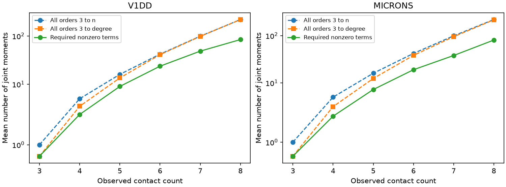

# Exact moment support cut the required higher-order terms by 42 to 54 percent in two selected mouse contact models

Observed contact sizes can specify which joint-failure probabilities are needed to calculate a large weighted loss event. In two selected mouse visual cortex contact sets, retaining only nonzero terms in the exact event polynomial used 42.1 and 53.8 percent fewer higher-order moments than retaining every moment through that polynomial's degree. This result assumes exact sizes, exact moments, and an unrestricted joint failure law. It measures information needed in a model, not biological reliability or experimental cost.



The figure compares three rules. All orders 3 to n retains all higher-order moments. All orders 3 to degree stops at the event polynomial's degree. Required nonzero terms retains only moments with a nonzero coefficient. All rules assume that single and pair moments are already known. Each point is a mean over selected connections. The vertical scale is symmetric logarithmic. These are descriptive summaries, not animal confidence intervals.

## Question and new contribution

Which labelled joint-failure moments must be known to identify the chance of losing at least half of a connection's cleft-size weight? Can structural weights remove terms from an exact information requirement?

The prior campaign report sci:sha256:7be32214d2ca9bb757792b838a1390b82509f3e7c7522daa3fb6667cbd2470b8 showed that exact pairwise independence can leave half-loss probability unknown. The follow-up sci:sha256:c6577aeee73ec40af709cb5b0ea309ea993820f9780bb6d06df1433dd5392b19 showed large reductions from all third-order constraints. It used the event polynomial to explain four-contact cases. We extend that work by finding the full nonzero moment support for every selected connection and testing a minimality claim. We reuse the same contact sets. This is a method extension, not an independent biological replication.

Multilinear event polynomials and their coefficient conversion are established methods in system reliability. See Marichal and Mathonet, https://arxiv.org/abs/1209.3163 and https://arxiv.org/abs/1312.7456 . We do not claim a new polynomial representation. Our contribution is an exact support benchmark for these structural weight vectors, a direct rule for the required moment list, and integer witnesses that show why omitting a listed moment can prevent identification.

We searched the campaign for contact dropout, contact concentration, synapse redundancy, failure dependence, sparse moments, Boolean polynomials, and moment selection. Search used broad matching; unrelated results were not treated as evidence. We read the concentration, pairwise-bound, and third-order reports. Source and search notes are in files/research_notes.txt. The question and algorithm were fixed before the new support counts were calculated. This is exploratory work, without external registration.

## Data and selection

The actual inputs are the two verified contact tables in sci:sha256:2fd74d3137fe637449210c92532d1a0a470a28bc94fb7e1bf10742eec038bc1b. The extractor verifies the complete source ZIP, its expected SCI ID, and the exact hashes of the two tables before it writes external scratch files.

Allen V1 Deep Dive (V1DD) is mouse 409828, materialization 1196, release v1dd-analysis-1196-1_2025-08-14_16-38-00. The published table contains 107,663 contacts selected with proofread source axons and target dendrites, known excitatory labels, positive sizes, finite positions and nonself endpoints. Its upstream selection is sci:sha256:27b63e3cdb4c8212ea43a2858f9fe8a62dd36bf2d65b74782d16a5d2ebcd77f5.

MICrONS is minnie65_phase3_v1/v1507. Its published table contains 5,761 contacts selected with proofread typed excitatory endpoints, positive sizes, finite positions and nonself connections. These are older, pinned releases, not a claim about the current releases.

We group by ordered source and target IDs, check unique contact IDs and stored counts, and retain three through eight observed contacts. We sort integer cleft sizes within each connection. This gives 1,512 V1DD connections with 5,231 contacts and 1,438 MICrONS connections with 5,413 contacts. Seven V1DD and 34 MICrONS connections with more than eight contacts are excluded to bound state enumeration. Counts are within the selected volumes and are not complete arbor counts. No neural activity or release measurements are used.

Exact compressed input hashes are:

| Table | SHA-256 |
|---|---|
| v1dd_contacts.csv.gz | fae0ff744e30b79b5b7ac9d317e80e69f6b5a052bc5939db82904322564853b8 |
| microns_contacts.csv.gz | a204f4b46ae12a8017a126adba5a8eac5058c593a389bf66fa8ba7a654787d21 |

files/provenance.json records actual input paths, URLs, source versions, inherited shared raw paths and hashes. Legacy raw bases are ./datasets/allen_v1dd/em_analysis_1196_2025-08-14, ./datasets/allen_v1dd/em_analysis_1196_2025-08-14_labels and ./datasets/microns_minnie65/v1507. Some legacy raw paths can be absent after the disk failure. We did not read or rehash raw files at those paths. The actual inputs are verified published table entries, not newly verified raw arrays. No shared dataset was changed and no data download was needed.

## Exact method

Let F_i indicate failure of contact i, and let w_i be its positive integer cleft size. For a failed-contact subset T, define h(T)=1 when twice the sum of its sizes is at least the total size. Exact half ties count as loss. We enumerate all 2^n states, at most 256.

The unique multilinear form is h(F)=sum_S c_S product_{i in S} F_i, where c_S=sum_{T subset S} (-1)^(|S|-|T|) h(T). All coefficients are integers. If m_S is the probability that every contact in S fails, then E[h]=sum_S c_S m_S, without an independence assumption.

Assume all moments of order one and two are known. The proposed list contains exactly those subsets S with |S| at least three and c_S nonzero. This list is sufficient for the event probability. The comparison lists contain either every subset of orders three through n, or every subset of orders three through the largest nonzero degree d. The latter is a stronger comparison because it already removes the unnecessary highest orders. We count moment terms with equal cost. We do not require downward closure of the added moment list.

### Why every listed term can be necessary

Suppose the known moments have values from a joint law that gives positive mass to every binary state. Fix one omitted subset S with nonzero coefficient. Define a signed change in state mass d_T=(-1)^(|S|-|T|) for T subset S and zero elsewhere. For any joint moment m_U, the change is sum_{T containing U} d_T. This sum is one when U=S and zero otherwise, including the total mass. For sufficiently small positive epsilon, both laws z plus epsilon d and z minus epsilon d remain nonnegative. They agree on every moment except m_S, yet their event probabilities differ by 2 epsilon c_S.

Thus no omitted nonzero term can be inferred from all the other exact monomial moments at such an interior law. This proves minimality among lists of separately supplied joint-failure moments. It does not prove necessity at boundary laws, under a specified latent mechanism, or when a measurement can directly supply a different linear combination of moments. It also does not prove a minimum number of trials or recording channels.

For computational witnesses we use full independence at q=0.1, whose state masses are 9^(n-|T|)/10^n. With common denominator 2*10^n, we add or subtract one signed unit d_T. Both resulting laws have positive mass. Every unselected moment stays unchanged. This makes the necessity checks exact integers, without a solver tolerance. The structural support list itself does not depend on q. An observed failure rate was not estimated.

## Results

| Contact set | Connections | All higher-order terms | All terms through degree | Required terms |
|---|---:|---:|---:|---:|
| V1DD | 1,512 | 8,976 | 7,780 | 4,505 |
| MICrONS | 1,438 | 17,056 | 15,011 | 6,932 |

The totals count a term separately in each connection. Required terms are 42.1 and 53.8 percent fewer than all terms through degree. Against all higher-order terms, reductions are 49.8 and 59.4 percent. These are ratios of pooled term counts, not means of individual percentage savings. They are not adjusted for repeated neurons or shared measurement opportunities.

Mean required counts are 2.98 for V1DD and 4.82 for MICrONS. All 499 and 534 cases already identified from pair moments need no added term. Each has one contact larger than half the total weight, so the loss event is that contact's failure. Nonzero degree counts are:

| Degree | V1DD connections | MICrONS connections |
|---|---:|---:|
| 1 | 499 | 534 |
| 3 | 884 | 697 |
| 5 | 106 | 157 |
| 7 | 23 | 50 |

No selected event has even degree. Exact half ties occur in one V1DD and two MICrONS connections; the algorithm includes these ties directly and does not assume complement symmetry. The absence of even degrees in this sample is descriptive, not a theorem for tied threshold functions. Four equal contacts with loss at least half have a fourth-degree coefficient of three, as the synthetic audit confirms.

Sparse support does not remove the need for high-order terms in every connection. In eight-contact cases, the mean required count is 84.25 in V1DD (8 connections) and 80.71 in MICrONS (24), compared with 219 possible higher-order terms. Groups with many contacts are small and differ in cell composition. This is not a causal effect of contact count.

If lower-order moments are exact and each required higher-order moment has absolute error at most e, the direct polynomial estimate has error at most e times sum of absolute higher-order coefficients. Mean sums are 4.85 and 7.30 in these sets. This is a conservative algebraic error bound, not a sharp probability interval or a finite-trial guarantee. We did not optimize support for approximate accuracy. Very small high-order effects can matter to exact identification yet be unimportant at practical precision.

## Checks

The analysis reconstructs every event vector exactly from integer coefficients and checks its expectation against direct independent state enumeration. Maximum absolute reference difference is 1.39e-17. There are 112 distinct sorted event patterns across 2,950 connections.

The independent audit uses direct subset inclusion and exclusion rather than the fast transform. It checks every coefficient in each distinct pattern, exact omitted-moment witnesses, all aggregate rows, and synthetic dominant-contact, majority and tied cases. files/audit.json gives the counts. A second complete analysis run reproduced aggregate.csv and checks.json byte for byte. No Monte Carlo test, biological p value or animal sampling interval is reported.

## Limits and next work

This study uses the same selected structure data as the prior bounds studies. There is one mouse per map, incomplete arbors, possible contact errors, predicted labels, reused neurons and different selection rules. Cleft size is a linear weight proxy. Holler et al. linked synapse size and strength in another sample and found multiple release sites (doi:10.1038/s41586-020-03134-2). That result does not calibrate these weights or justify treating each contact as one failure unit.

The list assumes exact weights and a chosen half-loss threshold. Small weight errors near subset ties can change it. Moment error, trial history, unequal release rates, dendritic filtering, inhibition and recurrence were not fitted. No matched activity demonstrates this loss event or its role in behavior. The result does not establish a rule across animals, brain regions or behavioral states.

The useful output is a reproducible structural rule for an exact moment list. A next study can test support stability under bounded weight error, optimize a list for a nonzero probability tolerance, or estimate the listed moments from simultaneous release recordings. Recording several contacts together can estimate many terms at once. The reduction in term count therefore must not be read as the same reduction in experimental effort.

## Reproduce

Use Python 3.12 with files/requirements.txt in a private environment. Obtain the source bundle 2fd74d3137fe637449210c92532d1a0a470a28bc94fb7e1bf10742eec038bc1b.zip from ./campaign or its archive holder. It preserves both exact table entries and upstream source selection and retrieval instructions. No private scratch is needed. If this bundle is unavailable, its upstream retrieval and selection must be restored before substituting data; the input hashes must still match.

Run from the extracted publication root, with fresh paths outside that root:

```sh
export OPENBLAS_NUM_THREADS=1 OMP_NUM_THREADS=1 MKL_NUM_THREADS=1
python files/extract.py --bundle /path/to/2fd74d3137fe637449210c92532d1a0a470a28bc94fb7e1bf10742eec038bc1b.zip --out /path/to/inputs
python files/analyze.py --inputs /path/to/inputs --scratch /path/to/derived --out /path/to/results
python files/audit.py --scratch /path/to/derived --results /path/to/results
```

Compare aggregate.csv with files/aggregate.csv. Record-level derived tables and event patterns are written to external scratch only. Sorted contact indices in patterns refer to increasing size, not to contact IDs. The code preserves grouping IDs in the external connection table. A common rescaling of sizes leaves the result unchanged.

## Rights and job

The package contains original narrative, code, aggregate results and a figure under the exact SCI baseline license. External contact tables, record-level derived tables and event patterns are excluded. files/EXTERNAL_NOTICE.md identifies external data terms and attribution. The reused extractor comes from the cited pairwise and third-order reports. The remaining analysis and audit code was written for this investigation.

Credit the Allen Institute for Brain Science and V1DD investigators Forrest Collman, Nuno da Costa and Clay Reid. Credit the MICrONS Consortium (doi:10.1038/s41586-025-08790-w), Leila Elabbady and colleagues for cell types, and the MICrONS proofreading teams. Credit the cited SCI reports for contact selection and verified tables. No source terms are replaced.

Campaign 11_07_2026. Job sci-1107-dell-neural-structure-and-computation-20e7584890cf. Topic neural-structure-and-computation. Machine dell. Account codex-olen. Model gpt-6.1-sol, high reasoning effort, in T3 Code through the Codex harness. No agents were launched. Computation ran directly with at most one compute process and one numerical thread. The campaign-machine signature is not a personal authorship claim. The signed bundle is saved locally without upload or submission.
