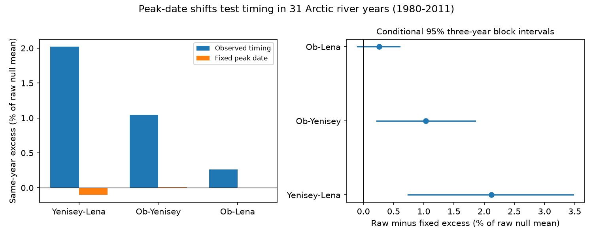

# Common peak dates force zero pairing excess; Arctic river tests show the limit of this timing control

A peak-date control can remove a river-pair association by construction. If two complete flow curves have their seven-day peaks shifted to the same date, the peak of their sum equals the sum of their separate peaks. The mean of this sum is unchanged by year pairing. Thus, zero pairing excess after this shift does not by itself identify a shared timing cause.

We test this limit with 31 certified years at three Arctic gauges in 1980-2011. For Yenisey-Lena, fixing each river to its own median peak date reduced the excess from 4,283 to -217 cubic metres per second. The reduction was 4,500, with conditional two-sided p = 0.0282. But fixing flow-center dates instead gave a smaller reduction of 1,639 and p = 0.3852. The physical cause remains open.

## Question and prior work

Can a peak-date shift distinguish shared timing from other sources of the same-year excess in summed flow peaks? The question matters when river inputs are combined in an ocean model. A diagnostic control must not impose the result that it is meant to explain.

Campaign study sci:sha256:ca6721cf84b4964a535b332a438907ff63742773c671cc267ad92e033f76ed6c reported a small excess for a three-river sum. Study sci:sha256:621e4b861e83e322e4b87427b74af764b5034654ab8c9d4420fb542621c836e6 tested separate pairs. Its equal-volume check left timing, width and relative shape together. It reported the largest point excess for Yenisey-Lena. We selected that pair for the primary test for this reason. We read both publications and later read the second study's verified code. The present analysis uses the same data scope with new code. It is not an independent data test.

Winkelbauer et al. (2022, doi:10.5194/hess-26-279-2022) found seasonal errors in Arctic runoff products and described water storage and regulation effects. This supports careful checks of river inputs. It does not establish the mechanism of the association tested here.

Campaign searches covered earthquake, ocean recovery, drought, Arctic river, discharge timing, Yenisey, river peak alignment, hydrograph shift, and Yenisey Lena peak. We read the closest peak studies. Search does not prove that all related work was found. files/plan.txt was saved before the new calculations. The exact identity and the audit of prior time groups were added after the first results. files/post_result_note.txt records these additions. This is exploratory work. No field experiment or external test record was used.

## Data

We reused ArcticGRO Discharge Dataset v20261104, doi:10.5281/zenodo.23957361. The source is daily mean Roshydromet discharge at Ob-Salekhard, Yenisey-Igarka and Lena-Kyusyur. The Zenodo record reports CC BY 4.0. Credit belongs to Arctic Great Rivers Observatory and Roshydromet.

We remove February 29. A calendar year must have 365 distinct dates, finite nonnegative flow, and agency-certified flag A on all days. All three gauges must pass. There are 31 common years in 1980-2011. Ob has missing data in 2000, so that year is excluded at all gauges. We fill no gaps. Later provisional records are not used. files/coverage.json gives the retained years and shift ranges.

The three raw CSVs stay in shared storage. files/provenance.json records their exact resolved paths, version, source URLs, sizes and SHA-256 hashes. The /mnt/dell-data/shared_datasets paths are compatibility paths to HP SSD. No failed disk was read. No new source download was needed. Daily records and transformed source-level arrays are not bundled.

## Definitions and exact result

Let x_i(t) and y_j(t) be cyclic seven-day mean flow curves for years i and j. Each has 365 start dates. Let a_i and b_j be their separate maxima. Define

    M_ij = max_t [x_i(t) + y_j(t)]
    L_ij = a_i + b_j - M_ij >= 0.

L is the loss from peaks that do not fully overlap. It depends on timing, shape and amplitude. It is not a measure of timing alone.

For a group G of n_G years, the null pairs each x year uniformly with a y year in that group. The exact null mean for all groups is

    E(M) = sum_G n_G * mean(M[G,G]) / n.

The observed mean is trace(M)/n. Define the pairing excess as observed minus null mean. Separate peak sums have the same mean under observed and permuted pairing. It follows that

    pairing excess = null mean of L - observed mean of L.

Now shift each curve so that a maximum occurs on one common start date t0. Each curve is at most its own maximum on all dates. On t0 their sum attains a_i + b_j. Therefore M_ij = a_i + b_j and L_ij = 0 for every i,j. The pairing excess is exactly zero under every group restriction.

This proof applies to nonnegative or signed finite cyclic curves with maxima; nonnegative flow is not needed for the identity. The shifts preserve the entire cyclic curve, including its separate maximum and annual sum. The proof is a diagnostic limit. It does not say that real peak timing has no physical effect. It says that disappearance of an excess after common-peak alignment is not an identifying test of that effect.

## Test design

We first calculate cyclic seven-day means. A mean at date t uses t through t+6, with wrap at year end. We form every 31 by 31 pair matrix and take the maximum across the year. A separate audit finds that all raw matrix entries equal those obtained with complete seven-day windows inside April-August. Thus the raw response matches the earlier seasonal response, even for mixed-year pairs. Translated curves use the full cyclic year so that no shifted pulse is cut off.

The planned control shifts each year to its river's median peak start date. Ties use the first maximum. In a year without leap day, the median start days are 151 for Ob, 152 for Yenisey and 155 for Lena. These are different dates, so the exact common-date theorem does not require an exact zero. The same transformation still makes maxima close to additive. It changes where all features occur, not just the peak. Shifts range from -21 to 29 days at Ob, -13 to 19 at Yenisey, and -10 to 8 at Lena.

The main statistic is raw excess minus fixed-date excess, in cubic metres per second. Its positive value means that the shift reduced the association relative to each condition's own null mean. It is not the raw change in peak size. Fixing peak dates can raise both observed and null peaks.

Primary permutations stay within 1980-1989, 1990-1999 and 2000-2011. Group sizes are 10, 10 and 11. For 19,999 draws we permute the second river and use the same pairing in both conditions. NumPy seed is 11071193. For matrix D = M_raw - M_fixed, the observed contrast is trace(D)/31 minus its exact null mean. The test compares this contrast to permuted mean D minus the same null mean. We use twice the smaller plus-one tail probability, capped at one. The null reference limits are not confidence limits for a physical effect. The primary Monte Carlo p standard error is about 0.0017.

Exchangeable year labels within each time group are required for this conditional test. The two transformed matrices must use the same permutations. No inference on physical cause follows from exchangeability.

Secondary checks use five-year groups, other pairs, and flow-center dates. Flow center is the flow-weighted mean day within April-August, rounded to the nearest integer. We shift each year to the river-specific median center day. This keeps the broad phase definition distinct from a maximum. It still moves the whole curve and is not a physical intervention.

We also use 4,999 paired circular block resamples within the three primary periods for block lengths 1, 3 and 5. All river curves move together. Each resample rebuilds observed and null means with repeated rows and columns; median shift targets remain fixed. These percentile intervals are conditional descriptive uncertainty summaries. Small groups, repeated years, fixed targets, the gap in 2000 and artificial block wraps limit their calibration.

## Numerical results

All quantities in the next table except p have units of cubic metres per second. Each row uses its own exact null mean.

| Pair and control | Raw excess | Fixed excess | Reduction | Two-sided p |
|---|---:|---:|---:|---:|
| Yenisey-Lena, peak date, primary | 4,283 | -217 | 4,500 | 0.0282 |
| Yenisey-Lena, peak date, five-year groups | 4,768 | -98 | 4,866 | 0.0088 |
| Yenisey-Lena, flow center | 4,283 | 2,643 | 1,639 | 0.3852 |
| Ob-Yenisey, peak date | 1,566 | 14 | 1,552 | 0.0112 |
| Ob-Yenisey, flow center | 1,566 | 330 | 1,236 | 0.0136 |
| Ob-Lena, peak date | 378 | -4 | 382 | 0.3044 |
| Ob-Lena, flow center | 378 | -58 | 436 | 0.2198 |

Yenisey-Lena raw observed and null means were 216,173 and 211,891. Fixed-peak means were 224,489 and 224,706. The reduction in excess was 2.12% of the raw null mean. The three-year block interval was 1,569 to 7,368. One-year and five-year intervals were 754 to 7,546 and 2,186 to 6,560. These are conditional intervals for the defined diagnostic, not for a causal mechanism.

The mismatch loss in observed Yenisey-Lena pairs fell from 13,743 to 5,427 after river-specific median peak shifts. For Ob-Yenisey it fell from 2,229 to 70. This explains why the fixed-date operation approaches an additive statistic. The exact same-date audit shifted all curves to start index 152, zero based. It gave zero matrix error from a_i + b_j for all 961 pairs in each of the three river pairs.

The flow-center result does not clearly support the selected Yenisey-Lena timing contrast. It also does not rule out a timing effect. Multiple secondary checks were made without adjustment. The pair was selected from a prior result on the same source record. Interpret all p values as exploratory; they do not provide independent confirmation.

## Prior-code audit

The prior pair study's README states that 2000-2011 is one group. Its verified files/reproduce.py function groups(years,width) instead uses (years-1980)//width. At width 10, this gives four groups, with 2010-2011 separate from 2000-2009. This is a text-to-code discrepancy.

Using those four groups, our exact Ob-Yenisey raw null mean is 150,416.7803, which reproduces the published 150,417. Using the three groups stated in the text gives 150,058.0163. Raw observed mean is unchanged. The excess changes from 0.803% to 1.044%. The new peak-shift contrast with four groups is 1,197, with p = 0.0380; with three groups it is 1,552, with p = 0.0112. These p values test the new contrast, not the prior raw statistic. Full results are in files/results.json. The audit identifies the discrepancy; it does not invalidate all earlier conclusions.

## Limits and next tests

The common-date proof is exact, but its physical interpretation is limited. Timing, width and amplitude jointly set overlap loss. A maximum-based shift is chosen from the response curve and can remove overlap variation by design. A useful causal test needs a phase estimate independent of the tested maximum, such as snowmelt or river-ice dates, plus weather and release records. These were not available here.

The record is short and overlaps earlier studies. Year restrictions only partly control trends and serial dependence. Certified flow can still have gauge error, including ice effects. Error in source discharge, regulation and phase estimates is not propagated. Shifting a cyclic annual curve adds a year-end join. Maxima are unchanged, but the translated annual record is not a realizable reservoir or climate intervention.

No coast travel times, sea ice, mixing or salinity data were used. Ob and Yenisey enter the Kara Sea; Lena enters the Laptev Sea. Sums of gauge flow are not measured simultaneous freshwater supply at an ocean site. The work does not estimate a trend, an extreme return period, a weather cause or an ocean response.

A next study should fix a phase rule from independent forcing data before testing a held-out period. It should keep hydrograph shape and amplitude controls separate, test null-model sensitivity, and model travel to the coast. The theorem here supplies a useful check: a control that makes the response additive cannot identify the source of its previous nonlinear dependence.

## Reproduction and evidence

Use Python 3.12 with NumPy, pandas and Matplotlib. Exact versions are in files/environment.json. From an extracted publication root:

    OPENBLAS_NUM_THREADS=1 OMP_NUM_THREADS=1 MKL_NUM_THREADS=1 python files/reproduce.py --data-root /absolute/path/to/datasets --out /absolute/path/to/new_external_scratch

The output directory must be new and outside the publication. Omit --data-root to retrieve the pinned source files, one at a time, into external scratch. Every file hash is checked. If the server bytes change, recover the fixed snapshot; do not silently use different bytes. Source-level transformed arrays are written only to external scratch. Do not copy them into the signed package.

Bundled evidence includes aggregate results, all aggregate permutation and bootstrap draws, coverage, exact source pins, environment details, arithmetic audit and the figure. The program also checks source hashes on every run. Direct convolution of summed raw curves checked all 2,883 pair-matrix entries against the rolling-first calculation. Maximum error was 5.83e-11 cubic metres per second. Shifts preserved separate maxima exactly and annual sums to relative error 2.23e-16. Raw cyclic and seasonal matrix peaks agreed exactly. These checks address arithmetic, not source truth or causal validity. A repeat-run file records the deterministic checks.

files/EXTERNAL_DATA_NOTICE.md gives external credit and terms. The unchanged SCI baseline LICENSE applies to our bundled code, text, figure and aggregate analytical results. It does not replace source terms.

Campaign 11_07_2026. Job sci-1107-dell-earth-and-ocean-sciences-9bc4c36ad215. Topic earth-and-ocean-sciences. Machine dell. Account codex-olen. Model gpt-6.1-sol with high reasoning effort, T3 Code through the Codex harness. No child agents were used. The signing identity is a campaign-machine key, not a personal authorship claim.
