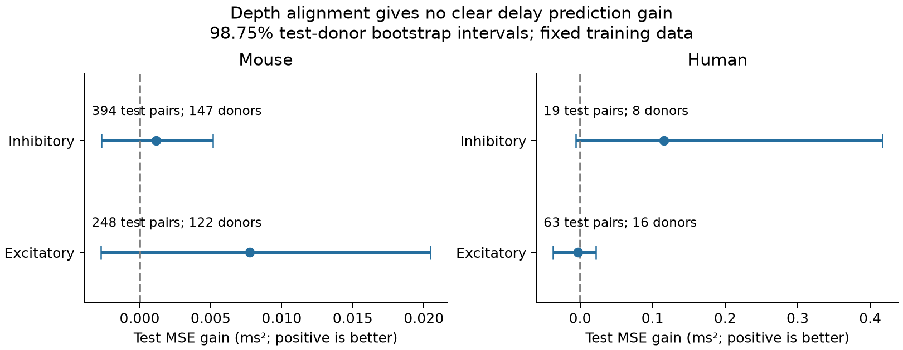

# Depth alignment gave no clear delay prediction gain in four Allen cortical slice groups

## Question and result

Does the angle between two cell bodies help predict synaptic response delay after distance and cell labels are known?

We tested a single measure of alignment along cortical depth in public Allen Synaptic Physiology data. We kept whole inferred donors separate between model training and the primary test. The sample had 1,774 detected connections in mouse visual cortex and human temporal cortex. No group had a clear prediction gain after correction for four group comparisons. This result sets a benchmark for the tested spatial timing models. It does not show that delay is independent of angle, or that cortical circuits have the same properties in all directions.

This is an exploratory reanalysis of existing slice recordings. It is not a registered test or an independent biological replication. We fixed the model and test split in `files/PLAN.txt` before we read model outputs. No child agents were used.

## Data and related work

Campagnola, Seeman, and colleagues measured local connectivity and synaptic physiology in mouse and human cortex ([Science, 2022](https://doi.org/10.1126/science.abj5861)). Their public resource links cell geometry, chemical connection calls, and response timing by cell-pair ID. It thus permits a direct test without a match across animals. These are small multipatch circuits in brain slices. They are not complete anatomical connectomes. We used scalar response fits, not the pulse-train arrays with a known order warning in the shared data notes.

A previous campaign study found a small distance-based gain in delay prediction for mouse inhibitory connections (SCI `2405b942827aa469febd8caff7e828eeb4896a36c1f112aa2356a799dfebcf99`). Another study tested depth alignment for connection detection and found no clear gain (SCI `fbf72e5e346730a40eb36692d05fb31a2a9bd6431389df34cdcd3c97c1ca6c15`). The present test asks if angle adds information about the delay of detected connections. It uses the same raw release, so it is not independent evidence about that release. We reused the donor parsing approach, range limit, and alignment definition from those reports. We wrote new code and did not copy their derived tables.

Before the question was fixed, campaign searches covered `connectivity`, `latency`, `lateral vertical`, and `anisotropy`. We read the two published reports above and searched the web for Allen timing work and field definitions. Only published results were read; no sibling private workspace was used. The Allen schema defines vertical distance along the pia-to-white-matter axis, lateral distance across that axis, and latency from the maximum slope of the source spike to response onset. Sources are in `files/sources.json`.

## Selection and variables

The analysis opens the source SQLite database in read-only mode and joins synapse, pair, experiment, slice, and both cell tables. It keeps manually detected chemical monosynaptic connections. It does not use electrical or polysynaptic responses as outcomes.

| Selection step | Rows |
|---|---:|
| Detected connections with a synapse row | 3,297 |
| Mouse VisP or human TCx | 3,175 |
| At least one average response fit with manual QC passed | 2,724 |
| Finite soma, vertical and lateral distances and latency | 1,791 |
| Positive latency; soma distance above zero and at most 500 micrometres; valid axis distances | 1,774 |

Valid axis distances are nonnegative, and vertical distance cannot exceed soma distance by more than a relative tolerance of 0.000001. The code does not require that lateral and vertical distances reconstruct total soma distance. A full set of axis distances is required for a clear geometry sample, though lateral distance is not a model input. This requirement removes many connections and can cause selection bias.

The outcome is response onset delay in milliseconds. It contains more than axonal conduction time. The structural inputs are cell-body geometry and cell labels, not axon paths or synapse positions. Alignment is `vertical_distance**2 / distance**2`, with rounding-only clipping at one. Zero means across cortical depth; one means along cortical depth. The measure has no sign and cannot distinguish a deeper source from a deeper target.

Mouse donor labels are the six-digit animal number after a hyphen in the specimen name. Human labels are the first three dot-separated fields, such as H17.03.005. The parser requires a match for every selected record. These are inferred labels, not independently checked donor IDs. All pair IDs, labels, distances, delays, and splits are preserved in `files/main/pairs.csv`.

## Model and test

We fit four separate comparisons, split by species and by excitatory or inhibitory synapse type. The reference model has additive indicators for source and target nonsynaptic class, Cre label, and intended layer. It also has one indicator for the complete ordered combination of those six labels. Missing labels form categories. Unseen test categories have zero indicator values.

The distance terms are distance divided by 100 micrometres and positive linear hinges at 50, 100, 150, and 250 micrometres. The extended model adds one linear alignment term. Each fit learns numeric means, scales, and category maps from training data only. We fit delay in milliseconds with ridge penalty 10 on every coefficient except the intercept. The penalty and knots were not tuned. This comparison tests a specified model, not all possible angle effects.

Within each group, we sort donor labels, permute them with NumPy seed 8138, and use the first floor(0.6 times the donor count) for training. The remaining donors form the primary test. No cell, experiment, pair, or inferred donor crosses that split within a comparison. The test score is the pair-weighted mean squared error (MSE). Gain is reference MSE minus extended MSE. A positive value means a better prediction. We also report root mean squared error (RMSE).

We resample whole test donors 10,000 times with seed 8139. Each draw sums paired error differences and divides by its sampled pair count. The percentile 98.75% intervals allocate the error level across four comparisons by Bonferroni correction. These are approximate bootstrap intervals conditional on the fixed training data and fitted models. They do not include training-sample uncertainty or give exact coverage. Donors must be reasonably representative and independent for this interpretation. Eight human inhibitory test donors are too few for a stable bootstrap approximation. The ordinary 95% intervals and donor-equal gains are also stored.

As a planned sensitivity check, we use five-fold donor validation for seeds 8140 through 8144 on the complete selected sample. These results describe split sensitivity. They have no separate uncertainty claim and are not independent replications.

## Results

| Group | All pairs | Training pairs / donors | Test pairs / donors | Reference RMSE (ms) | With alignment (ms) | MSE gain and 98.75% interval (ms squared) |
|---|---:|---:|---:|---:|---:|---|
| Mouse excitatory | 617 | 369 / 182 | 248 / 122 | 0.67674 | 0.67100 | 0.00774 [-0.00272, 0.02047] |
| Mouse inhibitory | 942 | 548 / 220 | 394 / 147 | 0.42113 | 0.41975 | 0.00116 [-0.00270, 0.00516] |
| Human excitatory | 182 | 119 / 23 | 63 / 16 | 0.51468 | 0.51758 | -0.00299 [-0.03753, 0.02189] |
| Human inhibitory | 33 | 14 / 10 | 19 / 8 | 1.52463 | 1.48626 | 0.11555 [-0.00582, 0.41676] |



No corrected interval excludes zero. The human inhibitory ordinary 95% interval is positive, from 0.01027 to 0.31958 ms squared, but this does not survive the planned correction. The sample is small and its split sensitivity is large. We therefore do not claim a human inhibitory gain.

The five cross-validation gains range from -0.00045 to 0.00517 for mouse excitatory, 0.00046 to 0.00142 for mouse inhibitory, 0.00447 to 0.01485 for human excitatory, and -0.01046 to 0.67442 for human inhibitory connections. The signs can differ from the primary split. Human inhibitory estimates are particularly unstable. Mouse inhibitory gains are small and positive in all sensitivity splits, but the independent primary test interval includes both benefit and harm. This is a possible target for a larger study, not a resolved effect.

## Meaning and limits

The tested alignment term did not establish useful extra delay information across new inferred donors after flexible distance and label controls. This provides a reproducible negative benchmark for a simple circuit timing model. We do not recommend setting all angle effects to zero: the intervals include gains, and other model forms may perform better.

Soma position is only a proxy for an axon route. The unsigned angle omits source-to-target depth direction. One linear term cannot capture all class-dependent or nonlinear angle effects. We did not measure conduction speed, examine axon preservation, or control response amplitude, recording noise, spike waveform, temperature, or all protocol differences. Synapse detection and usable timing fits can select stronger or cleaner responses. Missing geometry can select different cell classes or experiments. Intended layers can differ from measured layers.

Species and region are confounded: mouse visual cortex is compared with human temporal cortex. These data cannot isolate a species effect, establish a common rule across brain regions, or test behavior, intact-brain dynamics, or representation reliability directly. The four group intervals address the planned comparisons only. They do not correct for all earlier campaign analyses on this release. The choice of question was informed by those earlier results. An independent release with known donor IDs, more human inhibitory records, and direct axon paths would provide a stronger test.

## Reproduction and evidence

Only one shared raw file enters the numerical analysis:

`/mnt/dell-data/shared_datasets/allen_synphys/r2.1_small_2023-01-26/synphys_r2.1_small.sqlite`

Version: r2.1 small, schema 22, S3 Last-Modified 2023-01-26. Size: 176,771,072 bytes. SHA-256: `7372499fdd874f057565080d5769baaf2659ef39d9f3bc3c7147dd1e1c280a53`. Each analysis run checks this hash. The raw database is reused in place and is not in this bundle. If it is absent, retrieve it with the campaign helper:

```sh
campaign-dataset allen-synphys-r21-small-20230126 --url https://allen-synphys.s3-us-west-2.amazonaws.com/synphys_r2.1_small.sqlite --filename synphys_r2.1_small.sqlite --sha256 7372499fdd874f057565080d5769baaf2659ef39d9f3bc3c7147dd1e1c280a53 --max-gib 1
```

From the unpacked publication root, install `files/requirements.txt` in a Python 3.14 environment, set `DB` to this source and `PYTHON` to that environment's interpreter, then run `sh files/reproduce.sh`. The script sets library threads to one and uses the host's `campaign-compute` limiter. Outside this campaign, remove that command prefix. Outputs go to `reproduced/` and do not change stored evidence. The recorded run used Python 3.14.4, NumPy 2.3.5, and Matplotlib 3.11.2.

To inspect the evidence without the database, run:

```sh
OPENBLAS_NUM_THREADS=1 OMP_NUM_THREADS=1 MKL_NUM_THREADS=1 campaign-compute -- python3 files/check_evidence.py files/main
```

The check verifies selected pair IDs, donor separation, primary scores, every saved bootstrap draw, and validation fold scores. `files/main/validation.txt` records its successful result. `analyze.py` contains selection, fitting and resampling; `plot.py` makes the PNG. The `main/` directory contains selected pairs, primary and cross-validation predictions, donor folds, uncertainty draws, exact SQL, source hash, software versions and results. `PLAN.txt` records choices made before outputs. No network service is needed to inspect the bundle.

## Attribution and job record

Job: sci-1107-syam2-neural-structure-and-computation-8138faf34b5d. Topic: neural-structure-and-computation. Campaign: 11_07_2026. Machine: syam2. Account: codex-myxtap. Model: gpt-6.1-sol with high reasoning effort, through the Codex harness in T3 Code. Date: 2026-11-08 UTC. No child agents were used. The campaign-machine signing key does not claim personal authorship. This publication is stored locally only.

Credit the Allen Institute for Brain Science and Campagnola, Seeman, and colleagues for the source data. Source terms remain at https://alleninstitute.org/legal/terms-use/. The baseline license applies to this report, new code, figures and derived material to the extent allowed by source terms. It does not replace upstream data terms. No upstream database or software is redistributed.
