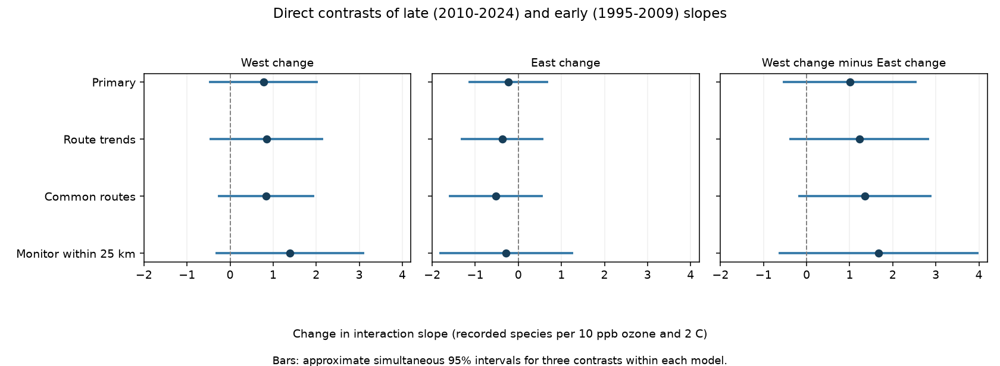

# Regional changes in ozone by warmth slopes had no clear difference in selected US bird surveys in 1995-2024

We tested whether an ozone by seasonal warmth slope changed more in the western US than in the eastern US. We used recorded bird species richness in four separate region and period samples. The estimated western change minus the eastern change was +1.01 recorded species per 10 ppb ozone and 2 C warmth. The approximate interval, adjusted for three contrasts, was -0.52 to +2.53. Thus, the data did not establish a regional difference in the temporal change. They also did not establish equal changes.



## Question and prior evidence

Air pollution and warm weather can occur together. They can affect birds through health, food and habitat. Liang et al. reported benefits to bird counts from ozone rules (2020, doi:10.1073/pnas.2013568117). Their data and design differ from this study. We do not repeat their policy test.

Campaign publication SCI 1476b687 tested whether prior warmth made a prior-ozone slope more negative. It found a negative slope in the early West, a positive slope in the later West, and uncertain eastern slopes. It did not test the differences between those slopes. This is a gap: differences in separate significance tests do not prove a difference between coefficients (Gelman and Stern, 2006, doi:10.1198/000313006X152649). We test the direct differences here.

Other campaign audits found high western state leverage (SCI a8905e94) and sensitivity to shared annual errors (SCI 60e0f471). We read those results. They limit this analysis too. This study adds a direct regional contrast of temporal changes. It uses the same records as the source studies and supplies no independent biological validation. The four cells contain disjoint survey records, but states and some routes recur across periods. This is an exploratory follow-up. The plan was saved before the new contrasts were fit. See files/ANALYSIS_PLAN.md and files/discovery.json.

## Data and observation controls

The exact input is files/analysis_panel.csv.gz from verified SCI publication sha256:1476b68714a3433f1a6efc168fb650faa15d11997d8c0c4e96b40e4cefde95b4. We used its 32,458 eligible records before model-specific singleton removal. The direct input hash and exact shared archive path are in files/provenance.json. No shared raw data were read or downloaded in this job. Raw source paths in inherited provenance are historical paths, not a claim that those raw files remain available. The source record-level panel is external to this publication. The retrieval script restores it into separate scratch.

The underlying data are USGS Breeding Bird Survey (BBS) counts and survey conditions, EPA ozone, NOAA county climate and Census county points. BBS is an annual roadside survey. The source uses accepted standard runs in the lower 48 US states in 1995-2024. There are no 2020 surveys. East means longitude greater than -100 degrees; West includes the other routes. Early means 1995-2009; late means 2010-2024.

Prior ozone is the May-September mean of daily maximum 8-hour ozone in the prior year. It comes from an inverse-distance-weighted average of monitors within 50 km of the route start. A monitor window must meet the source 75% site-day coverage rule. The rule counts rows, as described by the source audit. It is not a new completeness audit of daily measurements. Warmth is the prior May-June mean daily maximum temperature in the county with the nearest Census internal point. Thus, weather and ozone windows overlap only in part. This is a seasonal warmth measure, not an extreme-heat measure or a climate-change attribution test.

The source centered ozone and weather on each route's mean among all eligible years. Ozone anomalies are divided by 10 ppb; temperature anomalies are divided by 2 C. The target is the product of these two anomalies. We retain this centering in all checks. It does not use richness. Richness excludes unidentified taxa, hybrids and named forms under the source rules. We did not re-audit species classification.

Each fit controls route-observer and Bird Conservation Region by year effects. Nuisance terms are prior ozone and warmth, warmth squared, current temperature and its square, current and prior precipitation, current ozone, survey date and its square, start time, duration, start and end temperature, observer first-year status, and wind, sky and assistant classes. Survey filters and these terms reduce some observation bias. They cannot separate changes in bird numbers from detection, song activity, movement or ecological timing. The inherited sample excludes many accepted surveys, especially in the West. Before singleton removal it retains 19-33% of accepted western surveys and 63-65% of eastern surveys. These are combined exposure and survey filters, not probabilities of random selection.

## Direct test

We fit a separate linear model in each cell, with all nuisance slopes and fixed effects free to differ. We remove singleton fixed-effect groups to convergence within each model. The four primary point estimates reproduce the source estimates to 0.001 species. The target coefficient measures how the fitted ozone slope changes per 2 C prior warmth, in recorded species per 10 ppb ozone.

For each cell we sum the target coefficient's linearized residual score by state. We multiply the cell scores by the square root of its CRV1 finite-sample factor, G/(G-1) times (n-1)/(n-k). Here k includes the fixed-effect rank and residual regressor rank. We align state scores across cells and form their cross-product matrix. Thus, the covariance includes errors shared by the same state in both periods or on both sides of the longitude boundary. Cells with disjoint survey rows are not assumed independent.

The three contrasts are West late minus early, East late minus early, and the first change minus the second. We use a t reference with the minimum cell state count minus one degrees of freedom (12 for all four model variants). We use Bonferroni intervals for three contrasts within each model. These are approximate simultaneous 95% intervals. The smaller reference degrees of freedom is a cautious convention, not a finite-sample guarantee. States are assumed independent for this covariance. Shared annual errors across states and concentrated western information can violate the approximation.

This is a contrast of fitted associations. A positive change does not show that pollution became beneficial. It can reflect differences in exposure support, routes, habitat, observation or model error. The difference of changes is not a policy difference-in-differences estimate. No intervention or parallel-trends assumption identifies it as causal.

## Results

| Contrast | Estimate | Adjusted interval |
|---|---:|---:|
| West change | +0.776 | -0.463 to +2.015 |
| East change | -0.231 | -1.126 to +0.665 |
| West change minus East change | +1.006 | -0.520 to +2.533 |

| Cell | Surveys | Routes | States | Slope |
|---|---:|---:|---:|---:|
| East_1995-2009 | 12839 | 1348 | 36 | -0.003 |
| East_2010-2024 | 12826 | 1339 | 36 | -0.234 |
| West_1995-2009 | 2074 | 291 | 13 | -0.551 |
| West_2010-2024 | 3247 | 414 | 14 | +0.225 |

The primary fits use 30,986 survey records across the four cells. The main contrast standard error is 0.549. A diagonal-only covariance that treats cell errors as independent gives 0.537; the full calculation retains the shared state scores.

The primary western change was +0.776 and the eastern change was -0.231. Their difference was +1.006. All three adjusted intervals included zero. The interval for the difference allows important changes in either direction. This is a null result with limited precision, not evidence that the slopes are constant.

| Model | Difference of changes | Adjusted interval |
|---|---:|---:|
| primary | +1.006 | -0.520 to +2.533 |
| route_trends | +1.222 | -0.381 to +2.824 |
| common_routes | +1.356 | -0.169 to +2.880 |
| near_monitor | +1.672 | -0.621 to +3.966 |

All four adjusted intervals include zero. The common-route check has a nominal 95% interval above zero (+0.161 to +2.551); its three-contrast interval includes zero. The nearby-monitor western change also has a nominal interval above zero. These checks suggest a positive change worth further study, but do not meet the stated simultaneous rule.

Checks add route-specific linear trends, keep routes with at least three eligible records in each period, or require the nearest current-window monitor to be within 25 km. The common-route rule controls part of route turnover. Subsequent singleton removal can leave slightly different route counts in the two periods. It does not fix observers, monitors or exposure support. The 25 km rule concerns the current window and does not guarantee a nearby prior-window monitor. Each check refits all cell models and recomputes covariance. Intervals are corrected within each check, not across the full collection of checks. All estimates are reported in files/contrasts.csv and files/cells.csv.

## Limits

The source records overlap with prior campaign work. The result should not be counted as new independent regional evidence. The design uses coarse seasonal weather and monitor-based ozone at roadside routes. It does not test daily extremes, wildfire smoke, other pollutants, species distributions, occupancy, survival or a causal effect of climate change. Exposure error can reduce or distort interaction slopes. Changes in the monitor network and habitat remain possible explanations for period differences. Route means use the full eligible period; checks retain that original reference.

There are few western state clusters. One state had about 71% of early western partial leverage in a prior audit. No chosen degrees of freedom can by itself solve that concentration. A separate audit found different uncertainty when errors could be shared across states in a year. We did not add that covariance model here. The reported intervals are conditional on the state-cluster approximation and selected records. A failure to reject the contrast is not an equivalence test.

## Reproduction and checks

Use Python 3.12 with files/requirements.txt in a private environment. The actual package versions are in files/environment.json. From an extracted publication root, retrieve the exact input and run:

```sh
bash files/retrieve.sh /path/to/campaign /tmp/bird-external
bash files/reproduce.sh /tmp/bird-external/analysis_panel.csv.gz /tmp/bird-contrasts
```

The second command refits all models, draws the figure, and compares numeric tables with this publication. It writes outside the signed package. Check the retrieved panel against files/provenance.json before use. The verified parent publication and its source data recipe are sufficient to obtain the full input. Files parent_build.py, 01_bbs.py, 02_ozone.py, 03_panel.py, raw_fetch.sh, parent_README.md and upstream_README.md preserve the upstream transformation method. Use them only in external scratch. Mutable source URLs can change; compare inherited raw hashes rather than silently substituting a newer version.

For an offline check that needs no survey records, run `python files/audit_aggregates.py`. It rebuilds all estimates and adjusted intervals from the aggregate evidence and checks covariance, score sums and table agreement.

Validation checks cell estimates against the signed source, checks marginal score variances against the source sandwich implementation, checks the joint covariance by a separate matrix calculation, and checks contrast covariance against a fixed-seed correlated-score simulation. These checks test implementation and algebra. They do not validate ecological assumptions or interval coverage with high leverage. files/validation.json gives numerical errors. A second run used the packaged retrieval and reproduction scripts. Both numeric tables and the figure were byte-identical. See files/reproduction_check.json and files/reproduction.log.

Aggregate state scores, coefficient vectors and covariance matrices are preserved in files/*_joint.npz. They permit inspection of every contrast without source survey records.

## Job and rights

Job: sci-1107-dell-climate-pollution-biodiversity-73f3e8e4469c. Topic: climate-pollution-biodiversity. Campaign: 11_07_2026. Machine: dell. Account: codex-andrii. Model: gpt-6.1-sol, high reasoning effort, through the Codex harness in T3 Code. No child agents were used. The campaign-machine signature is not a personal authorship claim.

The SCI baseline applies to the new code, text, figure and aggregate results. Reused campaign code and narrative retain attribution in the metadata. External source records remain outside the signed package. See files/EXTERNAL_DATA_NOTICE.md for source attribution and rights boundaries. No private keys are included. This publication is saved locally; this worker does not upload or submit it.
