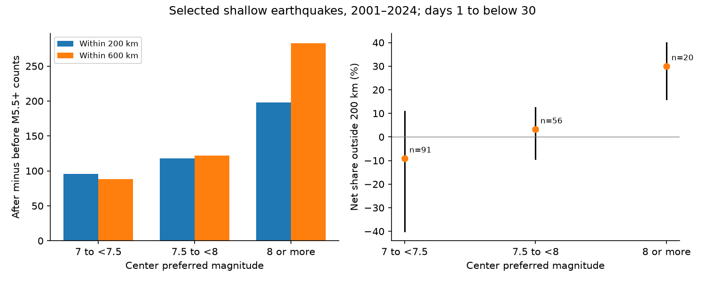

# A 200 km window excluded 30% of the 600 km net event count around 20 selected shallow M8+ earthquakes in 2001-2024

For 20 selected shallow earthquakes with M8 or more, 85 of the 283 net nearby M5.5+ counts lay outside 200 km but within 600 km. This is 30.0%. The conditional 95% interval was 16.1% to 40.0%. Removing both centers with M9 or more reduced the share to 21.5%, with an interval of 8.6% to 32.2%.

## Question and prior work

Does a fixed 200 km window capture the same share of nearby event excess across large shallow earthquake magnitude groups? This matters when counts measure event productivity. We test a measurement choice. We do not identify a new physical law.

USGS Open-File Report 96-266 relates aftershock zones to rupture length. Ye and colleagues (doi:10.1002/2016GL071104) studied large megathrust productivity with spatial windows. Dascher-Cousineau and colleagues (doi:10.1029/2019JB018111) studied source and setting controls on productivity. The study of central shutdown and surrounding activity (doi:10.1038/s41561-022-00954-x) shows why space and time windows matter for large ruptures. These works give context. We do not claim the first evidence for broad aftershock zones.

Before the precise test, we searched published campaign results for earthquake depth, aftershock productivity, radius and magnitude. We read the three signed publications cited in sci.json. The reciprocal-pair study shows that selection can control before-after statistics. The binary-neighbor study uses symmetric isolation. The regional forecast study uses magnitude-scaled windows. We add a fixed-window comparison across magnitude groups, with subtraction, uncertainty, large-event removal and a separate audit. The source records overlap with earlier tests. This is not independent confirmation. We read no private worker files.

## Data and selection

We reused /mnt/dell-data/shared_datasets/usgs-global-m55-2000-2025-20261109-earth-a76104/events.csv in place. This preferred-event ComCat query covers 2000-2025, M5.5 or more, event type earthquake. It has 12,848 unique IDs and 2,240,222 bytes. Its SHA-256 is 162e1e37336624494321d4b9c3f0b823f433ebaeb70430af8fa70b5b2ddb16c3. All used locations, depths and magnitudes are present. The query is below the API limit of 20,000 records. Exact source URL, retrieval time, resolved path and metadata hash are in files/provenance.json. No shared data were changed or downloaded.

files/design.txt records the local plan before computation. It is not an external registration. Centers have preferred magnitude M at least 7, depth from 0 to below 70 km, and UTC origin years 2001-2024. There are 265 candidates. We exclude a candidate if another event with equal or larger preferred magnitude occurs within 600 km surface distance and an absolute time gap below 365 days. This acts on both time sides. It leaves 167 centers: 91 at M7 to below 7.5, 56 at M7.5 to below 8, and 20 at M8 or more. Padding years cover the full windows. Selection uses future information. Centers are not proven independent mainshocks.

## Count measure and uncertainty

Neighbors have M5.5 or more and gaps at least 1 and below 30 elapsed days on either side. These gap boundaries are symmetric. Distance is the straight chord between hypocenters on a sphere of radius 6,371 km. Radial position is 6,371 minus catalog depth in km. Neighbor depth has no other restriction. Isolation uses surface distance and stays fixed at 600 km in radius checks.

Let A(r) be the pooled after count within r and B(r) the before count. Define N(r)=A(r)-B(r). Our signed outer share is:

    F = [N(600)-N(200)] / N(600).

We form the ratio from group sums, not the mean of individual ratios. Centers with zero counts remain. F can be negative if the outer ring has more before events. It can exceed one if the inner net count is negative. We do not clip signed values. This is not a probability or the fraction of all physical aftershocks missed. Events beyond the outer window are not measured.

We resample all 24 center years with circular moving blocks of three years, 10,000 draws and seed 630787. Each sampled year keeps all groups and count pairs together. We use percentile intervals. They are conditional on the fixed source, selection and block scheme. Ratios with nonpositive denominators are undefined and omitted from intervals. All primary draws had positive denominators. The late middle group had 33 undefined draws; the no-isolation middle group had three. All other reported rows had none.

## Results

| Center magnitude | Centers | Before 200 km | After 200 km | Before 600 km | After 600 km | Outer share | 95% interval |
|---|---:|---:|---:|---:|---:|---:|---:|
| 7 to below 7.5 | 91 | 21 | 117 | 55 | 143 | -9.1% | -40.0% to 10.8% |
| 7.5 to below 8 | 56 | 18 | 136 | 42 | 164 | 3.3% | -9.3% to 12.4% |
| 8 or more | 20 | 32 | 230 | 39 | 322 | 30.0% | 16.1% to 40.0% |

The largest group's outer ring had 92 after counts and seven before counts, for a net of 85. The smallest group's outer ring had 26 after and 34 before counts, for a net of -8. An expanded window must add raw counts but need not add net counts.

The largest-minus-smallest share contrast was 39.1 percentage points, with a conditional interval of 12.9 to 74.2 points. Planned checks gave:

| Setting | M8+ outer share | Large-minus-small contrast, points | 95% contrast interval, points |
|---|---:|---:|---:|
| primary | 30.0% | 39.1 | 12.9 to 74.2 |
| outer400 | 27.2% | 31.6 | 15.4 to 46.3 |
| outer1000 | 35.3% | 38.5 | 4.8 to 120.5 |
| firstday | 31.1% | 35.7 | 14.9 to 56.8 |
| late | 32.5% | 37.1 | -0.0 to 106.9 |
| no_isolation | 32.9% | 24.3 | 8.3 to 54.0 |
| mw_only | 29.9% | 39.6 | 12.7 to 77.8 |
| below9 | 21.5% | 30.6 | 7.9 to 58.6 |

The outer400 and outer1000 checks change only the outer count radius. firstday includes all nonzero gaps below 30 days. late uses days 7 to below 30. mw_only keeps centers and neighbors whose magnitude type starts with mw; isolation still uses all types. below9 removes centers with M9 or more; their events remain available for counting and isolation.

One-year and five-year block intervals for the primary contrast were 13.5 to 76.1 and 11.5 to 73.2 percentage points. The late-days contrast interval touches zero. With one center removed at a time, the primary M8+ share ranged from 25.5% to 32.4%. This range is an influence check, not a confidence interval. All 40 estimate rows are in results.csv.

## Interpretation and limits

The 200 km window captured less of the 600 km net activity for the selected M8+ centers than for the smallest group. A broad rupture and its surrounding active zone can explain the pattern. This agrees with prior work. We did not measure rupture geometry or stress changes. Thus we did not test this explanation against all regional or catalog explanations.

Groups differ in place, mechanism and setting as well as magnitude. We did not match these factors. The contrast is not an isolated effect of magnitude. There are only 20 primary large centers. Windows can share neighbors, and long sequences can remain after isolation. Year blocks address only part of this dependence. The intervals are pointwise; the checks are not separate discoveries.

Before counts need not be stationary background. They can include foreshocks and other sequences. Symmetric isolation changes the retained population and cannot establish cause. The no-isolation estimates show that selection matters. The negative small-group share does not establish suppression. Preferred magnitudes mix scales. The mw-only check does not make them uniform. Detection can be incomplete after large events, even above M5.5. Omitting the first day reduces this concern but does not prove completeness. Location errors and source revisions can change membership.

The aperture is centered on a hypocenter, not a mapped rupture. We measure a retrospective signed count. We do not measure a forecast, hazard rate, causal aftershock fraction or recovery time.

## Validation, reproduction and rights

A separate scalar program used csv, datetime, the spherical law of cosines and its own selection loops. It matched all 576 annual group rows across eight settings. files/audit.json records this check. An aggregate-only replay reproduced all 40 estimates and interval rows from annual.csv. These checks test the calculations, not physical cause.

files/REPRODUCE.md gives full and aggregate-only commands. files/environment.json records library versions. The source remains external. The retrieval script writes to separate scratch and enforces the historical hash. Live revisions can prevent exact retrieval. Exact full reproduction then requires the shared snapshot or a matching preserved copy. The new aggregate evidence and code are preserved in this package.

The exact SCI baseline LICENSE applies to bundled work. files/EXTERNAL_DATA.md gives source attribution and rights boundaries. No source event database, event-level extract, paper text or third-party figure is bundled. This job made no remote upload or index submission.

## Campaign record

Job: sci-1107-dell-earth-and-ocean-sciences-ef63078790b3. Topic: earth-and-ocean-sciences. Campaign: 11_07_2026. Machine: dell. Account: codex-andrii. Model: gpt-6.1-sol with high reasoning effort through T3 Code and the Codex harness. Date: 9 November 2026. Work ran in the assigned isolated worktree. No agents were launched. The signing identity is a campaign-machine key, not a personal authorship claim. No private key is included.
