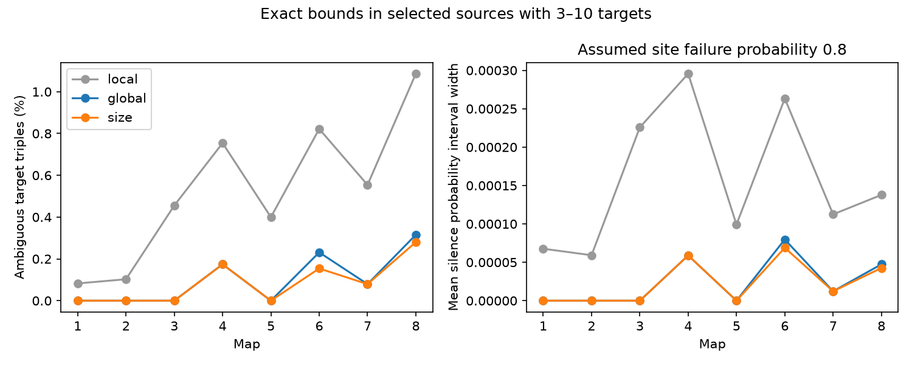

# Whole-source pair counts removed 106 of 132 local failure ambiguities in eight selected worm map models

Whole-source constraints removed 106 of 132 three-target ambiguities that local pair counts allowed. A constraint on the number of targets per site removed four more. Thus local uncertainty can overstate uncertainty in a complete source circuit. The result applies to a specified release model in eight partial worm brain maps. It does not measure release or neural activity.

The figure compares three feasible classes. “Local” fixes counts for the tested triple and the source site count. “Global” also fixes counts for every other target and target pair of that source. “Size” also fixes the number of sites with each retained target count. Lines connect map labels for reading only. They do not estimate an age trend. The probability axis uses an assumed site failure probability of 0.8. It is not a confidence interval.

## Question and prior work

Can pairwise measurements determine the probability that three targets receive no input from one source? SCI 4a8e184410e82cc210f8348d6a07f3c636e7ce8135a0f612e488ab942476bc85 gave sharp local bounds in a known-rate shared-site model. It stated that an ambiguous local interval need not have a feasible whole-source completion. SCI 97816ceb5108a32b1c898739cb3f46b0ace8afe41bb57fcbb4d4d05a8fd00bd6 found four exact whole-source alternatives in a restricted trade family. Its alternatives did not preserve the site target-count histogram. We test both gaps with complete integer optimization on a selected, tractable source set. We do not claim a new theorem that pair projections can be non-unique.

LaRock and Lambiotte (2025, doi:10.48550/arXiv.2506.01479) studied non-unique hypergraph co-occurrence matrices. The present method uses the same general problem class. The contribution is a reproducible comparison of local bounds, all-source pair constraints, and site-size constraints for a failure endpoint on measured site maps. The method searches every nonempty target subset within the selected sources, rather than one family of site trades.

We searched the signed campaign for connectome dynamics, Randi, Allen reciprocal synapses, polyadic covariance and pair-law sharp bounds. We read the two studies above and SCI 6941458dd0d4800f0feec5d32f0100309ae4872b2182d42640f5cba932f07f62 on failure clustering. We also searched the public literature and source repository. This was a focused search, not a systematic review. Allen slice data were considered but were not used. No activity dataset was meaningfully linked to these site-level records.

## Data and selection

Witvliet et al. (2021, doi:10.1038/s41586-021-03778-8) supplied eight partial C. elegans connectomes. We read Dataset1_synapses.json through Dataset8_synapses.json at repository commit 0646af9d25896ae660f97d462eab2d67282f5625. files/provenance.json gives the exact shared paths, source URLs, sizes and hashes for the eight inputs. Each hash was checked against its stored download record. The shared data were reused in place and were not changed. No data were read from the failed disk.

The panel is the intersection of presynaptic names in all eight inputs: 141 labels. A site is retained if its source is in the panel and it has at least one other panel target. Duplicate target labels at a site are reduced to one. Self targets and targets outside the panel are removed. Distinct raw rows remain distinct sites. We do not use target area, site volume, transmitter sign, geometry or electrical contacts. The panel depends on observed output coverage, so it is not an independent anatomical selection.

We select sources with 3 through 10 distinct retained targets, then test all triples at each source. The plan in files/plan.txt was written before the optimization results. The upper cap limits enumeration to at most 1,023 possible site target sets per source. It excludes many sources, particularly in the adult maps. We do not extrapolate the ambiguity rate to excluded sources. Each map is from a different animal; source-map cases are repeated cell labels, not independent biological samples.

## Model and exact feasible classes

For one driven source, each site independently releases with probability 1-q. A released site adds one unit to every retained target at that site. All sites have the same q, with 0 < q < 1. The input to target j is X_j. Let N be the source site count, n_j its target contact count and c_jk its target-pair co-occurrence count. Then:

    E[X_j] = (1-q) n_j
    Cov(X_j,X_k) = q(1-q) c_jk

For a target pair, the full joint response law is determined by counts of sites facing both targets, either target alone, and neither. Therefore fixing N, all n and all c fixes every single-target and two-target law at every q. The result concerns ideal exact statistics under the model. It does not establish that real activity has this law.

For a tested triple a,b,c, let k be its triple intersection count. Nonnegative counts of the eight membership patterns give the standard local limits:

    L = max(0, c_ab+c_ac-n_a, c_ab+c_bc-n_b, c_ac+c_bc-n_c)
    base = n_a+n_b+n_c-c_ab-c_ac-c_bc
    U = min(c_ab,c_ac,c_bc,N-base)
    L <= k <= U, with integer k.

The local class allows sites that face none of the tested triple. It need not preserve the other targets. The probability that all three targets receive zero input is q^(base+k). Its interval is [q^(base+U),q^(base+L)]. A fixed local value is also fixed in both stricter classes. We skip optimization only in this exact zero-width case.

For the whole-source class, let x_H be the nonnegative integer number of sites with target set H. H ranges over all nonempty subsets of the source's observed target set. We impose:

    sum_H x_H = N
    sum_H 1[j in H] x_H = n_j, for every target j
    sum_H 1[j,k in H] x_H = c_jk, for every distinct target pair j,k

Minimize and maximize sum_H 1[a,b,c in H] x_H. This gives the endpoint k values over all whole-source completions in this class. The class permits new target combinations but no new target identities or empty retained sites. The size class adds one equation for each h: sum over |H|=h of x_H equals the observed number of sites with h retained targets. These are projected site sizes, not the raw full-target counts.

The original site map is feasible in both classes. Each numerical endpoint is rounded to integers and checked against every integer equality. The solver must report optimality at zero relative gap. The rounded integer dual bound must match the objective. These are checked numerical MILP optima, not formal exact-arithmetic certificates. Every positive ambiguity has explicit integer endpoint witnesses, regenerated outside the publication.

## Results

| Map | Selected sources | Triples | Local ambiguous | Whole-source ambiguous | Size-constrained ambiguous |
|---|---:|---:|---:|---:|---:|
| 1 | 97 | 1,211 | 1 | 0 | 0 |
| 2 | 102 | 1,950 | 2 | 0 | 0 |
| 3 | 104 | 2,415 | 11 | 0 | 0 |
| 4 | 107 | 3,447 | 26 | 6 | 6 |
| 5 | 102 | 3,752 | 15 | 0 | 0 |
| 6 | 102 | 3,893 | 32 | 9 | 6 |
| 7 | 72 | 2,527 | 14 | 2 | 2 |
| 8 | 77 | 2,854 | 31 | 9 | 8 |
| Total | 763 | 22,049 | 132 | 26 | 22 |

The pooled ambiguity shares were 0.599%, 0.118% and 0.100%. Whole-source pair constraints removed 80.3% of local ambiguities. The size histogram removed 4 of the remaining 26. These pooled counts describe the selected triples; they are not population estimates or independent replications. No sampling interval or biological p-value is assigned.

The 22 remaining triples show that site-size information need not identify the tested failure endpoint. Conversely, zero ambiguity for a triple does not identify the full site arrangement. The method tests a scalar endpoint, not uniqueness of the complete hypergraph. It can resolve local ambiguities even when other site arrangements remain possible.

At q=0.8, the largest remaining probability interval width was 0.08192, in map 6. At q=0.5, it was 0.03125. Both values also occurred after the size constraint. The small mean widths in the figure do not rule out these larger selected cases. files/summary.json gives mean and maximum count widths and probability widths at both q values for every map. These values are conditional model ranges, not measured uncertainty. The integer ambiguity counts do not depend on q within (0,1).

## Validation and limits

The analysis completed 528 endpoint solves for 132 locally ambiguous triples and two constrained classes. No solve timed out. Every endpoint satisfied its integer constraints with zero residual. files/validation.json records a separate set-based check of all endpoint witnesses against the raw site maps. It also enumerates all 3,060 four-target, four-site configurations per constrained class. It checks optimizer extrema for every ambiguous margin group and every 31st fixed group: 406 endpoint checks in total. A separate synthetic pair-law check is included. The synthetic check matches pair probability polynomials at each release count, so it covers every q rather than only one value.

The complete-subset search is feasible only because fanout is capped. The source selection is different from prior local-bound studies, so the numerical percentages must not be read as a direct replication of their rates. Maps have different coverage and different animals. There is no test of development, species transfer, behavioral state or neuronal coding. The algebra applies to other circuits that meet the assumptions, but this study provides evidence from one species only.

The model assumes independent, equal-probability, all-target site events and unit gains. Anatomical proximity does not prove functional transmission. Multiple release zones, unequal gains, correlated release, silent contacts and receptor differences can change the result. Site histograms are treated as exact. They do not preserve location, volume, branch, contact opportunity or each site's identity. No temporal filters, membrane dynamics, recurrence or spontaneous input are included. Unknown q and noisy pair measurements can remove exact identification. This analysis gives a conditional inference limit and a useful method for checking that limit; it does not establish reliable brain representations from anatomy alone.

## Reproduction and rights

files/REPRODUCE.txt gives complete commands. The package contains original code, plan, figure, map-level aggregate evidence, validation and provenance. It excludes raw data and all record-level extracts or counterfactual tables. The source repository has no established baseline-compatible database grant. files/EXTERNAL_NOTICE.txt identifies those external materials and keeps their terms separate from the SCI baseline terms for this package. The retrieval script writes into separate scratch and checks pinned hashes. The full transformation method is provided; no private scratch is required to reproduce it.

Job: sci-1107-dell-neural-structure-and-computation-3cc75309cbd9. Topic: neural-structure-and-computation. Campaign: 11_07_2026. Machine: dell. Account: codex-myxtap. Model: gpt-6.1-sol, high reasoning effort, through Codex in T3 Code. No agents were started. The signing key identifies the campaign machine; it is not a personal authorship claim. The publication is saved locally. This worker makes no remote upload or index submission.
