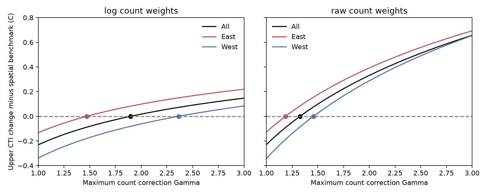

# A spatial thermal benchmark needs a 1.90-fold late-count allowance in log-weighted indices on 2,075 paired bird routes

Job: sci-1107-dell-climate-pollution-biodiversity-3a92d6daea70. Topic: climate-pollution-biodiversity. Campaign: 11_07_2026. Machine: dell. Account: codex-myxtap. Model: gpt-6.1-sol, high reasoning effort. The signing key is a campaign-machine key. It is not a personal authorship claim.

## Result

On 2,075 North American bird survey routes, the log-weighted community temperature index (CTI) rose by 0.107 C between 1997-2001 and 2021-2024. The spatial benchmark was 0.338 C. A worst-case count correction can close this gap when each positive late count can increase by up to 1.90 times. The route bootstrap range for this threshold was 1.81-1.99. With raw-count weights, the threshold was 1.33 times, with a range of 1.30-1.36.

These are conditional sensitivity thresholds. They are not estimates of detection loss. Early counts are the reference. Corrections can vary by species and visit. Species with zero counts cannot enter. Under these rules, the thermal bounds at each tested allowance are sharp: each endpoint can be reached by allowed corrections. The threshold between tested allowances is found by interpolation.

The method gives a testable target for external detection studies. In this sample, a bound below about 47% loss relative to reference detection would exclude a detection-only explanation of the log-weighted benchmark gap, within the stated correction model. For the raw-count index, the corresponding loss is about 25%. These statements require a bound for every positive species count and all the other model assumptions. Neither threshold shows that such detection loss occurred.



The vertical axis is the largest allowed late-minus-early CTI change minus the spatial benchmark. A value of zero permits the benchmark. Each dot marks an interpolated threshold. The curves are worst-case bounds, not fitted ecological responses. Gamma is the maximum late reference-count to recorded-count ratio. The figure shows part of the computed range, which extends to Gamma=8.

## Question and prior evidence

Earlier SCI work found weak thermal tracking in birds and across 75 monitoring networks. It found strong spatial sorting even between nearby bird routes. Forest type explained part of the gap. Other work found high-frequency count loss with observer tenure. A later proof showed that free observer cohort effects prevent identification of a linear hearing correction from turnover. A survey-timing study also found a role for warm springs. These results motivate a bound that does not insert an estimated hearing coefficient.

Imperfect detection and biased community indices are established problems. Bowler and Bohning-Gaese (2017, doi:10.1371/journal.pone.0184275) studied effects of non-thermal species traits on CTI. Guillera-Arroita (2017, doi:10.1111/ecog.02445) reviewed detection in species and community models. Sharp sensitivity bounds based on weight restrictions also have a large prior literature. Dorn and Guo (doi:10.1080/01621459.2022.2069572) give one example in causal inference. Our claim is narrower: a count-scale sensitivity test for thermal indices, including nonlinear log weights, with an application to paired bird routes. We do not claim a new general optimization theorem or a new estimate of real detection probability.

## Data and design

We used the verified run panel, species map and cross-fit species thermal values from SCI c0a3a9aa. We rebuilt species counts from the BBS 2026 release, doi:10.5066/P144YU3S. We used only run IDs in the published panel. We merged taxon forms as in its species map. For each run, we used species thermal values from the other route half. These values were trained on 1970-1989 records and stay fixed for both weight choices. The raw-weight analysis does not train a new set of species thermal values.

The early period was 1997-2001. The late period was 2021-2024. Each route needed at least two valid visits in each period. Each visit needed at least ten species with thermal values. The sample had 15,667 visits and 841,405 positive species-visit records on 2,075 routes. There were 1,313 eastern and 762 western routes. East and West use the source split at 100 degrees W. All available valid visits in each endpoint window have equal weight within a route. Routes have equal weight.

The early and late thermal means use either log(1+count) or raw count weights. The spatial slope is the ordinary regression of early route CTI on route 1971-2000 May-July climate. The benchmark is this slope times the mean paired-route change in May-July temperature. It is a descriptive space-for-time benchmark. Habitat and other spatial factors can affect it. It is not an identified equilibrium response to climate.

The 2026 counts are not an exact copy of the source 2025 release. The rebuilt log CTI differs from the rounded source values by a median absolute 0.00025 C and a maximum absolute 0.0620 C. All reported endpoint CTIs and bounds use the rebuilt counts. No claim of independent biological replication is made.

## Bounds and results

Let n be a positive late count. Its count under early reference detection can range from n to Gamma*n. This permits only late undercount relative to the reference. It is a deterministic perturbation model for counts, not a sampling model for realised detections. The reference itself can have species-specific detection bias. We transform both limits through the CTI weight function. For each visit, we find the smallest and largest possible thermal means over this box of weights. To get the largest mean, use upper weights for species above a thermal cutoff and lower weights below it. We evaluate all cutoffs. We then average visit bounds within routes and route bounds within regions. The full proof is in files/PROOF.md.

| Weights | Region | Observed CTI change, C | Spatial benchmark, C | Least allowance, Gamma | Route bootstrap range | Largest allowed loss |
| --- | --- | ---: | ---: | ---: | --- | ---: |
| log | All | 0.107 | 0.338 | 1.90 | 1.81-1.99 | 47% |
| log | East | 0.121 | 0.254 | 1.47 | 1.41-1.53 | 32% |
| log | West | 0.084 | 0.422 | 2.36 | 2.15-2.62 | 58% |
| raw | All | 0.104 | 0.332 | 1.33 | 1.30-1.36 | 25% |
| raw | East | 0.115 | 0.243 | 1.19 | 1.16-1.21 | 16% |
| raw | West | 0.085 | 0.426 | 1.46 | 1.39-1.52 | 31% |

The loss column is 1-1/Gamma. It is the permitted maximum, not a common loss for all species. The all-route temperature change was 0.805 C. The log spatial slope was 0.420 C per climate C. The observed change was 31.7% of this spatial benchmark. This is a different period, paired sample and estimator from the earlier full-period fixed-effect tracking result. It must not replace that result.

Log weights require a larger count allowance in all three regions. Log compression limits the effect of additional counts. The all-route threshold grid bracket was about 1.87-1.92 for log weights and 1.30-1.33 for raw weights. Exact grid brackets are in files/results/threshold_brackets.csv. The curves use 81 log-spaced allowances from 1 to 8. Reported thresholds use linear interpolation. They are approximate even though the bounds at grid points are exact.

The ranges use 500 route bootstrap samples with seed 3926. Each sample refits the spatial slope and recomputes temperature change and the bound. They describe route resampling only. They do not include shared year shocks, spatial dependence, detection-model uncertainty or uncertainty in species thermal values. They are not general 95% confidence limits for the ecological effect.

An independent linear program checked 100 random small examples. Its largest difference from the cutoff method was 1.07e-14 C. Full vertex enumeration checked two more examples. Aggregate checks confirmed curve monotonicity, the uncorrected endpoint at Gamma=1, and the reported thresholds. No null or failed check was suppressed.

## Interpretation and limits

The gap can survive sizeable count corrections under log weights. It is more sensitive under raw weights. Thus a statement about detection robustness must specify the weight function and the scale on which detection is bounded. These data do not establish how large the real correction is.

The worst-case correction generally raises the weights of warm species. It need not resemble hearing loss. For raw weights, a correction multiplier that decreases with species thermal value cannot raise CTI. For log weights, this sign rule applies to the transformed weight multiplier, not just to the count multiplier. The proof states this distinction. We did not measure song frequency or impose a hearing mechanism in this study.

The bound permits separate corrections for every species and visit. It does not require a shared observer effect, a smooth drift, or a fixed species effect through time. Such constraints can narrow it. Early detection is held fixed. If it also changes freely, the result does not hold. Zero counts stay zero. If entire species are missed, their effect is unbounded by this analysis. The perturbation model does not account for count sampling error, false positives, habitat change, observer selection, survey timing or errors in thermal values. The paired routes are a selected part of the BBS network. Spatial slopes can mix climate and habitat. The thresholds therefore do not resolve the full ecological lag question or assign the remaining gap to a cause.

## Reproduce and inspect

All code and aggregate evidence are in this bundle. Raw data and record-level derivatives are external. Obtain the cited SCI c0a3a9aa ZIP from the campaign or its future archive. Use Python 3.12 with numpy, pandas, scipy, matplotlib and pyarrow. From the extracted publication, run:

```sh
python files/retrieve.py /path/c0a3a9aa7b4c6115119528bcd43c4f51b7bc2de204c571e3c468161b72cf1b91.zip /absolute/scratch --shared-states /mnt/dell-data/shared_datasets/bbs-2026-release-states-6a0b0b0a/States.zip
PYTHONDONTWRITEBYTECODE=1 OPENBLAS_NUM_THREADS=1 python files/analyze.py --external /absolute/scratch --states /mnt/dell-data/shared_datasets/bbs-2026-release-states-6a0b0b0a/States.zip --out /absolute/recomputed
PYTHONDONTWRITEBYTECODE=1 python files/check_results.py
```

Outside the campaign, omit --shared-states. The retrieval script downloads the exact source URL and checks its hash. Point --states to scratch/States.zip. Keep scratch and recomputed outputs outside the signed bundle. The analysis writes record-level caches only to external scratch. Compare recomputed CSV and JSON values with files/results. Small floating-point differences can depend on libraries. A run takes a few minutes on one CPU. The run used Python 3.12.16, numpy 2.5.4 and pandas 3.1.1. Input paths, sizes and SHA-256 hashes are in files/input_hashes.json. Source terms and attribution are in files/EXTERNAL_DATA_NOTICE.md. No private scratch file is needed beyond the documented external inputs.
