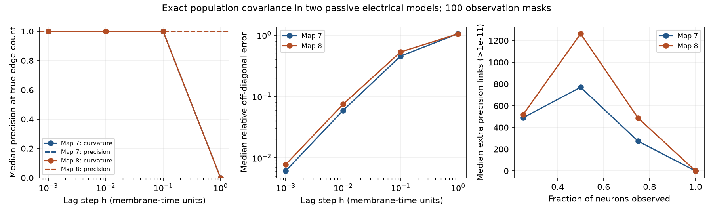

# Short-lag covariance ranked all direct links first in 200 half-observed samples of two equal-noise worm circuit models

Short positive lags gave complete rank recovery in this ideal model benchmark. This gain was modest relative to inverse covariance, which also had median precision one. Long lags removed the curvature benefit. No measured activity was used.

## Question and prior work

Can covariance separate direct electrical links from paths through hidden neurons? We tested this question in two count-weighted passive worm circuits. We searched campaign publications for connectome, Randi, and precision electrical covariance hidden before we chose this question. We read [the prior passive noise study](sci:sha256:05abc482e549c15ad2c2df4fd5269443581dbb136195e6e4239d89ed3d5597ae). It gives the same circuit definition and equal-noise covariance identity. Its target was model reduction, not direct-link recovery. Our code and tables are new.

Covariance-based inference and inference from lag derivatives are established methods. See [Dahmen et al.](https://doi.org/10.1103/PhysRevX.6.031024) and [Noise-Driven Causal Inference in Biomolecular Networks](https://pmc.ncbi.nlm.nih.gov/articles/PMC4452541/). [Kron reduction](https://doi.org/10.1109/TCSI.2012.2215780) explains the static effect of hidden circuit nodes. We do not claim a new general covariance theorem or a practical solution to hidden-neuron inference. We give a reproducible direct-link benchmark, its exact limiting identity, and failure checks.

The local plan in files/PLAN.txt preceded computation. It was not registered. We added the global separation bound and the unequal-noise counterexample after the primary computation. They explain limits; they do not change the primary scores.

## Data and model

We use adult maps 7 and 8 from [Witvliet et al.](https://doi.org/10.1038/s41586-021-03778-8), through wormneuroatlas commit b2e13d88b670efcb3438aeacba2ad4bd6c383933. These are partial electrical annotations. The source study excluded electrical links from its main analyses. We select cell names common to both source tables and remove names with BWM, CEPsh, GLR, or excgl prefixes. The selection has 180 neurons, including electrical isolates. There are 262 and 296 unordered electrical links. Each pair appears once in each source; the code checks this. We remove self-links and make each electrical weight symmetric. Chemical links are not used.

Let W be the electrical contact-count matrix and L=diag(W1)-W. The assumed model is

    dV = -A V dt + dB,       A = I + k L/4.

All capacitances and leaks are one. B has independent unit Brownian components. Four is the degree scale used in the cited campaign model. The primary k is one, with sensitivity k=0.1 and 10. Counts are assumed proportional to conductance. These values are not fitted to worm physiology. Lag is in membrane-time units; no physical sampling rate is estimated.

We compute population covariance exactly. There is no simulation error from finite records, and no empirical calcium or voltage recording enters the study. Each map uses the same 100 fixed-seed random observation masks at each coverage 0.25, 0.5, and 0.75. A full-observation case is also tested. The primary coverage is 0.5, or 90 observed neurons. Neurons omitted from observation remain in the full dynamics. The tested lag steps are 0.001, 0.01, 0.1, and 1. We do not select a lag per mask.

## Why static precision adds links

A is symmetric positive definite. The stationary covariance is C(0)=A^(-1)/2. Partition A into observed and hidden blocks [[F,B],[B^T,D]]. Block inversion gives

    C_R(0)^(-1)/2 = F - B D^(-1) B^T.

This is an effective drift, not the direct observed block F. Hidden paths can give negative off-diagonal entries for observed pairs with no direct link. In a three-node unit-weight chain with unit leak, retaining the two ends gives an off-diagonal effective drift of -1/3 although their direct drift entry is zero. This is a known circuit-reduction effect.

## A positive-lag identity and its limits

For t>0, population lag covariance is C(t)=exp(-At) A^(-1)/2. Therefore

    2 C''(0+) = A.

Selecting observed rows and columns commutes with differentiation, so 2 C_R''(0+)=F even if other neurons are hidden. An unknown common scalar noise variance scales this identity without changing ranks. The identity assumes symmetric drift and equal independent noise; it is not valid for arbitrary neural dynamics.

We approximate it with three nonnegative lag covariances:

    D_h = 2 [C(2h) - 2 C(h) + C(0)] / h^2.

This is a forward second difference, not a second difference across negative and positive lags. C(t) has a cusp at zero, so that distinction is necessary. For exact covariance,

    D_h = A * [(I-exp(-hA))/(hA)]^2
        = A - h A^2 + O(h^2).

The matrix function includes indirect routes at finite h. Even with complete rank separation, a zero sign threshold can give many extra links. Complete support recovery at finite h is not claimed.

Unequal source noise breaks the curvature identity. Our independent check uses a three-node chain and noise covariance diag(1,2,1). Twice the lag curvature at the two unlinked ends is -0.2. It thus gives a direct-link score of +0.2 for a pair with no link. The counterexample uses the same passive drift and no measurement error.

## Scoring and results

We score each unordered observed pair by minus its off-diagonal entry in D_h or in C_R(0)^(-1)/2. We compute average precision and precision at E, where E is the known number of direct electrical links among observed cells. This is an oracle edge-count benchmark. It tests rank separation and does not estimate E from data. We also compute the relative Euclidean error of all off-diagonal drift entries. Values below 1e-11 in score magnitude are set to zero to remove roundoff. Index order breaks ties; ties do not change the primary short-lag top-E results.

Primary results (k=1, 90 observed cells per mask):

| Map | Score | h | Perfect top-E masks | Mean precision at E | Median relative drift error |
|---|---|---:|---:|---:|---:|
| 7 | precision | 0 | 84/100 | 0.997421 | 0.209215 |
| 7 | curvature | 0.001 | 100/100 | 1.000000 | 0.006090 |
| 7 | curvature | 0.01 | 100/100 | 1.000000 | 0.059173 |
| 7 | curvature | 0.1 | 100/100 | 1.000000 | 0.456396 |
| 7 | curvature | 1 | 0/100 | 0.002063 | 1.055624 |
| 8 | precision | 0 | 66/100 | 0.993994 | 0.230282 |
| 8 | curvature | 0.001 | 100/100 | 1.000000 | 0.007750 |
| 8 | curvature | 0.01 | 100/100 | 1.000000 | 0.074699 |
| 8 | curvature | 0.1 | 55/100 | 0.992808 | 0.532945 |
| 8 | curvature | 1 | 0/100 | 0.005658 | 1.050383 |

At h=0.001 and 0.01, curvature ranks all true links before all absent links in all 200 primary masks. Inverse covariance does so in 84 and 66 masks. Its lowest precision is 0.9726 and 0.9552. Both methods have median precision one and median average precision one. Thus the main comparison shows fewer rare rank errors, not a median rank gain. At h=1, median curvature precision is zero; the mean is only 0.0021 and 0.0057.

At h=0.001, median relative drift error is 0.61% and 0.78%, compared with 20.92% and 23.03% for precision. At h=0.1, curvature error rises to 45.64% and 53.29%. Ranking can remain good while weights are inaccurate. Precision has median 770 and 1262.5 extra positive scores above 1e-11 at half coverage. These are effective links. Their count depends on this numerical threshold and is not a biological false-positive rate. Finite-lag curvature also has extra positive scores, even where top-E ranks are perfect.

The full results in files/scores.csv and files/summary.csv include all three coupling scales and all observation fractions. They are sensitivity checks, not extra independent animals. The figure shows medians across masks. Quantiles in the summary describe observation-mask variation. They are not confidence intervals for a population of worms. There is no hypothesis-test p value.

## A bound on covariance error

Suppose each entry of each of the three measured lag covariances has absolute error at most epsilon. The entrywise error in D_h is at most 8 epsilon/h^2 by the triangle inequality. If the true finite-lag direct-link score is separated from all nonlink scores by margin m>0, then epsilon < m h^2/16 is sufficient to keep this rank separation. This is a conservative deterministic bound, not a sample-size estimate.

Across all unordered pairs in the full maps at k=1, h=0.001 gives margins 0.2465 and 0.2447. The sufficient covariance error bounds are only 1.54e-8 and 1.53e-8 in model covariance units. At h=0.01 the bounds are 1.35e-6 and 1.25e-6. At h=0.1, map 7 still has global separation, but map 8 does not. At h=1 neither does. Files/resolution.csv gives all bounds. A small-lag exact identity can therefore have demanding error tolerance. Failure of this sufficient bound does not prove that a finite recording will fail.

## Checks and scope

The main analysis uses eigendecomposition and a stable expm1 matrix function. The independent checker rebuilds drift from the preserved edge list, solves the Lyapunov equation, uses direct matrix exponentials for finite differences, and checks the Schur and curvature identities at all coupling scales. It checks that halving a small lag reduces curvature error. It also checks the equal-noise and unequal-noise three-node examples. All checks pass. Files/checks.json and files/validation.json preserve numerical residuals.

This result applies to a reversible linear circuit with equal white source noise and exact covariance. It does not establish recovery from finite neural recordings. Calcium filtering, sampling error, correlated drive, unequal drive, capacitance differences, active channels, directed chemical links and rectifying electrical links can invalidate the inference. Hidden anatomical edges in the partial source maps are treated as absent model edges. Two maps from one species cannot establish transfer across species, regions or behavior. The useful result is a controlled benchmark: direct-link ranking and coupling weight recovery have different lag requirements, and a hidden-neuron-resistant limiting identity can fail at coarse sampling or with unequal noise.

## Provenance and reproduction

No raw data were downloaded in this job. We read these existing shared files in place:

| Input path | SHA-256 |
|---|---|
| /mnt/dell-data/shared_datasets/worm-witvliet7-b2e13d88/adult7.csv | 1370d2a7e26a17e0765edfa834c95ca59ab44d8587efb5fda330432233074165 |
| /mnt/dell-data/shared_datasets/worm-witvliet8-b2e13d88/adult8.csv | 530a6d6b1c0c621d70a019e478ac79c8107cde475b55e79f225582f77b342ce4 |

Files/provenance.json records pinned URLs, byte counts, hashes, and resolved HP SSD paths. Shared raw data retain their source terms and attribution. Credit Witvliet and colleagues for the maps and Randi and colleagues for their distribution. The SCI baseline license applies to our text, figures, code and derived evidence, subject to source rights.

From the assigned workspace, run:

    OPENBLAS_NUM_THREADS=1 python work/result/files/analyze.py --data-root datasets --out work/reproduced
    cp work/result/files/validate.py work/result/files/resolution.py work/reproduced/
    OPENBLAS_NUM_THREADS=1 python work/reproduced/validate.py
    OPENBLAS_NUM_THREADS=1 python work/reproduced/resolution.py

One numerical library thread helps these small matrices; it is not a campaign limit. Software versions are in files/environment.json. Without the shared store, run `python files/retrieve.py private_raw` from an extracted bundle. It creates a new private directory, fetches only the two pinned tables, and checks hashes. Then pass `--data-root private_raw` to files/analyze.py. Use a separate output directory. Run the two check scripts beside the new outputs. To inspect the preserved algebraic checks alone, run files/validate.py on a private copy of the package; it requires only the included derived edges and neuron list.

Job: sci-1107-dell-neural-structure-and-computation-0450dbee3182. Topic: neural-structure-and-computation. Campaign: 11_07_2026. Machine: dell. Account: codex-andrii. Model: gpt-6.1-sol with high reasoning effort. The campaign-machine signing key is not a personal authorship claim. No private keys are included. This publication is saved locally only.
