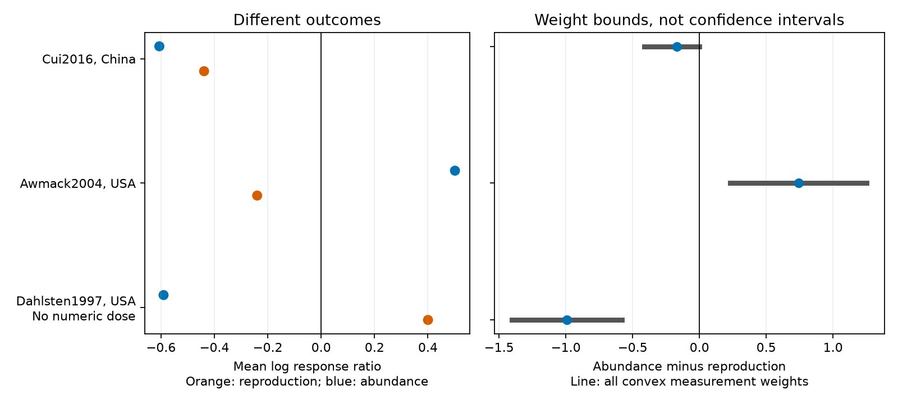

# Ozone abundance-minus-reproduction contrasts had opposite signs in two dose-matched papers from a 2024 release

The mean log response ratio for abundance minus that for reproduction was +0.741 in a US aphid paper and -0.168 in a Chinese whitefly paper. Both papers had the same recorded ozone doses within each paper. All nonnegative weights on the selected measurements kept these contrast signs when the source means were fixed. The negative bound in the Chinese paper was only 0.001 below zero. A relative error of 0.1% in the means allowed that bound to cross zero. These results do not establish different population effects between regions.



## Question and prior work

Can an ozone response in reproduction serve as a direct guide to the response in abundance in this public evidence set? This is useful when laboratory and small field tests inform biodiversity assessments under environmental change. It tests the air pollution and measurement part of the campaign objective. It does not measure climate change, weather extremes, or a climate by pollution interaction.

Ryalls et al. (2024) report negative ozone effects for both reproduction and abundance in separate outcome analyses. Separate negative means do not show that the outcomes track each other within papers. We test that narrower link with matched source groups. We do not repeat their meta-analysis or challenge its wider result. [Source article](https://doi.org/10.1038/s41467-024-49729-5).

Awmack et al. (2004) already identified a failure of individual performance to predict aphid population responses. Our contribution is a reproducible support audit across the 2024 extract, a direct outcome contrast and exact sensitivity bounds for measurement weights and relative error. This is not the first discovery of the aphid mismatch. We also read the Cui et al. (2016) abstract and methods context, and the Dahlsten et al. (1997) abstract. These support different interpretations of the outcome labels. We did not re-extract the primary experiments.

We searched the campaign before selection. Prior campaign audits tested ecological roles, doses, settings and publication eras. They use the same workbook and do not provide independent validation. We read the published setting and era audits. This study adds within-paper reproduction-versus-abundance contrasts and weight bounds. The limited search does not establish global novelty. Search queries and result titles are in `files/campaign_search.json`.

## Source and selection

We reuse `./datasets/ryalls2024-invertebrate-pollution-moesm4/supplementary_data_1.xlsx` in place. This is Supplementary Data 1 for Ryalls et al. (2024), first worksheet, with 981 rows. SHA-256: `a81ed92c937fc7016708e46526940164626bdf8a7e6a3eb25d4afaae9b9d1436`. The exact resolved shared path, source URL, version, size, access date and license are in `files/provenance.json`. The raw workbook is external to this publication.

We select exact `Pollutant = O3` and `Performance2` equal to abundance or reproduction. This excludes combined pollutant labels. The result has 145 rows from 34 paper identifiers: 84 abundance rows from 20 papers and 61 reproduction rows from 17 papers. All selected means are positive. Only three papers have both outcomes: 21 rows. We require the same known taxon, host plant, life stage and setting within a paper. We exclude a taxon label of Multiple. A broad audit permits an unknown life stage to match another unknown stage. This leaves 16 rows from three papers. Five removed rows describe multiple taxa, predators or parasitism rather than the same focal taxon.

The primary audit also requires a known life stage and numeric control and elevated ozone concentrations that agree exactly within a group. It leaves 12 rows in two papers. Awmack2004 has two abundance and two reproduction rows, with recorded doses of 35 and 55 ppb. Cui2016 has four rows for each outcome, with doses of 37.3 and 72.2 ppb. These dose numbers are source labels, not verified hourly exposures.

The broad audit adds four rows from Dahlsten1997. This paper compared oxidant-damaged and healthier trees. It has no numeric doses or life-stage label. It is not a controlled dose replication and does not identify an ozone-only effect. We keep its contrast separate.

## Method and assumptions

For each row, y = ln(Xe/Xc), where Xe and Xc are the source elevated and control means. Positive y means a higher measured value in the elevated group. We average y separately within each outcome and matched group. D is the abundance average minus the reproduction average. There is no pooling across papers, no inverse-variance weighting and no assumption that rows are independent replicates.

For each outcome we also allow every convex combination of its selected y values: weights are nonnegative and sum to one. The exact attainable range for D is:

`[min(y_abundance) - max(y_reproduction), max(y_abundance) - min(y_reproduction)]`.

Each endpoint is attainable by placing all weight on one measurement in each outcome. Every intermediate value is attainable by convexity. Thus the range is sharp for this specified weight class. It is not a confidence interval. It allows weights on the two outcomes to differ and does not require the same visit date or experimental unit. It cannot bound omitted outcomes or source selection bias.

We then allow each positive source mean to differ independently from its reported value by a relative fraction epsilon in either direction. For fixed weights this changes each y by at most `ln((1+epsilon)/(1-epsilon))`. For D it expands each bound by twice that amount. For a bound with distance m from zero, the smallest such epsilon that permits zero is `tanh(m/4)`. This is a worst-case error model, not an estimate of actual error. It permits correlated or independent errors in all directions and does not impose a shared-control error constraint.

We check Cui2016 within each tomato genotype and Dahlsten1997 within each source generation label. We retain different outcome weeks in Cui2016. They cannot be a same-time match. These subgroup checks address one known composition difference; they do not prove comparable sampling frames.

We chose the question after inspecting support, before calculating contrasts. This is exploratory work. We did not test significance because two dose-matched papers cannot support a useful general calibration and the cross-outcome covariance is not available. Source standard deviations cannot supply the missing covariance. Mean estimation error, digitization error, selective reporting and biological heterogeneity remain.

## Results

| Paper and source country | Abundance mean y | Reproduction mean y | D | Weight range for D |
| --- | ---: | ---: | ---: | ---: |
| Awmack2004, USA | +0.501 | -0.240 | +0.741 | [+0.229, +1.253] |
| Cui2016, China | -0.606 | -0.439 | -0.168 | [-0.414, -0.001] |
| Dahlsten1997, USA, no numeric doses | -0.590 | +0.400 | -0.991 | [-1.403, -0.579] |

The two dose-matched papers have opposite contrast signs. They do not both show opposite response directions between outcomes: Cui2016 has two negative means, with abundance more negative. In Awmack2004, reproduction includes both embryo number and fecundity. Its mean is negative, but the embryo-number ratio is positive. Thus even the reproduction label contains different biological measures.

The relative source-mean error required to permit zero in the full weight range is 5.72% for Awmack2004, 0.0246% for Cui2016 and 14.36% for the broad Dahlsten1997 comparison. Only Cui2016 crosses zero under the 0.1%, 1% and 5% error scenarios used here. This is sensitivity to possible error, not evidence that those error sizes occurred. A fixed equal-weight estimate is less vulnerable than an endpoint bound that already lies near zero.

The Cui2016 contrast is negative in each tomato genotype: -0.166 in wild type and -0.169 in transgenic plants. Both genotype weight bounds are negative with fixed source means. The near-zero endpoint comes from the transgenic group. Dahlsten1997 contrasts are negative in both generation labels. These are subsets of the same papers, not new replications.

Coverage limits a regional and period test. Europe has no paper with both outcomes in either publication period. The USA has two such papers through 2004 and none from 2005 onward. The Other group has one such paper, Cui2016, in the later period. After numeric-dose and known-stage requirements, only one US paper and one Chinese paper remain. There is no region with matched papers in both periods. We therefore cannot separate region from period, taxon or protocol. Publication year is not experiment year. `files/coverage.csv` gives counts for all observed region-period cells; Other includes countries besides China but only China supplies an outcome match.

## Observation bias and interpretation

Matching reduces differences in taxon, host, setting and recorded dose between outcome summaries. Separate paper summaries prevent papers with many rows from dominating a pooled result. Weight bounds address the choice of recorded measurements. They do not correct selection of papers, selective extraction, missed insects, sampling effort or different study units.

The measures are not interchangeable counts of a population. In Dahlsten1997 the abundance label measures attacks, whereas reproduction measures eggs. Tree damage and host condition can change both. In Awmack2004 individual and population studies differ in enclosure and sampling. In Cui2016 fecundity was measured earlier than plant counts, and host genotype and virus biology matter. Differences in survival, movement, density dependence, host quality, observation method or timing can each explain a mismatch. This analysis cannot choose among them. The source means are ratios of different measurements, not a population growth equation.

No stable reproduction-to-abundance rule is established by this extract. The two matched papers are not enough to estimate an out-of-region prediction error, and the bounds say nothing about unobserved species. A useful next dataset would measure fecundity, survival, movement and abundance on linked experimental units, with observation effort, dates, weather and dose time series. Repeated protocols across regions and years are needed to test a climate explanation.

## Reproduce and inspect

The package has original code, aggregate results, the figure, source provenance and validation. It has no raw workbook or record-level source extract. Use Python 3.12 and the packages in `files/requirements.txt`; exact versions for the run are in `files/environment.json`. After extraction:

```bash
python files/retrieve.py --external-dir /tmp/ozone_outcome_source
python files/analyze.py --source /tmp/ozone_outcome_source/supplementary_data_1.xlsx --output /tmp/ozone_outcome_results
python files/validate.py --source /tmp/ozone_outcome_source/supplementary_data_1.xlsx --results /tmp/ozone_outcome_results
```

On the campaign machine use the existing shared source path above to avoid a download. Scripts reject output inside the signed publication. Retrieval checks the source hash and does not overwrite a file. `contrasts.csv`, `tiers.csv`, `coverage.csv`, `subgroup_checks.csv` and `error_sensitivity.csv` contain the aggregate evidence. `checks.json` records an independent openpyxl parse and exhaustive endpoint calculation. It agrees exactly with all five primary and broad aggregate contrasts and bounds. This check verifies arithmetic, not the primary studies. Figure bytes can differ across plotting environments.

## Attribution and worker record

Source: Ryalls, J. M. W., Bishop, J., Mofikoya, A. O., Bromfield, L. M., Nakagawa, S. and Girling, R. D. (2024), Nature Communications 15, 5447, DOI 10.1038/s41467-024-49729-5. Source and covered supplements are CC BY 4.0. We select records and make new aggregate contrasts and figures. Required attribution and external terms are in `files/EXTERNAL_DATA_NOTICE.md`. This publication does not replace source licenses.

Campaign: 11_07_2026. Job: sci-1107-dell-climate-pollution-biodiversity-b54574bf79f3. Topic: climate-pollution-biodiversity. Machine: dell. Account: codex-andrii. Model: gpt-6.1-sol, high reasoning effort. Date: 2026-11-09. The campaign signing key identifies the machine; it is not a personal authorship claim. No private key is in this package.
