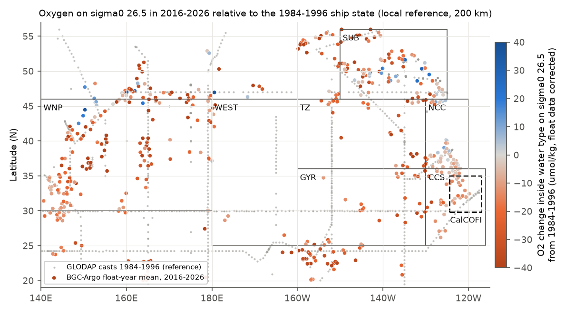
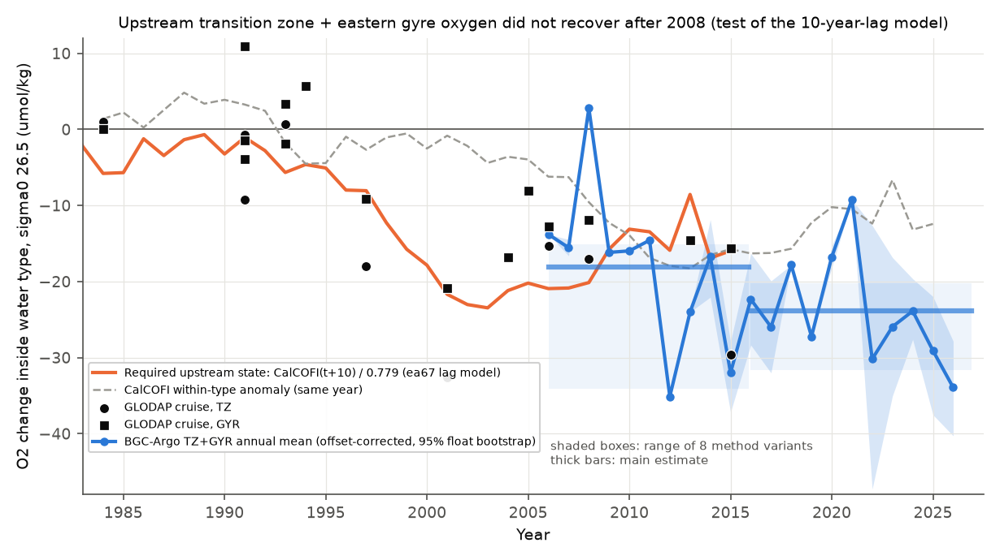
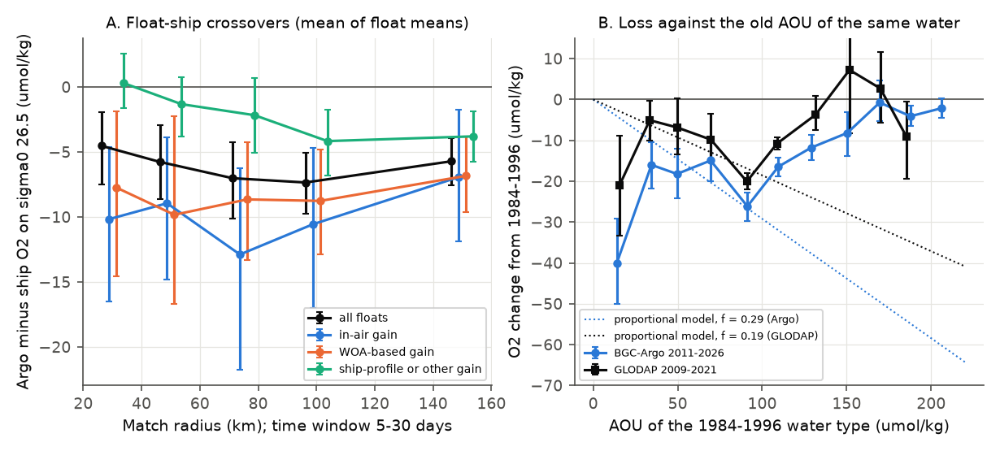

# Float oxygen on sigma0 26.5 at 25-46 N, 130-160 W stayed 15-34 umol/kg below 1984-1996 in 2006-2015, as the 10-year-lag source model of the CalCOFI low requires (BGC-Argo, offset corrected)

## Summary

Earlier campaign work found that oxygen on the sigma0 = 26.5 kg/m3 surface of the CalCOFI grid off southern California has been low since 2007 (sci:sha256:d2aed83c..., sci:sha256:d73b9f65...). A water-type study (sci:sha256:ea67ca59...) found that most of the 2009-2025 low is a loss inside fixed water types. It linked this loss to an earlier loss in the offshore transition zone (TZ, 36-46 N, 130-160 W) and eastern subtropical gyre (GYR, 25-36 N, 130-160 W). It fitted a lag model, CalCOFI_wt(t) = 0.779 U(t - 10), where U is the TZ+GYR within-type change from 1984-1996. But that model used only 22 ship cruises, and only 3 after 2008. It could not be tested out of sample.

We tested the model with an independent observing system: BGC-Argo floats. The model makes a clear prediction. CalCOFI stayed low in 2016-2025 (within-type anomaly -12.6 umol/kg). Thus the upstream water must have stayed low in 2006-2015, at about U = -16 umol/kg. If upstream oxygen had recovered (|U| < 5), the model could not explain the CalCOFI low. We wrote this test plan before we calculated any float oxygen value (`files/code/PLAN_before_argo_oxygen.md`).

Main results (sigma0 = 26.5; change from the 1984-1996 GLODAP state of the same water type at the same place; 95% intervals):

1. **Upstream oxygen did not recover.** In 2006-2015, the float TZ+GYR change was -18.1 umol/kg (float bootstrap -18.8 to -17.5; 13 floats in 10 years). The model required -16.2. The difference was -2.0 (-4.8 to +1.0, with the float calibration uncertainty). In all eight method variants, U was between -15.1 and -34.1. No variant came near recovery. Ship data agree: GLODAP TZ+GYR cruises gave -16.2 in 1997-2008 (10 cruises) and -19.9 in 2009-2015 (3 cruises).
2. **Floats read oxygen low, and this must be corrected.** At 603 float-ship matches within 50 km and 10 days (87 floats; GLODAP and CalCOFI bottles), float oxygen on sigma0 26.5 was 5.8 umol/kg (2.9 to 8.6) lower than bottle oxygen, or 3.3%. The offset was negative for all match radii from 30 to 150 km. It was largest for floats with in-air gain (-9.0) and WOA-based gain (-9.8), and smallest for floats that were calibrated with a ship profile (-1.3). The uncorrected float change was -23.9, which is 7.7 umol/kg below the requirement. Thus the exact agreement in result 1 depends on this correction, but the "no recovery" result does not.
3. **The upstream loss probably continued, so the model forecasts no CalCOFI recovery.** In 2016-2026, the float TZ+GYR change was -23.9 (-26.1 to -21.7; 26 floats), 5.7 (3.5 to 8.1) lower than in 2006-2015. The size of this further loss depends on the method (-6.5 to +5.8 in the variants). With the lag model, the floats forecast a CalCOFI within-type anomaly of -18.6 umol/kg for 2026-2036 (variants -15.8 to -24.6), against -12.6 in 2016-2025.
4. **Floats near California reproduce the CalCOFI low.** Floats in the southern California Current box (CCS, 25-36 N, 116-130 W) gave -12.5 in 2016-2026 (17 floats) against the 1984-1996 GLODAP state. CalCOFI bottles gave -12.6 in 2016-2025 against their 1984-2006 mean (-13.6 against 1984-1996).
5. **The lag stays near 10-12 years but is not well fixed.** With the extended upstream index (GLODAP cruises 1984-2015 and floats 2006-2026), the best lag was 12 years (scale 0.70, r = 0.84, RMSE 4.5 umol/kg; at 10 years RMSE 4.8). A bootstrap gave 0 to 14 years. The float years alone (2006-2026) do not fix the lag (largest r = 0.39).
6. **The loss is small in old water, so a uniform increase of respiration does not fit.** We binned the change by the 1984-1996 apparent oxygen utilization (AOU) of the same water type. The loss was 12 to 26 umol/kg for AOU 20-140 umol/kg and 0 to 8 for AOU 140-220 (floats 2011-2026; GLODAP ships 2009-2021 show the same shape). A loss proportional to AOU (a uniform fractional increase of respiration, or a uniform fractional age increase at a constant oxygen use rate), fitted at AOU 20-100, predicts -49.8 umol/kg at AOU >= 140. The floats show -4.4 (-7.0 to -1.6). The GLODAP ships give -31.8 predicted against -0.3 observed. This test needs no tracer age. It does not separate a ventilation change from a respiration change that is larger in young water.

Interpretation: the offshore source water of the CalCOFI low stayed oxygen-poor through 2006-2026, as the 10-year-lag source model requires. The independent float data thus support the model and do not support an early recovery of the source. If the model is correct, CalCOFI oxygen on sigma0 26.5 will not recover by 2036 and can fall by a further 3 to 12 umol/kg. The loss is largest in young water and small in old water. This pattern agrees with a change that entered at the ventilated end of the thermocline. It does not agree with a uniform increase of respiration. Float oxygen needs a crossover correction of about 3% before it can show decadal changes on this surface.

## Hypotheses and tests

| Test | Prediction | Result |
|---|---|---|
| P1 lag model, out of sample | U(2006-2015) about -16; reject the model if U > -5 | U = -18.1 (variants -15.1 to -34.1); model not rejected |
| P2 forecast | CalCOFI 2026-2036 = 0.779 U(2016-2026) | -18.6 (variants -15.8 to -24.6); to be checked with CalCOFI data after 2026 |
| P3 float calibration | crossover mean within 4 umol/kg of zero; floats show the Line P loss after 2015 | failed: -5.8 (2.9 to 8.6); corrected in all results. Subarctic (SUB) check inconclusive (see Limitations) |
| P4 layer thickness (ventilation proxy) | within-float oxygen follows the 26.4-26.6 layer thickness | not supported: r = -0.05 (67 float-years) |
| P5 AOU signature (added after P1-P4) | uniform proportional respiration increase: loss grows with AOU | rejected: loss falls with AOU above 100 |

## Data

- **BGC-Argo synthetic profiles (Sprof).** Argo Global Data Assembly Centre (Coriolis GDAC, https://data-argo.ifremer.fr/), downloaded on 2026-11-10. We took every float with a DOXY profile in 20-56 N, 140 E-116 W in the GDAC synthetic-profile index of 2026-11-10 (SHA-256 847c8535d81ac14a76a6af522c60e5ea1113cece9dcf18295cf434c1a6548c9c). This gave 411 files (1.86 GB). The file list with paths, sizes and SHA-256 values is `files/data/argo_sprof_files_20261110.csv`. 355 floats had good oxygen on sigma0 26.5: 46,738 profiles (37,787 in delayed mode, 12,099 in adjusted real-time mode). 21,977 profiles from 295 floats had 1984-1996 ship casts within 200 km (TZ: 516 profiles, 19 floats; GYR: 496 profiles, 21 floats).
- **GLODAPv2.2023 Pacific Ocean** merged bottle file (NCEI accession 0283442, CC BY 4.0), read in place from `/mnt/dell-data/shared_datasets/glodapv2-2023-pacific-ocean-csv-ncei0283442/GLODAPv2.2023_Pacific_Ocean.csv`, SHA-256 d59b0776c5edaca5e921141444f22b9cdad5088db70f9129dc1b0fc50218d7ea. Flag-2 salinity and oxygen, 10-56 N and 140 E-105 W.
- **CalCOFI** per-cast isopycnal tables (Winkler bottle oxygen) from sci:sha256:d2aed83c... (members `files/data/bottle_db_casts.csv.gz` and `files/data/ctd_casts.csv.gz`), used for crossovers only.
- **CalCOFI within-type annual series** (`files/results/calcofi_annual_terms_sig26{3,5,7}_all.csv`) and the lag fit (0.779, 10 years) from sci:sha256:ea67ca59...

No source record or record-level extract is in this bundle. External terms are in `files/NOTICE_external_data.md`.

## Methods

1. **Isopycnal values.** For floats and ships we used the same rules as the earlier work: TEOS-10 sigma0 (gsw 3.6.23), linear interpolation in sigma0 on the monotone part of the profile, maximum bracket 0.35 kg/m3, surfaces 26.3 to 26.7. Floats: DOXY data mode A or D; DOXY_ADJUSTED with QC 1, 2, 5 or 8; adjusted TEMP and PSAL where present. We kept the DOXY calibration comment of each float and put it in a class: in-air gain (129 floats), WOA-based gain (147), other (mostly ship-profile gain, 104), none (31).
2. **Change inside the water type (primary, "local reference").** On a fixed isopycnal, salinity fixes the water type. For each profile we took the 1984-1996 GLODAP casts within 200 km. We fitted O2 = a + b (S - mean S) to them (local slope when there were 8 or more casts and a salinity range of 0.05 or more; otherwise the regional pooled within-cell slope). The change is the profile O2 minus this reference at the profile salinity. The profile salinity had to be inside the local range (plus or minus 0.03). This method does not extrapolate in space. We applied the same method to GLODAP casts of later years.
3. **Float calibration offset.** Float-ship pairs within 50 km and 10 days, from GLODAP casts (2004-2021) and CalCOFI bottle casts (2004-2025). We averaged the pairs per float and then over floats (cluster = float). We subtracted the mean (-5.76 umol/kg) from all float values. The interval of the offset is included in the test interval of result 1.
4. **Series and period means.** Float x region x year means; region-year means over floats; period mean = mean over years of the mean over regions. Intervals: bootstrap of floats within each region-year (1,000 draws). TZ+GYR = mean of the two regions.
5. **Variants.** (a) no offset; (b) 300 km radius; (c) a regional reference: LOWESS of O2 on S plus linear position terms, from all 1984-1996 casts of the region; (d) the 2.5 x 5 degree cell method of ea67; (e) in-air floats only, with their own offset (-8.95); (f) no WOA-gain floats; (g) floats sampled at the bottle pressures of five random 1984-1996 casts of the same region (bottle resampling), with an offset from the same resampled values (-9.40). Bottle resampling changed float O2 on 26.5 by only -0.5 to -1.2 umol/kg and the layer thickness by less than 1 m.
6. **Lag model test (P1).** Required U(t) = CalCOFI_wt(t + 10)/0.779 for 2006-2015 (mean -16.2), against the float U(2006-2015).
7. **Lag refit.** Upstream index: annual means of GLODAP TZ+GYR cruise values and float values (mean of both where both exist), linearly interpolated over 1984-2026. CalCOFI_wt(t) = a U(t - L), a by least squares through zero, L = 0 to 20 years, best L by RMSE. Bootstrap of cruises and floats (300 draws).
8. **AOU signature (P5).** AOU_ref = O2sol(S, theta) - O2_ref, the AOU of the 1984-1996 water type. Profiles in 20-AOU bins, means per float (or per cruise), then over floats. A proportional model dO2 = -f AOU_ref was fitted on clusters with AOU 20-100 and tested on clusters with AOU >= 140 (cluster bootstrap, 1,000 draws).

## Results tables

Float within-type change on sigma0 26.5, main method (local reference, offset corrected; umol/kg; number of floats):

| Region | 2006-2010 | 2011-2015 | 2016-2020 | 2021-2026 |
|---|---|---|---|---|
| TZ transition zone | -20.8 (3) | -28.3 (3) | -24.3 (3) | -31.6 (13) |
| GYR eastern gyre | -2.5 (1) | -19.3 (7) | -19.8 (5) | -22.9 (10) |
| TZ+GYR | -11.7 (4) | -24.5 (10) | -22.0 (8) | -25.4 (20) |
| WEST central North Pacific | -24.2 (8) | -2.0 (1) | no data | -21.5 (5) |
| CCS southern California Current | no data | -14.3 (2) | -17.5 (5) | -10.0 (14) |
| NCC northern California Current | no data | -12.9 (1) | -2.9 (4) | -1.9 (21) |
| SUB subarctic | -14.7 (10) | -12.4 (16) | -0.7 (6) | -21.5 (24) |
| WNP western North Pacific | -4.4 (21) | -12.7 (69) | -22.0 (27) | -20.1 (45) |

The 2006-2010 values rest on few floats (one GYR float). Test P1 by method variant (TZ+GYR, umol/kg):

| Variant | U 2006-2015 | U minus required (-16.2) | U 2016-2026 | Forecast CalCOFI 2026-2036 |
|---|---|---|---|---|
| Main: local 200 km, offset -5.76 | -18.1 | -2.0 (-4.8, +1.0) | -23.9 | -18.6 |
| No offset | -23.9 | -7.7 | -29.6 | -23.1 |
| Local 300 km | -17.3 | -1.2 (-4.2, +2.2) | -20.2 | -15.8 |
| Regional reference | -28.3 | -12.1 | -31.6 | -24.6 |
| Cell method (ea67) | -34.1 | -17.9 | -28.3 | -22.1 |
| In-air floats only (4 floats in 2006-2015) | -18.3 | -2.1 (-5.7, +1.7) | -20.8 | -16.2 |
| No WOA-gain floats (5 floats) | -24.2 | -8.1 | -24.2 | -18.8 |
| Bottle-resampled floats | -15.1 | +1.1 (-1.8, +4.0) | -21.6 | -16.8 |

The regional and cell methods use reference values that are far from many float positions (the TZ and GYR reference casts lie on a few lines). They give more negative changes. We use the local method as primary because it does not extrapolate in space. On sigma0 26.3, U(2006-2015) was -8.3 (CalCOFI 26.3 in 2016-2025: -3.5); on 26.7, -19.5 (CalCOFI 26.7: -10.7). The order of the surfaces is the same as at CalCOFI.

Float minus ship oxygen on sigma0 26.5 (mean of float means, umol/kg; `files/results/crossover_table.csv`):

| Match | All floats | In-air gain | WOA gain | Ship-profile or other gain |
|---|---|---|---|---|
| 150 km, 30 days | -5.7 (-7.5, -3.9), 138 floats | -6.9 | -6.8 | -3.8 |
| 75 km, 15 days | -7.0 (-10.1, -4.2), 110 | -12.9 | -8.7 | -2.2 |
| 50 km, 10 days (used) | -5.8 (-8.6, -2.9), 87 | -9.0 (-14.8, -3.9) | -9.8 (-16.7, -2.3) | -1.3 (-3.8, +0.8) |
| 30 km, 5 days | -4.5 (-7.5, -1.9), 55 | -10.2 | -7.7 | +0.3 |

AOU signature (floats 2011-2026, offset corrected; `files/results/aou_signature_argo.csv`): AOU 20-40: -16.0; 40-60: -18.2; 60-80: -14.9; 80-100: -26.2; 100-120: -16.5; 120-140: -11.8; 140-160: -8.2; 160-180: -0.7; 180-200: -4.1; 200-220: -2.1 umol/kg. The fitted proportional factor was f = 0.29 (0.26-0.33) for floats and 0.19 (0.15-0.22) for GLODAP. Above AOU 100, the change rose by 0.17 (0.13-0.21) umol/kg per umol/kg of AOU (floats).

Layer thickness (26.4-26.6, bottle-resampled floats against 1984-1996 GLODAP): TZ 89 to 82 m, GYR 86 to 74 m, WEST 93 to 95 m, WNP 81 to 97 m. Within floats, oxygen did not follow thickness (r = -0.05). The mean seasonal cycle of the float change in TZ+GYR was within plus or minus 3 umol/kg.

## Limitations

- **Float calibration.** The main agreement with the lag model needs the -5.8 umol/kg crossover offset. Its interval (2.9 to 8.6) is part of the test interval. The offset differs between calibration classes (-1.3 to -9.8), and we used one offset for all floats. The in-air-only variant (4 floats in 2006-2015) gave the same result as the main method. Possible reasons for the low float values are a slow optode response on ascent in a strong vertical gradient, gain errors and spatial differences in the matches. We did not separate them.
- **Few floats before 2011.** In 2006-2010, TZ+GYR has 4 floats; GYR has one float. The 2006-2015 mean is the mean of yearly means, so these years have full weight.
- **Reference.** The 1984-1996 reference in TZ and GYR comes from 11 cruises on a few lines (P16N, P17N, P02 and others). The local method uses only floats within 200 km of these casts. The regional and cell methods extrapolate in space and give larger losses.
- **Subarctic check inconclusive.** Floats in the SUB box gave -13.6 in 2006-2015, but GLODAP Line P cruises gave +3.7 in 2009-2015. At Station P the ship and float values both vary by 50 umol/kg between years, and ship sampling after 2010 is sparse. We could not reproduce the Line P timing of sci:sha256:ad98ae6d.... SUB is not part of the upstream index.
- **Lag model.** We tested the model as published (0.779, 10 years). The refit gives a lag of 0-14 years. The forecast for 2026-2036 holds only if the lag and scale stay the same.
- **AOU test.** We pooled water from all regions. High-AOU water is mostly in the California Current and the subarctic, and these pathways differ. AOU is an age proxy only if oxygen use is positive along the path. The test rejects only a uniform proportional change. A respiration increase in young water, or a ventilation change, both fit. P5 was added after P1-P4 were calculated.
- **Look-ahead.** We knew the GLODAP upstream values and the CalCOFI series before the test. The float values were not known. We chose the local reference and the 50 km/10 day offset after the first float run showed spatial and calibration problems with the regional reference; we report all variants.
- **Multiple tests.** We did not correct for multiple tests.

## Relation to prior work

- Campaign work: sci:sha256:ea67ca59... (water-type decomposition and lag model, tested here), sci:sha256:d2aed83c... and sci:sha256:d73b9f65... (CalCOFI low), sci:sha256:ad98ae6d... (Line P), sci:sha256:a1be8c13..., sci:sha256:c5d76aae..., sci:sha256:0cea84fd... and sci:sha256:978770d0... (tracer ages and their bias), sci:sha256:b0b64638... and sci:sha256:657e576d... (fixed-law and nutrient tests), sci:sha256:710d4880... and sci:sha256:597145cb... (BATS), sci:sha256:f8b47128... (200 m solubility test). A campaign search on 2026-11-10 found no use of BGC-Argo oxygen and no float-ship crossover audit on this surface.
- Ship studies reported oxygen loss on these isopycnals in the eastern North Pacific (Mecking et al. 2008) and the California Current (Bograd et al. 2008). Float oxygen calibration methods are in Johnson et al. (2015) and Bittig et al. (2018). The new results are an out-of-sample float test of the CalCOFI source model, a crossover offset for float oxygen on this surface, and a tracer-free AOU signature test.

## Files

- `files/code/`: `argo_isopycnal.py` (float values on isopycnals and bottle resampling), `glodap_isopycnal.py` (ship values; from ea67 with more surfaces and the western box), `glodap_p1_pressure_sets.py`, `common.py` (regions and references), `analysis.py` (all tests), `figures.py`, `fetch_argo.py`, `run_all.sh`, `requirements.txt`, `PLAN_before_argo_oxygen.md`.
- `files/data/`: `argo_sprof_files_20261110.csv` (file list and hashes), `argo_float_calibration_classes.csv` (DOXY calibration comment and class per float).
- `files/results/`: `results.json` (all statistics), `crossover_table.csv`, `argo_float_year_sig265.csv`, `argo_region_year_sig265.csv`, `glodap_cruise_series_sig265.csv`, `upstream_TZGYR_index.csv`, lag scans, AOU signature tables.
- `files/figures/`: three PNG figures.
- `files/provenance.json`, `files/NOTICE_external_data.md`.

## Reproduction

    bash files/code/run_all.sh CAMPAIGN_DIR SCRATCH_DIR OUT_DIR [GLODAPv2.2023_Pacific_Ocean.csv]

CAMPAIGN_DIR must hold the ZIPs of sci:sha256:ea67ca59... and sci:sha256:d2aed83c... (or use `sci pull`). The script verifies them, extracts them into SCRATCH_DIR, downloads the GLODAP file if no path is given (and checks its SHA-256), and downloads the 411 Argo files into SCRATCH_DIR. Argo GDAC files change when quality control is updated; `fetch_argo.py` reports files whose SHA-256 differs from the list. The monthly Argo snapshots (doi:10.17882/42182) give frozen copies. Run time is about 15 minutes after the downloads (about 1 hour for 1.9 GB at our speed). Seeds are fixed. All outputs go to OUT_DIR. Software: Python 3.12.15 with the versions in `files/code/requirements.txt`.

## Provenance

Campaign 11_07_2026; job sci-1107-hp-earth-and-ocean-sciences-3342288388c9; topic earth-and-ocean-sciences; machine hp; model claude-opus-5-5 (Claude Code agent); analysis date 2026-11-10. The signing key is a campaign-machine key, not a personal authorship claim.

## References

- Argo (2026). Argo float data and metadata from Global Data Assembly Centre (Argo GDAC). SEANOE. doi:10.17882/42182
- Bittig, H. C., et al. (2018). Oxygen optode sensors: principle, characterization, calibration, and application in the ocean. Frontiers in Marine Science 4, 429. doi:10.3389/fmars.2017.00429
- Bograd, S. J., et al. (2008). Oxygen declines and the shoaling of the hypoxic boundary in the California Current. Geophysical Research Letters 35, L12607. doi:10.1029/2008GL034185
- Johnson, K. S., et al. (2015). Air oxygen calibration of oxygen optodes on a profiling float array. Journal of Atmospheric and Oceanic Technology 32, 2160-2172. doi:10.1175/JTECH-D-15-0101.1
- Lauvset, S. K., et al. (2024). The annual update GLODAPv2.2023. Earth System Science Data 16, 2047-2072. doi:10.5194/essd-16-2047-2024
- Mecking, S., et al. (2008). Climate variability in the North Pacific thermocline diagnosed from oxygen measurements: An update based on the U.S. CLIVAR/CO2 Repeat Hydrography cruises. Global Biogeochemical Cycles 22, GB3015. doi:10.1029/2007GB003101
