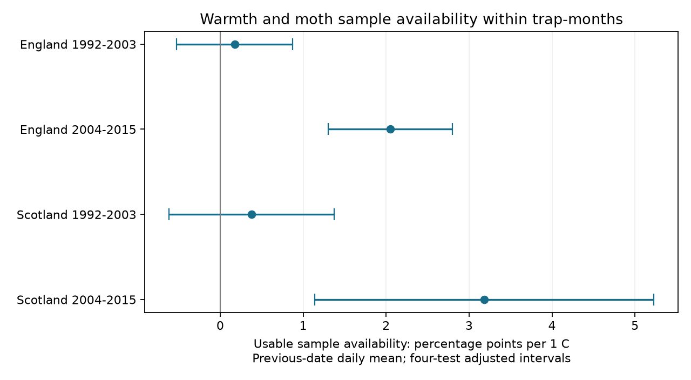

# Warmer dates had more usable moth samples in selected English and Scottish trap-months in 2004-2015

Job: sci-1107-dell-climate-pollution-biodiversity-77a9918296c4. Topic: climate-pollution-biodiversity. Campaign: 11_07_2026. Machine: dell. Account: codex-andrii. Model: gpt-6.1-sol with high reasoning effort. Date: 2026-11-09. The signing identity is a campaign-machine key. It is not a personal authorship claim.

## Result

We tested whether daily warmth was linked to usable moth sample dates. We joined UK Environmental Change Network records to E-OBS daily mean temperature. Four models used England and Scotland in 1992-2003 and 2004-2015. The main panel had 28,572 candidate dates in 934 trap-months. Models controlled trap-year-month, trap-specific weekday, and day within month. In 2004-2015, usable sample slopes were +2.05 percentage points per C in England and +3.18 in Scotland. Four-test intervals were +1.30 to +2.80 and +1.14 to +5.23. Both earlier intervals included zero. Later slopes stayed positive under sample-count thresholds, date shifts, month-edge removal, and a recorded-effort outcome. The Scottish result depended mainly on Glensaugh. These results show weather-linked sample availability within selected months. They do not establish deliberate weather selection, moth population effects, or a change between periods. Coarse daily weather, selected active months, few sites and few year clusters limit inference. The package includes the daily panel, source hashes, code and checks. No air pollution effect is tested.

| Region and period | Candidate dates | Trap-months | Usable share | Slope [four-test interval], points per C |
|---|---:|---:|---:|---:|
| England, 1992-2003 | 12,546 | 410 | 82.6% | +0.17 [-0.52, +0.87] |
| England, 2004-2015 | 10,673 | 349 | 69.9% | +2.05 [+1.30, +2.80] |
| Scotland, 1992-2003 | 3,213 | 105 | 95.1% | +0.38 [-0.62, +1.37] |
| Scotland, 2004-2015 | 2,140 | 70 | 71.3% | +3.18 [+1.14, +5.23] |

Figure 1. Each point is a conditional slope. Bars are 98.75 percent marginal intervals. Bonferroni correction covers the four main tests. A point at zero means no linear association after controls. Separate period estimates do not test their difference.

## Question and prior evidence

Do warmer dates have more usable moth samples within active trap-months? This is a check of the observation process. Weather can change moth flight and trap performance. Weather can also change when a sample is taken or recorded. These processes can act together. A count model that controls only monthly effort can miss the second process.

Jonason, Franzen and Ranius (2014, doi:10.1371/journal.pone.0092453) studied nightly moth trapping in Germany. They found strong temperature links to catches and compared sampling schedules. Their work motivates a check of the dates that enter a long record. We do not test their catch model.

We searched the campaign before we chose this question. The query `moth` returned studies of catch richness, concentration and turnover. The search list is in files/campaign_search.json. We read the verified publication sci:sha256:06dc7cded149294f30e29fd4042620f73104a929da18bd8df3dcc858dfeafd5f. It compared raw richness with richness at fixed catch size. We follow its source quality filters and cite its code under the MIT terms of its baseline license. We use a different outcome and add daily weather. These studies share moth records. This is not an independent replication of their abundance results. Our search was not a systematic review.

## Data and selection

Rennie and colleagues (2017) supply the ECN moth archive for 1992-2015, doi:10.5285/a2a49f47-49b3-46da-a434-bb22e524c5d2. We thank the source authors, field collectors and UK Centre for Ecology & Hydrology. The archive has an Open Government Licence. We use ECN_IM1, ECN_IM2 and the quality-text file. We remove duplicate effort keys, with both rows removed when a key repeats. We require a trap duration of exactly one day. We remove a sample with any Q-prefixed quality record. We also remove every date in a site quality-text interval. We require a numeric biological record or the explicit XX no-moths marker. A missing record is not a zero moth count.

The binary outcome is one if this rule gives a usable sample. It is zero on other candidate dates. A zero means no usable one-night sample under these rules. It does not prove the trap was off. The alternative raw-effort outcome is one for any unique recorded one-day duration, before quality and biological-record filters.

Each site and location code defines a trap unit. We form all May-September calendar dates for 1992-2015. We keep months with at least ten usable samples for the main test. This gives 28,572 dates in 934 trap-year-month groups. The broader five-sample panel has 30,446 dates and 22,848 usable samples. We do not infer operation during months with few or no samples. The denominator is a calendar within selected months, not a list of verified planned trap nights.

England has Drayton, Moor House, North Wyke, Rothamsted, Wytham, Alice Holt and Porton Down. Scotland has Glensaugh and Sourhope. The main early and late samples have 11 and 8 English trap units, and 3 and 2 Scottish units. The source site points and the selected weather cells are in files/sites.csv. We obtained public site points from the DEIMS API links on the official ECN site pages. They locate a site, not the exact trap.

E-OBS 31.0e supplies daily mean air temperature at 0.25 degree spacing. We use the nearest cell to each site point and the ensemble mean. The main predictor is temperature on the date before the recorded sample date. A night spans two dates, so we also test the recorded date and following date. Daily mean temperature is not nocturnal trap temperature. We do not use the E-OBS ensemble spread as a measurement-error estimate.

Files/provenance.json gives the exact shared paths, URLs, versions and SHA-256 hashes of all three raw files used. The hashes match the shared download records. Raw files remain in the shared dataset store. They are not copied into this package. DEIMS snapshots, their URLs and hashes are included. Files/daily_weather.csv preserves the extracted series, including dates around month edges. No new shared dataset was needed.

## Model and uncertainty

We fit a separate linear probability model for each country and period. The response is 100 times the usable-sample flag. The slope thus uses percentage points per 1 C. Controls are a fixed effect for each trap-year-month, a separate weekday pattern for each trap, and day within month and its square. We remove trap-year-month means from the response and every predictor before fitting. Each candidate date has equal weight. Complete months with no availability variation are retained. The model measures an average conditional linear association. It is not a model for probabilities at extreme temperatures.

We cluster errors by calendar year within each model. We correct for cluster count and for all fitted fixed effects. Intervals use a t distribution with year count minus one degrees of freedom. There are 11 or 12 year clusters. This allows arbitrary dependence across sites and dates within a year. It does not allow arbitrary dependence across years. Coverage can be poor with so few clusters. We correct across the four country-period tests within each model variant. This does not adjust across all variants. Selection rules, controls and variants were chosen from documentation and panel inspection before the first model output. The study is exploratory and was not registered.

## Checks and interpretation

Later slopes are positive for the five-sample and twenty-sample thresholds, common trap units, and date shifts. They also remain positive when we omit dates outside the first and last usable sample of each month. The raw-effort slopes are +2.05 points per C in later England and +3.18 in later Scotland. Their corrected intervals exclude zero. Thus quality flags and biological-record requirements do not explain the later main associations on this selected denominator.

All seven later English site-deletion slopes are positive, with corrected intervals above zero. The later Scottish slope is +3.79 [+1.29, +6.29] without Sourhope. Without Glensaugh it is +0.75 [-2.92, +4.41], based on only 397 candidate dates. Thus the Scottish sample is not strong evidence that the result holds at both sites. All main earlier intervals include zero. We did not test a formal period contrast. A clear later estimate and an uncertain earlier estimate do not establish a period change.

The next-date association is also positive in both later samples. Adjacent weather is correlated. This check does not identify the causal date or show that staff used weather forecasts. The evidence supports weather-linked recording or sampling availability. It cannot distinguish deliberate scheduling, technical failure, sample processing and other causes.

The usable flags agree with the prior verified source filter on every usable date in the broader panel. There are no duplicate candidate keys or missing weather values. Independent NumPy least squares and a direct year-score covariance calculation match all 50 fits to less than 1e-7. All transformed designs have full column rank. Files/validation.csv records numeric errors. These checks test computation, not causal identification.

This result matters when using moth records to estimate climate responses. A fixed number of sampled dates does not ensure the same weather distribution. Equal catch size also cannot correct a weather-dependent observation calendar. A useful next step is to obtain exact operating logs and nightly local weather, then model sampling availability and moth detection together. We supply a daily availability panel as a starting point.

Selection on at least ten usable samples can itself create associations. Weather can correlate with omitted rain, wind, holidays, staff schedules and equipment status. The country samples use different sites, but weather is correlated. Periods share sites and a monitoring system. Site-level weather error and unrecorded trap changes remain. The outcome says nothing directly about moth abundance, species ranges, biological timing, air pollution, or attribution to climate change. A result for selected active summer months does not apply to all ECN months or the whole UK.

## Reproduction and rights

After extraction, run `OPENBLAS_NUM_THREADS=1 OMP_NUM_THREADS=1 python files/analyze.py`. This uses only the bundled daily panel and rebuilds all 50 fits, checks, summaries and the PNG. Package versions are in files/environment.json. The thread settings are optional performance choices.

For a raw rebuild on this machine, run `python files/build_panel.py /absolute/path/to/this/worktree`, then run the analysis command. The argument must contain the datasets link. The script hashes only the files it uses and reads raw data in place. It writes derived files beside itself. It can take several minutes to extract weather from the compressed grid.

Elsewhere, first run `python files/retrieve.py /new/private/input_root`. This downloads the three pinned raw inputs into that root and checks their hashes. Then run `python files/build_panel.py /new/private/input_root` and the analysis command. Preserve the bundled DEIMS snapshots to use the same coordinates. Retrieval stops on an existing target or a source hash change. Source revision or access restrictions can prevent an exact raw rebuild. The bundled calendar still permits inspection and reproduction of the reported fits.

Original text, code and derived evidence use the SCI baseline license. Source data and metadata retain their source terms and attribution. The prior filter code is credited above. No private key is included. This package is signed and saved locally. It is not submitted to a remote archive or index.
