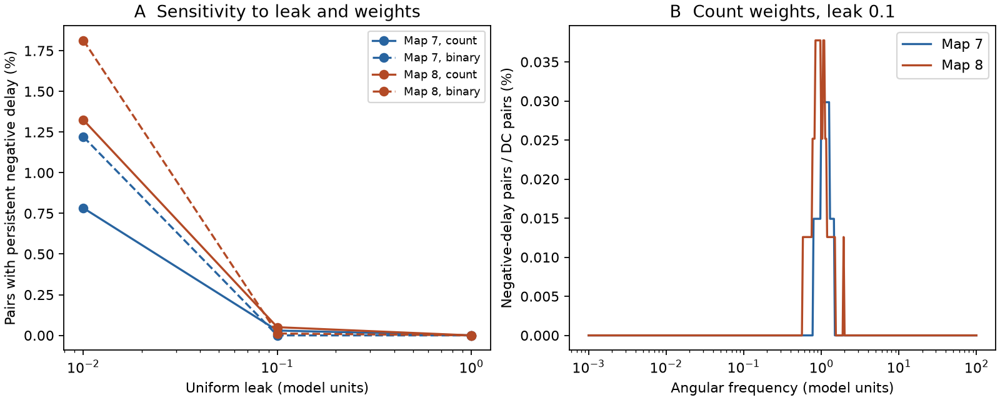

# Negative group delay occurred in passive models of two partial adult worm electrical maps

A negative frequency-based delay did not require an active circuit in this test. At uniform leak 0.1, 2 of 6,702 qualifying cell pairs in adult map 7 and 4 of 7,946 pairs in map 8 had negative group delay at three successive sampled frequencies. The impulse responses were causal and nonnegative. These are calculations in assumed passive models, not measurements of neural responses.

Figure 1. A: The share of qualifying unordered cell pairs that passed the three-frequency negative-delay rule. Solid lines use contact counts. Dashed lines give each present link equal weight. B: The share of fixed DC-qualified pairs that pass the negative-delay rule at each frequency, with count weights and leak 0.1. The frequency-dependent response floor also applies. Lines connect tested values only. The graphs, pairs and frequencies are dependent. The figure does not show an animal-level confidence interval.

## Question and prior work

Does a negative group delay, computed from an electrical transfer function, require active neural signaling? This question matters if a phase derivative is used as a propagation-time estimate. We test whether such an inference can fail in passive circuit models based on public neural wiring.

Negative group delay in passive electrical systems is established prior work. Das and Zhang, Synthesis of Negative Group Delay Using Lossy Coupling Matrix (arXiv:1708.02343), study its relation to loss in reciprocal circuits. Varshney et al. (2011, doi:10.1371/journal.pcbi.1001066) use electrical Laplacian models of worm wiring. Schroder et al. (2020, doi:10.1109/TNSE.2019.2901582) develop transient response moments from inverse system matrices. We do not claim to discover negative group delay or the transfer derivative formula.

The contribution is a reproducible neural-map benchmark with response floors, a delay margin, grid checks, and an exact three-cell example. It gives a concrete failure of interpreting every frequency-based delay as a causal travel time. It does not show that this error occurs in a measured worm experiment.

Before the precise test, campaign searches covered connectome, electrical, phase and group delay. The unquoted group-delay search returned broad word matches. The quoted phrase returned no records. We read SCI 5ec9c5b6 (response centroid versus hop distance) and SCI 2b74f471 (frequency averaging of loop phases). Neither read report tested this transfer group-delay question. Searches are not proof of novelty. All code here was written independently. An exploratory pilot on map-specific cell sets and a 101-point frequency grid found negative delays. We then used the common cell set and the stated 401-point rules below. This is exploratory work, not a registered test. Thresholds and models were chosen after the pilot; no p-value or discovery-rate claim is made.

## Inputs and model

The raw inputs are the adult 7 and 8 tables from wormneuroatlas commit b2e13d88b670efcb3438aeacba2ad4bd6c383933. The source reconstructions are Witvliet et al., Connectomes across development reveal principles of brain maturation (Nature 2021, doi:10.1038/s41586-021-03778-8). The paper states that electrical annotations include junctions where they were most visible. These electrical maps are partial. A zero in the model is not a confirmed absent biological link.

We used the existing shared files in place. Only the two used input files were hashed.

| Map | Exact shared path | SHA-256 |
|---|---|---|
| 7 | /mnt/dell-data/shared_datasets/worm-witvliet7-b2e13d88/adult7.csv | 1370d2a7e26a17e0765edfa834c95ca59ab44d8587efb5fda330432233074165 |
| 8 | /mnt/dell-data/shared_datasets/worm-witvliet8-b2e13d88/adult8.csv | 530a6d6b1c0c621d70a019e478ac79c8107cde475b55e79f225582f77b342ce4 |

These compatibility paths point to the HP SSD store. We accessed them through ./datasets. No data were read from /data. No shared dataset was changed. Exact source URLs, input sizes and software versions are in files/provenance.json.

We keep names in both edge tables, excluding prefixes BWM, CEPsh, GLR and excgl. This gives 180 putative neurons, including isolated cells. This name rule is not a complete cell-type audit. Each non-self electrical pair supplies one symmetric weight equal to its reported count. The code checks that each unordered pair occurs once. There are 262 and 296 retained electrical links. Chemical rows serve only to define the common name set. We do not use chemical signaling.

For each map, divide weights by mean weighted degree among cells with positive degree. With the scaled weight matrix W, define L=diag(W1)-W and A=L+ell I. The model is

    dv/dt = -A v + u,     F(w) = inverse(A + i w I).

Each cell capacitance is one and uniform membrane leak is ell. The primary leak is 0.1; checks use 0.01 and 1. These are assumed model units, without a conversion to milliseconds or hertz. Contact counts are not measured conductances. The binary-weight check replaces each nonzero weight by one before degree scaling.

## Delay and selection rules

For source s and target j, group delay is the negative derivative of the local transfer phase:

    tau_js(w) = -d arg(F_js(w))/dw
              = Re[(F(w) squared)_js / F_js(w)].

The derivative formula follows from F'(w)=-i F(w) squared. It needs F_js nonzero locally and does not require global phase unwrapping. Symmetry makes the two directions equal in this model, so each unordered pair is counted once.

Let H=inverse(A). The fixed DC floor is Q_js=H_js/sqrt(H_jj H_ss) >= 0.01, excluding j=s. At each frequency we also require abs(F_js(w))/H_js >= 0.01. A negative case must have ell*tau_js(w) < -0.001. This delay margin is 0.1 percent of the isolated membrane time 1/ell. These are numerical selection rules, not experimental signal-to-noise or significance thresholds.

The main grid has 401 log-spaced angular frequencies from 0.001 to 100 inclusive. A pair passes the main rule if all conditions hold at three successive grid points. We call this the three-frequency rule. This does not prove that conditions hold between the points, or that every negative band was found. A coarser grid takes every second point. Additional amplitude floors are 0.001 and 0.1. An additional delay margin is 0.01. The DC floor stays fixed in these checks. files/sensitivity.csv contains all these counts.

## Results

Count-weight results at the main floors and delay margin are:

| Map | Leak | DC-qualified pairs | Pairs negative at any grid point | Pairs passing three-frequency rule |
|---|---:|---:|---:|---:|
| 7 | 0.01 | 10,736 | 87 | 84 |
| 7 | 0.1 | 6,702 | 2 | 2 |
| 7 | 1 | 968 | 0 | 0 |
| 8 | 0.01 | 11,028 | 147 | 146 |
| 8 | 0.1 | 7,946 | 5 | 4 |
| 8 | 1 | 1,081 | 0 | 0 |

At leak 0.1 the main shares are 0.0298 and 0.0503 percent. The minimum eligible scaled delays ell*tau on the grid are -0.01648 and -0.01742. This is a sparse effect under these assumptions. It is not a common property of all electrical transfers.

Equal link weights give three-frequency counts of 131 and 200 at leak 0.01, zero and one at leak 0.1, and zero in both maps at leak 1. Thus count heterogeneity is not necessary across the tested settings. It changes the result at fixed leak. Changing leak also changes DC eligibility, so the pooled shares are not a causal leak effect within a fixed pair sample.

At leak 0.1 with count weights, the 201-point grid gives 2 and 3 three-frequency cases. Raising the amplitude floor to 0.1 gives one case in each map on the 401-point grid. Raising the delay margin to 0.01 at the main amplitude floor gives one and two cases. All counts depend on the sampled bandwidth and cutoffs. Zero counts at leak 1 do not prove absence at unsampled frequencies or smaller responses.

## Why a negative delay is compatible with this passive model

The unforced energy satisfies

    d(norm(v) squared / 2)/dt = -v transpose A v <= -ell norm(v) squared.

The matrix -A has nonnegative off-diagonal entries. Its exponential has nonnegative entries for nonnegative time. Therefore the impulse response h_js(t)=[exp(-At)]_js is nonnegative and causal. For a connected pair, its DC group delay is positive:

    tau_js(0) = (H squared)_js/H_js
              = integral(t h_js(t) dt) / integral(h_js(t) dt).

Thus zero-frequency group delay is the positive response centroid. A negative derivative of phase at a finite frequency measures a different feature. It does not place any impulse response before time zero. We did not test a finite pulse-envelope advance or any information transmission speed.

A separate synthetic triangle gives an exact example without external data. Its links are W_01=0.1 and W_02=W_12=1. Its capacitances are one and leak is 0.01, without degree scaling. For transfer from 0 to 1, the Laplace transfer is

    F_10(s) = 0.1 (s+12.01) /
              [(s+0.01)(s+1.21)(s+3.01)].

Its group delay is the sum of a/(a squared+w squared) over a=0.01,1.21,3.01, minus 12.01/(12.01 squared+w squared). At high frequency the leading coefficient is 0.01+1.21+3.01-12.01=-7.78, so its group delay is negative for sufficiently large finite w. The sampled minimum is -0.0144421 at w=13.8995. This simple example proves that the effect can occur in the stated passive model class. We did not fit this triangle to a biological motif or show that it explains each map case.

## Numerical checks and limits

Each graph-setting grid uses a real symmetric eigensystem. For the most negative qualifying case in each of the seven settings with cases, independent complex matrix solves agree in group delay within 1.7e-13 model time units. Central phase differences agree within 6.0e-10. Direct matrix-exponential impulse samples are nonnegative in these checks. Positivity for all nonnegative times follows from the matrix property, not from the sample grid. Direct DC solves also agree with the eigen calculation; all qualifying centroids are positive. files/checks.json gives the witness errors without named-cell records.

For the synthetic triangle, the pole-zero formula agrees with direct solves within 1.6e-12. Numerical integration of the causal impulse at w=0.1 agrees with the direct transfer within 5.9e-11. files/synthetic_checks.json records these checks. A second complete run reproduced the aggregate tables, numerical checks and figure byte for byte. files/reproduction_check.json records their hashes. The checks test implementation; they do not validate the physiology.

Only two partial maps from one species were tested. Missing junctions, assumed count-to-conductance conversion, uniform cell parameters and omission of chemical and active currents limit biological inference. There is no matched activity, behavioral condition, Allen measurement or measured propagation delay in this analysis. We chose a feasible structure-based methods test instead of an unsupported join between datasets. The result supports a caution about phase-derived timing under explicit passive assumptions. It does not establish a principle across animals, regions or behavior, or explain reliable representations in vivo. No biological rate, confidence interval or population p-value can be obtained from these dependent pair counts.

## Rights and reproduction

The bundle contains original code, text, a figure and aggregate results. External source tables, graph arrays, full transfer arrays and named-cell witnesses are excluded. The source repository has a GPL version 3 license. We do not replace its terms or grant the SCI baseline over those external materials. files/EXTERNAL_NOTICE.txt identifies the source and the separation. The original transformation method is fully supplied in analyze.py. Retrieval retains the source license outside the publication.

Use Python 3 with NumPy, SciPy, pandas and matplotlib. Exact versions from this run are in provenance.json. Install additional packages only in a private environment. From the extracted publication root, use new directories outside the signed folder:

    python files/retrieve.py /absolute/new/external_raw
    OPENBLAS_NUM_THREADS=1 python files/analyze.py --raw /absolute/new/external_raw --out /absolute/new/aggregate --detail /absolute/new/external_details
    python files/audit.py --detail /absolute/new/external_details --out /absolute/new/aggregate/sensitivity.csv
    OPENBLAS_NUM_THREADS=1 python files/validate.py > /absolute/new/aggregate/synthetic_checks.json

One BLAS thread was efficient for these small matrices; it is not a resource restriction. The main analysis takes seconds to minutes on this host. To reuse the shared inputs, make a new local folder with symlinks named adult7.csv and adult8.csv to the two exact files above, and give it as --raw. The scripts check input hashes. analyze.py refuses existing output directories and refuses output inside the publication. Floating-point last digits can differ across libraries. There are no random draws. No private scratch or network service is needed once the fixed external inputs are available.

## Campaign identity

Job: sci-1107-dell-neural-structure-and-computation-4a9401a6c07d. Topic: neural-structure-and-computation. Campaign: 11_07_2026. Machine: dell. Account: codex-myxtap. Model: gpt-6.1-sol, high reasoning effort. Analysis date: 2026-11-09. The signing key identifies a campaign machine, not a personal author. No private key is included. This job saves the signed bundle locally and does not upload or submit it to an external archive or index.
