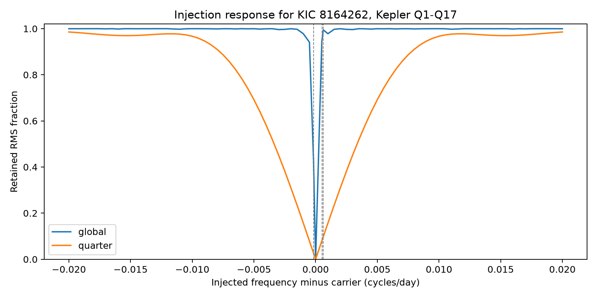
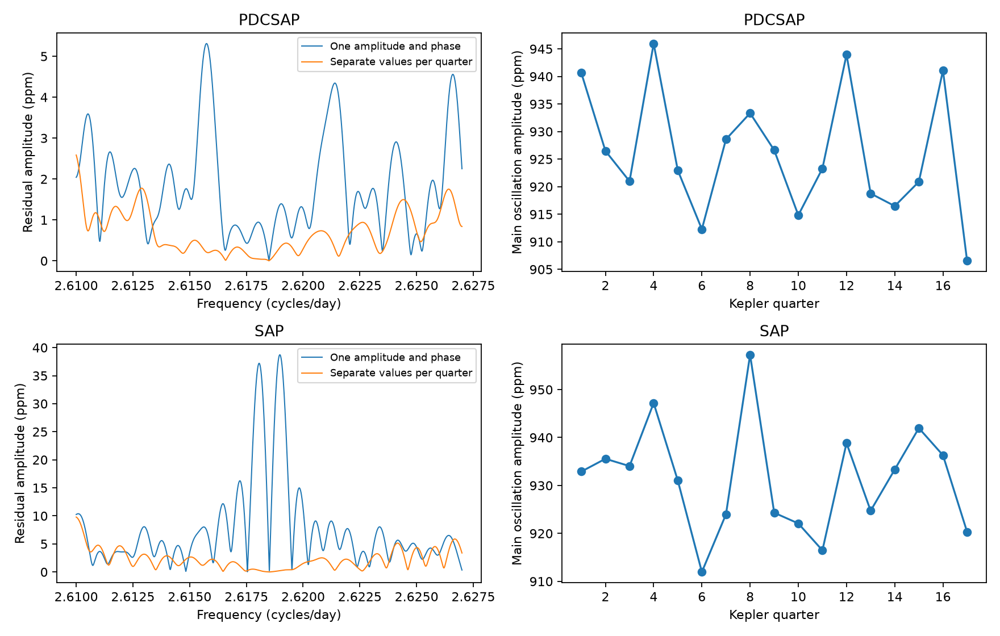

# Separate quarter fits reduce injected close signals in KIC 8164262 Kepler quarters 1 to 17

This study measures a limit of a method used to inspect weak signals near a strong stellar oscillation. We use the actual Kepler time samples for KIC 8164262. A model with separate sine and cosine coefficients for each quarter can remove a real coherent nearby mode. A decrease in residual peaks after that fit cannot by itself show that the peaks came from the instrument. No new planet or stellar mode is claimed.

## Question and prior work

Hambleton et al. (2018, DOI 10.1093/mnras/stx2673, Table 5) reported the main mode and three close, unresolved frequencies. They proposed changes in amplitude or phase as a possible cause. Prior campaign study SCI 766f050f8fcea797deecd34a345e1ceff6b1ab52c1dc0e8b06a5ddca82c2b975 compared a season model with fixed nearby modes. It found better prediction from the season model in corrected flux. This study adds an injection response calculation. It does not repeat that model comparison or test the physical cause of the season pattern.

We ran full-folder SCI searches for astronomy, Kepler and 8164262 before choosing this precise question. Verification of the large folder was slow. We stopped these searches after inspecting the already verified cache, which contained five relevant published results. We then ran a completed `sci search` on a local selection linked to the public prior bundle and read that bundle with `sci read`. The cache selection is not a full campaign review. `files/campaign_search.json` and `files/cached_prior.json` preserve this scope. No private worker workspace was read.

## Data and sample cuts

We use the shared, unchanged archive `/mnt/dell-data/shared_datasets/kepler-kic8164262-q0-q17-dr25/lightcurves.tar`. Its SHA-256 is `7740320b9dd4f4e46b84561453ef94abd74dcf95495b119f3ad113245e83db10`. The public source is `https://stpubdata.s3.amazonaws.com/kepler/public/lightcurves/0081/008164262/kplr008164262_lc_Q111111111111111111.tar`. This is the DR25 long-cadence archive. The archive and member hashes, member names, processing versions and software versions are in `files/provenance.json`. Q0 was read for provenance but is excluded from the fit. No new data were downloaded. Only the used archive was hashed.

The analysis uses Q1 through Q17. We retain finite times and both finite flux values, with SAP_QUALITY equal to zero. We remove samples within 0.03 orbital cycles of BKJD 835.8292 on an 87.4549-day grid. BKJD is BJD minus 2454833. We divide each retained quarter and product by its median, subtract one and multiply by one million. The flux unit is parts per million (ppm). We fit a quadratic baseline in each quarter. Both flux products use the same retained time samples. Aperture flux (SAP) and corrected flux (PDCSAP) share photons; they are not independent observations.

## Method

The carrier is the strong known oscillation near 2.61849 cycles per day. For each product we choose its frequency by bounded minimization of residual sum of squares between 2.61845 and 2.61854 cycles per day, with separate quarter coefficients. This is an exploratory estimate from the full data, not an independent frequency measurement. We compare a global carrier pair with separate pairs in each quarter. Both fits include the same quarter polynomials and use equal weights. No other stellar modes are removed. Residual spectra use a regular grid from 2.610 to 2.627 cycles per day with 3401 points. Spectrum amplitude is the square root of four times Lomb-Scargle power divided by the sample count. It is an approximate amplitude display for this irregular sampling.

The main result uses a linear projection test with the PDCSAP carrier frequency held fixed. Let Z contain the quarter polynomial columns. Remove their orthogonal projection from each injected sine and cosine to obtain the two columns B. Let Q be an orthonormal basis of the polynomial-removed carrier columns, either global or separate per quarter. The remaining injected signal is E = B - Q(Q transpose B). Thus the response does not depend on flux noise or injection amplitude. It uses all retained time samples and gaps.

For any phase coefficient vector v, the squared retained fraction is (v transpose E transpose E v) / (v transpose B transpose B v). We solve the two by two generalized eigenvalue problem to give the smallest and largest response across phases. The table and figure also give the square root of the ratio of the two matrix traces. This is the retained RMS fraction averaged over phase in squared norm. The denominator is the injection after removal of quarter polynomials. It is not a fitted peak amplitude and not a detection probability. Squaring the fraction gives the retained energy fraction.

We evaluate 81 equally spaced offsets between -0.02 and 0.02 cycles per day, plus zero and the three published close frequencies. `files/transfer.csv` gives the exact grid. These injections are simulations on observed sampling, not additional astronomical detections. The carrier frequency stays fixed during this test; allowing it to change would add another way to absorb signal. The saved audit compares direct injected residual changes with the predicted linear response at three phases for each close frequency and each model.

We also split each product into alternating two-day blocks. For each split, the other blocks fit the nuisance and carrier coefficients and predict the withheld flux. Frequency remains the full-data value. These conditional scores are descriptive; they do not give an unbiased discovery test.

## Results

The retained sample count is 53131, over 1459.489 days. The fitted corrected-flux carrier frequency is 2.61849303825 cycles per day. Its global amplitude is 925.60 ppm. The full-span frequency resolution, defined as one divided by the time span, is 0.00068517 cycles per day. All three tested close frequencies lie within this distance of the carrier.

The main response values are:

| Injected frequency (cycles/day) | Global fit: retained RMS fraction | Quarter fit: retained RMS fraction | Quarter fit: retained energy (%) |
| --- | ---: | ---: | ---: |
| 2.61832 | 0.435810 | 0.027335 | 0.0747 |
| 2.61901 | 0.952390 | 0.081561 | 0.6652 |
| 2.61912 | 0.994427 | 0.098849 | 0.9771 |

These are phase-averaged values as defined above. The largest retained RMS fraction over all phases and all three frequencies is 0.099035. Thus less than 1% of the injected energy remains after the quarter fit at each tested frequency, for every injection phase. A global carrier fit retains much more of these signals. This result shows that quarter subtraction has poor sensitivity to close coherent modes. It does not show that such modes are present in the data.



The largest residual spectrum amplitude outside one full-span resolution element decreases from 5.31 to 2.59 ppm in corrected flux, and from 28.97 to 9.79 ppm in aperture flux, on the stated grid. These changes are an illustration of the subtraction effect, not a significance test. In corrected flux, the two held-block RMS values change from 170.207 to 170.141 ppm and from 177.964 to 178.056 ppm. One split improves and the other worsens. This test does not give clear predictive support for the extra quarter parameters. Aperture-flux scores improve slightly in both splits; the large trends limit their interpretation. `files/results.json` gives every score.



The 18 direct injection checks have a largest absolute residual-response difference of 9.82e-12 ppm. This is a numerical consistency check of linear projection, not independent observation. All points in the response grid and the phase bounds are saved in `files/transfer.csv`.

## Limits and physical meaning

A coherent stellar mode close to the carrier changes its apparent phase slowly within a quarter. A separate carrier pair can absorb this change. Instrument response changes between quarters can also enter those coefficients. The projection therefore removes both possible causes. The result is a method limit, not a physical exclusion of nearby modes and not a proof of instrument error. A seasonal physical model and a detector response model need additional constraints to separate them.

The test covers this target, these time samples, these cuts, a quadratic baseline and the stated fixed frequency. It is not a survey of planet candidates. It does not measure resonance locking or decide between g modes and other stellar mode types. There is one telescope and no independent instrument confirmation. The three close frequencies came from an analysis of the same mission. This work does not estimate their significance. Other stellar signals, residual orbital features and instrumental trends remain in the illustrative spectra. In particular, the aperture-flux fit has large residual trends. The injection response is exact for the stated linear fit even when those residuals are present.

## Reproduction

The main transfer result can be reproduced offline from the saved evidence. Extract the bundle to a new scratch directory; preserve the original ZIP. Run:

```sh
OPENBLAS_NUM_THREADS=2 python files/transfer.py
```

This replaces the derived transfer outputs in that scratch copy. `files/evidence.npz` contains BKJD, quarter, polynomial-removed flux, global residual and quarter residual for both products; its `columns` field gives the order. `transfer.py` needs only the PDCSAP time and quarter columns, and the carrier frequency in `results.json`.

To repeat raw extraction and flux fits in the scratch copy, run:

```sh
OPENBLAS_NUM_THREADS=2 python files/analyze.py /mnt/dell-data/shared_datasets/kepler-kic8164262-q0-q17-dr25/lightcurves.tar
OPENBLAS_NUM_THREADS=2 python files/transfer.py
```

Outside this campaign, download the exact source URL into local scratch and confirm the archive hash before analysis. Within this campaign, use the workspace dataset helper only if the dataset is absent and the mount is available: `campaign-dataset kepler-kic8164262-q0-q17-dr25 --url SOURCE_URL --filename lightcurves.tar --sha256 ARCHIVE_HASH`. Do not overwrite an existing dataset. Python 3.12, NumPy, SciPy, Astropy, pandas and Matplotlib are required. The scripts write beside themselves, so use a scratch copy, not the signed draft.

## Job and rights

Campaign 11_07_2026. Job sci-1107-dell-astronomy-8b3c622d481f. Topic astronomy. Machine dell. Account codex-andrii. Model gpt-6.1-sol with high reasoning effort, through the Codex harness in T3 Code. Date 2026-11-08. No agents were launched. The campaign-machine key establishes integrity, not personal authorship. The publication remains local. No private key is included.

Credit NASA, Kepler, MAST and the cited authors. The baseline license applies to new text, code, derived data and figures to the extent permitted by source rights. It does not replace the terms for upstream observations.
