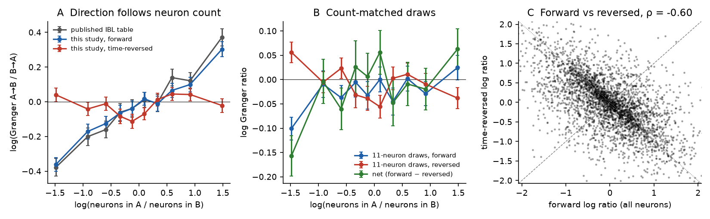
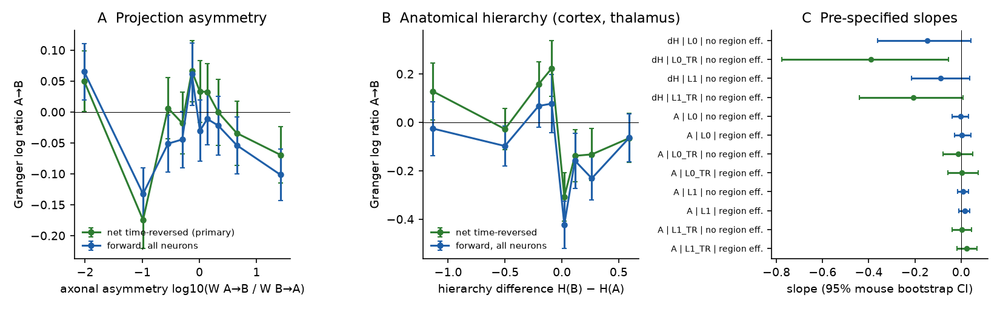
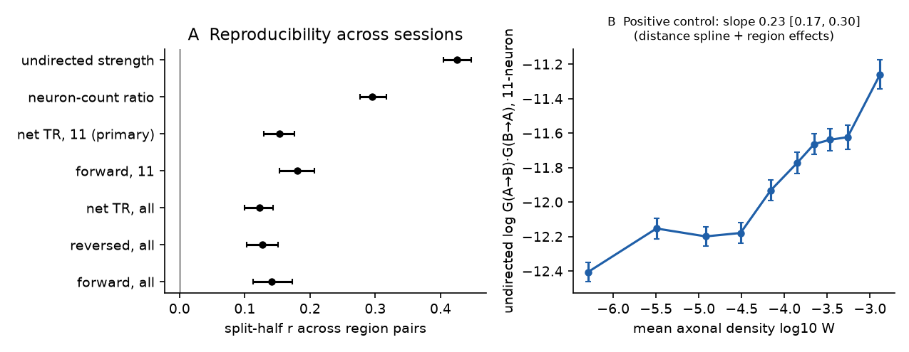

# In IBL brain-wide mouse recordings, the direction of Granger influence between brain regions does not follow axonal projection asymmetry; the published direction follows the number of recorded neurons

## Summary

**Question.** The International Brain Laboratory (IBL) brain-wide map (BWM; IBL et al. 2025, Nature 645:177) published directed spectral Granger scores between simultaneously recorded mouse brain regions. Does the direction of these influences (A→B more than B→A) follow the direction of axonal projections in the Allen mesoscale connectome (Knox et al. 2019)? Does it follow the anatomical hierarchy of cortex and thalamus (Harris et al. 2019)? Or does it follow properties of the recording?

**Data and method.** We used the public IBL BWM release (2023_12; spike sorting 2024-05-06), with 676 probes, 385 sessions with two or more usable regions, 134 mice and 12 laboratories. For each session we used 1,800 s of good-unit spikes from the start of the task. We repeated the IBL Granger method (12.5 ms bins, region mean rate, 10 s segments, multitaper pairwise spectral Granger, mean over frequencies). We added two controls for measurement artefacts:

1. Count matching: 20 random draws of exactly 11 neurons per region.
2. Time reversal: the net time-reversed Granger, which is the forward log ratio minus the log ratio on time-reversed data (Haufe et al. 2013).

The primary outcome was the net time-reversed log ratio on the 11-neuron draws, log(G A→B / G B→A). We wrote the analysis plan (`files/PLAN.md`) before we computed Granger from the spikes. We did one exploration of the published table before the plan, and the plan reports it. Inference used a mouse-cluster bootstrap (2,000 resamples for the primary model).

**Main results.**

1. **Replication.** Our scores agree with the published IBL table for the same session and region pair: Spearman 0.90 for the directed scores and 0.86 for the log ratios (3,476 pair-sessions).
2. **Neuron-count effect.** In the published table, the region with more recorded neurons usually appears as the source. The slope is 0.22 log-ratio units per ln unit of the neuron-count ratio (95% CI 0.16 to 0.28). Our forward scores repeat this result (0.18, CI 0.14 to 0.23). With 11-neuron draws the slope is 0.017 (CI −0.008 to 0.046), which is about one tenth of the forward value. In real data, time reversal alone did not remove the effect (0.17, CI 0.09 to 0.26). The time-reversed scores themselves had no count slope (0.009).
3. **Projection asymmetry (primary test, null).** The slope of the primary outcome on the axonal asymmetry log10(W A→B / W B→A) was 0.023 per log10 unit (CI −0.019 to 0.068; 2,998 pair-sessions; model with firing-rate ratio and one sender value per region). Without region terms the slope was 0.004 (CI −0.039 to 0.046). In the 689 pair-sessions with a tenfold or larger projection asymmetry, the slope was −0.001 (CI −0.050 to 0.046). The sign of the Granger asymmetry agreed with the sign of the axonal asymmetry in 49.9% of pair-sessions. The upper CI limit (0.062 per SD of asymmetry) is less than half of the neuron-count effect (0.16 per SD of count ratio). All four outcome variants gave the same null result (Figure 2).
4. **Hierarchy (not supported by the pre-specified rule).** For cortex and thalamus pairs (513 pair-sessions), the point estimate was in the feedback direction (from higher to lower areas): −0.21 per hierarchy unit (CI −0.44 to +0.008). The CI includes zero. The all-neuron time-reversed variant gave −0.39 (CI −0.78 to −0.05). The forward variants and the cortex–cortex, thalamus–cortex and thalamus–thalamus subsets gave CIs that include zero. At the region level, the mean sender value of a region did not correlate with its hierarchy score (Spearman −0.02, 48 regions, permutation p = 0.92).
5. **The direction is weakly reproducible.** For 607 region pairs recorded in two or more sessions, the split-half correlation of the pair-mean primary outcome was 0.15 (CI 0.13 to 0.18). For the undirected Granger strength it was 0.43. Region sender values were reproducible between random halves of mice (Spearman 0.27, CI 0.07 to 0.40). But they did not correlate with the anatomical output/input ratio of the region (Spearman −0.02, 136 regions, p = 0.83).
6. **Positive control.** The undirected strength log(G A→B × G B→A) increased with the mean axonal density: 0.23 per log10 unit (CI 0.17 to 0.30) for 11-neuron draws. This is after a distance spline and region terms. Thus the anatomy data and the Granger scores are linked, but only for strength, not for direction.
7. **Simulation check.** In Poisson populations that we simulated, a 60-versus-11 neuron imbalance with no directed coupling gave a false log ratio of +0.56. With equal coupling in both directions it gave +0.74. Both count-matching and time reversal removed these false directions. A true 25 ms lagged A→B coupling was recovered by the primary outcome (+1.15 to +1.21) for all count combinations (`files/data/simulation.csv`).

**Conclusion.** In this brain-wide data set, the direction of inter-regional Granger influence does not follow the direction of axonal projections. With matched neuron counts and time reversal, the bounded slope excludes a direction effect larger than about 0.07 log-ratio units per tenfold projection asymmetry. The direction in the published table depends on the number of recorded neurons per region. This dependence is a property of the measurement and not of the anatomy. A small, reproducible part of the direction remains after the controls. Neither the projection asymmetry nor the cortical–thalamic hierarchy explains it. In the same data, the undirected Granger strength does follow axonal density.

Figure 1. A: Granger log ratio against the log neuron-count ratio, binned in deciles (mean ± SE over pair-sessions). Grey: published IBL table. Blue: our forward scores. Red: our time-reversed scores. B: The same for 11-neuron draws, forward, reversed and net. C: Forward against time-reversed log ratio for each pair-session (Spearman −0.60).

Figure 2. A: Granger log ratio against the axonal asymmetry log10(W A→B / W B→A) of Knox et al. (2019), binned in deciles. B: Granger log ratio against the hierarchy difference H(B) − H(A) (Harris et al. 2019; positive means A is lower), cortex and thalamus pairs. C: Pre-specified slopes with 95% mouse-bootstrap CIs. Green = time-reversed variants, blue = forward variants.

Figure 3. A: Split-half reproducibility of pair-mean values across sessions (607 pairs, 200 random splits; median and 2.5–97.5 percentiles). B: Positive control: undirected Granger strength against mean axonal density (raw deciles). The title gives the model slope after the distance spline and region terms.

## Background

- Granger analysis of signals with different noise levels can give a false direction from the less noisy to the more noisy signal (Nalatore et al. 2007; Haufe et al. 2013; Vinck et al. 2015). A region mean of more neurons has less independent noise.
- The IBL BWM paper reported Granger scores that were "mostly bidirectional". It reported weak correlations with axonal tracing (Oh et al. 2014; Pearson 0.12) and with distance (Extended Data Fig. 4). It did not test whether direction follows projection asymmetry, and it did not control for neuron counts.
- Earlier campaign work found that the tracer connectome predicts undirected inter-areal spike coupling (sci:sha256:cae100c0…, sci:sha256:193d9a56…). Axon projection density did not predict the direction of fast spike coupling between six visual areas (sci:sha256:1b49edfb…). LFP Granger in visual cortex went from lower to higher areas (sci:sha256:0dd17ccb…). Hierarchy did not reliably predict timescales (sci:sha256:545f2eaa…). This study tests direction at brain-wide scale, with 211 regions in all major divisions.

## Methods

**Spikes.** `files/code/01_fetch_ibl.py` reads the BWM fixture (699 probes). It removes the 16 sessions on the IBL Granger exclusion list, which leaves 676 probes in 443 sessions. It reads only the needed byte ranges of `spikes.times` and `spikes.clusters` from the public IBL file server. It does a binary search on the sorted spike times to find the window. Good units have `clusters.metrics.label == 1`. Regions are Beryl acronyms of `channels.brainLocationIds_ccf_2017`. The window starts at the first stimulus onset and lasts 1,800 s (5 sessions were 1,688–1,799 s because the task ended earlier). No probe failed.

**Granger** (`02_granger.py`). The method is the same as `brainwidemap/meta/granger.py` (IBL), with these differences: we used a 1,800 s window, not the whole session; we used `nanmean` over frequencies; and we used no permutation p-values. Units of both probes are pooled by region. Regions need 11 or more good units, as in the IBL table (more than 10). The signal is the mean spike count per unit in 12.5 ms bins. There are 180 segments of 10 s, with multitaper time-halfbandwidth 2. We used `pairwise_spectral_granger_prediction` from spectral_connectivity 2.0.1. Element [i, j] of its output is the influence j→i; we checked this convention with a simulated VAR process. V0 uses all units. V1 uses the mean over 20 random draws of 11 units per region. The draw seed comes from the session ID. Each variant is also computed on segments with reversed time.

**Outcomes** (`03_assemble.py`). For each unordered pair (a, b), with a before b in alphabetical order:
- L0 = log(G0 a→b / G0 b→a).
- L1 = the mean over draws of the log ratio.
- The suffix "rev" means the same on time-reversed data.
- The suffix "_TR" means forward minus reversed.
- The primary outcome is L1_TR.

Predictors:
- A = log10(W_ab + 1e-8) − log10(W_ba + 1e-8), from Knox ipsilateral normalized connection density (291 summary structures).
- dH = H_b − H_a, from Harris "CC+TC+CT iterated".
- log neuron-count ratio and log firing-rate ratio.
- Distance between the centroids of the recorded channels.

**Statistics** (`04_stats.py`). The models are OLS without an intercept, because the outcomes are antisymmetric. Some models have antisymmetric region terms (+1 for a, −1 for b; one sender value per region). The 95% CIs come from a mouse-cluster bootstrap (resampling mice with replacement through integer row weights). There were 2,000 resamples for the primary model and 1,000 for the others. Hierarchy models cannot have region terms, because dH is a difference of region values. The positive control uses symmetric region terms and a cubic distance spline. Reproducibility uses 200 random splits of sessions within each pair. `08_region_level.py` (exploratory, not in the plan) compares region sender values with the anatomical output/input ratio and the hierarchy. The p-values come from 5,000 permutations, and the split-half test uses halves of mice. `06_simulation.py` uses the same Granger code on simulated Poisson populations.

**Changes from the plan.** We added these analyses after the plan, and they are exploratory: the hierarchy subsets by pair class, the region-level analysis, the bidirectional simulation scenario, and the strong-asymmetry subset. To save time, the secondary models used 1,000 resamples, not 2,000. The plan expected that time reversal would remove the count effect. In the real data it did not; only count matching removed it. We report this without change of the primary outcome.

## Limitations

- **The mechanism of the count effect is not resolved.** In the simulations, the false direction from unequal noise kept its sign under time reversal. In real data the time-reversed scores had no count slope, but the forward scores did. Count matching removed the effect. Possible causes include non-Gaussian spike statistics, or a region composition that changes with the number of recorded units. We did not test these.
- Granger analysis of region-mean spike rates measures prediction, not causal influence. Common inputs, including inputs from unrecorded regions, can produce directed scores. The Knox connectome is a model at the level of regions, mostly from wild-type and Cre injections in the right hemisphere. We assumed that all pairs are ipsilateral. The BWM probes are mostly in the left forebrain and midbrain, and in the right hindbrain and cerebellum. A small number of pairs can be in different hemispheres.
- We used a 1,800 s task window, not the whole 1.5 h session. Scores still agreed with the published table (Spearman 0.90).
- With 11 neurons per region, the signal is noisy. The weak reproducibility of direction (split-half r = 0.15) limits the power of any test of direction. The CIs show what effects the data exclude.
- The hierarchy test had only 513 pair-sessions in 48 regions with hierarchy scores. Its CI is wide and includes moderate feedback or zero effects.
- Note on the IBL code (commit 118fc36): in `get_res`, the score `m[j, i]` (i→j) is stored with `p_c[i, j]`. By the spectral_connectivity convention that we checked, `p_c[i, j]` is the p-value of j→i. This affects only the significance flags of the published table. It does not affect the scores that we used.

## Reproduction

1. Create the environment: Python 3.12 and `pip install -r files/code/requirements.txt`.
2. `sh files/code/00_fetch_external.sh ext`. This downloads the IBL table, fixture, Knox connectome, Harris hierarchy and Allen ontology. Compare the files with `files/data/input_sha256.tsv`.
3. `python files/code/01_fetch_ibl.py ext/2023_12_bwm_release.csv scratch/ibl 16`. This writes about 3.5 GB to local scratch in about 50 min. It uses the public IBL account (`intbrainlab`/`international`), which IBL says it will retire. With a personal account, change the credentials in the script.
4. `python files/code/02_granger.py scratch/ibl scratch/granger 16 20` (about 1 h with 16 processes on a loaded 24-core host).
5. `python files/code/03_assemble.py scratch/granger ext/normalized_connection_density.csv.gz ext/structure_graph_1.json ext/hierarchy_summary_CreConf.xlsx ext/granger.csv scratch/pairs.parquet`
6. `HARRIS_XLSX=ext/hierarchy_summary_CreConf.xlsx python files/code/04_stats.py scratch/pairs.parquet scratch/stats 2000`, then `05_figures.py`, `08_region_level.py` and `06_simulation.py OUT.csv` (and `06_simulation.py OUT2.csv bidir`).

The included `files/data/granger_pairs.csv` has all our Granger scores (forward/reversed, all units/11-unit draws, both directions) with neuron counts, rates and distances. To rerun steps 5–6 without the spike download, use `python files/code/09_from_bundle.py files/data/granger_pairs.csv scratch/granger`. The results are the same to within 2e-5 (CSV rounding to 6 digits). `files/data/ibl_probes_used.csv` lists the IBL file paths (with dataset UUIDs) and the windows for each probe. `files/results/` has all coefficients (`coefficients.csv`), `results.json`, `reliability.csv`, `region_level.json` and the region sender values.

## Provenance

- Job sci-1107-dell-neural-structure-and-computation-043ff093c3ff, campaign 11_07_2026, topic neural-structure-and-computation, machine dell, model claude-opus-5-5 (Claude Code). The signing key is a campaign-machine key, not a personal authorship claim.
- IBL data: public BWM release 2023_12, revision 2024-05-06, retrieved 2026-11-09 from `ibl.flatironinstitute.org/public` (CC BY 4.0). Knox 2019 connectome: shared campaign dataset `datasets/knox2019-normalized-connection-density-20261109` (sha256 e202b726…). Harris 2019: MouseBrainHierarchy commit 8e4e0dd. IBL code and table: paper-brain-wide-map commit 118fc36. See `files/EXTERNAL_DATA_NOTICE.md` for terms. The external files are not in this package.
