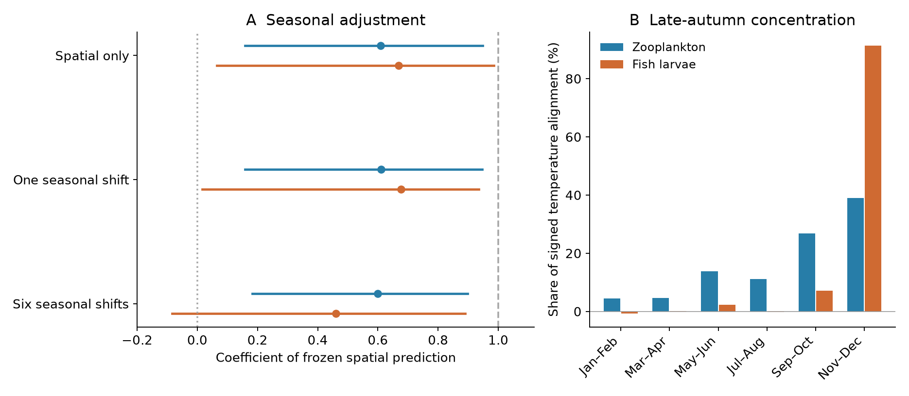

# Seasonal adjustment retained a positive spatial-temperature response in Northeast Shelf zooplankton

## Result

Seasonal timing did not remove the spatial-temperature response in the selected zooplankton samples. The result was less clear for fish larvae. We used original NOAA EcoMon tow records, not BBS records or the existing network summaries. We trained temperature and seasonal directions on 1992-2007 records and tested changes in 2008-2023. Training excluded the focal 2-degree spatial block.

For zooplankton, the coefficient of the frozen spatial warming prediction was 0.610. It was 0.599 after we allowed a separate seasonal shift in each of six two-month periods. The conditional 95% crossed-bootstrap interval for the latter coefficient was 0.183 to 0.898. For fish larvae, the coefficient fell from 0.668 to 0.460. Its interval was -0.084 to 0.891. The paired reductions were uncertain: the interval for the change in coefficient was -0.106 to +0.054 for zooplankton and -0.390 to +0.136 for fish larvae.

November-December supplied 91% of the signed temperature alignment for fish larvae, compared with 39% for zooplankton. In these late-autumn samples, the spatial and seasonal vectors had a cosine of -0.704 for fish larvae and +0.012 for zooplankton. Thus, the fish-larva contrast is much more exposed to seasonal ambiguity. These shares concern a signed inner product. They are not fractions of all community change or causal fractions. The fish share interval was 0.159 to 1.655, and the late-autumn cosine interval was -0.823 to +0.620. The point pattern is therefore a diagnostic, not a precise population contrast.



Panel A shows the coefficient of the early spatial prediction, with conditional 95% crossed-bootstrap intervals. A value of one is the full uncalibrated early spatial prediction. Panel B shows each season's share of the signed temperature-alignment numerator. Negative shares are possible. Each assemblage uses the same records across its three models.

## Why this test matters

Earlier campaign work found weak temporal transfer of spatial temperature gradients across many systems (SCI 0037934e). Northeast Shelf plankton were an important contrast: their thermal means tracked much more of their spatial benchmark (SCI dd5e171c). That contrast supported, but did not establish, a role for fast generations and high mobility. Earlier work also showed that a thermal mean need not describe the full species response, including in Finnish moths (SCI d8a7d7b1).

A warm place and a later point in seasonal succession can have similar species composition. A shift in biological timing can therefore look like geographic community replacement even when survey dates are controlled. We test this alternative in the full composition vector. We do not infer timing from the thermal mean.

The problem is established in prior literature. Ji et al. (2010), DOI 10.1093/plankt/fbq062, called for methods that separate plankton timing from spatial change. Walsh et al. (2015), DOI 10.1371/journal.pone.0137382, studied both larval timing and geographic shifts on this shelf. Weisberg et al. (2024), DOI 10.3354/meps14592, found heterogeneous larval timing and links to Gulf Stream intrusions. We do not claim discovery of phenological change. Our contribution is a frozen, spatially held-out vector test of whether seasonal succession can account for the marine thermal-tracking contrast.

## Data and scope

We read three shared files in place: EcoMon CSV version 3.10 in NCEI accession 0187513, archive version 4.4; its documentation PDF; and a NOAA OISST version 2.1 monthly snapshot through October 2026. Exact shared paths, URLs, byte counts, versions and SHA-256 hashes are in files/provenance.json. No new raw-data download was needed. Source terms and attribution are in files/EXTERNAL_NOTICE.md. NOAA, NMFS, NEFSC, Oceanography Branch supplied the plankton data. NOAA PSL and NCEI supplied SST.

We reused the verified preparation code from SCI dd5e171c. It combines documented taxon columns, removes unresolved or protocol-dependent groups, and matches each tow to monthly SST at the nearest valid ocean pixel. Monthly climatology uses 1982-2023. The test uses 1992-2023 to avoid the earlier MARMAP-to-EcoMon programme change. Taxon selection requires presence in at least 1% of processed early-period tows. Later counts do not set the vocabulary.

A survey unit is a 0.5-degree cell by two-month period. We require at least five nonempty processed tows and at least three distinct years in each 16-year half. We treat blank taxon entries as zero only in processed tows, as in the cited preparation. We exclude catches with no selected taxon. Therefore the fish analysis describes composition conditional on a nonempty selected catch, not fish occurrence in every processed tow.

The primary zooplankton test has 14,727 tows, 39 taxon groups and 523 cell-season units. The fish test has 8,939 tows, 37 taxa and 378 units. Both span 15 occupied 2-degree blocks. These are two overlapping assemblages in one survey, not independent regional experiments. The selected units warmed by a mean monthly SST anomaly difference of 0.841 C for zooplankton and 0.694 C for fish larvae.

## Method

### Two directions trained before the test period

For each tow, let p be the vector of log(1 + taxon density), divided by its sum. The primary composition vector Y equals p. Presence proportions and sqrt(p), the Hellinger transform, are sensitivity tests. Proportions describe catch composition, not biomass or equal catchability.

We train a separate pair of directions in each two-month period. For each focal spatial block, all training records come from other blocks and from 1992-2007 only.

1. The seasonal vector h is the multivariate slope of early tow composition on day of year after cell effects are removed. Its unit is composition per day. The analogous slope hT is fitted for monthly SST climatology.
2. We adjust each early cell mean to a common survey day: A* = mean(Y) - h times the difference from the common day. We adjust its SST climatology with hT in the same way. The spatial vector g is the multivariate slope of A* on this adjusted climatology, with an intercept and equal cell weights. Its unit is composition per C.
3. We validate g in the omitted block by projecting its adjusted early cell means onto g and regressing that score on the centered climate coordinate. We validate h with within-cell day-composition cross-products in the omitted early block. Neither validation slope is forced to one outside training.

The primary held-out spatial validation slopes were 0.935 for zooplankton and 0.729 for fish larvae. The seasonal validation slopes were 0.765 and 0.731. Spatial delete-block jackknife intervals were above zero for all four slopes. Crossed-bootstrap validation intervals can be biased downward when training becomes sparse; both sets of results are supplied. Validation establishes predictive direction in the selected early records. It does not establish a causal thermal niche.

### Test-period displacement

For each cell-season unit, D is the late mean composition minus the early mean, adjusted by h times the difference in mean survey day. Temperature exposure dT is the late-minus-early mean monthly SST anomaly. This avoids using the seasonal SST cycle itself as the warming exposure. It remains sensitive to unequal sampling of warm and cold years.

Set G = g dT and H = h dT. We fit the following descriptive least-squares models, with equal unit weights and no intercept:

- Spatial only: D = alpha G + residual.
- One timing shift: D = alpha G + k H + residual.
- Six timing shifts: D = alpha G + k_b H + residual, with one k_b for each two-month period.

The third model allows spring and autumn shifts to have different signs. A positive k is a move forward along the early seasonal trajectory at a fixed calendar date. Its unit is days per C. It is an equivalent seasonal shift, not a measured spawning date. All models use frozen early directions; their amplitudes are estimated from later displacement. Their projection shares are descriptive fits, not out-of-sample forecast scores.

The spatial-only coefficient is sum(G dot D) / sum(G dot G). The joint coefficients solve the two- or seven-column Gram system. The pooled axis cosine is sum(G dot H) / sqrt[sum(G dot G) sum(H dot H)]. Seasonal shares in the figure divide each season's sum(G dot D) by the total. These definitions make the scale and the seasonal ambiguity explicit without a species thermal index.

The alpha coefficients measure transfer relative to the trained vector. As a secondary calibration, division by the held-out spatial slope gives 0.652 before and 0.640 after six timing shifts for zooplankton; fish larvae give 0.916 and 0.631. These ratios have wider intervals. They are not the same estimands as the earlier study's all-year CTI trend ratios.

### Uncertainty and diagnostics

We attempt 399 crossed bootstrap draws for the primary transform. Each draw resamples 15 spatial blocks and four 4-year time blocks separately within each half. It refits directions, validation and endpoints. A focal block never trains its own vector, including repeated copies. A draw is rejected if a seasonal training set has fewer than five cells or a degenerate design. There were 399 valid zooplankton draws and 375 fish draws. Fish intervals therefore condition on valid training designs. Fixed period, taxon vocabulary, source coverage and climate product are not resampled.

We also delete each of the 15 spatial blocks and refit, with t intervals using 14 degrees of freedom. The six-shift alpha intervals from this method were 0.505-0.692 for zooplankton and -0.210 to 1.130 for fish larvae. The wider fish interval agrees with the lack of a clear residual fish response. The crossed intervals include common multi-year shocks; the spatial jackknife does not. All intervals are nominal, conditional and exploratory.

We repeat the fits with Hellinger and presence composition, omit each season in turn, and add early mean log depth and surface salinity to spatial training. The seasonal-shift test is not a complete advection test. The primary plan was written before outcome fits. The six-season extension, autumn concentration table and split-year diagnostic were added after first fits. files/PLAN.txt records this sequence.

## What the evidence supports

A single common timing shift gave coefficients of -0.50 days per C for zooplankton and +0.76 for fish larvae. Both intervals included zero. It changed the spatial coefficients very little. This simple model is too restrictive to rule out seasonal effects in general.

Six seasonal shifts left the zooplankton coefficient near 0.60. Hellinger and presence fits gave 0.562 and 0.616. After each season was omitted, the primary six-shift coefficient ranged from 0.544 to 0.721. Adjustment for depth and salinity also retained a positive point estimate. Thus the selected zooplankton contrast survived a test that used early seasonal succession as an explicit alternative direction.

For fish larvae, six seasonal shifts gave 0.460; Hellinger and presence fits gave 0.378 and 0.518. All require uncertainty to interpret. Omission of November-December reduced the primary spatial-only coefficient from 0.668 to 0.282, and the six-shift coefficient from 0.460 to 0.153. The late-autumn concentration and large local axis overlap constrain a dispersal-based interpretation of the earlier fish result. They do not prove that phenology caused the change. The paired change in coefficient remained uncertain.

The full unscaled spatial prediction reduced composition error by only 2.7% for zooplankton and 4.2% for fish larvae. Both crossed intervals included zero. A positive response along the temperature direction therefore did not establish useful full-community prediction. This is compatible with the earlier Finnish result that a thermal summary can change faster than the whole community.

## Sampling noise and persistent displacement

A small fraction of raw displacement along a climate direction can be misleading when cell means have few tows. We split each half into odd and even years, freeze the trained directions, and form two endpoint changes D_A and D_B with separate date corrections. Units need at least two tows in all four subsets. This leaves 479 zooplankton units and 327 fish units.

The persistent cross-product is sum(D_A dot D_B). The directional cross-product is sum[(D_A dot g)(D_B dot g)/(g dot g)]. Their ratio is 27.6% for zooplankton and 30.1% for fish larvae. For comparison, the same units' raw local-direction shares were 15.1% and 16.9%. These local-direction measures allow each unit its own amplitude. They differ from the 4.6% and 5.5% global warming-prediction projection shares.

The odd-even displacement cosines were only 0.163 and 0.185. This shows limited repeatability of fine-scale changes. The cross-product calculation is a diagnostic, not a causal noise correction: it assumes comparable odd/even sampling, fixes trained directions, and cannot remove common environmental shocks or shared model error. It can have unstable or negative denominators. files/replication_intervals.csv gives the wide spatial conditional intervals. We do not assign all remaining displacement to a non-climatic process.

## Limits and next tests

The test separates two observed composition directions. It does not identify the ecological process that sets the remaining gap. Temperature, advection, food supply, predator change and geographic species pools can covary. Depth and surface salinity are incomplete controls. Fast demographic response and high dispersal remain plausible for zooplankton, but are not established by this observational contrast.

A common early seasonal derivative within each two-month period cannot represent species-specific timing changes, changed seasonal duration, nonlinear local trajectories, or different shifts among water masses. The strong early validation does not remove that model limit. The larval-fish literature already shows that timing responses differ among taxa and locations. The weak common timing coefficient must not be read as an absence of phenological change.

Other limits include coarse taxon groups, changes in catchability and gear, nonempty-catch selection, 0.5-degree aggregation, surface SST as a water-column proxy, sparse winter training, and only 15 spatial blocks. Nonlinear spatial temperature responses can invalidate a single linear vector. The two assemblages share cruises and physical conditions. A positive spatial-temperature component is not a causal fraction of warming or an equilibrium response.

A useful next test would combine measured spawning dates or stage structure with depth-resolved water-mass transport. It would test species-specific timing and demographic replacement directly, instead of interpreting thermal tracking as evidence for one mechanism.

## Reproduce and inspect

Extract the signed publication. Use Python 3.12 with versions in files/environment.json. All analysis and retrieval output must go to a separate scratch directory outside the publication.

```
OPENBLAS_NUM_THREADS=1 OMP_NUM_THREADS=1 MKL_NUM_THREADS=1 python files/run_all.py /absolute/external_scratch --shared /mnt/dell-data/shared_datasets
```

The runner verifies the three source hashes, prepares tow records in scratch, runs both transforms and uncertainty settings, runs the odd-even diagnostic and independent checks, and draws the report. To download instead, omit --shared. The mutable OISST URL can now return different bytes; the runner rejects a hash mismatch. Exact reproduction then requires the recorded shared snapshot. No source tow or SST record is bundled. The shared raw files and exact retrieval recipe are sufficient to regenerate all derived records outside the signed draft.

For a short numerical check, run `python files/validate.py`. It recovers known spatial and seasonal coefficients and compares within-cell estimation with explicit fixed-effect regression. `python files/audit.py --tows /absolute/external_scratch/prepared/tows.parquet` independently checks a trained spatial and seasonal vector against explicit design-matrix fits. Aggregate unit sufficient statistics, selection counts, bootstrap draws, jackknife draws, sensitivity results and figures are bundled for direct inspection. They are original outputs derived from NOAA data, not a tow-level source extract.

## Research record

Campaign 11_07_2026. Job sci-1107-hp-climate-pollution-biodiversity-4c34be062add. Topic climate-pollution-biodiversity. Machine hp. Account codex-olen. Model gpt-6.1-sol with high reasoning effort. One finite automated worker, with no subagents. The campaign-machine signing key is not a personal authorship claim. All computations used at most two processes and one numerical thread per process. No private key is included. The signed bundle is saved locally; this worker did not upload or submit it.
