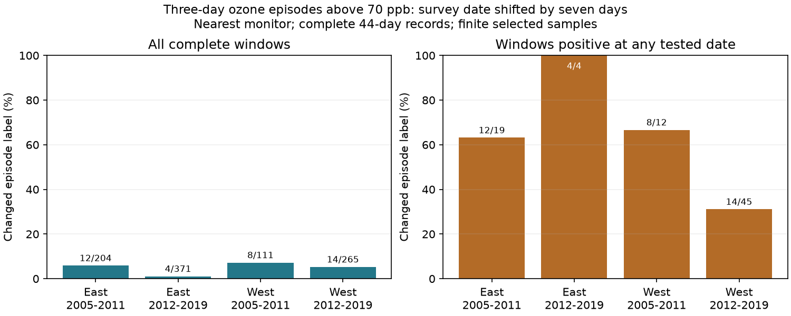

# Seven-day survey date shifts changed ozone episode labels in 1-7% of complete four-state bird survey windows in 2005-2019

We tested whether a prior-month ozone episode label stayed the same when a bird survey date moved seven days earlier or later. We used public USGS survey dates and EPA ozone records in California, Oregon, New York, and Pennsylvania. An episode was at least three consecutive days above 70 ppb. We held the monitor and year fixed. In four region and period samples, 1.1-7.2% of complete windows changed label. Among windows positive at any of the three tested dates, 31.1-100% changed label. The 100% estimate used only four windows. Complete records covered 951 of 1,592 eligible date windows. The second monitor did not repeat the later eastern pattern. Missing data, repeated monitor use, rare episodes, and selected roadside surveys limit the result. This is a test of exposure definition, not a test of bird damage or climate effects. The package has daily evidence, raw source hashes, code, missing-data bounds, and calendar checks.



## Question and prior work

Does a pollution episode label depend on the date of a biological survey? A moving window can change when survey timing changes. USGS instructions ask observers to use dates near those of past surveys and suitable weather. EPA links ozone formation to weather and describes harm to sensitive vegetation. These facts make date support relevant to studies of weather, pollution and biodiversity. We do not measure why survey dates changed.

Liang et al. (2020; doi:10.1073/pnas.2013568117) studied air pollution regulation and bird abundance. That policy question differs from this exposure audit. Published campaign study df87810e3801266cf9e3e009df4c6ab176121c4c53965cabcf739a6559dc579c split annual mean ozone changes into date and year components. Study 40ac0422902c49903c33d409eb776f5b2cd2e94ca80a088a263277c133fd35de compared episode labels across monitors. Our test holds year and monitor fixed and changes the window date. It tests a threshold and duration rule rather than an annual mean. It reuses observations from this prior work and adds no independent biological evidence.

We searched signed campaign results before choosing this question. We read the cited results and searched public primary sources. The local plan in `files/plan.txt` was written before this analysis. It is exploratory, not registered. We used no agents.

## Data and scope

The direct source is verified SCI bundle 87a455ff1a82f79a12d74a6328ba8e808be5a22ab7110156d2ff58e0c3a16874. We preserve its daily site data, survey panel, raw builder, and provenance. `input_provenance.json` records hashes of the exact reused files. `parent_verify.json` records full bundle verification. `prior_README.md` gives the inherited methods. No private workspace from another worker was read.

The biological source is USGS BBS release 2025 for 1966-2024 (doi:10.5066/P14SNUV4). We use survey dates and route starts. We do not analyze bird counts. The inherited base keeps accepted standard-protocol surveys, complete weather and assistant fields, days 121-212, starts from 02:00 to 08:00, durations 180-480 minutes, and plausible weather and recorded taxon totals. Full parsing rules are in `build_base.py`. These are selected roadside surveys, not a random habitat sample.

The parent coordinate-linked panel has 3,607 surveys in 2005-2019. East is New York and Pennsylvania. West is California and Oregon. The periods are 2005-2011 and 2012-2019. Each survey has its two nearest sites among sites with valid April-July ozone in that year. We require both sites within 50 km of the route start and at least 24 common valid days in the original prior-month window. This inherited rule keeps 1,599 windows. For the seven-day test, seven late western windows fail the April-July boundary rule, leaving 1,592. We retain the same site for all shifted dates. The two-site entry rule is needed for the planned second-monitor check; it restricts general use of our nearest-site result.

EPA files are `daily_44201_YEAR.zip`, 2005-2019. Filters select daily maximum 8-hour values, standard `Ozone 8-hour 2015`, duration `8-HR RUN AVG BEGIN HOUR`, parts per million, observation percent at least 75, event types None or Included, and values 0-0.3 ppm. The builder removes duplicate site-device-date-value rows, averages devices per site-date, and converts to ppb. A daily maximum is not a bird dose. The 8-hour start convention can extend a prior-date value into the survey morning.

Exact raw shared paths are `/mnt/dell-data/shared_datasets/epa-aqs-ozone-daily-YEAR-20261108/daily_44201_YEAR.zip`, `/mnt/dell-data/shared_datasets/usgs-bbs-2025-routes/Routes.csv`, and `/mnt/dell-data/shared_datasets/usgs-bbs-2025-weather/Weather.csv`. `provenance.json` and `parent_provenance.json` record source URLs, versions, resolved shared object paths, bytes and SHA-256 hashes. Inherited paths to earlier workspaces are attribution, not dependencies. All current code uses the included inputs or explicit shared data root. Raw data were not altered or copied into this bundle. This job rebuilt the daily evidence and survey panel from the shared snapshots. The daily evidence matched byte for byte. The survey panel matched numerically at tolerance 1e-12 but differed in CSV float formatting. `raw_rebuild_provenance.json` records the source hashes checked in this run.

## Method

For an actual survey date d, we assign three hypothetical dates: d-7, d and d+7. For each date, the window is its 30 prior calendar dates; the assigned date is excluded. Their union has 44 dates, d-37 through d+6. We require that this union lie within April-July of the same year. A positive label requires at least three consecutive days with ozone strictly above 70 ppb, with a numerical tolerance of 1e-9 ppb. Missing dates never join separate runs. The cutoff describes exposure; it is not a bird harm level or a regulatory compliance test.

The primary test requires all 44 nearest-site dates observed. A changed window has at least one positive and one negative label among the three tested dates. We report its share of all complete windows and of those positive at any tested date. The second denominator avoids hiding changes under many all-negative windows. It is selected using all three labels and is not the error rate among truly exposed birds. We also report separate changes from the original date to each shift.

We do not claim stability for every intervening date. We do not move the actual bird survey or infer its counterfactual count. The later assigned window includes days after the actual survey. It is a hypothetical exposure definition, not a causal predictor of that actual count.

For incomplete unions, each label has a lower bound from setting all missing days low and an upper bound from setting them high. A definite change requires at least one label forced positive and another forced negative. A possible change requires some label able to be positive and another able to be negative. We average these indicators over all eligible windows. The bounds are conservative: they allow different assignments for shared missing dates in different labels and windows. They are not necessarily tight. They are not sampling confidence intervals.

We test equal route weights, equal monitor weights, unique monitor-date records, and the second monitor. Each weight gives the selected route or monitor equal total weight within its complete cell. Other checks use shifts of three and fourteen days, thresholds 60 and 80 ppb, and run lengths one and five. Each shift has a different coverage sample. These checks are descriptive and do not isolate a causal effect of window size.

## Results

| Region | Period | Eligible | Complete | Any positive | Changed | Changed (%) | Changed among any positive (%) |
|---|---|---|---|---|---|---|---|
| East | 2005-2011 | 341 | 204 | 19 | 12 | 5.9 | 63.2 |
| East | 2012-2019 | 629 | 371 | 4 | 4 | 1.1 | 100.0 |
| West | 2005-2011 | 174 | 111 | 12 | 8 | 7.2 | 66.7 |
| West | 2012-2019 | 448 | 265 | 45 | 14 | 5.3 | 31.1 |

Only 59.7% of eligible seven-day windows have complete nearest-site union data (951/1,592). Their 38 changed labels are finite-sample facts. The low overall change rates coexist with much larger changes among the 80 any-positive windows. Later East has four any-positive windows and no stable positive window. It does not support a general claim that eastern episodes always depend on date.

The 16-day common core is d-23 through d-8. A complete three-day high run wholly inside that core guarantees positive labels at all three dates. In table order, core runs occur in 7, 0, 3 and 31 windows. No episode occurs anywhere in the union in 185, 367, 99 and 220 windows. Thus most overall stability comes from no observed episode. Early West has one stable positive window without a core run: different runs can keep all three labels positive. These are calendar explanations, not tests of atmospheric causes.

Median ranges of the three monthly means are 2.87, 2.27, 2.70 and 3.03 ppb. A modest change in a mean need not preserve a threshold-run label. We do not compare the statistical quality of these two exposure measures.

## Missing data and sensitivity

The bounds for the changed share of all eligible windows are:

| Region | Period | Minimum changed (%) | Maximum changed (%) |
|---|---|---|---|
| East | 2005-2011 | 6.2 | 14.4 |
| East | 2012-2019 | 0.8 | 7.9 |
| West | 2005-2011 | 8.0 | 14.9 |
| West | 2012-2019 | 5.8 | 15.0 |

These bounds retain missing dates and use the same monitor and date assignments. Their width prevents a precise full-sample frequency estimate. Complete-case estimates cannot be assumed to apply to missing windows.

The table below gives changed shares among any-positive complete windows. Counts n are unweighted any-positive windows, even for weighted rules.

| Rule | East early | East late | West early | West late |
|---|---|---|---|---|
| a equal_route | 72.7 (n=19) | 100.0 (n=4) | 66.0 (n=12) | 31.4 (n=45) |
| a equal_site | 75.9 (n=19) | 100.0 (n=4) | 62.9 (n=12) | 33.8 (n=45) |
| a unique_site_date | 63.2 (n=19) | 100.0 (n=4) | 66.7 (n=12) | 31.1 (n=45) |
| b primary | 54.5 (n=22) | 0.0 (n=1) | 50.0 (n=22) | 48.8 (n=41) |

Alternative weights and exact monitor-date deduplication retain nonzero changes at the nearest site in all four samples. They do not make the observations independent. The second-monitor later eastern result is zero changed labels among only one any-positive window. Thus the four-cell positive-window pattern does not replicate uniformly at the second site. The two monitor analyses have different complete samples and neither is a true exposure reference.

With three-day shifts, nearest-site changed shares among any-positive windows are 37.5%, 66.7%, 33.3% and 11.6%. With fourteen-day shifts they are 92.6%, 100%, 69.2% and 43.6%. Coverage changes with shift. `summary.csv` preserves every planned threshold, duration, monitor and weighting result, including small or empty positive denominators.

## Observation bias, uncertainty and limits

`selection.csv` compares complete, incomplete and ineligible surveys by region, period, mean start temperature and mean day of year. Date support, monitor proximity and reporting completeness select the sample. No weights recover missing exposures or unsampled habitats. Removing missing unions removes direct missing-day ambiguity but can introduce selection bias.

Routes, monitors, episodes and overlapping dates repeat. Some routes and monitors recur across periods. Regions have separate records but can share broad atmospheric drivers. These are four separate descriptive samples, not four independent population replications. We give exact counts and sensitivity ranges rather than independent-window confidence intervals or trend tests. Very few positive windows make the later eastern conditional result unstable. The wider campaign search also makes these exploratory results unsuitable for confirmatory significance claims.

The date shifts are hypothetical. They do not measure actual scheduling error, biological exposure error, climate-driven phenology, heat injury, air pollution injury, species distributions, or biodiversity loss. Fixed route-start monitors can be far from the rest of a roughly 39-km route. Both sites may miss true exposure. Roadside surveys restrict general use. We do not model temperature extremes, drought, wind transport, habitat or detectability. This useful method result is limited to the sensitivity of an episode definition near biological observations. Studies that link climate, pollution and biodiversity should report date-window sensitivity along with monitor sensitivity.

## Reproduction

From an extracted bundle, run these commands with Python 3, NumPy, Pandas and Matplotlib:

```sh
python files/analyze.py files /tmp/ozone-date-output
python files/validate.py files /tmp/ozone-date-output
```

`environment.json` gives exact installed versions; `requirements.txt` pins them. `validate.py` uses a separate calendar-triple method from the Python standard library. It checks all 3,184 primary monitor-window records, missing-day bounds, core stability rules and all unweighted primary summaries. `validation.json` records success. Validation was first invoked before the output file existed; the completed rerun passed. `reproduction_checks.json` records the final repeat and raw rebuild comparisons. All three result tables also matched byte for byte when the full analysis used the rebuilt raw inputs. The final figure places the 100% count label inside its bar for clear display.

For a raw rebuild, run:

```sh
python files/retrieve.py
python files/build.py /mnt/dell-data/shared_datasets /tmp/ozone-date-raw
python files/analyze.py /tmp/ozone-date-raw /tmp/ozone-date-from-raw
```

`retrieve.py` prints source URLs and immutable-hash campaign-dataset commands. It does not download. The raw builder uses the included `base_runs.csv` and checks source hashes. A mutable URL that no longer matches needs the archived snapshot. The inherited `build_base.py` can rebuild the survey filters from the weather source. Raw files need not be in the publication.

## Job and rights

Campaign: 11_07_2026. Job: sci-1107-dell-climate-pollution-biodiversity-c3b1735cb8c8. Topic: climate-pollution-biodiversity. Machine: dell. Account: codex-andrii. Model: gpt-6.1-sol, high reasoning effort, T3 Code through the Codex harness. Date: 2026-11-08. No agents were launched. The campaign-machine signing key is not a personal authorship claim. No private key is in the publication. New text, figures, code and derived evidence use the baseline license, subject to source rights. Reused SCI code and evidence retain attribution under its baseline terms. EPA and USGS retain source attribution. This publication is saved locally without remote archive upload or index submission.
