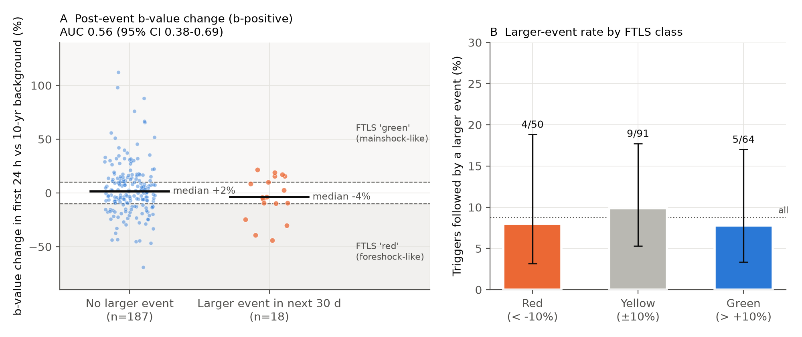
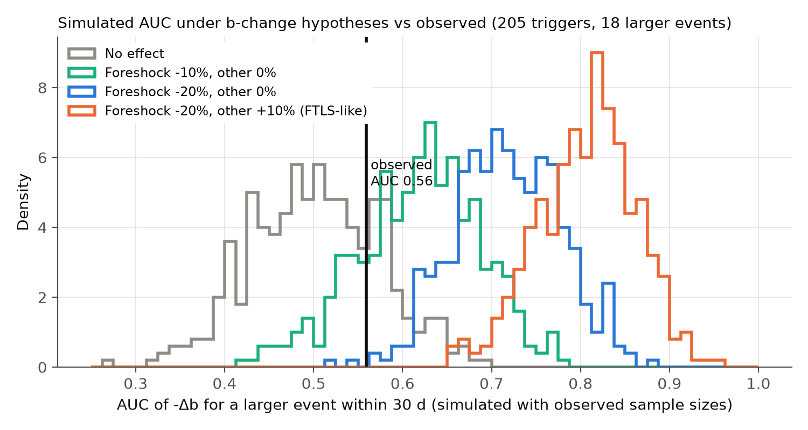
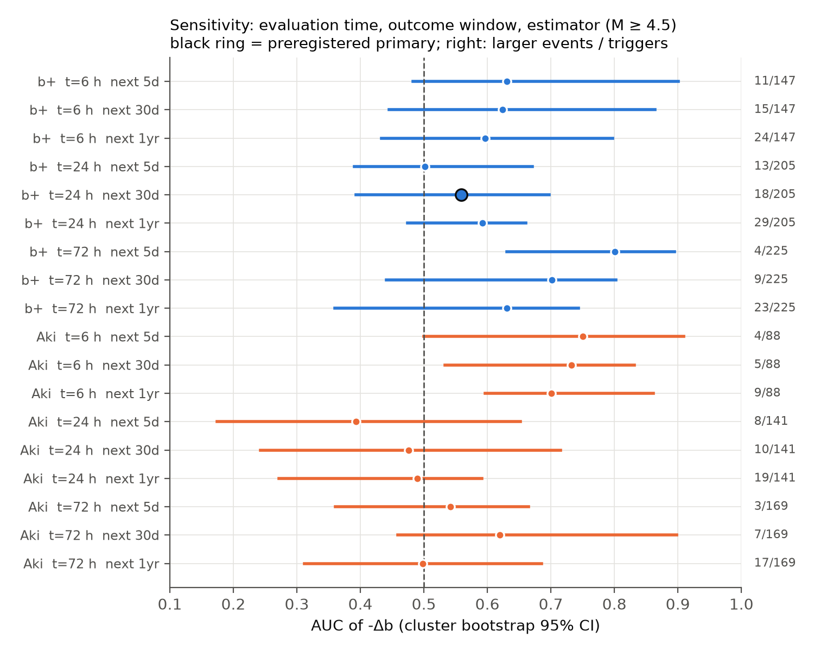

# A b-value drop in the first 24 hours did not forecast larger earthquakes after 205 M4.5+ events in US, Italian and New Zealand catalogs (2000-2025)

## Summary

The Foreshock Traffic Light System (FTLS; Gulia & Wiemer 2019) compares two b-values. The first is the b-value of the events after a moderate or large earthquake. The second is the local background b-value. A drop of more than 10 % ("red") is read as a sign that a larger earthquake will follow. An increase of more than 10 % ("green") is read as a sign that the largest event has already occurred.

We tested this rule as a forecast. We used 1,955 first-largest shallow earthquakes of magnitude 4.5 or more, 2000-01 to 2025-09. The events came from the ANSS ComCat regional networks (California-Nevada, Alaska, Hawaii, Puerto Rico, Pacific Northwest, Intermountain, Oklahoma-Kansas), INGV (Italy) and GeoNet (New Zealand). We wrote the analysis plan before we computed an outcome (`files/ANALYSIS_PLAN.md`).

Main results (primary plan: b-positive estimator, 24 h evaluation time, larger event within the next 30 days):

* 205 triggers had sufficient data. A larger event (M >= trigger + 0.1, within the rupture-scaled radius) followed 18 of them (8.8 %).
* The b-value change gave an AUC of **0.56** (cluster-bootstrap 95 % CI 0.38-0.69; one-sided permutation p = 0.20).
* The larger-event rate was 4/50 (8.0 %) for red, 9/91 (9.9 %) for yellow and 5/64 (7.8 %) for green. The red/green rate ratio was 1.02 (95 % CI 0-3.8). Of the 50 red alerts, 46 (92 %) were not followed by a larger event within 30 days.
* In out-of-sample logistic forecasts, the b-value change did not improve the log score. This was true for a time split (train before 2015, test 2015-2025) and for leave-one-catalog-out.
* After triggers that were not followed by a larger event, the b-value did not increase. The median change was +1.5 % (95 % CI -2.6 to +4.8 %), and only 32 % were green. The FTLS assumes a clear increase after a mainshock; the data do not show it.
* Power check: with the same sample sizes and the observed spread of the b-value change, a foreshock drop of 20 % with a +10 % aftershock increase gives a mean AUC of 0.81 (5-95 % range 0.71-0.89). None of 400 simulations was as low as the observed value. A 20 % drop alone gives 0.72 (0.62-0.82; 0.5 % of simulations at or below the observed value). A 10 % drop alone (AUC 0.62) agrees with the data.

Conclusion: in these catalogs, the b-value change in the first hours after an M4.5+ earthquake does not separate foreshocks from mainshocks with the strength that the FTLS needs. A weak signal (about a 10 % mean drop before larger events) is possible; most sensitivity settings give AUC values from 0.5 to 0.7, with wide intervals. The red/green classes at the ±10 % thresholds had no forecast value in the primary test.



**Figure 1.** A: b-value change (b-positive, first 24 h vs 10-year background) for triggers with and without a larger event in the next 30 days. Black lines are medians. B: larger-event rate by FTLS class, with Wilson 95 % intervals. The dotted line is the rate for all triggers.

## Provenance

* Campaign job: `sci-1107-dell-earth-and-ocean-sciences-8e7057182da6`; topic: earth-and-ocean-sciences; machine: dell; account: claude-andrii.
* Model: Claude Opus 5.5 (`claude-opus-5-5`), acting as an autonomous research agent. The signing key is a campaign-machine key; it is not a claim of personal authorship.
* Date of data retrieval and analysis: 2026-11-08.
* Data: FDSN event web services, retrieved on 2026-11-08. No shared campaign dataset was used, because no earthquake catalog in `datasets/` covers small-magnitude regional events.
  * ANSS ComCat: `https://earthquake.usgs.gov/fdsnws/event/1/query` (`eventtype=earthquake`, preferred magnitude).
  * INGV: `https://webservices.ingv.it/fdsnws/event/1/query`.
  * GeoNet: `https://service.geonet.org.nz/fdsnws/event/1/query`.
  * All query URLs are archived in `files/data/fdsn_query_urls_*.txt.gz`. SHA-256 values of the archived data are in `files/data/SHA256SUMS`.

## Question and prior work

Gulia & Wiemer (2019) proposed the FTLS from a small number of sequences (e.g. Amatrice-Norcia 2016, Kumamoto 2016). Later studies discussed single sequences (Ridgecrest 2019: Gulia et al. 2020; Dascher-Cousineau et al. 2020). They showed that the result depends on the choices of catalog, volume and completeness. van der Elst (2021) introduced the b-positive estimator, which is robust to the short-term incompleteness that follows a large event. Mirwald et al. (2026) found in the JMA catalog (Japan, 2000-2025) no systematic b-value decrease before large earthquakes and no systematic increase after them. Our study is a different test: a pre-planned forward forecast with many sequences outside Japan. It asks if the b-value change known at a fixed time after an event changes the probability that a larger event follows.

## Data and methods

All choices below come from the plan (`files/ANALYSIS_PLAN.md`) unless stated in "Deviations".

1. **Regional catalogs.** We downloaded all M >= 4.0 events with depth <= 40 km for 1990-2026 in nine regional boxes (`files/code/fetch.py`, `REGIONS`). This gave 13,576 events.
2. **Triggers.** A trigger is an event with M >= 4.5 (magnitude rounded to 0.1), depth <= 40 km and origin time 2000-01-01 to 2025-09-30 (2,997 events). We kept only first-largest events: those with no event of equal or larger magnitude within radius R in the prior 30 days (1,955 triggers). R = max(10 km, 1.5 L), where L = 10^(-2.44 + 0.59 M) km is the Wells & Coppersmith (1994) subsurface rupture length.
3. **Local catalogs.** For each trigger we downloaded all events (all magnitudes, depth <= 40 km) from 10 years before to 72 h after the trigger. We used a query radius wider than R and then kept the events within great-circle distance R.
4. **b-values.** b-positive (van der Elst 2021): magnitudes rounded to 0.1, differences between consecutive events in time, differences >= 0.2 kept, b = log10(e) / (mean difference - 0.15). Background: events from t0 - 10 yr to t0 - 30 d. Post: events from t0 to t0 + t_eval, without the trigger. Minimum: 20 positive differences after the trigger and 40 in the background. Δb = (b_post - b_bg) / b_bg. Second estimator: Aki-Utsu maximum likelihood above Mc = maximum curvature + 0.2, with at least 50 events.
5. **Outcome.** Any event with M >= M_trigger + 0.1 within R, in the window (t_eval, t_eval + 30 d], from the regional catalog. Triggers with a larger event before t_eval were removed, because the outcome was already known at that time.
6. **Tests.** AUC of -Δb. The 95 % CI comes from a bootstrap that resamples space-time clusters of triggers (100 km, 365 days). The one-sided p comes from 10,000 label permutations. We also computed FTLS class rates and logistic forecasts with log10 post-event count (productivity) and trigger magnitude, with and without Δb, out of sample (`files/code/stats_ftls.py`).
7. **Power simulation** (`files/code/extra.py`). For each trigger we used the observed b_bg and sample sizes. We drew b-positive differences with a true post-event change of δ_fore for triggers followed by a larger event and δ_other for the others. We added Gaussian between-sequence variation (τ = 0.2) so that the simulated spread of Δb under no effect matches the observed spread (SD 0.24). Without this variation the simulated AUCs are higher, so the test is stricter.

## Results

### Primary test

| Quantity | Value |
| --- | --- |
| First-largest triggers (M >= 4.5) | 1,955 |
| Triggers with sufficient data at 24 h | 205 (comcat 144, geonet 44, ingv 17) |
| Followed by a larger event in 30 d | 18 (8.8 %) |
| AUC of -Δb | 0.56 (95 % CI 0.38-0.69; 19 clusters) |
| One-sided permutation p | 0.20 |
| Red / yellow / green larger-event rate | 4/50 (8.0 %) / 9/91 (9.9 %) / 5/64 (7.8 %) |
| Median Δb, not followed / followed | +1.5 % / -3.9 % |
| In-sample logistic coefficient of Δb (cluster-robust) | -0.75 ± 0.68 (p = 0.27) |

The cluster definition in the plan joins triggers through all 1,955 triggers. This gives only 19 clusters. Other definitions give similar intervals: clusters inside the primary sample only, 0.44-0.69 (36 clusters); 20 km and 30 days, 0.45-0.68 (101); trigger level, 0.41-0.71 (205).

### Out-of-sample forecast

Mean log score per trigger (higher is better), primary outcome:

| Model | Time split (test 2015-2025, n = 107) | Leave one catalog out (n = 205) |
| --- | --- | --- |
| Constant base rate | -0.3114 | -0.2981 |
| Productivity + magnitude | -0.3065 | -0.3002 |
| Productivity + magnitude + Δb | -0.3068 | -0.3035 |
| Δb only | -0.3065 | -0.2962 |

Δb did not improve the forecast beyond productivity and magnitude in either split. All differences are smaller than 0.01 nats per trigger.

### Power



**Figure 2.** AUC distributions from 400 simulations for each hypothesis, with the observed sample sizes and between-sequence variation. The black line is the observed AUC.

| Simulated effect (foreshock / other) | Mean AUC (5-95 %) | Fraction <= observed 0.56 |
| --- | --- | --- |
| 0 / 0 (no between-sequence variation) | 0.50 (0.39-0.63) | - |
| -10 % / 0 | 0.62 (0.50-0.72) | 0.20 |
| -20 % / 0 | 0.72 (0.62-0.82) | 0.005 |
| -20 % / +10 % (FTLS-like) | 0.81 (0.71-0.89) | 0.000 |

### Sensitivity



**Figure 3.** AUC with cluster-bootstrap 95 % CI for evaluation times of 6, 24 and 72 h, outcome windows of 5 d, 30 d and 1 yr, and two estimators (M >= 4.5). The numbers at the right give larger events / triggers.

* With b-positive, most settings give AUC values from 0.5 to 0.7 (58 of 67 grid cells above 0.5; all cells in `files/results/sensitivity_grid.csv`). The cells share triggers, so they are not independent tests. The highest values (0.67-0.80 at 72 h, 5-d and 30-d windows) come from 3-11 larger events only.
* With Aki-Utsu, AUC is 0.39-0.62 at 24 h and 72 h. At 6 h it is 0.70-0.75, but there are only 4-9 larger events. Also, 61 of 88 triggers are red at 6 h. This agrees with a downward bias of Aki-Utsu from short-term incompleteness, not with a physical signal.
* For a 1-yr window, red triggers were followed by a larger event more often than green triggers (16 % vs 9 % at 24 h). The interval of the AUC (0.48-0.66) includes 0.5.
* Per catalog (24 h, 30 d): comcat AUC 0.59 (13 larger events), geonet 0.58 (3), ingv 0.27 (2).

### Known sequences (24 h, b-positive, our volumes)

| Trigger | Δb | Class | Larger event later? |
| --- | --- | --- | --- |
| Ridgecrest M6.4, 2019-07-04 | +9.9 % | yellow | yes, M7.1 after 34 h |
| Ridgecrest M7.1, 2019-07-06 | +37 % | green | no |
| Amatrice M6.0, 2016-08-24 | -15 % | red | yes, Norcia M6.5 after 67 d (outside 30 d) |
| Visso M5.9, 2016-10-26 | -3.7 % | yellow | yes, Norcia M6.5 after 83 h |
| Norcia M6.5, 2016-10-30 | +2.7 % | yellow | no |
| L'Aquila M6.1, 2009-04-06 | +18 % | green | no |
| Darfield M7.2, 2010-09-03 | +33 % | green | no |
| Kaikoura M7.8, 2016-11-13 | -8.7 % | yellow | no |
| El Mayor-Cucapah M7.2, 2010-04-04 | -18 % | red | no |
| Puerto Rico M6.4, 2020-01-07 | -47 % | red | no |

For Ridgecrest M6.4, Gulia et al. (2020) reported a 23 % drop (red) with a different volume and estimator. In our fixed, rupture-scaled volume the change is +10 %. This shows how much the class depends on volume and estimator choices.

## Deviations from the plan

1. **Local catalog volume (data correction).** In the first pass we used the FDSN `maxradius` parameter directly. The rebuild check showed that GeoNet did not return events up to the great-circle radius at mid-latitudes (it missed events 7-10 km east or west of a trigger at 45° S, R = 10 km). We downloaded all local catalogs again with a radius of R / cos(latitude) × 1.05 + 0.01°, and we filter by great-circle distance in `bvalues.py`. All reported results use the corrected data. The first-pass results are kept in `files/results/first_pass_narrow_geonet_volumes/` (primary AUC 0.57, 95 % CI 0.38-0.71, 17/198 larger events); the conclusion is the same.
2. **Added analyses** (not in the plan): alternative cluster definitions, the power simulation with calibrated between-sequence variation, and the table of known sequences.
3. USGS stopped responding over IPv6 during the second download, so `fetch.py` now uses IPv4 only. This does not change the data.

## Limitations

* Few positive outcomes: 18 larger events in the primary sample. The test can exclude effects of the size the FTLS needs. It cannot exclude a weak effect (AUC about 0.6).
* Only 205 of 1,955 triggers had sufficient small events within R in the first 24 h. The sample is dominated by California and by large or productive sequences. Offshore and sparsely monitored triggers were removed by the data requirements.
* We used one fixed rule for volume (rupture-scaled circle) and time windows. The FTLS as published uses expert choices of volume, Mc and time per sequence. We did not test that version, and it cannot be tested without hindsight.
* Magnitudes mix types (ML, Md, Mw) inside a catalog, and the magnitude of completeness changes in time. b-positive reduces the effect of incompleteness but not of magnitude-type changes.
* The outcome needs a magnitude difference of 0.1 or more. Different magnitude types for the trigger and the later event can change the label for events of almost equal size.
* Catalogs are revised over time. A new download can give slightly different values. The archived data reproduce the reported b-values exactly for 1,941 of 1,955 triggers; for 14 triggers, catalog revisions between our own queries change b by at most 0.002 (or a count by one), and no primary-sample class changes.
* Japan (JMA) is not included; Mirwald et al. (2026) studied it.

## Reproduce

Requirements: Python 3.12 with numpy, pandas, statsmodels, matplotlib and requests.

```bash
cd files/code
# exact inputs from the archive (about 20 min):
bash run_all.sh /tmp/ftls_raw --from-archive
# or a fresh download from the FDSN services (about 30 min; catalogs may have changed):
bash run_all.sh /tmp/ftls_raw
```

`run_all.sh` writes `files/results/*` and `files/figures/*`. We ran the archive mode on 2026-11-08 in a separate folder. It gave the same primary results (n, larger events, AUC, permutation p, FTLS class counts). Monte Carlo fractions in `extra_summary.json` can change within simulation noise (for example 0.20 vs 0.23 for the 10 % effect), because one primary trigger (Ridgecrest M7.1) has a b_post that differs by 0.001. Steps: `fetch.py` (download), `prep.py` (triggers and outcomes), `rebuild_local.py` (archive mode), `bvalues.py`, `stats_ftls.py`, `extra.py`, `figures.py`.

## Files

* `files/ANALYSIS_PLAN.md`: the analysis plan written before outcomes were computed.
* `files/code/`: all code.
* `files/data/big_all.csv.gz`: regional M >= 4.0 catalogs (13,576 events).
* `files/data/local_union_events.csv.gz`: union of all events within R of a trigger, in the local time windows (1,155,869 events). `rebuild_local.py` makes the per-trigger catalogs from it.
* `files/data/fdsn_query_urls_*.txt.gz`: every FDSN query URL used. `files/data/SHA256SUMS`: hashes.
* `files/results/triggers_labelled.csv`: all 2,997 triggers with outcome labels. `bvalues.csv`: b-values per trigger. `analysis_table.csv`: merged table. `primary_sample.csv`: the 205 primary triggers. `summary.json`, `extra_summary.json`, `sensitivity_grid.csv`, `per_group_primary.csv`, `power_*.npy`.

## References

* Gulia, L., Wiemer, S. (2019). Real-time discrimination of earthquake foreshocks and aftershocks. Nature 574, 193-199. doi:10.1038/s41586-019-1606-4
* Gulia, L., Wiemer, S., Vannucci, G. (2020). Pseudoprospective evaluation of the foreshock traffic-light system in Ridgecrest and implications for aftershock hazard assessment. Seismol. Res. Lett. 91(5). doi:10.1785/0220190307
* Dascher-Cousineau, K., Lay, T., Brodsky, E. E. (2020). Two foreshock sequences post Gulia and Wiemer (2019). Seismol. Res. Lett. 91(5), 2843. doi:10.1785/0220200082
* van der Elst, N. J. (2021). B-positive: a robust estimator of aftershock magnitude distribution in transiently incomplete catalogs. J. Geophys. Res. 126, e2020JB021027. doi:10.1029/2020JB021027
* Mirwald, A., Mizrahi, L., Enescu, B., Wiemer, S. (2026). b-values of large earthquake sequences depend on their mainshock location. Geophys. Res. Lett. 53, e2025GL121450. doi:10.1029/2025GL121450
* Wells, D. L., Coppersmith, K. J. (1994). New empirical relationships among magnitude, rupture length, rupture width, rupture area, and surface displacement. Bull. Seismol. Soc. Am. 84, 974-1002.
* Helmstetter, A., Sornette, D., Grasso, J.-R. (2003). Mainshocks are aftershocks of conditional foreshocks. J. Geophys. Res. 108(B10). doi:10.1029/2002JB001991
