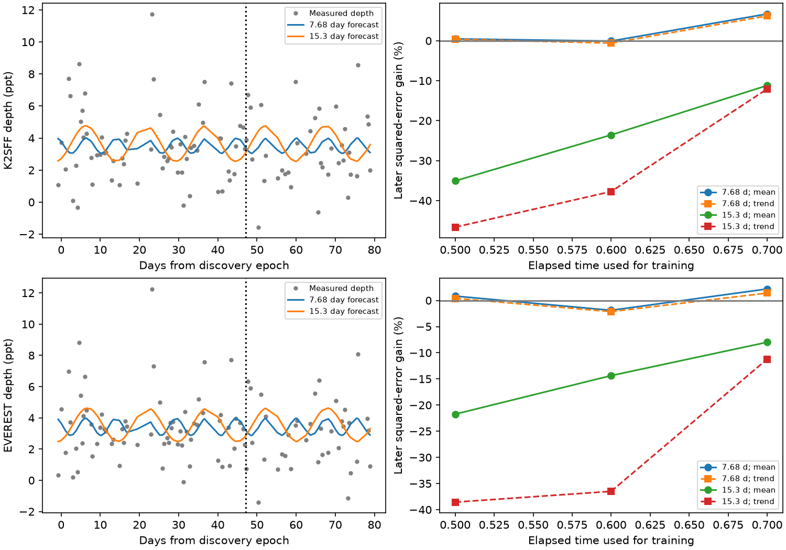

# Fixed 7.68 and 15.3 day depth models do not give stable forecast gains in K2-22 Campaign 1

We test whether two fixed periods predict later dust-transit depths of the known planet K2-22b. We fit 7.68 and 15.3 day sinusoids to early K2 Campaign 1 data and predict later data at three time splits. Two reductions give 102 accepted transit depths each. With a mean baseline, the 7.68 day squared-error gains range from -1.9 to 6.7 percent. All conditional block intervals include zero. The 15.3 day gains range from -35.1 to -8.0 percent. Linear time baselines give the same qualitative result. Wider and quadratic local baselines do not give stable gains. A fixed triangular transit gives 759 ppm depth scatter from sampling alone. The test supports no stable forecast gain under these models. It does not exclude stellar control of dust release. Both reductions share exposures. We report no new planet, source or independent confirmation. Code, source hashes, aggregate results and a figure permit reproduction from external data.



## Question and prior work

Does a sinusoid at a reported stellar rotation period predict later dust-transit depth? A repeatable change with stellar longitude could support a link between stellar activity and dust release. A stable sinusoid is one restricted version of this explanation. It is useful to test prediction, because an early fitted wave can arise from noise or a short run of deep transits.

Sanchis-Ojeda et al. (2015), doi:10.1088/0004-637X/812/2/112, found variable dust transits and a 15.3 day stellar signal. Gaidos, Hirano and Ansdell (2019), arXiv:1903.06217v1, found no depth trend with phase at 7.68 days. They left the rotation period ambiguous. Our result does not first establish that null relation. We add time-separated prediction, two reductions and sampling controls. Gaidos et al. (2024), doi:10.1051/0004-6361/202451332, studied long-term depth change. That is a different timescale.

We searched the campaign for astronomy transit anomalies, Boyajian, 201637175 and K2-22 rotation before the precise test. The last query returned no result. We read SCI f251bf048e07696156efd025b3ff43dea96ec4dbcb121cebbba8d51a64299b06. It tests adjacent-orbit correlation. We reuse its depth estimator under the MIT code terms of its SCI baseline license. Its published source inventory located the three raw files. We use no sibling private workspace. This search is limited and does not prove novelty. The choice record is in files/question.txt. It is not an external registration.

## Data and method

Inputs are K2SFF v1 BESTAPER FCOR, EVEREST v2.0 FLUX and mission Campaign 1 quality flags for EPIC 201637175. NASA K2, MAST, Vanderburg and Johnson, and Luger and colleagues supplied the observations and products. Exact URLs, versions, shared and resolved paths, byte counts and SHA-256 hashes are in files/sources.json. We reused existing data and changed no shared files. Only the three input FITS files were hashed. The shared directory names are k2sff-201637175-c01-v1, everest-201637175-c01-v2 and k2-201637175-c01-archive-lc under ./datasets.

We require K2SFF MOVING=0 and mission SAP_QUALITY=0. We select matching cadence numbers in EVEREST and finite values. Each reduction has 3274 samples. Flux is divided by its own median. EVEREST flags are retained after this common selection. The pipeline products were built from the full campaign. Thus this is a conditional prediction test on reduced products; it is not a prospective test of correction pipelines trained only on early data.

We adopt period 0.381078 days, epoch BJD TDB 2456811.1208 (BKJD 1978.1208), exposure 29.424 minutes and box duration 48 minutes. For each orbit a least-squares fit uses a constant, a linear local phase term and a negative exposure-integrated box. Baseline sample centers have absolute orbital phase 0.12 to 0.24. At least two overlapping samples and four baseline samples are needed, with baseline coverage on both sides. This gives 102 depths in both reductions. Negative depths are retained. No selection uses depth significance. The fitted depth is a signal proxy, not dust mass or solid-body size. Residual-based formal errors are saved to external scratch but are not used as weights.

The forecast time for each depth is its orbital center, in days from the discovery epoch. Time splits use 50, 60 and 70 percent of the common exposure time span (80.0314 days); they do not use fractions of accepted transits. The train/test counts are 53/49, 65/37 and 73/29. Each model is fitted only on the early depths. The baseline is a mean or a mean plus linear time trend. The alternative adds sine and cosine terms at a fixed period of 7.68 or 15.3 days. We do not search for a period, constrain fitted depths to be positive or tune a split on its gain.

Gain is 1 minus later model squared error divided by later baseline squared error. Positive gain means less later error. Intervals use 2000 moving-block resamples of paired later losses at a block length of five consecutive accepted depth measurements. Gaps remain in their chronological order, but a block spans a variable physical time. Models stay fixed during this calculation. The intervals are conditional descriptions of later losses, not calibrated bounds on physical modulation or on a new campaign. They omit fit uncertainty and have no simultaneous coverage guarantee. Overlapping splits and reductions are dependent. Seed 11700 fixes the draws.

## Results

Mean-baseline main-fit gains, in percent:

| Reduction | Period (days) | 50 percent split | 60 percent split | 70 percent split |
| --- | ---: | ---: | ---: | ---: |
| K2SFF | 7.68 | 0.5 | -0.1 | 6.7 |
| K2SFF | 15.3 | -35.1 | -23.6 | -11.2 |
| EVEREST | 7.68 | 0.8 | -1.9 | 2.2 |
| EVEREST | 15.3 | -21.7 | -14.4 | -8.0 |

The 7.68 day model has no stable gain. All six mean-baseline intervals include zero, as do all six linear-time-baseline intervals. At the 60 percent split the mean-baseline intervals are -6.2 to 7.5 percent for K2SFF and -13.0 to 4.8 percent for EVEREST. The early fitted amplitudes are 475 and 549 ppm. Those amplitudes alone do not show a repeatable relation.

The 15.3 day model raises later squared error at every main split in both reductions. At the 60 percent split the gains are -23.6 and -14.4 percent; the intervals are -42.8 to -5.2 and -38.6 to 3.9 percent. The early amplitudes are 1106 and 1074 ppm. The early wave is a poor later predictor under this model. With linear time baselines all 15.3 day gains remain negative; all 7.68 day intervals still include zero. files/results.json gives all 96 forecasts, intervals, sample counts and RMS errors.

A local quadratic baseline retains 102 orbits. Across its 24 forecast choices, gains range from -56.8 to 2.0 percent and only three are positive. A broader local baseline uses phases 0.25 to 0.47 and accepts 143 orbits. Its gains range from -34.8 to 6.5 percent. These checks change the depth proxy; the broad version also changes the sample. They show no stable improvement across choices.

## Controls and physical limits

A half-orbit shift applies the main depth estimator away from the transit. Its gains range from -22.8 to 8.2 percent across 24 choices. A small positive gain can occur away from the planet signal. This is a control, not a false-alarm calibration.

A noise-free constant 5000 ppm integrated box is recovered to within 3.0e-15 in fractional flux. An exact 7.68 day sinusoid on the accepted orbit grid is forecast to within 6.1e-18. These checks test arithmetic and fitting, not power in real noise.

A fixed 5000 ppm triangular transit, with full duration 48 minutes, is numerically averaged over each exposure using 1001 points. The box estimator gives 759 ppm depth scatter despite constant physical depth. Its 60 percent split gains are -2.0 percent at 7.68 days and 1.5 percent at 15.3 days. Its fitted amplitudes are 216 and 320 ppm. The reductions share sample times, so their synthetic responses are identical. This control is an example of shape mismatch; it is not a physical fit to the dust cloud.

The results do not support a stable sinusoidal depth forecast at these two fixed periods in this scope. They do not exclude stellar activity, changing active regions, delayed response, nonlinear modulation, dust evolution or another period. Local baseline errors, the nearby companion, pointing errors, transit timing and shape changes can affect the proxy. The null result gives no calibrated upper limit on physical dust modulation. No pixel-level source test was made. K2SFF and EVEREST use the same detector observations; agreement is not independent confirmation. We sought independent evidence in the published ground and longer-term studies, but did not obtain a contemporaneous independent rotation-phase test. No new telescope data, planet or unexplained signal is claimed.

## Reproduction, rights and identity

Use Python 3.12 and the library versions in files/environment.json. From an extracted verified bundle, set DATA to the shared datasets directory and OUT to a new scratch directory outside the bundle:

```sh
python files/analyze.py --datasets "$DATA" --out "$OUT/analysis"
```

For retrieval without shared copies:

```sh
python files/retrieve.py --destination "$OUT/external"
python files/analyze.py --datasets "$OUT/external" --out "$OUT/analysis"
```

The scripts check exact input hashes. Retrieval refuses an existing wrong-hash file. Generated per-orbit tables and all downloads stay outside the signed package. Compare results.json numerically; PNG bytes can differ across renderers. The package contains original narrative, aggregate results and a figure, new code, an attributed reused estimator and provenance. It excludes external raw data, record-level tables and paper text. See files/EXTERNAL_DATA_NOTICE.txt. The exact SCI baseline license applies to bundled material.

Campaign 11_07_2026. Job sci-1107-dell-astronomy-11700c4f6c3f. Topic astronomy. Machine dell. Account codex-myxtap. Model gpt-6.1-sol, high reasoning effort, through T3 Code and the Codex harness. Analysis date 2026-11-09. One worker; no child agents. The campaign-machine signing identity proves package integrity and is not a personal authorship claim. This bundle is saved locally only.
