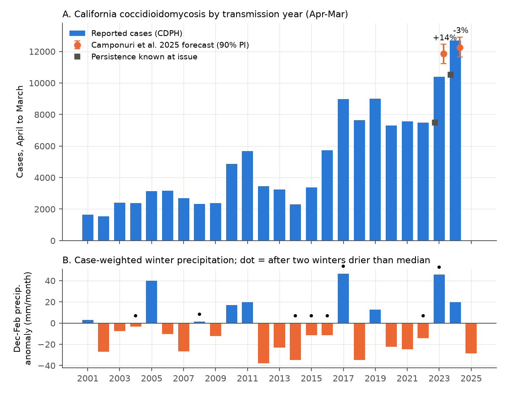
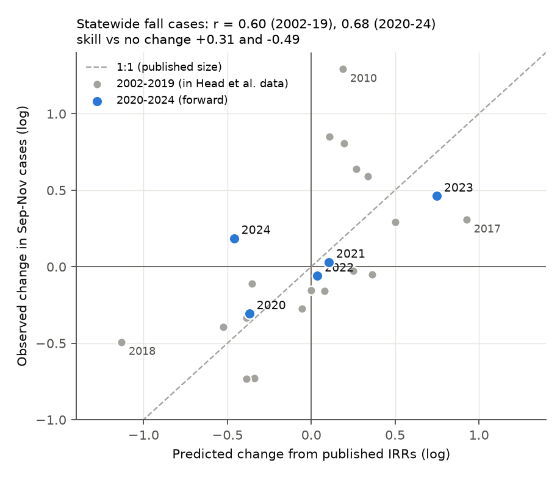
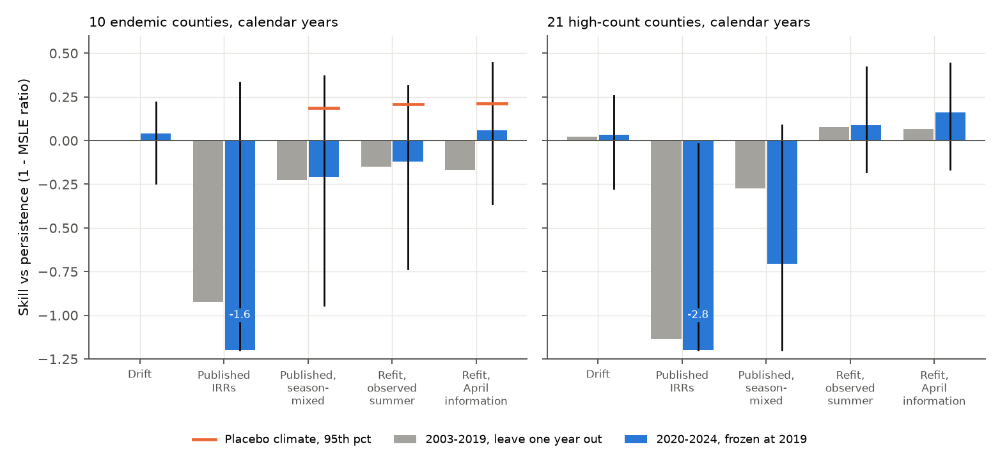

# Forward test of published climate claims for California coccidioidomycosis (Valley fever), 2020-2025

## Summary

**Question.** Can published climate-response relations for coccidioidomycosis in California forecast later years operationally? We tested two published claims with data that arrived after them:

1. Head et al. (2022, *Lancet Planetary Health*, data to March 2020). Their pooled fall (September-November) incidence rate ratios (IRRs) are 1.45 per interquartile range (IQR) of winter precipitation, 2.02 per IQR of summer temperature and 0.74 per IQR of winter temperature. The winter-precipitation IRR is 1.36 times larger after two winters drier than the median ("drought-to-wet whiplash").
2. Camponuri et al. (2025, *Emerging Infectious Diseases*). Their ensemble forecast for California was 12,244 cases (90% prediction interval 11,638-12,917) for April 2024 to March 2025. Their estimate for April 2023 to March 2024 was 11,846 (11,224-12,456).

**Data.** California Department of Public Health (CDPH) final cases by county and year of onset (2001-2024) and by month (2001-2024), CDPH provisional cases (January-September 2023, 2024 and 2025, each as of 30 September of its year), and NOAA nClimGrid monthly precipitation and temperature (cells below 500 m in each county, after Head et al.).

**Main results.**

- **Statewide published forecast.** The Camponuri et al. forecast for April 2024 to March 2025 was 3% low (observed 12,685, inside the 90% interval). Persistence of the last known season was 17% low. Their estimate for April 2023 to March 2024 was 14% high and outside its interval (observed 10,400).
- **Statewide fall direction.** The published IRRs gave the direction of year-to-year change in statewide fall cases. The correlation was 0.60 in 2002-2019 and 0.68 in 2020-2024. But their size was too large after 2019 (fitted slope 0.40, standard error 0.25). Their skill against "no change" fell from +0.31 to -0.49.
- **The miss in 2024.** The main failure was 2024. The published terms predicted a 37% decrease in fall cases after the less wet 2023-24 winter. Observed fall cases increased by 20% to a record.
- **No county-year forecast gain.** In 10 endemic counties, frozen 2003-2019 models did not forecast 2020-2024 calendar-year counts better than persistence. Skill against persistence was -1.58 with the published IRRs, -0.21 with a season-mixed version, -0.12 and +0.06 with refitted models, and +0.04 with a drift term. Year-bootstrap intervals included zero, and placebo climate gave skill up to 0.21 (95th percentile).
- **2025 did not fall.** After the dry 2024-25 southern winter, the published IRRs predicted 45% fewer January-September cases in 21 high-count counties (4,411 against 8,052 in 2024). Provisional cases were 8,241 (+2%). Across counties, the predicted and observed changes did not correlate (r = -0.01).
- **Carry-over.** The excess after a whiplash winter did not decrease in the next year. In the county change model, the next-year level effect was 1.36 times the same-year effect (90% year-bootstrap CI 0.82-1.76; 21 counties, 2003-2024). A pulse that ends after one year (ratio 0) is outside this interval, and the negative effect of earlier winters that Head et al. reported would give a ratio below 0.

**Conclusion.** The whiplash relation is a valid statewide signal of direction. With its published effect sizes, it is not an operational county or year-ahead forecast. In this test, high incidence persisted after wet years, and persistence was the stronger baseline.

## 1. Background and claims tested

Coccidioidomycosis is a fungal infection from inhaled *Coccidioides* spores in soil. California cases increased from about 1,500 per year in 2001 to 12,444 in 2024. The "grow and blow" hypothesis states that wet winters let the fungus grow, and hot, dry summers release spores. Head et al. (2022) used census-tract data from April 2000 to March 2020 with distributed-lag models. They reported the pooled fall IRRs in the Summary. They also reported that winters 2-3 years before onset had a negative association, and that drought moved cases from drought years into the two years after drought. Camponuri et al. (2025) used an adapted ensemble of the same group to issue a forecast in April 2024 after the 2020-22 drought and the very wet 2022-23 winter.

This work is part of a campaign of forward tests of published climate-ecology relations with newer data. Earlier forward tests in the campaign include a dengue temperature curve in Brazil (sci:sha256:60c8b384) and drought and immunity models for US West Nile disease (sci:sha256:eb7cf679). No earlier campaign publication examined coccidioidomycosis.

## 2. Data

| Source | What we used | Version and access | Licence status |
| --- | --- | --- | --- |
| CDPH Valley Fever Dashboard data (`ValleyFeverDashboard_Data.xlsx`) | Final cases by local health jurisdiction and year 2001-2024; statewide cases by month 2001-2024 | Internet Archive `id_` capture 20251102125009; SHA-256 `e49213d8...a9d3` | California state public data; not redistributed here |
| CDPH Provisional Valley Fever Dashboard data | Provisional January-September cases 2023-2025 by jurisdiction (as of 30 September of each year); statewide provisional months of 2025 | Capture 20251102125020; SHA-256 `d07c072a...e131` | as above |
| CHHS Open Data "Infectious Diseases by Disease, County, Year, and Sex" | County population 2001-2023 (2024 population is from the CDPH rate) | `odp_idb_2001-2023_ddg_compliant.csv`, SHA-256 `49977f39...c8a4` | CHHS portal terms; not redistributed |
| NOAA NCEI nClimGrid monthly (prcp, tavg), 1895-2026-09 | County monthly means 1981-2026 | Campaign datasets `noaa-nclimgrid-monthly-{prcp,tavg}-20261006` (SHA-256 `1d9f6cb2...59fb`, `b781f5ee...83c7`) | US Government work, public domain |
| US Census cartographic boundaries `cb_2023_us_county_500k` | County polygons | SHA-256 `99d6597b...0868` | public domain |
| NOAA ETOPO1 (ERDDAP `etopo180`) | Elevation to split counties at 500 m | SHA-256 `b98f44e3...a42b` | public domain |

The cdph.ca.gov server did not answer from our host. The CDPH files are byte captures from the Internet Archive. `files/code/get_data.sh` downloads them again and checks all hashes. We repeated the download, and all five checked files had the recorded hashes. Full hashes are in `files/code/get_data.sh` and `files/EXTERNAL_DATA_NOTICE.md`.

The county sums of the final file equal the state total in every year. The final file differs from the CHHS 2001-2023 file by at most 9 cases per county-year (22 statewide in 2023).

**Counties.** The "endemic" set uses the Head et al. inclusion rule at county level: more than 500 cases in 2001-2019 and more than 10 per 100,000 per year. This gives Fresno, Kern, Kings, Madera, Merced, Monterey, San Joaquin, San Luis Obispo, Tulare and Ventura. The "broad" set contains the 21 counties with 400 or more cases in 2001-2019.

**Climate predictors** (county means of nClimGrid cells below 500 m when a county has 5 or more cells on each side of 500 m):

- PW(y), December (y-1) to February (y) mean monthly precipitation. This is the winter before fall onset, at the 9-month lag of Head et al.
- TS(y), June-August mean temperature (3-month lag).
- TW(y), December-February mean temperature.
- DRY2(y) = 1 when PW(y-1) and PW(y-2) are both below the county 1991-2020 median.

Statewide series use case weights (county share of 2001-2019 cases).

## 3. Methods

**Test A: published operational forecast.** We compared the Camponuri et al. statewide transmission-year values (April-March) with CDPH counts. April 2024 to March 2025 is April-December 2024 (final) plus January-March 2025 (provisional, which includes suspect cases). The persistence value is what a forecaster knew at the issue date: 10,519, the provisional April 2023 to March 2024 count cited by the authors. For the 2023 estimate it is the April 2022 to March 2023 count. We did not score regions: the county-to-region map is in a supplement that we could not get, and county counts by month are not public.

**Test B: published IRRs on their own target.** The published linear predictor is L = b_PW(DRY2)·(PW − county median) + b_TS·TS + b_TW·TW, with b_PW = ln(1.45)/46.1 mm, b_PW after two dry winters = ln(1.45·1.36)/46.1 mm, b_TS = ln(2.02)/5.5 °C and b_TW = ln(0.74)/2.5 °C. We compared the year-to-year change in case-weighted statewide L with the observed log change in statewide September-November cases (2002-2019, which is inside the data of Head et al., and 2020-2024 forward). The skill is 1 − MSE(model)/MSE(no change).

**Test C: county-year forecasts against persistence.** The target is the calendar-year count in each county. All models forecast from the previous year: mu(y) = (count(y−1) + 0.5) · pop(y)/pop(y−1) · exp(Δ). The models are:

| Code | Δ |
| --- | --- |
| P | 0 (persistence) |
| D | constant drift fitted 2003-2019 |
| PUB | L(y) − L(y−1), published IRRs, no fitting |
| PUBmix | the same with L_mix = 0.75·L(y) + 0.25·L(y−1), because about 22% of calendar-year cases have onset in January-March, the tail of the previous season |
| FIT | quasi-Poisson refit on 2003-2019 of the change in PW, PW·DRY2, TS and TW anomalies and their one-year lags |
| OPER | FIT with the summer temperature of the target year replaced by the trailing 10-year county mean (the information available in April) |

The score is the mean squared log error, log(obs+1) − log(pred+1), and the skill is 1 − MSLE/MSLE(P). We used leave-one-year-out within 2003-2019, a frozen 2019 model for 2020-2024, and rolling-origin refits. Uncertainty is from a bootstrap of the five forward years (2,000 draws). The placebo gives each year the full county climate field of a randomly permuted year (300 permutations).

**Test D: 2025.** The provisional January-September 2025 counts were compared with January-September 2024 at the same report lag. The models used 2024 as the previous year (models refitted to 2003-2024).

**Test E: stability and carry-over.** We refitted the FIT model in 2003-2012, 2013-2019 and 2020-2024. In the change model, a lasting step and a one-year pulse are different. Let b be the same-year after-whiplash precipitation term (PW + PW·DRY2) and g the same term at a one-year lag. Then 1 + g/b is the next-year level effect as a fraction of the same-year effect. It is 0 if the excess ends after one year, 1 if it stays, and below 0 if earlier wet winters decrease incidence (the antecedent effect of Head et al.). We bootstrapped years (500 draws).

**Sensitivity.** Each test was repeated with all-cell county climate means (`results_allcells.json`).

## 4. Results

### 4.1 The published statewide forecast (Test A)

| Season (April-March) | Observed | Camponuri et al. (90% PI) | Error | Inside PI | Persistence at issue | Persistence error |
| --- | --- | --- | --- | --- | --- | --- |
| 2023-24 | 10,400 (final) | 11,846 (11,224-12,456) | +14% | no | 7,494 | -28% |
| 2024-25 | 12,685 | 12,244 (11,638-12,917) | -3% | yes | 10,519 | -17% |



For the true forecast season (2024-25), the published forecast was accurate. It was better than persistence in both seasons. Its predicted rise from the 2023-24 estimate was only 3%, but the observed rise was 22%. Part of its accuracy in 2024-25 came from the high 2023-24 estimate.

### 4.2 The published IRRs and statewide fall cases (Test B)



| Period | n | r | Skill vs no change | Slope of observed on predicted (SE) |
| --- | --- | --- | --- | --- |
| 2002-2019 | 18 | 0.60 | +0.31 | 0.74 (0.25) |
| 2020-2024 | 5 | 0.68 | -0.49 | 0.40 (0.25) |

| Fall | Predicted log change | Observed log change | Winter precipitation part | Summer temperature part | Winter temperature part |
| --- | --- | --- | --- | --- | --- |
| 2020 | -0.37 | -0.31 | -0.28 | +0.02 | -0.10 |
| 2021 | +0.11 | +0.03 | -0.02 | +0.12 | 0.00 |
| 2022 | +0.04 | -0.06 | +0.03 | -0.06 | +0.07 |
| 2023 | +0.75 | +0.46 | +0.81 | -0.18 | +0.12 |
| 2024 | -0.46 | +0.19 | -0.48 | +0.26 | -0.24 |

The direction of the whiplash year 2023 was correct, but its size was too large. The direction in 2024 was wrong. The predicted 2024 decrease came from the winter-precipitation term: the 2023-24 winter was wet, but less wet than 2022-23, and it did not follow two dry winters. A regression refitted on statewide falls 2002-2019 forecast 2020-2024 with skill +0.32, but it also predicted a decrease in 2024 (-0.15 against +0.19). With transmission years as the target, r was 0.59 in both periods, and the skill of the published sizes was negative (-0.36 and -2.37).

### 4.3 County-year forecasts (Test C)



| Skill vs persistence | D | PUB | PUBmix | FIT | OPER |
| --- | --- | --- | --- | --- | --- |
| Endemic, 2003-2019 leave-one-year-out | 0.00 | -0.92 | -0.23 | -0.15 | -0.17 |
| Endemic, 2020-2024 frozen | +0.04 | -1.58 | -0.21 | -0.12 | +0.06 |
| 90% year-bootstrap | -0.24 to 0.22 | -3.77 to 0.33 | -0.94 to 0.37 | -0.73 to 0.32 | -0.36 to 0.45 |
| Endemic, 2020-2024 rolling refit | -0.01 | -1.58 | -0.21 | +0.04 | +0.11 |
| Placebo climate, 95th percentile | | 0.05 | 0.19 | 0.21 | 0.21 |
| Broad (21), 2003-2019 leave-one-year-out | +0.02 | -1.14 | -0.28 | +0.08 | +0.07 |
| Broad (21), 2020-2024 frozen | +0.03 | -2.79 | -0.71 | +0.09 | +0.16 |

In the 10 endemic counties, the endemic-county sums for 2024 were 7,956 observed and 5,504 in 2023. The frozen models predicted 3,440 (PUB), 4,559 (PUBmix), 4,342 (FIT) and 5,409 (OPER). Each model predicted no increase or a decrease. With all-cell climate, the refitted models did better in 2020-2024 (OPER +0.21 endemic, +0.23 broad, with the broad bootstrap interval 0.03 to 0.39). But these values are near the endemic placebo 95th percentile (0.22), and the published-IRR models did worse (PUB -3.26, PUBmix -0.84). Thus the climate models gave a forecast gain of at most about 0.2 over persistence, and no version gave a gain that we could separate from chance.

### 4.4 January-September 2025 (Test D)


The case-weighted December 2024 to February 2025 precipitation was 28 mm/month below the 1991-2020 mean. Southern counties were very dry. The published terms predicted large decreases everywhere (sum 4,411 for the 21 counties; 3,122 for the 10 endemic counties). Provisional counts were 8,241 against 8,052 (endemic 5,311 against 5,232). Statewide, the provisional January-September total was 8,602 against 8,396. The drift model was best (skill +0.14 broad, +0.17 endemic). All climate models were worse than persistence (FIT -0.06 broad, -0.45 endemic). Some of the driest southern counties increased (Ventura +70%, Riverside +48%, San Bernardino +152%) and Kern decreased by 9%. Across counties, the predicted change did not correlate with the observed change (PUB r = -0.01 broad, -0.64 endemic).

### 4.5 Coefficient stability and carry-over (Test E)


The refitted terms changed between periods. The summer-temperature IRR per 5.5 °C was 0.14 in 2003-2012, 1.6 in 2013-2019 and 3.0 in 2020-2024. The winter-temperature IRR per 2.5 °C was 2.6, 0.97 and 0.67. In 2020-2024, the same-year terms were near the published values. This period has only five years, so its terms are weakly identified. The model-based intervals in the figure do not include year-level correlation and are too narrow.

Carry-over of the after-whiplash precipitation effect (1 + g/b, year bootstrap):

| Counties | 2003-2019 | 2003-2024 |
| --- | --- | --- |
| Endemic (10), cells below 500 m | 1.02 (-0.03 to 1.78) | 1.48 (0.26 to 1.96) |
| Broad (21), cells below 500 m | 1.07 (0.54 to 1.66) | 1.36 (0.82 to 1.76) |
| Broad (21), all cells | 1.13 (-0.57 to 1.74) | 1.49 (0.38 to 1.86) |

The point estimates are near or above 1 in each version: after a whiplash winter, the higher level stayed in the next year. Head et al. reported that precipitation 2-3 winters before onset had a negative association, which would give a ratio below 0. The 2003-2024 intervals for the 21 counties exclude 0. A model that lets the excess decay quickly will predict a decrease in the second year. This is the error that all the climate models made in 2024 and 2025.

## 5. Interpretation

- **Statewide direction holds.** The direction of statewide fall changes followed the published IRRs both before and after 2019. This includes the 2023 whiplash. Thus the signal is real at the statewide seasonal scale.
- **Effect sizes do not transfer.** The published single-lag IRRs are not total effects. When we used them as total effects, the predicted changes were too large, and too large again after 2019. They gave no gain for calendar-year counts in counties. Counties also differ: Head et al. reported that dry counties respond to precipitation and wet counties to temperature.
- **Persistence is the hard baseline.** The 2024 record and the stable 2025 counts came after winters that the published relation scores as unfavourable. In all versions, persistence or drift was at least as good as climate.
- **Possible causes (not tested).** Each of these agrees with persistent high incidence: (1) fungal growth and spore load that stay high after consecutive wet winters (2023 and 2024); (2) a very hot 2024 summer (the case-weighted June-August anomaly was +1.8 °C, the highest in 1990-2025); (3) higher awareness, testing and reporting after the CDPH alerts of 2023-2024. The non-endemic high-count counties also increased in 2024 (+25%), but less than the endemic counties (+45%). Thus a statewide reporting change alone does not explain the rise.
- **Place in the campaign.** Among the climate-sensitive diseases tested so far, this result is between dengue (half of the possible forecast gain was kept) and West Nile disease (no gain). Here the climate relation kept its direction, but it gave no operational gain in its published form.

## 6. Limitations

- Public county data are annual and by calendar year. Head et al. used census tracts by month and fall onsets only, so our transfer of their IRRs is approximate. Our PUBmix variant tries to correct for the mixing of seasons, but it is also approximate. The statewide fall test (Test B) uses their exact target season, but at state level.
- The single-lag IRRs from a distributed-lag model are not total effects. A fair forward test of the full Head et al. model needs their lag curves and tract data, which are not public.
- We used whole counties, with a 500 m elevation split. Head et al. used sub-counties (for example, only northern Los Angeles County). Our county climate comes from nClimGrid, but theirs came from PRISM.
- We have only five forward years with final data, plus a partial 2025 that contains only January-September and the January-March tail of the 2024 season. Provisional counts include suspect cases and can change.
- Our score for the published forecast is statewide only. Region scores need a county-to-region map that we could not get.
- The refitted coefficients use quasi-Poisson standard errors without year clustering. They are descriptive; the forecast tests use year bootstraps.
- Reporting rules changed over the record (laboratory reporting from 2014; COVID-19 effects on testing in 2020-2021). These changes can affect any model, including persistence.

## 7. Reproduction

Python 3.12 with numpy, scipy, pandas, matplotlib, statsmodels, netCDF4, openpyxl, shapely and pyshp (we used numpy 2.5.4, pandas 3.1.1, scipy 1.18.1, statsmodels 0.15.0, matplotlib 3.11.2, netCDF4 1.7.5.1, shapely 2.2.0, openpyxl 3.1.5 and pyshp 3.1.8 in a private virtual environment).

```bash
# 1. external inputs into scratch (checks SHA-256 of the CDPH, CHHS, Census and ETOPO files)
bash files/code/get_data.sh /tmp/cocci_scratch
# 2. full pipeline; the second argument is a folder with the nClimGrid netCDF files
#    (in this campaign: datasets/, containing noaa-nclimgrid-monthly-{prcp,tavg}-20261006/)
bash files/code/run_all.sh /tmp/cocci_scratch /path/to/datasets
```

| Script | Output |
| --- | --- |
| `01_county_climate.py` | `county_climate_monthly.csv` (bundled) |
| `02_cases.py` | case tables in scratch (not bundled) |
| `03_forward_test.py` | `results.json`, county forecasts, statewide series |
| `04_figures.py` | figures |
| `05_export.py` | copies the derived outputs that we can redistribute into `files/data` |

Runtime is about 1 minute for each analysis variant after the climate extraction (about 10 minutes). We ran steps 02-05 a second time from fresh downloads of the case files (with the same climate file), and `results.json` was byte-identical.

**Bundled files.**

- `files/data/results_below500m.json`: all test results (main analysis).
- `files/data/results_allcells.json`: the sensitivity analysis.
- `files/data/county_forecast_predictions.csv`: climate and drift model predictions by county and year; observed counts and persistence values are not bundled (get_data.sh retrieves them).
- `files/data/statewide_predictors_and_log_changes.csv`: case-weighted climate, published-IRR predictor and observed log changes.
- `files/data/county_climate_monthly.csv`: nClimGrid county means for 1981-2026-09, all cells and cells below 500 m.

## 8. Provenance

- Campaign 11_07_2026. Job sci-1107-dell-climate-pollution-biodiversity-bb7d4812ab65, topic climate-pollution-biodiversity, machine dell, model Claude Opus 5.5 (claude-opus-5-5).
- The signing key is a campaign-machine key. It is not a personal claim of authorship.
- Analysis date: 2026-11-10. The CDPH data are the captures of 2 November 2025, the latest available.
- External-data terms are in `files/EXTERNAL_DATA_NOTICE.md`. The LICENSE applies to the bundled code, text, figures and derived data of this publication only.
