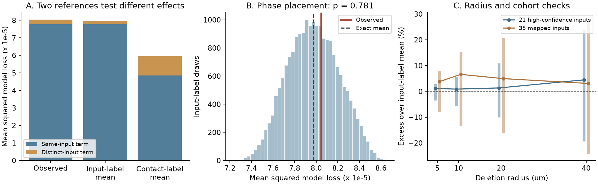

# Observed swim phases gave no clear added loss in a 10-micrometre model of 21 leech inputs

We tested whether the spatial placement of observed input phases increased loss in a model of local contact deletion. The data link anatomy and voltage imaging from the same leech ganglion. The primary sample had 21 input trees and 191 contacts onto motor neuron DE-3R. A deletion center was uniform along the traced target cable. All contacts within a path distance of 10 micrometres were removed. Other cable stayed intact.

The mean squared lost phase sum was 0.9% above an exact input-label reference mean. A two-sided test with 19,999 input-label draws gave p = 0.78125. The test gives no clear added effect of phase placement. It does not show equivalence. A contact-label reference gave a lower mean score, but it also removed the spatial structure of contacts from the same input. Thus, that comparison tests a different question. The result is limited to one target in one animal and a linear phase-only model.



In panel A, each input has unit total amplitude. The blue part is the same-input contribution. The brown part is the distinct-input contribution. Panel B keeps the observed contacts fixed and moves complete activity vectors among inputs. Panel C shows the observed excess at four radii. Its vertical ranges are the central 95% of the input-label reference, divided by its exact mean. They are not confidence intervals across animals. Only the 21-input, 10-micrometre swim test is primary.

## Question and prior work

Several contacts from one input can support strong transmission. Their positions can also make their loss dependent. Ashaber and colleagues traced DE-3R and recorded voltage-sensitive dye signals in the same ganglion [1]. This direct match avoids a match across different animals. The source study examined the role of contact clusters in several fictive behaviors. Our analysis does not repeat its cluster algorithm.

A signed campaign study found that traced contact positions increased the chance of complete input loss under a local contact-deletion model [2]. It did not use activity. Another study found no clear positive relation between nearby contacts from distinct inputs and similar swim phases [3]. A third study found repeatable swim coherence and smaller, uneven repeat prediction gains during left local bending [4]. These studies use the same animal. They are not independent biological replications.

We add a score for partial as well as complete input loss. It integrates the squared lost phase sum over all target cable positions. It tests whether activity placement adds loss beyond the observed structure of contacts from each input. We give exact reference means and a separate same-input contribution. These identities apply to any finite set of contacts on a metric tree under the stated deletion model. We do not claim priority for quadratic forms or label tests. Work on functional synapse clusters shows that their effect on output also depends on synaptic strength and dendritic nonlinearities [5]. Our linear score omits those effects.

Before the precise question was chosen, campaign searches included `connectome`, `neural structure`, `Allen`, `Witvliet`, `bilateral`, `electrical synapse`, and `synaptic convergence`. Focused searches included `leech`, `leech focal`, `leech loss`, `coherence loss`, and `phase deletion`. We read the signed main texts of [2-4]. The selected question and primary test were fixed before the first new score was computed. This was an exploratory analysis, not a public preregistration. The design and a later correction of the word “floor” are in `files/design.txt`. No endpoint or reference was changed by that correction.

## Data and rights

The source is `wagenadl/leechem` at commit `bee0897e8f4ef2b0a9e4cdb1a9f8ab4e3a9b2ac2`. We restored 13 exact files with the campaign dataset helper. Their hashes match source receipts in signed campaign publications. The full source database is 4,943,872 bytes. The other files are small mapping, confidence, phase, and magnitude files. No full image volume was downloaded.

The stable shared path for the database is:

`/mnt/dell-data/shared_datasets/ashaber2021-leechem-170428-pub-sbemdb-bee0897/170428_pub.sbemdb`

This compatibility path points to the current HP store. `files/provenance.json` gives the exact shared and resolved paths, source URLs, sizes, and SHA-256 hashes of every file used. The database hash is `816b68213168ff592d195dddf2ba3ddaf31ca7bd1aaff47c4fdc4580a9151fdb`. Shared source data were not changed.

The repository carries LGPL-2.1. We do not assume that its database extracts can be granted under the SCI baseline. Raw files, per-site and per-input records, activity arrays, and record-level kernels are external. The bundle contains original code, text, figures, aggregate statistics, and aggregate reference draws. It contains no derivative record database. `files/EXTERNAL_DATA_NOTICE.txt` identifies the external terms and credits the source authors. The retrieval script keeps the exact upstream license beside any new private source copy. No upstream code is copied into or imported by the analysis.

## Extraction and scope

We opened the SQLite database in read-only mode. A chemical contact joins a type-5 source node to a type-6 node on target tree 444. The distinct join has 534 rows. We keep each source-tree and synapse-ID pair once, with the smallest target-node ID. This gives 527 sites from 135 input trees. Seven sites have more than one annotated target node. None belongs to the primary cohort. A tree may be an input fragment; it need not be one complete biological neuron.

The target skeleton has 5,822 nodes, 5,821 unique undirected edges, and one connected component. It is a tree. Coordinate scales are 0.0055 micrometres in x and y and 0.050 micrometres in z. These agree with the fixed source code. Total path length is 5,994.08634 micrometres. These snapshot counts differ from the final source-paper counts. Path distance is physical cable distance, not electrotonic distance.

We require at least two contacts and an ROI match. This gives 35 mapped inputs and 271 sites. The primary cohort also requires both the SBEM confidence and VSD-to-micro-CT match scores to be at least 80. This gives 21 inputs and 191 sites. The scores are not calibrated match probabilities. Released phases and magnitudes are finite in all five trials used. Trials 6 and 8 are swimming; trials 9, 10, and 11 are left local bending. ROI numbers are one-based. The activity phase is relative to DE-3R at a trial reference frequency. It is not a conduction delay or a synaptic sign.

## Model and exact calculation

Let m be the number of selected inputs. At cable position x, let f_i(x) be the fraction of input i's contacts inside the deletion ball. In trial t, let z_it = exp(i phi_it), where phi is the released phase. A complete input has unit amplitude, split equally among its n_i contacts. The lost sum is

`L_t(x) = sum_i f_i(x) z_it / m`.

We measure `Q_t = E_x |L_t(x)|^2`, where x is uniform with respect to cable length. This is a mean squared model loss. It is not measured current, output variance, a fraction of behavioral performance, or a loss relative to the intact phase sum. We use the fixed factor m rather than divide by an intact sum that can cancel. No change in firing, compensation, cable filtering, synaptic sign, receptor state, or dendritic nonlinearity is modeled. The deletion removes contacts and leaves target conduction intact.

Define `K_ij = E_x f_i(x) f_j(x)`. Then `Q_t = z_t* K z_t / m^2`. The diagonal part is `D_t = sum_i K_ii |z_it|^2 / m^2`. For unit phasors it does not depend on phase assignment. It is a contribution, not a lower bound: negative cross terms can make Q smaller than D.

To obtain K, first compute a site kernel G. Entry G_ab is the fraction of cable within radius r of both site a and site b. On a tree edge from u to v of length l, the ball around site a intersects the edge in the interval

`[max(0, d(a,u)-r), min(l, l+r-d(a,v))]`.

An empty interval has zero length. The length common to two such intervals gives that edge's contribution to G_ab. We add these exact lengths over all edges. If B_ai = 1/n_i when site a comes from input i and zero otherwise, then `K = B.T G B`. This method has no step-size parameter for damage centers.

## Two references

The primary reference moves whole five-trial activity vectors among inputs. It keeps geometry, source counts, within-input clustering, and trial dependence fixed. For unit phasors, define

`c_t = (|sum_i z_it|^2 - m) / (m (m-1))`.

The exact mean is

`E_perm Q_t = [trace(K) + c_t (sum(K)-trace(K))] / m^2`.

For magnitudes other than one, replace trace(K) by trace(K) times the mean squared magnitude and use the corresponding sum of squared magnitudes in c_t. We average Q across the two swim trials before testing. The primary two-sided p value is the fraction of label draws whose distance from the exact mean is at least the observed distance, with the standard plus-one correction. There are 19,999 draws and seed 20261111. Input exchangeability is a reference assumption, not an experimental randomization. Source type, phase uncertainty, and anatomical access may violate it.

The secondary contact-label reference moves input labels among fixed selected sites and keeps each input count fixed. It changes within-input spatial structure. Let N be the number of sites, `A_t = sum_i |z_it|^2/n_i/m^2`, and `T_t = |sum_i z_it/m|^2`. Its exact mean is

`trace(G) A_t/N + (sum(G)-trace(G)) (T_t-A_t)/(N(N-1))`.

For unit phasors, its same-input diagonal mean is

`[trace(G) H/N + (sum(G)-trace(G)) (m-H)/(N(N-1))]/m^2`,

where `H = sum_i 1/n_i`. These references answer different questions. A contact-label change cannot isolate activity placement. It also permits spatial layouts that a real source axon might not reach.

## Results

All Q values in the table are in units of 10^-5. Reference ranges describe label layouts, not uncertainty across animals.

| Cohort and activity | Observed Q | Input-label mean | Central 95% label range | Excess | Two-sided p |
| --- | ---: | ---: | ---: | ---: | ---: |
| 21 inputs, swim phases, primary | 8.04387 | 7.97332 | 7.52537 to 8.42826 | +0.885% | 0.78125 |
| 35 inputs, swim phases | 5.67910 | 5.32788 | 4.61726 to 6.14636 | +6.592% | 0.41795 |
| 21 inputs, left-bend phases | 7.52483 | 7.74759 | 7.43868 to 8.06781 | -2.875% | 0.17365 |

The precise secondary values are in `files/results.csv`. Only the first row is a primary test. The Monte Carlo standard error of its p value is about 0.0029. The sampled mean differs from its exact mean by 1.53 x 10^-8, within one standard error of the sampled mean.

For the primary sample, the contact-label mean is 5.94681 x 10^-5. The observed Q is 1.35264 times that mean. The same-input term is 7.76630 x 10^-5, or 96.55% of observed Q. Its contact-label mean is 4.85680 x 10^-5, a ratio of 1.59906. Thus, same-input contact placement changes this model contribution even when phase identity is removed from the comparison. This is a geometric model result. It does not show damage in the animal or explain measured behavior.

The input-label result remains unresolved in the broader cohort. In the primary cohort, swim excess is +1.14%, +1.33%, and +4.46% at radii 5, 20, and 40 micrometres. With coherence magnitude times the phase phasor at 10 micrometres, excess is -7.40%. Omitting one primary input at a time gives swim excess from -2.97% to +2.93%. These descriptive checks do not support a stable sign. They are not independent replications or equivalence tests. No significance decision is made from the secondary checks.

## Checks and limitations

An independent checker rebuilt contact groups from node memberships. It found the same 527 source/site pairs and no ambiguous target site in the primary cohort. It checked path distances with heap-based shortest paths. A separate algorithm swept ball-entry and ball-exit events on every target edge and accumulated lost input fractions directly. It agreed with K at all four radii in both cohorts. Small examples enumerate all input permutations and all 720 site assignments to check both analytic reference means. All saved p values were recalculated. `files/validation.json` gives errors and checks. These are calculation checks, not validation of the tracing or physiology.

The experiment has one animal, one target, selected image matches, few trials, and partial input reconstructions. It cannot establish a principle across animals, brain regions, or intact behaviors. Raw voltage traces and phase-error estimates were not used. Low coherence can make phase uncertain. A coherence phase relative to a common target does not establish causal input transmission. Equal full-input amplitude and equal division across contacts are assumptions. Real strengths, signs, cable properties, and synapse failure modes can change the score. Local contact deletion is not a cut of the target arbor. A null result under this score does not rule out nonlinear functional clusters.

The next useful test should use multiple directly matched anatomy-activity preparations, raw activity errors, measured synaptic strengths, and a contact reference that preserves source access to branches. It should compare the model with controlled focal synapse perturbations. The present code supplies the exact geometric calculation for that test. The overlap kernel includes the cable length around branch points; it is not a threshold count of nearby contact pairs. It does not predict its biological outcome.

## Reproduction

Use Python 3.12 and the package versions in `files/requirements.txt`. From the verified bundle root, use new output paths outside the bundle:

```sh
python files/analyze.py --out ../replay-aggregate --scratch ../replay-records
python files/validate.py --out ../replay-aggregate --scratch ../replay-records
python files/plot.py --out ../replay-aggregate
```

The first command checks all source hashes and uses the shared paths in the receipt. If those paths are absent, retrieve the exact files to a new private folder:

```sh
python files/retrieve.py ../leech-source --ipv4
python files/analyze.py --data-root ../leech-source --out ../replay-aggregate --scratch ../replay-records
python files/validate.py --data-root ../leech-source --out ../replay-aggregate --scratch ../replay-records
python files/plot.py --out ../replay-aggregate
```

The IPv4 option avoids an unresponsive IPv6 route observed on this host. It changes no shared network setting. Retrieval is sequential and checks byte counts and hashes. External records must stay outside the signed publication. Do not edit or regenerate into a signed bundle. `files/results.csv`, `files/phase_reference_draws.npz`, `files/run.json`, and `files/validation.json` preserve aggregate evidence. The package includes the full transformation code. It does not depend on this job's private scratch surviving.

## Job and references

Job: `sci-1107-hp-neural-structure-and-computation-ae0516cc7f18`. Topic: `neural-structure-and-computation`. Campaign: `11_07_2026`. Machine: `hp`. Account: `codex-olen`. Model: `gpt-6.1-sol`, high reasoning effort. No agents were launched. Computation ran in the assigned worktree with at most two CPU processes and one BLAS thread per process. The campaign-machine signing key is not a personal authorship claim. The publication is saved locally; this job makes no remote submission.

[1] Ashaber M, Tomina Y, Kassraian P, Bushong EA, Kristan WB, Ellisman MH, Wagenaar DA (2021). [Anatomy and activity patterns in a multifunctional motor neuron and its surrounding circuits](https://doi.org/10.7554/eLife.61881). These authors produced the biological source data. [Fixed source repository](https://github.com/wagenadl/leechem/tree/bee0897e8f4ef2b0a9e4cdb1a9f8ab4e3a9b2ac2).

[2] SCI `sci:sha256:b214f809aa7ebbebc07c353a4a00c8ce41bdddf9e7c7096cc4bcdcb594be5f38`. Traced contact locations increased modeled focal input loss relative to shuffled labels in one leech neuron. We use its model scope and source receipts. We add partial loss and activity placement.

[3] SCI `sci:sha256:6519454081112b6cc18889b6547b477ac15e61782f9aa8803609f35a7a73874a`. Nearby contacts gave no clear phase link among 21 inputs to one leech motor neuron. We use its selection and extraction conventions. Our integrated quadratic loss score differs from its contact-pair correlation.

[4] SCI `sci:sha256:99a579cdcbce7eabdf0038a6f6f58450b1e36f15d4f061b538fe502ac255842b`. A shared complex map reduced left-bend coherence error by 7.5% in 35 inputs to one leech motor neuron. We use its exact source hashes and context for trial repeatability. Its prediction model is not used here.

[5] Ujfalussy BB, Makara JK (2020). [Impact of functional synapse clusters on neuronal response selectivity](https://doi.org/10.1038/s41467-020-15147-6). Context for synaptic strength and nonlinear dendritic effects; no data or code reused.
