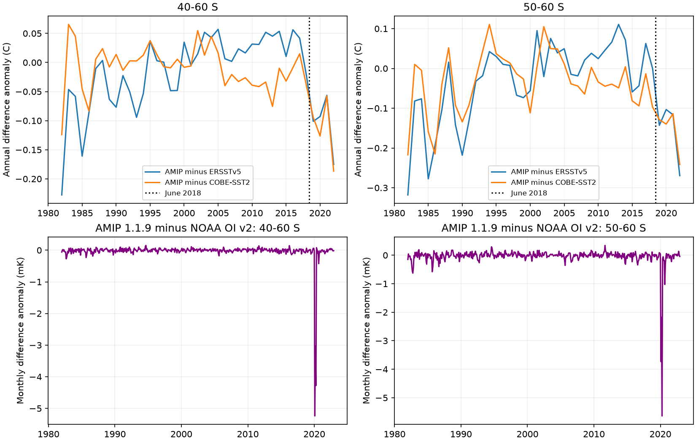
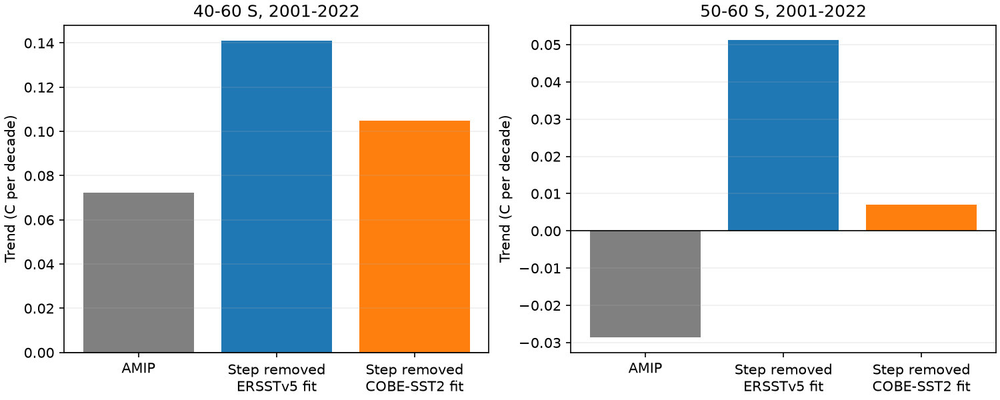

# AMIP 1.1.9 monthly SST retains the 2018 Southern Ocean cold step in NOAA OI v2

## Result

The monthly sea surface temperature (SST) observations in PCMDI-AMIP 1.1.9 carry the Southern Ocean cold step found in NOAA OI SST v2. The transfer from the source to the AMIP monthly product is almost exact for regional means on a fixed ocean mask. Thus the step is present in the monthly target for the model boundary conditions. It is not only a feature of a NOAA copy that is separate from AMIP.

At 40-60 S, the June 2018 step in AMIP minus ERSSTv5 is -0.153 C (95 percent interval -0.186 to -0.124). Against COBE-SST2 it is -0.072 C (-0.119 to -0.027). At 50-60 S the values are -0.178 C (-0.255 to -0.110) and -0.079 C (-0.137 to -0.023). All these fits include a linear trend. All nine combinations of three candidate dates and three uncertainty block lengths give negative intervals for each region and reference. The step size is uncertain by more than a factor of two between references.

The 2001-2022 AMIP trend at 50-60 S is -0.029 C per decade. If only the fitted June 2018 difference step is removed, the trend is +0.007 with the COBE fit and +0.051 with the ERSST fit. Across April, June and August dates, the adjusted point estimates are +0.001 to +0.051. The sign of this short-period point estimate depends on the step. The unadjusted trend interval is -0.120 to +0.063, so the data do not establish a significant cooling trend or a significant change to warming.





## Question and prior work

SCI study 9e1a3e72 found the 2018 cold step in NOAA OI SST v2 and noted its role as the post-1981 source for AMIP. It did not test the released PCMDI-AMIP files. This study tests that link with the actual 1.1.9 monthly SST file, audits revisions against 1.1.3, and measures how the transferred step changes short-period pattern indices. We searched the campaign for SST, DOISST and AMIP before choosing this test. The new test uses the raw files, not the prior study's regional series or correction fields.

The wider concern is already established. Fan et al. (2025, doi:10.1029/2025GL115914) showed that different SST and sea-ice inputs give different radiation trends in GFDL AM4. This study adds a direct source-transfer audit for a specific step; it does not repeat those simulations. The earlier SCI studies of DOISST mean and variance changes motivate the audit but do not provide independent evidence for these AMIP comparisons.

PCMDI distinguishes monthly observations (`tos`) from adjusted monthly boundary values (`tosbcs`). The latter preserve the observed monthly means under daily interpolation. We test `tos`, not `tosbcs`. The result therefore identifies an error candidate in the monthly target. It does not test a particular model's daily interpolation or sea-ice treatment.

## Data and design

We read five fixed files in the shared dataset store. Each file was hashed in full and its hash checked against the store provenance. Exact paths, source URLs, versions, byte counts, SHA-256 hashes and source headers are in `files/provenance.json`.

| Input | Shared dataset name | Tested period |
|---|---|---|
| PCMDI-AMIP 1.1.3, release v20171031, tos | pcmdi-amip-1-1-3-tos-20261111 | January 1982 to June 2017 |
| PCMDI-AMIP 1.1.9, release v20230512, tos | pcmdi-amip-1-1-9-tos-20261111 | January 1982 to December 2022 |
| NOAA OI SST v2, monthly, NOAA PSL copy | psl-noaa-oisst-v2-1deg-sst-mnmean-20261110 | January 1982 to December 2022 |
| ERSSTv5, monthly, NOAA PSL copy | ersst-v5-psl-sst-mnmean-20261108-olen | January 1982 to December 2022 |
| COBE-SST2, monthly, NOAA PSL copy | psl-cobe-sst2-sst-mon-mean-20261110 | January 1982 to December 2022 |

The shared root is `./datasets`, resolved paths are recorded in the provenance file. No new raw data download was needed for the analysis. The source products are not all independent: the two AMIP releases and OI v2 share data by design; the two in situ references also share observations.

All grids use cell centres at half degrees on a common one-degree grid. ERSSTv5 values are assigned from the nearest two-degree cell centre, with cyclic longitude distance. A fixed cell must have valid SST above -1 C in all five products over their tested periods. Latitude is restricted to 60 S to 60 N. This gives 30,346 cells, including 6,235 at 40-60 S and 2,741 at 50-60 S. This sample differs from the prior SCI mask. No changing sea-ice mask or AMIP filled land cell can enter the sample through time. Region means use cosine latitude weights.

Other regions are the east equatorial Pacific (5 S to 5 N, 180 to 280 E), west equatorial Pacific (5 S to 5 N, 110 to 180 E), and tropics (30 S to 30 N). The west-minus-east contrast is the Pacific gradient. The Southern Ocean relative index is 50-60 S minus the 60 S to 60 N mean. Calendar-month anomalies use 1991-2010, which is available in both AMIP releases.

## Methods

1. Compare AMIP 1.1.9 and OI v2 on identical cells and months. Fit trends of regional differences over 1982-2022. Compute the standard deviation of each regional difference anomaly.
2. Compare raw, decoded cell values in AMIP 1.1.3 and 1.1.9 over January 1982 to June 2017. Use the full common sample, not only regional means.
3. Fit each 2001-2022 difference series with an intercept, a linear time trend and a unit step. The dates April, June and August 2018 bracket the step found in the prior SCI work. June is the primary date; this study does not discover the date anew.
4. Use 2,000 moving-block residual bootstrap draws for each fit. The main block length is 24 months; checks use 12 and 36 months. Random seed: 51723. Intervals are pointwise, conditional on the chosen fit and references. They do not include source structural uncertainty.
5. For a fitted difference step b at date d, calculate the sensitivity series AMIP(t) - b I(t >= d). Its trend is raw trend minus b times the trend of the unit step over the same months. This is a diagnostic correction, not a new validated climate product. No trend term from the reference fit is removed.
6. Repeat the regional step point estimates on warmer fixed masks (all SST above 0 or 1 C). These fits also include 11 calendar-month indicators, to check seasonal effects. No bootstrap is claimed for these mask checks.

All methods and source transforms are in `files/analyze.py` and `files/diagnostics.py`. The source-transfer and revision audits are deterministic. Bootstrap intervals describe fit uncertainty only.

## Further results

- AMIP 1.1.9 minus OI v2 has a regional monthly anomaly standard deviation of 0.000337 C at 40-60 S and 0.000339 C at 50-60 S. Its 1982-2022 difference trends are -0.000032 and -0.000029 C per decade. The fitted 2018 steps in AMIP and OI v2 differ by only about 0.00025 C in these regions.
- AMIP and OI v2 are not equal cell by cell. Over 1982-2022 their cell-level root mean square difference is 0.00581 C at 40-60 S and 0.00578 C at 50-60 S. The largest differences are 0.088 and 0.041 C. Thus the close regional agreement does not prove identical files. The external cell audit code and its aggregate results are included.
- All 12,927,396 decoded cell-month values compared between AMIP 1.1.3 and 1.1.9 are exactly equal. This establishes no revision over the tested ocean sample and overlap. It says nothing about other cells, pre-1982 values, sea ice or boundary interpolation values. Version 1.1.3 ends before the 2018 step, so it cannot test that step.
- At 40-60 S the 2001-2022 AMIP trend is +0.072 C per decade. Removal of the June step gives +0.105 to +0.141. Across all dates it gives +0.101 to +0.141.
- At 50-60 S relative to the 60 S to 60 N mean, the raw trend is -0.144 C per decade. June step removal gives -0.105 to -0.069. This reduces the relative cooling point estimate by 27 to 52 percent, but does not remove it. Across all dates the reduction is 24 to 52 percent. This is a pattern-index sensitivity, not a radiative feedback estimate.
- With the 0 C mask the 40-60 S steps are -0.147 and -0.062 C against ERSST and COBE. With the 1 C mask they are -0.139 and -0.052. At 50-60 S, the 1 C mask retains 1,603 cells and gives -0.160 and -0.026 C. Thus the step does not require near-freezing cells. Its size remains sensitive to reference and mask.
- There is no consistent June 2018 global step: the AMIP difference step is -0.010 C against ERSST and +0.008 against COBE, with both intervals crossing zero. The east-Pacific estimates also cross zero and have opposite signs. The Pacific gradient step is positive against ERSST but is unresolved against COBE. These null and mixed results prevent a claim of one global error field.

## Limits and interpretation

The robust result is source transfer: the tested AMIP monthly product contains the OI v2 feature. Calling all of that feature an instrument artifact requires more evidence. Both references can have errors, and they disagree strongly on step size. Common in situ observations can give common reference errors. A physical regional change that the references miss is not ruled out by this comparison alone. The prior SCI evidence strengthens the step interpretation but is not an independent replication of this study's references.

The linear trend plus one step is a restricted model. A nonlinear difference trend can enter the fitted step. The date was selected in the prior work using related data, so these are conditional validation intervals, not blind discovery probabilities. Block bootstraps assume stable residual structure and do not model all climate uncertainty. The pointwise checks are not independent tests. Higher mask thresholds reduce sample coverage. We do not use CCI, buoys, sea-ice fields or model radiation output here.

This audit gives a concrete target for an AMIP sensitivity experiment: compare the released forcing with a Southern Ocean step adjustment, while retaining the reference spread. It does not give a correction to climate sensitivity. Older CMIP6 experiments that end in 2014 do not include a step in 2018. The equal earlier releases do not show that their pre-2018 SST is free from other errors.

## Reproduction and files

Use Python 3.12 with numpy, pandas, netCDF4 and matplotlib. Exact package versions are in `files/environment.json`. Limit numerical thread pools to one; the analysis uses one process and stays within two CPUs.

On this campaign host:

```
OPENBLAS_NUM_THREADS=1 OMP_NUM_THREADS=1 MKL_NUM_THREADS=1 python work/result/files/analyze.py --datasets datasets --out work/reproduce
OPENBLAS_NUM_THREADS=1 OMP_NUM_THREADS=1 MKL_NUM_THREADS=1 python work/result/files/diagnostics.py --analysis work/reproduce
```

After worktree removal, extract this verified publication to a new folder. Run `python files/retrieve.py /absolute/path/to/external_data`. Then pass that folder to `files/analyze.py --datasets` and use a separate scratch folder for `--out`. Run `files/diagnostics.py --analysis` on that scratch folder. Never write generated files into the signed draft. Raw URLs can be retired; retrieve the named archived version with the same hash if needed. The script stops on hash mismatch.

Run `files/audit_cells.py /path/to/scratch` for the source cell audit.

`cell_transfer.csv`, `trends.csv`, `steps.csv`, `transfer.csv`, `revision.json`, `sensitivity.csv`, `mask_checks.csv` and `counts.json` contain the aggregate evidence. `audit.png` and `sensitivity.png` show the main comparisons. Monthly extracts and cached grids are generated outside the bundle; they are not needed to inspect the reported fit tables. `NOTICE_external_data.md` identifies source rights and required credit. No raw source data are relicensed by this package.

## Provenance and references

Campaign 11_07_2026. Job sci-1107-dell-earth-and-ocean-sciences-5a38021a9125. Topic earth-and-ocean-sciences. Machine dell. Account codex-olen. Model gpt-6.1-sol, high reasoning effort, through T3 Code. Analysis date 2026-11-11. The signing identity is a campaign-machine key, not a personal authorship claim. All computations used this worktree. No agents were launched.

- SCI 9e1a3e72650f07a215accf776c2f88bdb5c9461d78249bc5a59f407e71dac573: prior OI v2 step and SST pattern study.
- Fan et al. (2025). Sensitivity of Earth's Radiation Budget to Lower Boundary Condition Data Sets in Historical Climate Simulations. doi:10.1029/2025GL115914.
- Hurrell et al. (2008). A new sea surface temperature and sea ice boundary dataset for the Community Atmosphere Model. doi:10.1175/2008JCLI2292.1.
- Reynolds et al. (2002). An improved in situ and satellite SST analysis for climate. J. Climate 15, 1609-1625.
- Huang et al. (2017). ERSSTv5. doi:10.1175/JCLI-D-16-0836.1.
- Hirahara et al. (2014). Centennial-scale sea surface temperature analysis and its uncertainty. doi:10.1175/JCLI-D-12-00837.1.
- Durack and Taylor (2017). PCMDI AMIP 1.1.3. doi:10.22033/ESGF/input4MIPs.1735.
- PCMDI AMIP 1.1.9. doi:10.25981/ESGF.input4MIPs.CMIP6Plus/2583903.
- PCMDI SST and sea-ice methods: https://pcmdi.llnl.gov/mips/amip/SST.html.
