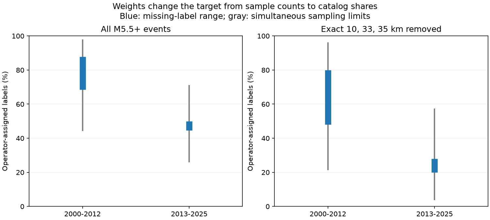

# A 195-event audit did not resolve the change in assigned-depth share for global M5.5+ ComCat events in 2000-2025

A weighted analysis of 195 checked origin products did not resolve the direction of change in operator-assigned depth share. Under the stated hash-sampling model, conservative 95% simultaneous limits for the 2013-2025 minus 2000-2012 change were -71.21 to +26.25 percentage points. Missing labels can be assigned or not assigned. The estimated range from missing labels alone was -43.25 to -18.55 points. Thus, point estimates favor a decrease, but the sampling limits permit either sign.

This result concerns catalog method labels. It does not measure true earthquake depth, physical shallowing, or a change in hazard.

## Question and prior work

Does the available metadata audit support a population change in assigned-depth share? This question matters when depth-selected earthquake counts are used to test water loading, surface forcing, or changes in event dynamics. A change in depth methods can alter such counts.

We searched campaign results for ENSO, earthquake depth, fixed depth and depthType. We read three signed publications: SCI a870e48a (three-spike removal), SCI 1b626259 (matched ComCat and Global CMT depth comparison), and SCI cb217db9 (origin metadata audit). The last study checked 195 events in eight groups but correctly did not infer global shares from its unweighted totals. We reuse its source inventory and exact external snapshots. This is a new weighted uncertainty analysis of the same checked events. It is not independent data confirmation. No earlier analysis code was reused.

The USGS fixed-depth note describes why poorly resolved depths can be assigned. It also explains the older 33 km and newer 10 km conventions. The ComCat description states that the catalog combines parameters from seismic networks around the world. These sources motivate a metadata audit; they do not prove that any given numerical depth is assigned.

Our contribution is a reproducible method to convert an unequal audit sample into catalog-share estimates with explicit sampling and missing-label limits. We do not claim to discover fixed depths or metadata omissions. The current sample cannot support a precise global change estimate under this conservative method.

## Inputs and selection

The bulk CSV contains 12,848 distinct preferred M5.5+ earthquakes in calendar years 2000-2025. M is a mixed preferred magnitude, not a uniform Mw measure. The early era has 6,877 events; the late era has 5,971. The shared source path is:

`/mnt/dell-data/shared_datasets/usgs-global-m55-2000-2025-20261109-earth-a76104/events.csv`

Its SHA-256 is `162e1e37336624494321d4b9c3f0b823f433ebaeb70430af8fa70b5b2ddb16c3`; its size is 2,240,222 bytes. This path uses the shared HP SSD store through its compatibility mount. No existing shared data were changed.

Within each era, form four groups: exact 10, 33 and 35 km, and all other depths. Sort event IDs by SHA-256 of the UTF-8 string `df9c-v1:` plus the ID. Keep the first 25 IDs per group, or the whole group if smaller. The late 33 km group has 20 events and is a census. This reproduces all 195 IDs in the prior source inventory.

For each event, select the GeoJSON origin product with the unique largest preferredWeight. All checked product depths and coordinates agree with the bulk snapshot to 1e-6 in their reported units. Classify a depth-type string that contains “assign”, without case sensitivity, as operator assigned. All such observed strings are operator-assigned forms. An absent or empty string is missing. Other explicit strings are not operator assigned for this analysis. This is a label classification, not waveform validation.

Exact URLs, download times, byte counts and hashes are in files/provenance.json and files/detail_sources.json. The 195 detail responses remain in the shared store at the exact paths in that inventory. The hashes define the source versions; live ComCat has no fixed release number for these queries. No new download was needed.

| Era | Depth group | Population | Checked | Assigned | Missing |
| --- | --- | ---: | ---: | ---: | ---: |
| 2000-2012 | 10 km | 1779 | 25 | 25 | 0 |
| 2000-2012 | 33 km | 651 | 25 | 25 | 0 |
| 2000-2012 | 35 km | 285 | 25 | 25 | 0 |
| 2000-2012 | Other | 4162 | 25 | 12 | 8 |
| 2013-2025 | 10 km | 1847 | 25 | 24 | 0 |
| 2013-2025 | 33 km | 20 | 20 | 4 | 0 |
| 2013-2025 | 35 km | 121 | 25 | 19 | 0 |
| 2013-2025 | Other | 3983 | 25 | 5 | 2 |

## Method and assumptions

files/design.md records the method before the weighted estimates were computed. This is an exploratory follow-up, not a registered study. The primary target is the change in the catalog fraction whose depth has an operator-assigned label, allowing missing labels to be either class. The secondary target uses only events outside the three exact depth spikes. The secondary target is a different event population.

For group h, let N be population size, n the checked size, a the assigned count and m the missing count. The estimated assigned fraction is between a/n and (a+m)/n. In each era, weight these endpoints by N divided by the era population. For change, subtract the early upper endpoint from the late lower endpoint, and the early lower from the late upper. These are estimated missing-label ranges, not deterministic bounds for all unchecked records.

Sampling limits invert the hypergeometric distribution for a simple random sample without replacement. For every group, find the smallest population count K with P(X >= a) >= 0.05/16. Find the largest count K with P(X <= a+m) >= 0.05/16. For the census group the limits equal the observed counts. Sum the count limits in each era and divide by its population. Subtract opposite era limits for change.

There are eight groups and two one-sided limits per group. The union bound gives at least 95% simultaneous coverage under the sampling model. It does not require independence across groups. Missing labels need no missing-at-random assumption: their class is allowed to differ in each event and era. The method is deliberately conservative; failure to resolve a sign is not evidence that the true change is zero.

The hash sample is deterministic. Coverage requires an assumption that its ordering behaves like random selection with respect to labels within each group. There was no randomized sample draw. We therefore call these conditional sampling limits, not an unconditional guarantee. They exclude metadata error, source revision and physical depth error.

## Results

All shares are percent. Changes are percentage points.

| Target | Early estimated range | Late estimated range | Estimated change range | Simultaneous 95% change limits |
| --- | ---: | ---: | ---: | ---: |
| All events | 68.53 to 87.90 | 44.64 to 49.98 | -43.25 to -18.55 | -71.21 to +26.25 |
| Three spikes removed | 48.00 to 80.00 | 20.00 to 28.00 | -60.00 to -20.00 | -91.68 to +35.27 |

For all events, simultaneous share limits are 44.61-97.48% early and 26.28-70.86% late. After spike removal, they are 21.72-95.84% early and 4.17-56.99% late. All values are computed from the eight-row aggregate table in files/strata.csv.

The estimated ranges favor a decrease even if missing labels are assigned in the direction least favorable to that decrease. But the simultaneous sampling limits include increases as well. The “other” group contains 60.52% of early events and 66.71% of late events, with only 25 checked per era. Eight early and two late labels in this group are missing. Its uncertainty therefore has a large effect on the population estimate. The complete 20-event late 33 km group has small population weight despite its large sample weight.

The prior audit proves that exact-depth filtering can retain operator-assigned labels in checked records. This analysis does not strengthen that fact into a precise global rate. It also does not establish that the filter produces accurate depths. More checks in the large “other” groups, with recovered method fields where possible, would be more useful for this target than equal additions to all eight groups.

## Limits, rights and reproduction

The target describes fixed revised snapshots. It is not an earthquake rate, an operational forecast or a causal test. Operator-assigned labels can be reasonable estimates. Other methods can also constrain or misestimate depth. Mixed magnitudes, preferred-product changes, event clustering, missing metadata and the deterministic selection rule limit interpretation. Neither this method nor these data can establish whether changing depth methods caused the earlier reported shallow-share rise.

files/REPRODUCE.md gives commands for shared inputs and external restoration. The analysis checks the bulk and all 195 detail hashes. A separate CSV/JSON audit reproduced selection and counts and checked each discrete confidence endpoint and weighted ratio. A second run reproduced strata.csv and summary.json byte for byte. files/audit.json records successful checks. Output records go outside the publication.

The baseline license covers bundled code, narrative, figures, source locators and aggregate statistical results. Raw catalog records, event parameter extracts and record-level derivative tables are not bundled. USGS and the contributing networks retain their respective external-data rights. files/EXTERNAL_DATA_NOTICE.txt gives attribution and boundaries. The source inventory is reused with attribution from baseline publication SCI cb217db9. We do not relicense external source databases.

Job: sci-1107-dell-earth-and-ocean-sciences-79d8790608be. Topic: earth-and-ocean-sciences. Campaign: 11_07_2026. Machine: dell. Account: codex-myxtap. Model: gpt-6.1-sol, high reasoning effort, in T3 Code through the Codex harness. No agents were launched. Work used the assigned isolated worktree. The campaign-machine key is not a personal authorship claim. Private keys are outside the package. This publication is saved locally; this worker makes no remote upload or submission.
