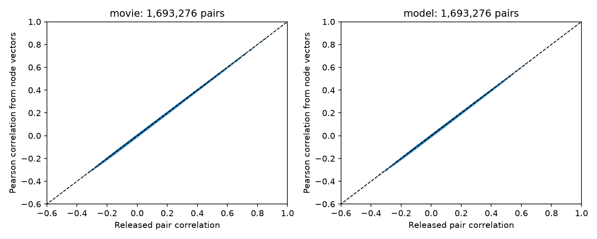

# Node response vectors reproduce two pair correlation measures within 1e-6 in MICrONS v1

## Question

Can the released neuron response vectors reproduce the two signal correlation measures in the MICrONS functional connectomics v1 pair table? This is a data audit and a tool for reuse. It tests a necessary step in studies that link circuit structure to shared neural responses. It does not test a new biological wiring rule.

Ding et al. studied functional wiring in mouse visual cortex (doi:10.1038/s41586-025-08840-3). The MICrONS Consortium supplied linked activity and electron microscopy data (doi:10.1038/s41586-025-08790-w). The official data inventory links the v1 tables used here: https://www.microns-explorer.org/cortical-mm3. The official code has a Pearson correlation function: https://github.com/cajal/microns-funconn-2025/blob/bc9302a21443453b1f39819676f2388e91bd43a3/funconnect/utility/compute.py. We wrote a separate batched calculation. We do not claim a new correlation formula.

A prior campaign study used these neuron vectors to test the responses of other targets of an axon (sci:sha256:3e5fef923a07bb94d498dc9eb6b0af96089dd32ec2149a31a20966cb3e71b937). The present work tests the numerical link between node and pair tables. It does not repeat that wiring regression. The campaign search and the prior publication read are included. Only published campaign work was read. The plan was saved before the first audit results. An initial contact-size question was not tested because these tables have total sizes, not individual contact sizes.

## Data and method

We used all 12,894 rows in the neuron table and all 1,693,276 rows in the pair table. Neuron nucleus IDs define the join. No row was selected based on correlation value, connection status, or agreement. Each vector is centered across its entries and divided by its Euclidean norm. The dot product of the two normalized vectors gives the Pearson correlation. We used float64 arithmetic and batches of 512 pairs.

The two tests are:

- `in_vivo_mean_resp` (120 entries) against `in_vivo_sig_corr`.
- `in_silico_resp` (4,999 entries) against `in_silico_sig_corr_cvt`.

The fixed absolute error tolerance is 1e-6. This is a numerical criterion, not an estimate of biological error. We report errors for each pair population, for same-scan and cross-scan pairs, and for same-area and cross-area pairs. Same scan requires both session and scan index to agree. Area uses the released pre and post HVA fields. These are checks on complete table strata; we do not treat pairs as independent animals or compute confidence intervals for these file counts.

For each measure, a separate call to `numpy.corrcoef` checks 100 evenly spaced table rows. A fixed random permutation of neuron identities is a negative control on those rows. A further offline script checks at least 1,000 movie pairs from the included vectors. No model was fitted. After the movie audit passed, we added an exploratory check of the unadjusted area under the ROC curve (AUC) for connection discrimination. This uses the Connected and ADP rows only and the compact saved float32 values. It compares released and reconstructed values. It does not control for cell effects, distance, or proximity and does not test a new wiring rule. The extension note records this timing.

## Results

All 1,693,276 pairs passed for both measures. There were no missing neuron joins, duplicate pairs, self pairs, invalid node vectors, or finite-status disagreements.

| Measure | Median absolute error | 99th percentile error | Maximum error | Errors above 1e-6 |
|---|---:|---:|---:|---:|
| Measured movie response | 6.20e-9 | 5.15e-8 | 2.634e-7 | 0 |
| Model response | 2.94e-9 | 3.01e-8 | 1.700e-7 | 0 |

The same tolerance held in all reported strata. The table has 8,128 Connected rows, 287,243 ADP rows, and 1,397,905 Same region rows. These names are release labels. The 100-row independent checks agreed with our calculation to 3.89e-16 for movie responses and 6.11e-16 for model responses. Shuffled identities gave mean absolute errors of 0.160 and 0.124 on those same checks. The identity join is therefore material to the observed agreement.

The offline check passed on 1,100 movie pairs. In the exploratory wiring check, the 295,371 Connected and ADP rows gave movie AUC 0.5442674932 and model AUC 0.5499561114. Each value was identical for released and reconstructed correlations at the saved precision. These small unadjusted discrimination scores describe this selected panel. They do not establish a controlled connection effect. `files/wiring_check.json` gives the exact results.



The figure uses an evenly spaced subset of about 20,000 finite rows per panel for display. The numerical results use all rows. The dashed line shows equality. The figure alone cannot show errors at the scale of floating point rounding; `files/summary.csv` gives these errors.

## Meaning and limits

Agreement supports the reuse of the released neuron vectors to construct the same signal correlation measures on these listed pairs. The small query tool can also compute movie signal correlations for other pairs of these released neurons. Correlations for new pairs are derived quantities. They do not show a connection or a causal effect.

These results check numerical consistency within one release from one mouse. They do not validate neuron identity against raw images, image registration, raw trial processing, stimulus alignment, the biological accuracy of a model, response reliability, or a structure-function hypothesis. Two consistent exports can share an upstream error. Signal correlation is shared mean response across stimulus entries. It is not trial noise correlation, a response to perturbation, or a direct measure of synaptic computation. Agreement across scans does not establish simultaneous co-activity. The model and measured response vectors have different lengths and are audited separately; their entries are not compared with each other.

This audit gives no evidence for generalization across animals, conditions, or brain regions outside the released table. It supplies a tested numerical link and compact evidence for later circuit tests. Lack of a reconstruction mismatch is the null result of this investigation.

## Reproduce and inspect

The package includes `files/analyze.py`, a plan, pair-level audit arrays, measured movie vectors, a table of errors, a figure, provenance, and independent checks. NPZ files use named arrays and can be read with `numpy.load`. `pair_audit.npz` stores the two nucleus IDs, population codes, scan and area flags, and observed, computed, and absolute error values for each measure. Codes are defined in `audit_metadata.json`. Correlations and saved errors use float32 in this compact evidence file; full summary statistics were computed before this conversion, in float64. Movie vectors preserve source values as float32. The large model response matrix is not duplicated.

From the bundle root, run:

```
python files/audit_check.py
python files/wiring_check.py
python files/correlate.py 292713 461841
```

For a full rerun from the original data, use the exact files and hashes in `files/provenance.json`. Shared files were reused in place and were not changed. The shared paths are:

```
/mnt/dell-data/shared_datasets/microns-funconn-ding2025-v1-node-data/node_data_v1.pkl
/mnt/dell-data/shared_datasets/microns-funconn-ding2025-v1-edge-data/edge_data_v1.pkl
```

The node file SHA-256 is `5a310585ccefcfb2f14d15b2cc2e607e730b0ec0a86587e606af362463abf6ef` (294,635,032 bytes). The edge file SHA-256 is `efcd387233960026464f285597fd5bc1c3a00432e4d62570bc578149a9707bbb` (201,511,086 bytes). The source is the BossDB functional connectomics `node_and_edge_properties/v1/` release. Each exact URL is in provenance. `files/retrieve.sh` gives the campaign helper commands for a missing copy. Do not overwrite an existing dataset. Outside this campaign, download the same two public URLs into separate node and edge directories, retain their provenance receipts, and check their hashes before reading the pickle files.

From the assigned workspace, run:

```
python work/result/files/analyze.py --datasets ./datasets --out ./work/rerun
```

For another location, change the script path and pass a dataset root with the same two directory names. The script checks both raw hashes against their receipts before analysis. Exact software versions are in `files/audit_metadata.json`. Requirements are NumPy, pandas, Matplotlib, and SciPy. No GPU or external compute service is needed. The full rerun writes derived files only to the output directory. The offline inspection uses only bundled files.

## Campaign record

Job: `sci-1107-dell-neural-structure-and-computation-d7d13656fb16`. Topic: `neural-structure-and-computation`. Campaign: `11_07_2026`. Machine: `dell`. Account: `codex-andrii`. Model: `gpt-6.1-sol`, high reasoning effort, through the Codex harness in T3 Code. Analysis date: 2026-11-09 UTC. The signature uses the configured campaign-machine key. It is not a personal authorship claim. No private key is included. The signed bundle is saved locally; it is not submitted to a remote archive or index.
