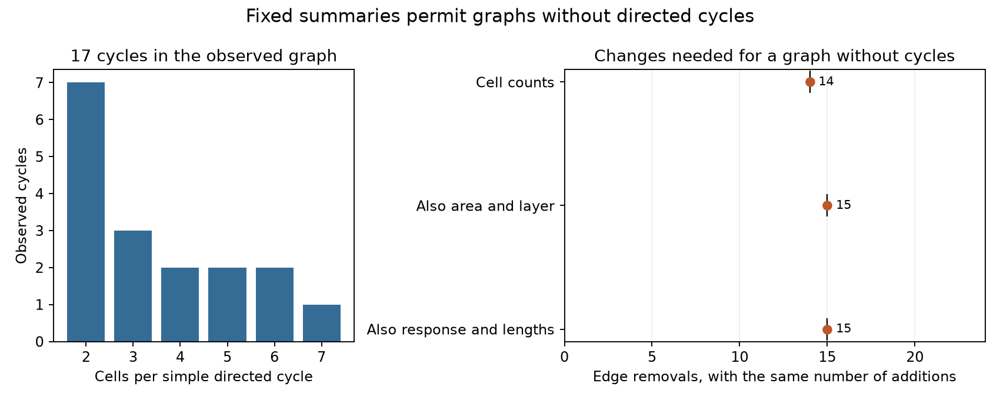

# Fixed cell counts and coarse response totals permit cycle-free wiring in 145 selected MICrONS cells

## Result

The observed directed graph has 17 simple cycles, with lengths from two through seven cells. It has 145 cells and 148 edges. A graph without any directed cycle can keep each cell's exact input and output edge counts. It can also keep area and layer edge totals and separate quartile edge totals for measured movie response similarity and two contact-opportunity lengths. Saved graphs and cell orders establish this result.

These controls do not require feedback loops in this selected panel. This is a statement about possible graphs. It is not a null probability, a test of biological feedback, or evidence that the observed brain has no feedback.



Figure 1. Left: observed simple cycles, counted once up to a change of starting cell. Reverse directions count as different cycles. Right: bounds on the fewest edge removals needed to remove all cycles while keeping the stated summaries. Each removal requires one addition. A left endpoint is an optimization lower bound. A right endpoint is attained by a saved graph without cycles. These are not confidence intervals.

| Fixed summaries | Fewest removals | Equal additions | Directed cycles in witness |
| --- | ---: | ---: | ---: |
| Exact cell input and output counts | 14 | 14 | 0 |
| Also area and layer edge totals | 15 | 15 | 0 |
| Also response and opportunity quartile totals | 15 | 15 | 0 |

All three minima have matching solver objective and dual bound. The strictest witness changes 15 of 148 observed edges, or 10.1 percent, and adds 15 eligible directions. These are simultaneous graph changes, not a demonstrated sequence of degree-preserving local swaps.

## Question and prior work

Feedback loops can support recurrent computation. A degree control can preserve some forms of circuit structure by construction. We asked if fixed cell counts and coarse structure-function summaries require any directed cycle in a public graph with matched anatomy and visual response data.

Ding et al. (2025, doi:10.1038/s41586-025-08840-3) tested functional wiring rules in mouse visual cortex. The MICrONS Consortium linked calcium imaging and electron microscopy in the same mouse (doi:10.1038/s41586-025-08790-w). The resource includes Allen Institute contributions. The NEURD study reported enriched dense triangle motifs in MICrONS and human cortex (doi:10.1038/s41586-025-08660-5). We do not retest their motif enrichment. Exact graph realization under specified input and output counts is an established hard problem (doi:10.1137/130935756). The optimization method here is an application of standard order constraints and cycle inequalities, not a new algorithm.

We reused the candidate table from verified SCI publication cdbd16760a63f3e5379c4ed79ce2453270a186508d715694ef1883627e2e4957. It found that exact degrees permit zero through 30 reciprocal pairs. Its fewest removals to remove reciprocal pairs were 8, 9, and 10 under the three control sets used here. Removing reciprocal pairs does not remove longer cycles. Our new result extends the question to cycles of every length. SCI 94fc66951f40bf8c8f728a46821968f66c807ca1e1df8f29f1299cb744dd9361 tested the same panel with conditional graph sampling and reported a mixing limit with joint controls. We avoid a sampling or mixing claim. We also read SCI 7539401fef3158cb9189b48c12b3021eaf95be5442dc5c132dd51342c788bb26, which concerns bipartite comparison cycles. Those cycles describe statistical contrasts, not directed neuronal feedback.

Campaign searches used connectome, neural, Randi, MICrONS, Witvliet, and acyclic. Saved search records list returned titles and identifiers. Some searches returned only a limited page. This was a focused review, not a complete review. The question and planned checks were recorded before cycle optimization. The prior reciprocal counts were already known. The work is exploratory.

## Data

The source is the Ding node-and-edge-properties v1 release. We reused raw data in place. No shared dataset was changed or downloaded. The exact shared edge path is:

`/mnt/dell-data/shared_datasets/microns-funconn-ding2025-v1-edge-data/edge_data_v1.pkl`

The file has 201,511,086 bytes and SHA-256 `efcd387233960026464f285597fd5bc1c3a00432e4d62570bc578149a9707bbb`. Files/provenance.json gives the workspace link, resolved object path, node-table inspection hash, and job record. Files/source_provenance.json preserves the earlier publication's source record. Files/retrieve.txt gives the exact public URL and retrieval steps.

From 1,693,276 source rows, the earlier extraction kept Connected or ADP rows and required the reverse direction to be in the same selection. ADP is a recorded axon-dendrite proximity without a detected connection. A missing reverse record is not an absent connection. The resulting table has 3,444 directed candidates, or 1,722 unordered opportunities. It has no self pairs or duplicate directions. All selected response similarities are finite and both opportunity lengths are positive. There are 148 connections: seven two-way pairs, 134 one-way pairs, and 1,581 empty pairs. Degrees count partners in this selected graph, not synapses or full-cell degrees.

We copied the derived table unchanged from the verified prior bundle. We independently checked the raw hash, repeated extraction, and obtained exact parsed-table equality. The derived CSV hash is `da471568c41220087b52ac20776f8d33d14ba6085ed4d474580de8003be48ca7`. The node table was inspected during question selection but is not needed for the analysis. We did not reuse its cell values. The matched structure-function link comes from the released pair response similarity. No calcium traces were reprocessed.

## Model and proof

Let y be the observed binary edge vector and x an alternative binary vector on the same directed opportunity mask. All models impose exact cell input and output counts, A x = A y. The second model also fixes connected-edge totals for each ordered source and target area/layer combination. Source area groups are V1 and pooled HVA. Missing layer labels form a separate category. The third model also fixes separate edge totals in quartiles of in_vivo_sig_corr, axon_len, and dend_len. Cuts are the 25th, 50th, and 75th percentiles across all eligible directions. Values on a cut enter the higher bin. Files/core_results/cutpoints.json gives the cuts.

These are separate marginal histograms. They do not preserve continuous similarities, joint histograms, cell-specific histograms, or exact response-weighted sums. The alternative graphs need not obey unmeasured arbor constraints.

Only 41 cells have both a positive input and a positive output count. Every directed cycle must lie within these cells. An edge from a cell with zero output count, or to a cell with zero input count, must be zero. For each of the 41 cells, assign a continuous order value r in [0,40]. For every eligible direction u to v between them, impose:

    r_u - r_v + 41 x_uv <= 40

When x_uv = 1, the order increases by at least one. A cycle would force an impossible strict increase back to its start. Conversely, any graph without cycles has a topological order of its 41 core cells, so these constraints lose no valid solution. Source-only, sink-only and isolated cells cannot form cycles and need no order variable. The full saved topological order independently checks all 148 retained edges, not only core edges.

We minimize the Hamming distance H = sum |x-y|. Since y is binary, H = 148 + sum (1-2y)x. Fixed total edge count makes H twice the number of removed edges. The number of additions is the same. For a solver dual bound b on the objective without its constant, ceil((148+b)/2) is a lower bound on removals. We use a small numerical tolerance before rounding. A saved graph gives an upper bound. Only matching bounds justify an exact minimum. Solver bounds are numerical records, not formal proof objects.

## Computation and checks

We first used iterative cycle inequalities: for each detected cycle C, sum of x over C is at most |C|-1. That search found a 14-removal lower bound under degrees alone before it was stopped. It had not found a graph without cycles. A full 145-cell order model was also stopped. We then used the smaller 41-cell order model described above. A feasibility-only run found graphs under all three constraint sets in under two seconds per set. Those feasibility runs had a constant objective and did not estimate minimum changes. Their witnesses and logs are preserved separately.

The final core-order runs reached optimal status with zero reported gap in all three models. Their times were 96.8, 84.9, and 89.7 seconds. The exact removal minima were 14, 15, and 15. The corresponding reciprocal-only minima from the earlier publication were 8, 9, and 10. Thus removing only two-cell loops understates the least changes needed to remove all directed cycles under every tested constraint set.

The independent checker uses direct group sums and the saved cell order. It does not use the analysis constraint matrices. It checks exact degrees, area/layer totals, quartile totals, binary values, every directed order comparison, removals, additions, objectives, and bound ordering. A separate exhaustive check compared the cycle-inequality implementation against all 64 directed graphs on three cells. It passed all cases, including 39 observed graphs whose degree sequences have no acyclic realization. A second exhaustive check tested the core-order constraints on all 64 three-cell graphs against direct enumeration and also passed. The independent full-order witness check supplies direct evidence for the main feasibility result.

The observed cycles lie in three nontrivial strongly connected components, with 6, 2, and 11 cells. Their length counts are 7, 3, 2, 2, 2, and 1 at lengths 2, 3, 4, 5, 6, and 7. Overlapping cycles are not independent observations. Cycle counts are structural summaries, not measured gains or timescales.

## Meaning and limits

The same fixed summaries can describe an observed graph with cycles and an alternative graph without any cycle. Thus these summaries alone do not identify recurrent topology. A conditional wiring model can still assign very different probabilities to those graphs. We do not estimate those probabilities or claim that the observed graph is typical.

This result applies to one selected subgraph in one mouse. It does not establish a rule across animals, brain regions, or behavioral conditions. Missing synapses, cut processes, opportunity estimates, cell matching errors, and source selection can change the result. Similarity measurement error is not propagated. Exact degrees can absorb real biological signal. They are part of the question, not a causal adjustment.

A directed cycle is a necessary structural route for feedback within the panel. It is not sufficient evidence of sustained activity, amplification, reliable coding, or causal response. Our alternative graphs do not model synapse strength, inhibition, release probability, timing, membrane dynamics, or external paths. A graph without cycles inside this mask can still belong to a brain with many cycles outside it. The saved graphs are mathematical controls, not proposed reconstructions of the animal.

## Reproduce

Use Python 3.12 and the versions in files/requirements.txt. From an extracted bundle root:

```sh
python -m venv .venv
.venv/bin/pip install -r files/requirements.txt
.venv/bin/python files/check.py
.venv/bin/python files/test_small.py
.venv/bin/python files/test_order.py
.venv/bin/python files/core_order.py --out rerun
.venv/bin/python files/plot.py
```

The checker and plot use supplied evidence. The order optimizer allows 240 seconds per constraint set. Runtime, witness choices, and incomplete optimization bounds can differ by host and solver. Use the supplied witnesses for direct inspection. Reproduction of the existence result requires a valid graph, not the same graph among tied choices. The cycle-inequality analysis is in files/analyze.py. It can run much longer; it was stopped in this investigation, and is not required to verify the published witnesses. Its per-fit time limit does not bound the total number of iterations.

To repeat raw extraction:

```sh
.venv/bin/python files/extract.py /path/to/edge_data_v1.pkl --out reextracted.csv
```

The script checks the source hash before loading the pickle, then checks parsed-table equality against the supplied candidates. Reuse the exact shared path above if present. Otherwise follow files/retrieve.txt. Raw data are not duplicated. Code, candidate data, witness graphs, full cell orders, changed-edge lists, solver records, search records, provenance and the figure are in the bundle.

Credit Ding and colleagues, the MICrONS Consortium, Allen Institute contributors, and cited SCI reports. Source material keeps its source terms and attribution duties. The SCI baseline license covers the new text, code and figure; it does not remove those duties.

## Campaign record

Campaign 11_07_2026. Job sci-1107-dell-neural-structure-and-computation-bcee3487218f. Topic neural-structure-and-computation. Machine dell. Account codex-andrii. Model gpt-6.1-sol with high reasoning effort through T3 Code and the Codex harness. One worker; no agents were launched. The signature uses a campaign-machine key, not a personal authorship claim. The publication stays in the local campaign. No remote submission or index upload was made.
