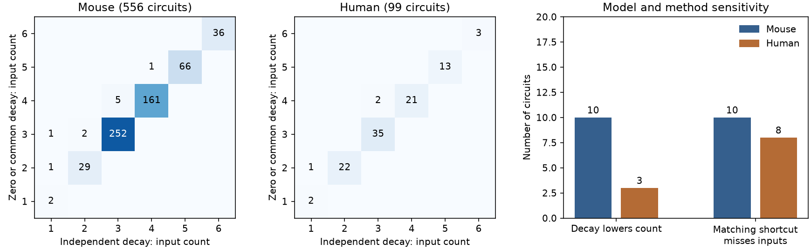

# Independent cell decay lowered dedicated input counts in models of 13 of 655 selected Allen circuits

Allowing a separate decay term at each cell lowered the minimum dedicated input count in models of 13 of 655 selected Allen cortical slice circuits. The count fell by one in 12 models and by two in one model. A common decay term at all cells cannot cause this change: it preserves the controllability rank for every fixed set of inputs.

These are exact structural model results for the selected graphs. They are not measurements of brain control or evidence that real cell decay varies in this way. The useful output is a small, reproducible audit that separates decay assumptions, input accessibility, and degree constraints.

Figure 1. The first two panels give counts of observed circuit graphs by minimum input count under two models. Each input acts on one cell. The last panel counts graphs with lower cost under independent decay and graphs where a matching-only shortcut gives too few dedicated inputs. Mouse and human results are descriptive. Most selected circuits have no detected edge within the selected cells.

## Question and prior work

Can a wiring graph and its cell degrees fix a model's minimum dedicated input count when intrinsic dynamics are uncertain? We tested two diagonal rules on the same graphs. We then fixed each cell's measured input and output count and the tested-pair mask, and enumerated all compatible graphs.

Campagnola, Seeman, and colleagues provided the Allen cortical slice recordings (doi:10.1126/science.abj5861). Each detected chemical connection is linked to its source and target in the same recording. This is a direct structure and physiology link, with no cross-animal cell match. The data are detected functional connections, not an anatomical census of synapses.

Lin's structural control theory (doi:10.1109/TAC.1974.1100557) and the dedicated input framework of Pequito, Kar, and Aguiar (doi:10.48550/arXiv.1309.5868) supply the established model criteria. Cowan and colleagues already showed why intrinsic dynamics matter (doi:10.1371/journal.pone.0038398). Their single signal with several attachment points differs from our one independent signal per stimulated cell. We do not claim a new theorem about cell decay or a new control algorithm. We measure how these assumptions affect a defined public neural sample.

We searched signed campaign results for connectome, short term plasticity, binomial, motif, and controllability. We read the fixed-degree audit (SCI 0bd9b9fa, cited in metadata). It supplied the selection rule and showed that most degree reference sets were singletons. We use that rule to make a new control-model comparison, not an independent replication of its state-space result. We also read the worm matching-choice study (SCI ce80e697). It separated matching deficit from full input accessibility but did not test this Allen sample or the dedicated input counts with independent decay. No code or numerical table was reused. No private worker workspace was read. The local plan in files/PLAN.txt preceded the calculations; it was not externally registered.

## Data and selection

We used Allen Synaptic Physiology r2.1 small, object dated 2023-01-26. We checked the whole input file used: 176771072 bytes, SHA-256 7372499fdd874f057565080d5769baaf2659ef39d9f3bc3c7147dd1e1c280a53. The shared path is:

/mnt/dell-data/shared_datasets/allen-synphys-r2.1-small-20230126/synphys_r2.1_small.sqlite

The source URL and resolved shared path are in files/provenance.json. We used this file in place, read-only. No data were downloaded or changed.

We selected mouse VisP and human TCx recordings with three through six cells labeled ex in cell_class_nonsynaptic. We used all such cells in each recording, not a subset of a larger group. Within these cells, an ordered pair was allowed only if has_synapse was explicitly 0 or 1. A 1 supplied an edge. A 0 supplied an allowed but unoccupied position. Self edges were excluded from the measured wiring. A recording with no explicit pair calls was excluded. No distance filter was used.

There were 556 mouse recordings and 99 human recordings. Cell counts were three in 289 recordings, four in 194, five in 93, and six in 79. The selected measured subgraph had at least one edge in only 157 recordings: 112 mouse and 45 human. Thus 498 selected subgraphs had no detected edge. Thirteen mouse recordings had an incomplete tested-pair mask; the others had a complete mask. Unknown calls are forbidden positions in the reference enumeration, not claims that the biological connections are absent.

Recordings can share donors. These are finite audit counts, not independent animal samples. No population confidence interval or species effect test is reported.

## Models and exact calculation

Let x be a vector with one scalar state per selected cell. The model is dx/dt = A x + B u. An edge i to j permits an independent nonzero entry A[j,i]. Each column of B acts on one selected cell. Distinct selected cells have independent signals. The cost is the smallest number of such cells that makes the model structurally controllable.

Structural controllability means that some allowed parameter values give a full-rank Kalman matrix [B, AB, ..., A^(n-1)B]. Under independent free entries, almost all allowed values then give full rank. It does not mean every allowed value works. We test no control horizon, input bound, energy, conditioning, noise, or nonlinear activity model.

The zero-diagonal model fixes A[i,i] = 0. A common-decay model replaces A by A-cI for a shared scalar c. For every k, (A-cI)^k B is a linear combination of B through A^k B with coefficient 1 on A^k B. This is an invertible triangular change between the two Kalman column blocks. Thus zero and common decay have the same rank for every fixed A and B.

The independent-decay model permits a separate free nonzero diagonal entry at every cell. These diagonals represent intrinsic dynamics, not measured self synapses. They are independent model parameters, not fitted decay rates. Restricting free diagonal values to a negative open region does not remove the generic-rank argument. No physiological decay distribution is inferred.

For each graph and diagonal rule, we enumerate cell subsets in increasing size. A subset is feasible if (1) every cell is reachable from it, and (2) the bipartite graph for [A B] has a matching that covers all state rows. Both conditions are required. The first size with any feasible subset is the exact dedicated input count. These are the established structural criteria, not a numerical rank threshold.

With independent diagonal entries, self matches already cover all state rows. Only reachability remains. The minimum count is therefore one cell in each source strongly connected component. In contrast, max(1,n-r), where r is the adjacency maximum matching size, can miss accessibility requirements for dedicated inputs. We calculate that shortcut only as a diagnostic. It can describe other input architectures; the audit does not invalidate those architectures.

For the secondary test, we enumerate labeled graphs row by row. Each row keeps its observed output count. Remaining target counts enforce each cell's input count. Only allowed pair positions can receive edges. This visits each valid graph once. The model cost and the difference between model costs are computed for every state. There is no random graph sampler. All reference sets fit under the planned 20000-state limit.

## Results

| Quantity | Mouse | Human | All |
|---|---:|---:|---:|
| Selected recordings | 556 | 99 | 655 |
| Recordings with a detected edge | 112 | 45 | 157 |
| Independent decay lowers cost | 10 | 3 | 13 |
| Matching shortcut gives too few inputs | 10 | 8 | 18 |
| More than one degree-compatible graph | 15 | 9 | 24 |
| Zero/common-decay cost varies across compatible graphs | 2 | 2 | 4 |
| Independent-decay cost varies across compatible graphs | 2 | 2 | 4 |
| Difference between model costs varies across compatible graphs | 1 | 1 | 2 |

Independent decay left the cost unchanged in 642 of 655 graphs. The 13 lower counts were 7 changes from four to three, 2 from three to two, 2 from two to one, 1 from five to four, and 1 from three to one. All changes occur among the 157 graphs with detected edges. Their descriptive share is 8.28 percent in that subset and 1.98 percent overall. The edge-bearing subset is a diagnostic of sample sparsity, not a new sampling population.

There were 721 compatible states across the separate reference sets. Of 655 recordings, 631 had just one state. Only 24 provide a nontrivial test of information beyond labeled degrees. Within those 24, four recordings had more than one possible cost under each diagonal rule. Only two had more than one possible difference between diagonal rules. Thus degrees often fix this result in this selected sparse sample, but they do not fix it in every case. Equality of costs does not imply equality of feasible input locations.

The 18 matching-shortcut underestimates show why full input accessibility must be checked for this dedicated input architecture. They are separate from the 13 decay-sensitive cases and must not be added as disjoint groups. Every aggregate count and cost pair is in files/summary.json.

## Validation and limits

The validator checks all 64 loopless directed graphs on three cells and every nonempty input subset under both diagonal rules: 896 graph-input-model cases. For each case, eight independent continuous weight draws gave the same generic controllability verdict as the graph criteria. It also checked rank invariance under a common scalar shift in all 7168 draws. These random checks are numerical diagnostics, not formal probability bounds. The primary costs use integer graph algorithms.

An independent exhaustive list of all three-cell graphs checked enumeration in all 63 degree classes. A source with two targets gave cost two without independent decay and one with it. Two disconnected reciprocal pairs gave dedicated cost two despite a perfect adjacency matching. All checks passed; files/validation.json records them.

The neural sample contains only three to six selected excitatory cells from a slice recording. It omits most inputs, outputs, inhibitory cells, weak or missed connections, and intact dynamics. The high share of empty subgraphs limits interpretation of the small overall difference. A different cell selection can give a different rate. The source labels and connection calls are treated as fixed. This report supplies no uncertainty model for call errors.

Independent diagonal entries and independent edge weights are mathematical assumptions. Generic rank does not establish robust or low-energy control, and arbitrarily small parameter differences can make a generically controllable system poorly conditioned. Shared parameters, synaptic filtering, cell state, noise, and nonlinear responses can change the conclusion. We do not establish a principle across animals, regions, species, or behavioral conditions. The result is a finite audit of a structure-to-function inference tool.

## Reproduction, rights, and job record

See files/REPRODUCE.txt for commands, exact retrieval steps, and external scratch separation. Run files/validate.py for source-free checks. Run files/analyze.py against the hashed shared database to regenerate the full aggregate summary and record-level audit. The latter stays in separate scratch. Run files/plot.py for the figure. The package contains all original code needed to reproduce the calculation and does not depend on private scratch.

Credit the Allen Institute for Brain Science and Campagnola, Seeman, and all coauthors for the data. The Allen Institute for Brain Science - Synaptic Physiology Public Data Set was accessed on 2026-11-09. External source terms and attribution are identified in files/EXTERNAL_DATA_NOTICE.txt. The source database, connection records, adjacency matrices and record-level derivatives are not included. The baseline license covers this original report, code, synthetic checks, aggregate method results and figure. It does not replace the external data terms.

Campaign: 11_07_2026. Job: sci-1107-dell-neural-structure-and-computation-035f19ca5922. Topic: neural-structure-and-computation. Machine: dell. Account: codex-myxtap. Model: gpt-6.1-sol, high reasoning effort, through T3 Code and the Codex harness. No agents were launched. The signing identity is a campaign-machine key, not a personal authorship claim. The bundle is saved locally without remote upload or submission.
