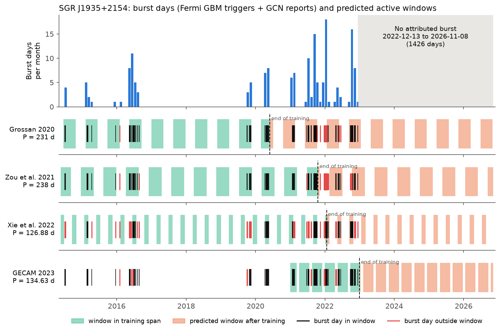
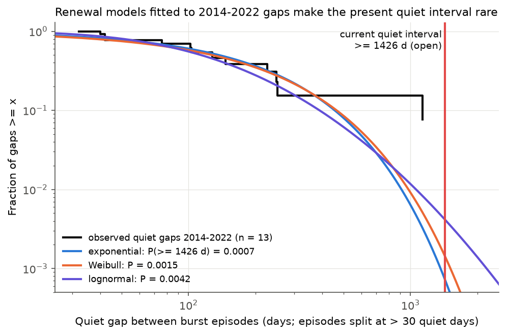
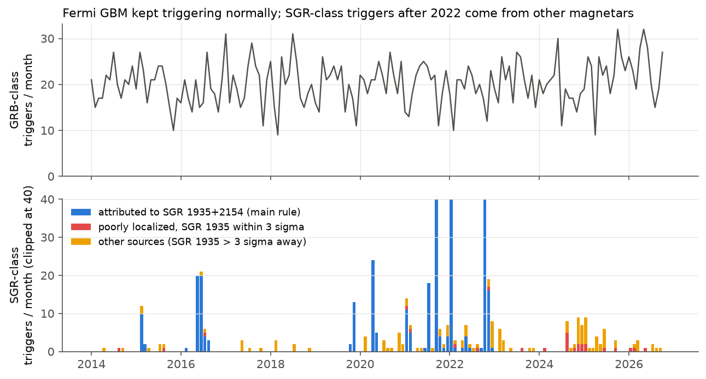

# SGR J1935+2154 stayed silent from 2022-12-14 to 2026-11-08, and four published activity periods did not predict its later behavior

## Summary

SGR J1935+2154 is the Galactic magnetar that made the X-ray burst linked to FRB 200428. Four papers report that its burst activity repeats with a period: about 231 d (Grossan 2020), about 238 d (Zou et al. 2021), 126.88 d (Xie et al. 2022) and 134.63 d (GECAM catalog, 2023). Each period gives "active windows" when bursts can occur. We test these windows with data that came after each model was made.

We use two public records: the Fermi GBM trigger catalog (HEASARC `fermigtrig`, snapshot 2026-11-09) and the GCN Circular archive (snapshot 2026-11-08).

Main results:

1. **Silence.** The last burst that we can attribute to SGR J1935+2154 occurred on 2022-12-13. After that date, no well-localized GBM trigger and no GCN report attributes a burst to this source, up to 2026-11-08. This quiet interval is 1,426 days, and it is not yet closed. It is the longest quiet interval since the source was found in July 2014. The previous longest interval was 1,134 days (2016-08 to 2019-10).
2. **Periodic windows did not predict the silence.** From 2023-01-01 to 2026-11-08, each model predicted 5.8 to 11 active windows. All of these windows were empty. In each model, we use the fraction of active windows before the model was made. With this fraction, the probability that all later windows are empty is 0.012 to 0.027 (Zou, 238 d or 239 d), 0.016 (Grossan, 231 d), 0.067 (Xie, 126.88 d) and 4e-5 (GECAM, 134.63 d; all six training windows were active).
3. **Periodic windows did not predict the 2020-2022 bursts better than chance.** For the three models with bursts after their training data, the fraction of later burst days in the windows was not higher than for random phase shifts of the same windows (phase-shift p = 0.15 for 231 d, 0.69 for 238 d, 0.14 for 126.88 d). The windows that Zou et al. published (2021-06-25 to 2021-11-08 and 2022-02-19 to 2022-07-04) missed the 24 burst days of the 2021-12-24 to 2022-02-06 episode. Only 1 of the 4 episodes that started after their cutoff started inside a window.
4. **No period is special in the 2014-2022 record.** We calculated the smallest phase window that contains all burst days at each trial period from 60 d to 400 d. The best period (154.5 d, window 0.79) is not better than in records with shuffled episodes and gaps (global p = 0.56). At the published periods, the window must be 0.82 to 0.94 of the cycle to contain all burst days.
5. **The silence is also rare for non-periodic (renewal) models.** We fitted exponential, Weibull and lognormal distributions to the quiet gaps between 2014-2022 episodes. These fits give a probability of 0.0007 to 0.004 for a gap of 1,426 d or more. With other episode definitions (15 d to 180 d split), the probability is 3e-5 to 0.047.

Conclusion: the 2014-2022 burst history of SGR J1935+2154 does not show a stable periodic window. Since December 2022, the source has been quieter than any stationary model fitted to 2014-2022 predicts. The data agree better with a change in the long-term activity level, such as a decrease after the 2019-2022 active years. Other magnetars (for example SGR 1900+14 and SGR 1806-20) also had active years followed by long quiet intervals. The data do not show the physical cause.



Figure 1. Top: burst days per month (GBM main-rule triggers and GCN reports). Gray: the open quiet interval. Lower rows: the active windows of each model. Green windows are in the training span. Orange windows come after the training cutoff (dashed line). Black ticks are burst days in a window. Red ticks are burst days outside a window. The GECAM windows start at the GECAM epoch (2021-01-01).

## Question

Did published periodic-activity models of SGR J1935+2154 predict the bursts and the quiet intervals that came after them? Is the silence after December 2022 unusual?

## Data

| Input | Source | Snapshot | SHA-256 (file used) |
| --- | --- | --- | --- |
| Fermi GBM trigger catalog (13,090 triggers, 2008-07-14 to 2026-11-09) | HEASARC TAP table `fermigtrig` | 2026-11-09 | `5757fc789e67e992e9c3be3d0a862b1ed20d0c9fa0db9540ffd0c9323ed53155` (VOTable) |
| GCN Circular archive (JSON) | https://gcn.nasa.gov/circulars/archive.json.tar.gz | Last-Modified 2026-11-08 19:38 UTC | `640a6efaae9953dc2224b28f44fd874493ba472c0ab7fd2a13b79966a9114df7` |
| GBM burst catalog rows for nearby GRB-class triggers | HEASARC TAP table `fermigbrst` | 2026-11-09 | rows in `files/data/gbm_burstcat_grbclass_near1935_after20221214.csv` |

Campaign shared copies: `datasets/fermi-gbm-trigger-catalog-20261109/fermigtrig.vot` and `datasets/gcn-circulars-archive-json-20261108/archive.json.tar.gz` (the provenance JSON files are copied in `files/data/`). The bundle also contains the full trigger table as `files/data/fermigtrig_snapshot_20261109.csv.gz`. CSV rounding changes trigger times by about 1 ms. It gives the same burst-day record.

## Method

### Burst-day record

- **GBM triggers.** We use the triggers that the GBM team classified as `SGR` (684 triggers). We calculate the angular distance to SGR J1935+2154 and to 25 other known magnetars. The localization error is the catalog radius plus a 3.7 deg systematic error, added in quadrature. Precise positions from "Known Source", Swift or LAT get 0.5 deg.
  - Main rule: error radius <= 10 deg and SGR J1935+2154 within 2.5 sigma (340 triggers).
  - Liberal rule: any error radius and SGR J1935+2154 within 3 sigma (378 triggers).
  - Strict rule: error radius < 1 deg and distance < 1 deg (270 triggers).
- **GCN circulars.** We use 146 circulars from 2014 to 2026 that name SGR 1935+2154 and report a detection. We remove circulars about other sources (Swift J1935.7+2036, GRB 240112A, GRB 211229A, GRB 150301A) and circulars that report only plans or upper limits. The circular date is the burst date. This date can be one or two days late.
- **Primary record:** the union of main-rule GBM days and GCN days. It has 168 burst days from 2014-07-05 to 2022-12-13.
- **Episodes:** a new episode starts after more than 30 quiet days. This gives 14 episodes (`files/data/episodes_union_main.csv`). We also test 15, 60, 90 and 180 days.

### Published models

| Model | Period | Window | Training cutoff | Source of the window |
| --- | --- | --- | --- | --- |
| Grossan 2020 (arXiv:2006.16480) | 231 d | 0.554 of cycle | 2020-06-01 | Paper gives no epoch. We use the smallest window that contains all our burst days before the cutoff. This window (0.554) agrees with the paper (about 0.55). |
| Zou et al. 2021 (arXiv:2107.03800) | 238 d (also 239 d) | 136 d (0.571) | 2021-10-21 | The two windows in their Table 3, extended with the period. One variant uses the 63.2 % duty cycle from the abstract. |
| Xie et al. 2022 (arXiv:2205.08003) | 126.88 d | phase 0.05 to 0.40, T0 = MJD 56658 | 2022-01-19 | As published. |
| GECAM catalog 2023 (arXiv:2307.01010) | 134.63 d | phase 0.7 to 1.5, T0 = MJD 59215 | 2023-01-01 | As published. |

### Tests

- **Test A (later bursts):** the fraction of burst days after the cutoff that are in windows. The null distribution comes from 4,000 random phase shifts of the same windows. This keeps the clustering of the bursts. We also count the episode starts in windows and use a binomial test with the duty cycle.
- **Test B (silent windows):** we count the window-equivalents from 2023-01-01 to 2026-11-08. We take *a* active windows out of *n* complete training windows. We give the probability of zero active windows as a Beta(a+1, n-a+1) predictive probability. We also give the plug-in value.
- **Test C (renewal models):** exponential, Weibull and lognormal fits (location 0) to the quiet gaps between episodes before 2023. For each fit, we calculate the survival probability at 1,426 d. For the lognormal fit, we use a parametric bootstrap (4,000 resamples) to show the uncertainty.
- **Supplementary periodogram:** for 4,000 trial periods from 60 d to 400 d, we calculate the smallest phase window that contains all burst days. The null keeps the internal structure of each episode. It shuffles the order of the episodes and of the quiet gaps (1,000 simulations).

## Results

### Test A and Test B

| Model | Duty | Training burst days in window | Later burst days in window (n) | Phase-shift p | Episode starts in window | Training windows active | Window-equivalents 2023-01 to 2026-11 | P(all silent), Beta | P(all silent), plug-in |
| --- | --- | --- | --- | --- | --- | --- | --- | --- | --- |
| Grossan 231 d | 0.554 | 0.98 | 0.75 (104) | 0.15 | 4 of 6 | 6 of 10 | 6.1 | 0.016 | 0.0037 |
| Zou 238 d | 0.571 | 0.96 | 0.45 (58) | 0.69 | 1 of 4 | 7 of 11 | 5.9 | 0.012 | 0.0027 |
| Zou 239 d | 0.569 | 0.95 | 0.41 (58) | 0.72 | 1 of 4 | 6 of 11 | 5.8 | 0.027 | 0.010 |
| Zou 238 d, duty 0.632 | 0.632 | 0.99 | 0.52 (58) | 0.71 | 2 of 4 | 7 of 11 | 5.9 | 0.012 | 0.0026 |
| Xie 126.88 d | 0.35 | 0.59 | 0.72 (39) | 0.14 | 2 of 3 | 5 of 21 | 11.0 | 0.067 | 0.050 |
| GECAM 134.63 d | 0.80 | 0.91 | none | - | - | 6 of 6 | 10.3 | 4.4e-5 | 0 |

Only 59 % of our burst days before 2022-01-19 fall in the Xie et al. window. Their window comes from a rate profile, not from a window that contains all bursts.

### Test C

| Episode split | Episodes | Longest earlier gap | P(gap >= 1,426 d): exponential | Weibull | lognormal |
| --- | --- | --- | --- | --- | --- |
| 15 d | 21 | 1,134 d | 3e-5 | 6e-4 | 0.0027 |
| 30 d (main) | 14 | 1,134 d | 7e-4 | 0.0015 | 0.0042 (bootstrap 16-84 %: 1e-4 to 0.012) |
| 60 d | 10 | 1,134 d | 0.0049 | 0.0027 | 0.0035 |
| 90 d | 9 | 1,134 d | 0.0076 | 0.0036 | 0.0041 |
| 180 d | 5 | 1,134 d | 0.047 | 0.019 | 0.019 |

The other records (GBM main only, GBM strict only, GCN only) give 0.0007 to 0.006 at the 30 d split (`files/data/results.json`).



Figure 2. Survival of the quiet gaps between 2014-2022 episodes (black) and three fitted renewal models. The red line is the current open quiet interval (1,426 d).

### Instrument check and possible missed bursts

GBM triggered at its usual rate during 2023-2026 (about 20 GRB-class triggers per month). It also continued to trigger on bursts from other magnetars, for example 1E 1841-045 (from August 2024) and SGR 1806-20. So the silence is not a GBM outage.

After 2022-12-14, 84 triggers have the SGR class. Of these, 19 are within 3 sigma of SGR J1935+2154 under the liberal rule. All 19 have error radii of 9.7 deg or more. For 18 of them, another magnetar is a better positional match. 12 of the 19 occurred from 2024-08-21 to 2025-01-25, when 1E 1841-045 was active. The remaining one (2024-08-21 08:47 UTC) has a 50 deg error radius and occurred during the 1E 1841-045 outburst. No GCN circular attributes any of them to SGR J1935+2154.

We also checked the GRB-class triggers within 2.5 sigma with error radius <= 10 deg (16 triggers in the GBM burst catalog). Most are long or hard. Three are short: GRB 251012616 (T90 0.58 s, Epeak 53 keV, 14.6 deg away, 9.9 deg error), GRB 260928022 (T90 0.38 s, 14.1 deg away, 9.8 deg error) and GRB 260429975 (T90 0.16 s, Epeak 601 keV, a hard short GRB). We do not attribute them to SGR J1935+2154. As a worst case, we assume that GRB 251012616 came from SGR J1935+2154. Then the quiet interval is 1,034 d. The renewal probabilities become 0.005 to 0.011 (30 d split) and 0.014 to 0.029 (90 d split). The silent-window probabilities become 0.029 to 0.055 (Zou), 0.048 (Grossan), 0.13 (Xie) and 2e-4 (GECAM).



Figure 3. Top: GBM GRB-class triggers per month. Bottom: SGR-class triggers per month. Blue: attributed to SGR J1935+2154 (main rule). Red: poorly localized, SGR J1935+2154 within 3 sigma. Yellow: other sources.

`files/figures/fig3_cover_periodogram.png` shows the supplementary periodogram.

## Limitations

- The record contains only bursts that triggered GBM or that were reported in a GCN circular. Fainter bursts (for example from untriggered GBM searches, GECAM, NICER or radio) are not in it. Thus the "silence" is a silence of bright bursts. A decrease in burst brightness without a decrease in burst rate would look the same.
- We did not recalculate the published period searches. We use the published windows. For Grossan 2020, we made the window again from our record, because the paper gives no epoch.
- The window-activity probabilities assume that windows become active independently with a constant probability. The renewal fits assume stationary gaps. Both use few events (10 to 21 windows, 4 to 20 gaps).
- We chose to test the silence after we saw it in the catalog. The periodic-window tests use predictions that were published before the silence. The renewal probabilities are descriptive.
- GCN circular dates can be one to two days after the burst. The association rules use one systematic error (3.7 deg) for all GBM localizations.
- The GBM catalog and the GCN archive grow with time. A new download will contain more rows.

## Reproduce

Requirements: Python 3.12 with numpy, pandas, scipy, astropy and matplotlib.

```sh
# 1. Get inputs (or use the campaign shared copies, or files/data/fermigtrig_snapshot_20261109.csv.gz)
sh files/code/fetch_inputs.sh
# 2. Burst-day record and candidate tables (about 30 s)
python -I files/code/build_record.py raw/fermigtrig.vot raw/archive.json.tar.gz files/data
#    offline: python -I files/code/build_record.py files/data/fermigtrig_snapshot_20261109.csv.gz raw/archive.json.tar.gz files/data
# 3. Tests (about 6 min with 4,000 simulations; seed 20261109)
python -I files/code/tests.py files/data 4000
# 4. Figures
python -I files/code/figures.py files/data files/figures
```

Outputs: `files/data/results.json` (all test values), `files/data/burst_days.json`, `files/data/episodes_union_main.csv`, `files/data/gbm_sgr_triggers_classified.csv`, `files/data/gbm_triggers_near1935_after20221214.csv`, `files/data/gcn_circulars_sgr1935.csv`, `files/data/cover_periodogram.csv` and `files/data/tests_log.txt`.

## Provenance

- Campaign 11_07_2026, job `sci-1107-dell-astronomy-de625dcd2348`, topic astronomy, machine dell, account claude-andrii.
- Analysis and text by the model Claude Opus 5.5 (`claude-opus-5-5`) in Claude Code. The signing key is a campaign-machine key. It is not a personal authorship claim.
- Data retrieved 2026-11-09 UTC from NASA HEASARC (Fermi GBM trigger and burst catalogs) and NASA GCN (circular archive).

## References

- Grossan, B. 2020, "Possible periodic windowed behavior in SGR 1935+2154 SGR bursts", arXiv:2006.16480.
- Zou, J.-H. et al. 2021, "Periodicity search on X-ray bursts of SGR J1935+2154 using 8.5 yr of Fermi/GBM data", ApJL 923, L30, arXiv:2107.03800.
- Xie, S.-L. et al. 2022, "Revisit the periodicity of SGR J1935+2154 bursts with updated sample", arXiv:2205.08003 (v3, 2025).
- Xie, S.-L. et al., "GECAM observations of the Galactic magnetar SGR J1935+2154 during the 2021 and 2022 burst active episodes. I. Burst catalog", arXiv:2307.01010.
- GECAM team 2026, "GECAM discovery of the second FRB-associated magnetar X-ray burst from SGR J1935+2154", arXiv:2602.10895.
- Fermi GBM trigger catalog: https://heasarc.gsfc.nasa.gov/W3Browse/fermi/fermigtrig.html
- GCN Circulars: https://gcn.nasa.gov/circulars
