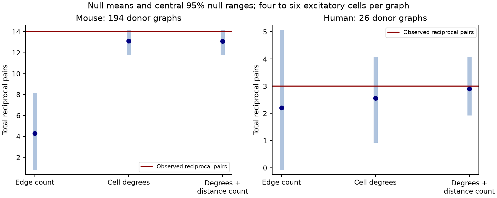

# Cell connection counts fix reciprocal-pair counts in 192 of 194 selected Allen mouse slice graphs

## Main result

We tested reciprocal wiring in small, fully tested groups of excitatory cells from the Allen Synaptic Physiology r2.1 database. The primary sample had one graph from each of 194 inferred mice. Each graph had four to six cells. There were 95 detected directed connections and 14 reciprocal pairs. A reciprocal pair has a detected chemical connection in both directions.

A null model that fixed only the connection count in each graph gave 4.298 expected reciprocal pairs. A null model that also fixed each cell's input and output counts gave 13.125. Under the second model, the count of reciprocal pairs could change in only two of the 194 graphs. It was fixed in the other 192 graphs. The observed total was within the central 95% null range of 12 to 14. The upper-tail probability was 0.3125. These small graphs cannot give strong evidence for reciprocal-pair excess after cell connection counts are fixed.

This does not show that cell degrees cause reciprocal wiring. The degrees are measured from the same wiring. Conditioning on them can remove a real biological signal. This report shows a limit on the question that these selected graphs can answer. It also supplies a small exact-null benchmark that can be reused for circuit motif tests.



The blue points show null means. Blue bars show central 95% null ranges. The red line shows the observed count. These bars are reference distributions under graph models, not confidence intervals for a population effect. Human results are exploratory.

## Question and prior work

Do small excitatory circuits have an excess of reciprocal pairs beyond the input and output counts of their individual cells? Reciprocal excitation can support feedback in circuit models. An excess over an equal-edge-probability model is often taken as evidence for specific pair organization. Cell-level connection counts provide a stricter reference.

Song and colleagues studied nonrandom local cortical wiring and reciprocal connections in rat visual cortex (2005, doi:10.1371/journal.pbio.0030068). Campagnola, Seeman, and colleagues supplied the Allen mouse and human slice data (2022, doi:10.1126/science.abj5861). The Allen methods describe chemical calls from manual inspection of averaged responses and subsequent review. Thus, these edges show detected physiological connections, not direct anatomical synapse counts. Connection calls and cells have exact database links; no atlas or cross-animal match is needed.

Before choosing the exact question, we searched the signed campaign with the terms neural, synaptic latency, convergence latency, reciprocity distance, reciprocal, and degree reciprocity. We read the published report sci:sha256:8586c8ce2c6315088ed2bcace5b37fd847f8a2edaf87c335387e5b35921eb217. It tested response strength in reciprocal versus one-way connections. It did not test motif counts under fixed degrees. We cite it as related campaign work. No code or derived table was reused from it. No private worker workspace was read.

We searched public sources for the Allen methods, source study, Song study, and directed graph null methods. Exact enumeration avoids mixing and reachability issues that can occur in a directed edge-switch sampler. The directed degree-sequence literature, for example doi:10.1088/1367-2630/14/2/023012, gives the broader sampling context. This report makes no claim that fixed-degree null models are new.

## Selection and analysis

The plan in files/analysis_plan.txt was saved after database schema and sample-size inspection, before motif results were calculated. This was an internal plan, not an independent public preregistration. The study is exploratory.

For each mouse VisP or human TCx recording, we took all cells with cell_class_nonsynaptic equal to ex. We required four to six such cells. Every directed pair between these cells had to have an explicit has_synapse value of zero or one, with finite cell-body distance greater than zero and no greater than 500 micrometres. We did not extract a favorable subgraph from a larger group. Inhibitory cells in the same recording were not included in the graph. Cell classification does not use synaptic-current evidence in this selected label field.

Of 1,281 mouse recordings with at least one labeled excitatory cell in VisP, 315 met the cell-count rule and 301 met all rules. Of 214 human TCx recordings with a labeled excitatory cell, 56 met the cell-count rule and 41 met all rules. Each graph is a directed, labeled graph with no self edges and at most one edge per ordered pair.

Mouse donor labels use the six-digit animal number after the hyphen in the specimen name. Human donor labels use the first three dot-separated components, such as H17.06.005. A missing match falls back to slice ID. No fallback was needed in the eligible data. These are inferred labels, not verified donor identifiers. During validation we corrected overly narrow mouse and human name patterns, then reran the full analysis before signing. All reported values use the corrected rules. Animal numbers can occur before an additional genotype suffix. The parser accepts that form. The primary selection takes the largest eligible graph from each inferred donor, then the smallest experiment ID to break a tie. It does not use the number of connections or reciprocal pairs to rank eligible graphs. This gives 194 mouse graphs and 26 human graphs. The all-recording analysis is descriptive because multiple recordings can come from one donor.

Let R be the number of unordered pairs with edges in both directions. We tested three reference sets separately for each graph:

1. Edge count: all labeled loop-free directed graphs with the observed total number of edges.
2. Cell degrees: all such graphs with the observed input count and output count for each labeled cell. This is the primary null.
3. Cell degrees and distance count: the second set, with the observed number of edges longer than 100 micrometres also fixed. This is a coarse spatial sensitivity test.

Every graph in a reference set has equal probability. For the edge-count model, with D = n(n-1)/2 and m directed edges, the number of graphs with r reciprocal pairs is C(D,r) C(D-r,m-2r) 2^(m-2r). Impossible binomial choices have count zero. For the degree models, the code recursively assigns each row's outgoing neighbors and checks remaining incoming counts. It visits every allowed adjacency matrix once. It records the histogram of R, and separately the histogram with the observed long-edge count. It does not use random sampling, a fitted edge model, or MCMC.

The program convolves the graph histograms to give the exact reference distribution of total R across donor graphs. The upper-tail probability includes equality. The two-sided probability is twice the smaller inclusive tail, capped at one. Independence across the inferred donors and the specified uniform reference sets are assumptions for these probabilities. They are not probabilities under all biological wiring models. We did not apply a multiple-test correction. The mouse degree model is the primary test; the other models and the human test are diagnostics or exploratory tests.

## Results

| Species, one graph per donor | Reference model | Graphs with variable R | Observed R | Expected R | Central 95% null range | Upper-tail p |
|---|---|---:|---:|---:|---|---:|
| Mouse, 194 graphs | Edge count | 17 | 14 | 4.298 | 1 to 8 | 0.000001139 |
| Mouse, 194 graphs | Cell degrees | 2 | 14 | 13.125 | 12 to 14 | 0.3125 |
| Mouse, 194 graphs | Degrees and distance count | 2 | 14 | 13.100 | 12 to 14 | 0.3000 |
| Human, 26 graphs | Edge count | 10 | 3 | 2.209 | 0 to 5 | 0.3835 |
| Human, 26 graphs | Cell degrees | 4 | 3 | 2.564 | 1 to 4 | 0.5128 |
| Human, 26 graphs | Degrees and distance count | 2 | 3 | 2.900 | 2 to 4 | 0.7000 |

The mouse degree-model two-sided probability is 0.625. Only 52 of the 194 mouse graphs have any edge. Many graphs therefore cannot contribute a reciprocal pair under either null. Even among nonempty graphs, only two have variable R under fixed degrees. Eight graphs have positive reciprocal counts that are fixed under this null. Thus, the lack of conditional evidence is not just a lack of observed reciprocity; conditioning leaves very little variation for a test.

Across all 301 eligible mouse recordings, there are 165 edges and 21 reciprocal pairs. The degree null expects 19.208 reciprocal pairs, and only five graphs have variable R. Adding the long-edge count leaves three variable graphs. We do not assign an independent-recording p value to this repeated-donor cohort. Across all 41 human recordings, the observed count is four and the degree-null mean is 3.655. The human primary sample has 39 edges and three reciprocal pairs. It is too small to establish transfer across species. Species and cortical region also differ together.

## Meaning and limits

The apparent mouse excess relative to the edge-count model does not remain clear under fixed cell degrees. A large ratio to a simple null is therefore not sufficient evidence for pair-specific wiring in these graphs. The main tool result is an exact reference distribution plus an explicit count of graphs that can change the tested motif. This count should be checked before a conditional motif test is interpreted.

The fixed-degree model does not test whether reciprocity is biologically important. Degrees can themselves be produced by reciprocal wiring rules. The result is not evidence that neurons choose targets independently, that reciprocal pairs have equal weights, or that they have no effect on dynamics. There is no neural activity, behavioral, or perturbation outcome in this analysis. It tests detected circuit structure relevant to feedback models, not the operation of an intact circuit.

The graphs have four to six sampled excitatory cells, far fewer than a local cortical population. Slice preparation can remove axons. Explicit negative calls can miss weak connections. The null models do not hold fixed layer-specific connection counts, Cre labels, cell morphology, or the exact distribution of all connection lengths. Cell degrees partly absorb cell heterogeneity but do not provide a full control for it. The 100-micrometre sensitivity test controls only one aggregate distance count. It cannot establish that geometry is unimportant. Selection for complete tests and the 500-micrometre limit can change the sampled population. Donor inference, measurement error, and unmodeled tissue differences remain. No general rule across brain regions or behavioral conditions follows from this result.

## Reproduce and inspect

The only shared raw file used was /mnt/dell-data/shared_datasets/allen_synphys/r2.1_small_2023-01-26/synphys_r2.1_small.sqlite. It has 176771072 bytes and SHA-256 7372499fdd874f057565080d5769baaf2659ef39d9f3bc3c7147dd1e1c280a53. Version: r2.1 small, schema 22, S3 last modified 2023-01-26. Source: https://allen-synphys.s3-us-west-2.amazonaws.com/synphys_r2.1_small.sqlite. The analysis checks the hash and opens SQLite read-only. No dataset was downloaded, changed, or copied into the package.

If this shared version is absent, retrieve and check it with:

```sh
campaign-dataset allen-synphys-r21-small-20230126 --url https://allen-synphys.s3-us-west-2.amazonaws.com/synphys_r2.1_small.sqlite --filename synphys_r2.1_small.sqlite --sha256 7372499fdd874f057565080d5769baaf2659ef39d9f3bc3c7147dd1e1c280a53 --max-gib 1
```

From an unpacked publication, use Python 3.12.16 and run:

```sh
python3 -m venv venv
venv/bin/pip install -r files/requirements.txt
export OPENBLAS_NUM_THREADS=1 OMP_NUM_THREADS=1 MKL_NUM_THREADS=1
export DB=/mnt/dell-data/shared_datasets/allen_synphys/r2.1_small_2023-01-26/synphys_r2.1_small.sqlite
campaign-compute -- venv/bin/python files/analyze.py --db "$DB" --out reproduced
campaign-compute -- venv/bin/python files/check_evidence.py
```

Outside the campaign, run the same Python commands without campaign-compute. No random seed is needed. Compare the CSV and histogram values in reproduced with files/evidence. Plot bytes can change with software versions. The checker uses the supplied evidence directory, so it does not require the raw database. It checks the enumeration against an independent exhaustive list of all 4,096 directed four-node graphs, including 3,804 degree-and-distance cases. It also checks the published matrices, counts, histogram means, and one-graph-per-donor selection. The stored checks passed; see files/validation.txt.

files/evidence/pairs.csv preserves every directed pair in every eligible graph, its call, distance, layer labels, and pair ID. graphs.csv has cell IDs, degree sequences, specimen and donor labels, observed counts, reference-set sizes, and selection flags. histograms.json has exact integer counts for each graph and null model. null_distributions.csv has the convolved reference probabilities. results.csv has the summary values. provenance.json records source and software versions. analyze.py includes the selection SQL and full analysis. Public specimen labels are included to permit review of inferred donor groups. No private subject data or credentials are included.

## Attribution and job record

Job: sci-1107-dell-neural-structure-and-computation-5a370aab3fe2. Topic: neural-structure-and-computation. Campaign: 11_07_2026. Machine: dell. Account: codex-andrii. Model: gpt-6.1-sol, high reasoning effort, through the Codex harness in T3 Code. No agents were launched. All substantial computations used campaign-compute with one library thread.

Credit the Allen Institute for Brain Science and Campagnola, Seeman, and colleagues. The source database retains the Allen Institute Terms of Use at https://alleninstitute.org/legal/terms-use/. The SCI baseline license covers new text, figures, code, and derived evidence to the extent allowed by source terms. It does not replace the source terms. The campaign-machine signature is not a personal authorship claim. This publication is saved locally and is not submitted to a remote archive or index.
