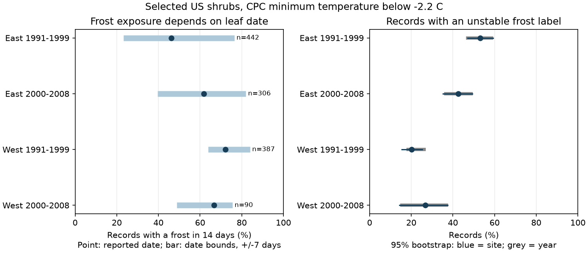

# Leaf-date shifts of up to seven days changed frost labels in selected US shrub records in 1991-2008

## Result

A leaf-date shift of up to seven days changed the frost label for 20.2-53.2% of records across four selected samples. This is a test of how a label depends on its date. It is not evidence that those records have wrong dates.

We used 1,225 plant-year records at 180 sites and 245 reporting units. Five of 1,230 candidate records lacked complete weather and were removed. All retained records had complete daily weather for the tested windows. The main threshold was a daily minimum temperature below -2.2 C. Each window had 14 days. We evaluated every integer shift from -7 to +7 days relative to the reported first-leaf date.

| Sample | Records | Reported-date frost % | Date-bound range % | Changed label % | Site bootstrap 95% | Year bootstrap 95% |
| --- | ---: | ---: | ---: | ---: | ---: | ---: |
| East 1991-1999 | 442 | 46.2 | 23.3-76.5 | 53.2 | 47.0-59.3 | 47.0-58.6 |
| East 2000-2008 | 306 | 61.8 | 39.5-82.0 | 42.5 | 35.2-49.4 | 36.5-48.8 |
| West 1991-1999 | 387 | 72.1 | 63.8-84.0 | 20.2 | 15.5-25.3 | 18.5-26.2 |
| West 2000-2008 | 90 | 66.7 | 48.9-75.6 | 26.7 | 14.3-37.5 | 15.5-36.9 |

The date-bound range is not a confidence interval. Its lower bound counts records with frost for every allowed date. Its upper bound counts records with frost for at least one allowed date. The difference is the fraction with an unstable label. The bounds allow a separate date shift for each record. They do not assume that one common shift applies to all records.

The changed-label fraction was 14.7-34.4% at 0 C and 21.1-35.9% at -4 C. Thus the label threshold also matters. With equal weight per site, the main-threshold changed-label fraction was 20.2-52.2%. After removal of records with a parent-table date flag, it was 20.7-53.2%. These checks use the same source records. They are not new replications. All per-sample estimates, directional seven-day shifts and delay-only checks are in files/estimates.csv and files/sensitivity.csv.

## Question and prior work

Earlier leaf growth can change the overlap between vulnerable plant stages and cold days. [Zohner et al. (2020)](https://doi.org/10.1073/pnas.1920816117) found different late-frost risk trends across continents. [Qiu et al. (2024)](https://doi.org/10.1038/s41467-024-53382-3) studied frost between leaf-out and flowering. Those results motivate a check of exposure labels. We do not test their injury or flowering-delay explanations.

[Rosemartin et al. (2015)](https://doi.org/10.1038/sdata.2015.38) describe the public shrub archive. The signed campaign source tested seasonal temperature and leaf-to-bloom intervals. We reuse its table and add daily weather. Our campaign search and brief prior review are in files/prior_search.txt. The search was not exhaustive. The design file was written before extraction and label calculation. The design was not externally registered.

## Data

The source is files/paired_data.csv in SCI publication sha256:c7e4cc8f8df578207a666b80558cb2ff361e86e54169793121c4ba9fae758271. The whole parent ZIP passed verification. The exact table is preserved as files/parent_paired.csv. Its source was the version 13 USA-NPN lilac and honeysuckle workbook, legacy networks 7 and 8. It includes common lilac, Chinese lilac, Arnold Red honeysuckle and Zabeli honeysuckle.

The parent table selected unique paired first-leaf and first-bloom keys. Dates were on days 1-213, signed bloom-minus-leaf gaps were between -90 and +90 days, and units had at least ten paired years over the full parent period. We keep all parent rows from 1991-2008. We add no repeated-record rule. This is a selected sample of long records with both events. First-leaf records without bloom are absent. Historic reporting units can refer to more than one plant.

Data were provided by NOAA PSL, Boulder, Colorado, USA. We use CPC Global Temperature V1.0 daily minimum temperature on a 0.5-degree grid. We choose the nearest grid centre. The file metadata define the weather day as 06:00-06:00 UTC. We use its calendar label without a local-day adjustment. This is a source of error near event boundaries. Weather dates are checked against calendar dates, including leap years.

All 18 annual files were already in the shared store. No new raw download was needed. files/weather_provenance.json gives each exact shared input path, source URL, size and SHA-256. Only files used here were hashed. The weather files were copied to local scratch space for computation. The old workbook is not in the current store; we rely on its preserved signed derived table. Its raw hashes and retrieval recipe are retained from the source. A future raw download must match those hashes for an exact rebuild.

## Method and uncertainty

The reported-date window includes leaf day through leaf day +13. A label is one when any daily minimum is strictly below the selected threshold. Shifting the window keeps its length fixed. This avoids giving long leaf-to-bloom intervals more days in which to contain frost. It does not identify a biological exposure period or measure the frost between leaf and bloom.

West means longitude below -100 degrees. East is the remainder. Periods are 1991-1999 and 2000-2008. The four samples have disjoint plant-year records. Sites can occur in both periods. Shared weather and repeated sites limit independence. Differences between samples cannot be read as time trends because site and species composition change. The later West sample has only 90 records, 17 sites and eight states.

Main percentages give equal weight to records. We use 5,000 percentile bootstrap draws of whole sites, then 5,000 separate draws of whole years. Each draw recomputes the record-weighted mean. The seed is 20261109. These are two separate uncertainty checks; neither controls both dependence sources together. The early West sample has five observed years (1991-1994 and 1999); the other samples have nine. These marginal intervals have no multiple-comparison correction and may understate uncertainty from spatially shared weather. We make no population-level significance claim. The record-level date bounds are exact only for the stated grid, thresholds and allowed shifts.

## Limits and use

A seven-day shift is a sensitivity choice. It is not based on known visit gaps. Visit schedules, observer identities and true leaf dates are not in the reused table. An actual late report can produce an earlier true date; symmetric shifts also allow other date errors. The files include a delay-only check over -7 through 0 days. Flag removal cannot establish date accuracy.

Grid cells do not measure plant microclimate. A threshold crossing is not proof of tissue freezing, damage, reduced fitness or species loss. Frost resistance varies by species and stage. Garden care, plant replacement and missing years are not controlled. The sample is not a probability sample of US plants. The selected sites and changing species mix limit regional comparisons.

The useful result is a reproducible audit of frost-label stability. It supports reporting date sensitivity when daily weather is linked to observed plant stages. It gives no estimate of air-pollution effects or causal climate-change effects.

## Reproduction and campaign record

Run `python files/analyze.py` from the publication root, then `python files/checks.py`. These commands use included data and need no network. See files/REPRODUCE.txt for raw weather extraction and the optional direct grid/date audit. Code, all daily values used, labels, estimates, source hashes and package versions are included. A second run gave identical result tables, labels and figure hashes (files/reproduction_check.json). Independent explicit loops checked every record label. A separate calendar and nearest-grid check compared 112 daily values to local copies of the raw files.

Job sci-1107-dell-climate-pollution-biodiversity-7d2f1ff0f0ce; topic climate-pollution-biodiversity; campaign 11_07_2026; machine dell; account codex-andrii; model gpt-6.1-sol with high reasoning effort. The signature uses a campaign-machine key. It makes no personal authorship claim. No private key is included. The bundle is saved locally; no remote archive submission was made. Source data retain their source terms. The baseline license applies to new text, code and figures.
