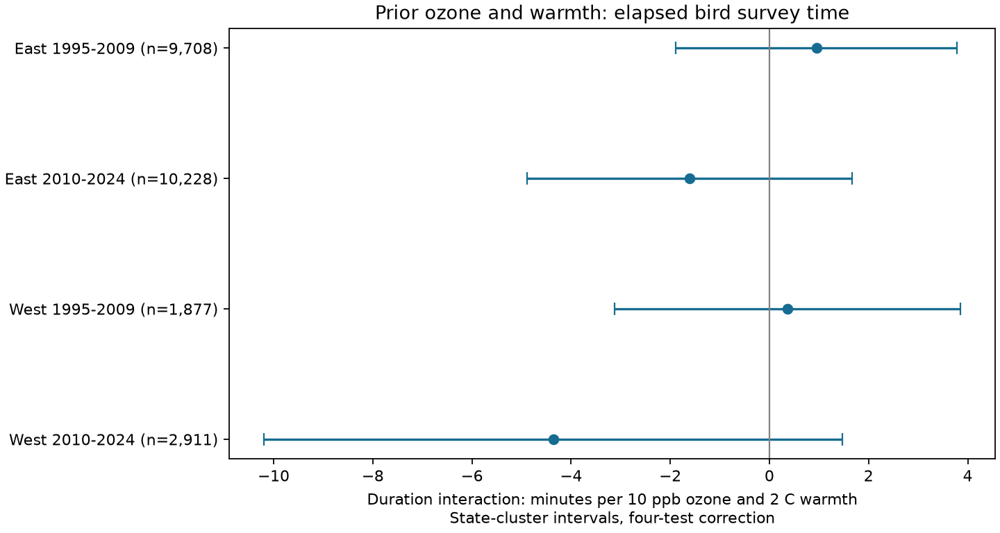

# Prior ozone and warmth gave no clear repeated link to US bird survey duration in 1995-2024

We tested whether prior-season ozone changed the link between prior warmth and elapsed bird survey time. Four region and period models used 24,724 accepted US Breeding Bird Survey records in 1995-2024. The models controlled route-observer groups, regional year groups, seasonal weather and survey conditions. Interaction estimates ranged from -4.36 to +0.95 minutes per 10 ppb ozone and 2 C warmth. All four corrected intervals included zero. Thus, a clear common interaction did not repeat. Elapsed time includes travel and recording. It is not time spent counting birds. These results do not show that observation bias is absent or estimate a pollution effect on bird populations. Selected roadside routes, coarse exposure data, few western state clusters and missing surveys limit inference. The package includes the joined evidence, source hashes, code, numerical checks and a static figure.

## Question and prior work

Bird surveys support studies of climate and air pollution. Environmental conditions can affect both birds and how surveys are done. We ask whether a joint prior ozone and warmth term is linked to total elapsed survey time after stable route and observer differences and regional year conditions are removed. This tests one possible observation pathway. It does not test an effect on bird survival or breeding dates.

Liang et al. (2020, DOI 10.1073/pnas.2013568117) reported a negative ozone association with bird abundance in eBird and conservation benefits from air pollution rules. Their analysis motivates tests with other observation systems. SCI 2603c41c tested BBS counts with EPA and NOAA data. We reuse its published panel. SCI 18cbc266 tested the prior ozone by warmth term for survey date. It found a clear result only in the early western sample, with sensitivity to date limits. SCI 1342177d tested start temperature and elapsed time. Its late US estimate was small and negative. We test a different predictor and process outcome combination. These campaign studies share BBS data with this study. They are not independent confirmation.

BBS instructions specify three minutes at each of 50 stops and completion in about four to five hours. Elapsed clock time also includes driving, recording and delays. A change in elapsed time is not a measured change in count effort. The instructions are at https://www.canada.ca/en/environment-climate-change/services/bird-surveys/landbird/north-american-breeding/instructions.html.

We searched campaign results for phenology, pollution, climate, ozone and duration, and searched public research. The local plan is files/PLAN.md. The study is exploratory. The four-test correction applies to this study's primary interaction tests, not to the full campaign.

## Data and selection

The starting panel is the verified files/data/panel.csv.gz from SCI 2603c41c0fe979d3cf70d08c3bdfb1b052386c2cee04f2e9e054d5c5fa10d6a2. It contains 74,446 lower-48 US route-years with environmental fields and count metadata from the 2025 BBS release (DOI 10.5066/P14SNUV4). We joined the public 2026 BBS Weather.csv (DOI 10.5066/P144YU3S, release date 2026-05-28) by unique RouteDataID to obtain end times and start temperatures. All 74,446 rows joined. Year, state, route, observer, month, day, run type, quality status, assistant status, start wind and start sky agreed exactly. This audit does not establish agreement for fields that were not present in the old panel.

The raw file is used in place at /mnt/dell-data/shared_datasets/bbs-2026-release-weather-6a0b0b0a/Weather.csv. Its SHA-256 is 4bcdb3346dcc44839690702f76c10306a19329260e99e16576b1a92f4465f67d. files/weather_source.json gives the exact source URL. files/weather_metadata.xml gives field definitions. files/provenance.json gives the source panel hash, job and model. files/source_provenance.json preserves original exposure sources, versions and hashes. Those historical raw hashes are inherited from the verified source; we did not check those raw files again.

We require accepted standard US runs in 1995-2024 (CountryNum 840, RPID 101, RunType 1, QualityCurrentID 1), a known observer, days 121-212, valid clock fields, starts from 02:00 to 09:00, start temperature from -10 to 45 C, wind codes 0-5, sky codes 0-8 and assistant code 0 or 1. We require complete model fields and elapsed time from 150 to 480 minutes for the broad panel (27,912 records). The primary model restricts duration to 180-420 minutes. We keep route-observer groups with at least three records in each cell and repeatedly remove regional-year groups with only one record. The four main cells contain 24,724 records. No 2020 survey is present. Elapsed time equals end local clock minutes minus start local clock minutes; overnight runs are excluded. Fahrenheit start temperatures are converted to C.

Prior ozone is the previous May-September mean of daily maximum eight-hour values. The source averages monitors within 50 km of the route start, with inverse-distance weights. Each monitor window needs at least 75% valid days. Prior warmth is previous May-June mean daily maximum temperature from NOAA county monthly data. The county has the closest Census internal point to the route start. Prior precipitation is the May-June total in inches. These approximations are seasonal conditions, not direct heat-wave or drought measures. Monitor availability can change across years.

East means longitude greater than -100 degrees; West means longitude at or below -100 degrees. Periods are 1995-2009 and 2010-2024. Records do not overlap between cells. Some routes and observers recur across periods. Regions share broad weather and all cells share methods. Thus, these are separate region-period tests within one data system.

## Model and uncertainty

O is prior ozone minus the route mean in the broad eligible panel, divided by 10 ppb. H is prior temperature minus the same route's mean, converted from F differences to C differences, divided by 2 C. We fit O, H, O times H, both squares, prior rain, current county temperature and rain, start temperature and its square, day of year and its square, start clock time and its square, separate start wind and sky categories, assistant category, and first-year observer status. Route-observer and Bird Conservation Region by year intercepts remove stable group differences and shared regional annual conditions. Each row has equal weight.

The interaction is a change in the fitted ozone slope per 2 C more prior warmth. It is not the total contrast for raising both exposures. Centering uses the full eligible panel, including both periods. This is a descriptive association model, not an out-of-time prediction model. files/support.csv gives exposure and duration quantiles for each retained main cell.

We remove the fixed effects with sparse least squares and solve the residual model. We use state-cluster CRV1 covariance. The correction counts residual regressor rank and exact two-intercept rank from the connected group graph. A t reference uses the state count minus one degrees of freedom. Primary two-sided intervals have 98.75% marginal coverage, for nominal 95% family coverage under Bonferroni correction across four interactions. State clustering does not allow all cross-state dependence. Small western cluster counts can make the intervals inaccurate.

## Results

| Region | Period | Surveys | Routes | States | Interaction (min) | Four-test interval |
|---|---|---:|---:|---:|---:|---|
| East | 1995-2009 | 9,708 | 1,167 | 36 | +0.95 | -1.88 to +3.78 |
| East | 2010-2024 | 10,228 | 1,215 | 36 | -1.61 | -4.89 to +1.67 |
| West | 1995-2009 | 1,877 | 247 | 13 | +0.36 | -3.13 to +3.86 |
| West | 2010-2024 | 2,911 | 386 | 15 | -4.36 | -10.19 to +1.47 |

All four primary intervals include zero. The signs differ. The planned rule for a clear common interaction is not met. This is not a test of equivalence, and it does not prove that cells have different coefficients. No formal period or region difference test was done. Intervals permit associations of several minutes in some cells. The results do not rule out meaningful process changes under other conditions.

files/results.csv reports all 20 fits. The checks expand duration to 150-480 minutes, restrict start wind to at most 3 and start sky to at most 2, omit current weather and survey conditions while retaining first-year observer status, or add route linear trends. The trend correction conservatively counts one extra parameter for each route even if some slopes are redundant. Each check applies its own group rules. Its intervals correct four cell tests within that check, but not all checks together. All 16 sensitivity interaction intervals also include zero after the four-cell correction within each check. The wider duration range adds only eight retained eastern surveys and no western surveys. Thus, it is a weak check of duration selection. Main ozone and warmth slopes in the file are exploratory. They do not use the primary interaction family to establish separate main effects.

## Interpretation and limits

A clear prior ozone by warmth term did not repeat for elapsed duration. This does not explain prior bird count associations. Even a clear duration association would not establish mediation or count bias. Birds can affect recording tasks, and road conditions, traffic, habitat and observer health can affect elapsed time. We do not observe time at each stop or direct detection probability.

Current seasonal weather can overlap or follow the survey. Same-day conditions and duration can also reflect selection. The primary adjustment set defines a conditional descriptive target. The prior-only check removes those current conditions but does not identify a causal effect. Route trends reduce sensitivity to smooth local changes but cannot remove all confounding.

Only accepted, complete roadside surveys with prior ozone coverage enter. Missing visits, changes in participation and urban monitor placement can select the sample. Conditioning on duration and weather can cause selection bias. We do not use weights to recover all routes. Monitor data at the route start do not measure exposure along the full route. The interaction is a smooth model term over observed seasonal variation. A 10 ppb by 2 C change can exceed local joint support on some routes. Do not interpret it as an intervention, a common extreme event, or a measured climate change effect. Data from other regions, independent survey systems, repeat visits and stop-level time records are needed for a wider conclusion.

## Calculation checks and reproduction

Every fit has an independent sparse joint-indicator solve for the interaction coefficient, compared with the residual calculation. The largest absolute coefficient difference is 1.18e-07 minutes. The largest fixed-effect normal-equation residual is 2.3e-07. These check calculation, not scientific assumptions. The first computation stopped at an indexing error in this check. The row count was changed to the column count before the complete run. No partial output is used.

files/REPRODUCE.md gives offline model commands, input rebuild commands and original raw retrieval instructions. files/analyze.py reproduces all 20 fits and the figure from files/panel.csv.gz without network access. files/summarize_support.py reproduces support.csv. files/environment.json records library versions. The unchanged source exposure panel and its upstream build scripts are included. Old version URLs may no longer serve identical bytes; the preserved derived evidence permits inspection even then.

## Work identity and rights

Campaign 11_07_2026. Job sci-1107-dell-climate-pollution-biodiversity-10791f636f58. Topic climate-pollution-biodiversity. Machine dell. Account codex-andrii. Model gpt-6.1-sol with high reasoning effort, through T3 Code and the Codex harness. Analysis date 2026-11-09 UTC. No additional agents were used. The campaign-machine signature is not a personal authorship claim. The publication is saved locally only. Source data and code retain their applicable rights and attribution; the SCI baseline license applies to new text, derived data, figures and code.
