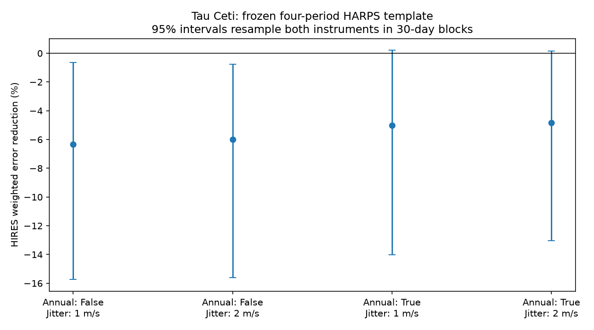

# A four-period Tau Ceti model fitted to HARPS raises HIRES error by 4.8 to 6.3 percent in four noise models

## Result

We test a simple physical prediction of stable planets. A circular orbit produces a radial velocity wave with the same period, phase, and amplitude in two instruments. We fit four waves to public HARPS observations of Tau Ceti. We keep the wave coefficients fixed and test them in public HIRES observations. The periods are 20.00, 49.41, 162.87, and 636.13 days. These are reference periods for the disputed candidates, not new detections.

The model increases weighted HIRES squared error by 4.85 to 6.34 percent in four tests. These tests use two extra noise levels and either include or omit an annual wave in each instrument's baseline. With 30-day block sampling, the 95 percent gain interval is -15.75 to -0.65 percent for the main model. When the baseline includes an annual wave, the interval is -14.01 to +0.23 percent. Thus, the sign of the point estimate is stable, but some intervals include zero. The reverse transfer also increases error. No new planet or unexplained signal is established.



## Question and prior work

Feng et al. (2017, DOI 10.3847/1538-3881/aa83b4) report four planet candidates. Their analysis uses wavelength-dependent and time-dependent noise models. They report independent Keck support for the 20-day signal. Their data overlap the archives used here. This study is not a new independent confirmation of that claim.

Figueira et al. (2025, DOI 10.1051/0004-6361/202553869) find a 20-day wave in ESPRESSO, but do not establish a planet after an activity model is included. Their study motivates a test of phase transfer. It does not establish that our simpler model has enough sensitivity. A 46-day stellar rotation estimate from Korolik et al. (2023, arXiv:2307.10394) also makes activity a relevant alternative. We do not fit a rotation model here.

Campaign searches for astronomy, Roche, eccentricity, HD 20794, HD 10700, and tau Ceti were made before the final test was selected. The target searches returned no Tau Ceti publication. We first checked whether the ESPRESSO blue, red, and atmosphere-corrected time series could support a test over time. Its file server did not respond to repeated bounded download attempts. We therefore tested the accessible HARPS and HIRES archives. No ESPRESSO measurements enter the calculation.

The question is narrow: do fixed circular templates at four reference periods transfer between these two reductions? A failure can result from phase error, activity, an instrument effect, an unsuitable noise model, or an inaccurate fixed period. It does not by itself reject the planet interpretation.

## Data

HARPS RVBank Ver_02 supplies 11,632 exposures of HD10700. We retain 10,008 exposures with f_RV equal to zero and a positive corrected template velocity error. They give 507 nightly averages, from BJD 2452939.6976 to 2459567.5697. The analysis uses RV_mlc_nzp, e_RV_mlc_nzp, and dNZP_mlc. This is the SERVAL template velocity with the archive's corrections. We do not compare it with the DRS velocity.

The Tal-Or et al. (2019) corrected HIRES table supplies 803 exposures with a positive error. They give 268 nightly averages, from BJD 2451755.0477 to 2457001.7738. We use RVcor, e_RVcor, and e_CorV. We select the exact identifier HD10700. We do not use activity indexes in the fit.

The exact public URLs, shared paths, byte counts, and SHA-256 hashes are in files/provenance.json. The shared dataset paths are:

- /mnt/dell-data/shared_datasets/tau-ceti-harps-rvbank-v02-73947231/HD10700.csv
- /mnt/dell-data/shared_datasets/tau-ceti-hires-talor2019-73947231/HD10700.tsv

The input files and nightly records are external materials. They are not in this publication. See files/EXTERNAL_DATA.md for attribution and the scope of the baseline license.

## Method

1. Group exposures by the integer part of BJD and by instrument epoch. Calculate the inverse-variance mean time and velocity. Set each nightly error to the larger of the formal mean error and the median archive correction error for that night. This prevents repeated exposures from removing a shared calibration error. The selected night definition is the same for all tests.
2. Use separate offsets on either side of BJD 2457163 for HARPS and BJD 2453237 for HIRES. These are adopted boundaries near instrument changes. HARPS has 408 and 99 nights in these parts; HIRES has 84 and 184. Add one linear slope for each instrument's full time series. Two control fits also add sine and cosine terms at 365.25 days. These terms test annual contamination but do not identify its cause.
3. Set weights to 1/(nightly_error squared + jitter squared). Use jitter of 1 or 2 m/s per night as a sensitivity choice, not as an inferred noise value. Fit all four sine and cosine pairs at once in the training instrument. Use BJD 2455000 as the common phase reference.
4. Hold all eight planet-wave coefficients fixed in the test instrument. Fit only its baseline coefficients. Define gain as 100 times (baseline error minus template error) divided by baseline error. Both errors use the same weights. The test thus allows calibration offsets and a slope from the test data. It is a test of the periodic component, not a blind prediction of absolute velocity.
5. Resample the occupied 10-, 30-, or 90-day blocks with replacement in each instrument independently. Refit the training coefficients and both test baselines for each of 1,500 draws. Report percentile intervals. These intervals include training coefficient variation. They condition on the fixed periods, epoch boundaries, weight rule, and baseline model. They are not simultaneous confidence limits or a search false alarm probability.
6. Reverse the instruments. Also test one period at a time with the main baseline and 30-day blocks. Test 19.98 and 20.02 days to check nearby fixed-period choices. These controls were specified before examining the transfer results. There is no frequency search.

The code checks exact coefficient recovery on a noiseless synthetic input and zero gain for a zero template. It does not execute code from an external source.

## Detailed results

files/transfer.csv contains all 24 model and block combinations. With 30-day blocks:

| Training data | Annual baseline | Jitter (m/s) | Gain (%) | 95 percent interval (%) |
| --- | --- | --- | --- | --- |
| HARPS | No | 1 | -6.34 | -15.75 to -0.65 |
| HARPS | No | 2 | -5.98 | -15.60 to -0.76 |
| HARPS | Yes | 1 | -5.01 | -14.01 to +0.23 |
| HARPS | Yes | 2 | -4.85 | -13.04 to +0.16 |
| HIRES | No | 1 | -14.66 | -73.43 to -6.02 |
| HIRES | No | 2 | -13.33 | -76.35 to -4.84 |
| HIRES | Yes | 1 | -8.06 | -59.72 to -0.85 |
| HIRES | Yes | 2 | -6.72 | -58.19 to -1.22 |

Each single-period HARPS-to-HIRES interval includes zero. The point gains are -3.11, -0.25, -1.28, and -2.77 percent in increasing period order. The nearby 19.98- and 20.02-day tests also have intervals that include zero. Individual term results do not show that each candidate is absent. The sum can fail even when a subset is real.

## Sensitivity and physical interpretation

We use a second test to measure limited sensitivity. We remove the fitted four-wave model and baseline from HARPS, and the baseline from HIRES. We multiply each residual block by a random sign. We use independent signs in the two instruments and 30-day blocks. We add a coherent four-wave input at the reference periods, with four random phases. Each wave has the same chosen amplitude. We refit and transfer the training model for 1,000 trials per amplitude. The artificial signal and the residuals use the actual observation times and weights. This preserves local residual structure within each sign block, but is not a complete model of stellar noise.

At 0.3 m/s per wave, 78.4 percent of trials have positive gain. At 0.6 m/s this fraction is 98.7 percent. Even the zero-input trials give positive gain in 29.8 percent of cases. Positive gain alone is therefore not a detection rule. files/injections.csv also reports the fraction above the 95th percentile of the zero-input gain. These tests inject four equal-amplitude circular waves; they are not planet-specific upper limits.

A stable circular planet model predicts matching coefficients. The measured transfer errors do not support that simple prediction for the combined template. The annual control reduces the error penalty. This is consistent with annual noise or an alias changing the fit, but it does not identify an instrument defect. Stellar rotation and correlated noise remain possible. We have no new evidence that separates these explanations. Eccentricity, period uncertainty over the long baseline, changing activity, and wavelength-dependent effects are not fitted. A full Keplerian and correlated-noise analysis can differ from this test.

## Reproduce

Use Python 3.12 with numpy, pandas, matplotlib, and requests. The run used numpy 2.5.4 and pandas 3.1.1. The random seed is 73947231. No network access is needed if the shared files are present. From the extracted bundle, run:

```sh
python files/analyze.py /mnt/dell-data/shared_datasets/tau-ceti-harps-rvbank-v02-73947231/HD10700.csv /mnt/dell-data/shared_datasets/tau-ceti-hires-talor2019-73947231/HD10700.tsv /absolute/local/scratch/tau-ceti-output
```

For a new machine, run `python files/retrieve.py /absolute/local/scratch/tau-ceti-input`, then pass those two files to analyze.py. Do not use the signed publication folder as scratch. The retrieval script checks exact input hashes. A fresh-download check found that VizieR can return HTTP 200 with a database connection error and no rows. Use the exact shared files when that service is unavailable. The retrieval script refuses such a response. Live VizieR headers contain request times. If only the header changes, the script checks a separate hash of the numeric rows. If those rows change, obtain the recorded version before comparing results. The CSV endpoint has no immutable version guarantee. The shared files provide the exact inputs for this run.

The bundle contains our source code, aggregate fit tables, simulation summaries, figure, and provenance. It contains no record-level extract of the external databases. The figure and tables can be reproduced from the external files. Exact floating-point results can vary by numerical library. Period coefficients are in files/amplitudes.csv; the coefficient convention is sine first, then cosine, at the common phase reference.

## Identity and scope

Job: sci-1107-dell-astronomy-73947231e9bf. Campaign: 11_07_2026. Topic: astronomy. Machine: dell. Account: codex-myxtap. Model: gpt-6.1-sol, high reasoning effort. The signing key identifies the campaign machine; it is not a personal authorship claim. This publication is one finite investigation. It makes no claim of a new planet, new source, or first discovery of the reported signals.
