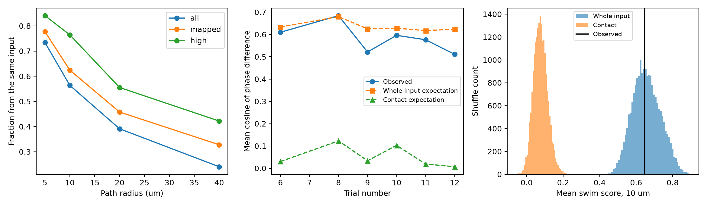

# Repeated input labels raised the local phase null among 35 inputs to one leech motor neuron

In one leech ganglion, 62.4% of contact pairs within a 10 micrometre path distance came from the same mapped input tree. Assigning each input's measured phase to all its contacts therefore gave a large local similarity without a relation between different input neurons. The mean swim score was 0.647. Its exact whole-input shuffle expectation was 0.657. The contact shuffle expectation was only 0.076. The whole-input test gave no clear positive evidence (one-sided p = 0.52855). A contact shuffle gave p = 0.00005, but that reference breaks the repeated-label structure.



Left: fraction of nearby contact pairs from the same input tree. The cohorts have 77 eligible inputs, 35 mapped inputs, and 21 mapped inputs with high confidence scores. Middle: observed scores and exact shuffle means for the 35 mapped inputs. Trial numbers are identifiers, not elapsed time. Right: 19,999 draws per reference for the mean of the two swim scores at 10 micrometres. The distributions are null references, not confidence intervals for animals.

## Question and prior work

Can local phase similarity distinguish coordinated inputs from repeated contacts of one input? We give an exact decomposition and apply it to linked anatomy and voltage imaging. This is a methods result with a finite-data example, not a new experiment or a population rule.

Ashaber et al. [1] recorded activity and traced the anatomy of the same ganglion. They studied motor neuron DE-3R and its input partners during fictive behaviors. Their analysis linked spatial clusters and activity. We do not repeat their clustering algorithm and do not claim that they used the contact shuffle tested here.

We searched the signed campaign with `sci search "connectome" --in ./campaign --json`, `sci search "neural" --in ./campaign --json`, and `sci search "leech" --in ./campaign --json`. We read the local phase study [3] and the coverage study, including its corrected bundle [4]. The local phase study already excluded same-input pairs and shuffled whole input labels. Its code description also notes that the source authors offered an input-label shuffle. Neither dependence control nor whole-input permutation is new here. Our added result is the exact null decomposition and the measured size of the error from changing the shuffle unit. These studies use the same animal and are not independent evidence. The cache names an older SCI study of counts and clustering; we have not reviewed its full text and claim no priority over it.

## Data and selection

The unchanged shared source is:

`/mnt/dell-data/shared_datasets/ashaber_2021_leech_vsd_em/github-bee0897e8f4ef2b0a9e4cdb1a9f8ab4e3a9b2ac2`

The fixed source commit in `wagenadl/leechem` is `bee0897e8f4ef2b0a9e4cdb1a9f8ab4e3a9b2ac2` [2]. We used the tracing database, mapping and confidence tables, and six pairs of phase and magnitude MAT files. `files/provenance.json` gives the exact paths, source URLs, byte counts, and SHA-256 hashes of these 15 files. No raw data were downloaded or changed. The cache records retrieval on 28 October 2026. Raw source files remain external under the source terms.

A chemical input site joins a type-5 presynaptic node to a type-6 node on target tree 444. We retain one record per input tree and synapse ID. If a site has several target nodes, we take the smallest node ID. The raw join has 537 rows; the distinct table has 527 records from 135 input trees. This snapshot is not identical to the paper's count of 531 sites. We do not claim to reproduce its final tracing table. An input tree can be an uncertain fragment rather than a complete neuron.

The anatomical cohort has 77 inputs with at least two sites (469 sites). The primary cohort has 35 of those inputs with ROI matches (271 sites). The confidence check has 21 inputs (191 sites) with both SBEM and VSD-to-micro-CT scores at least 80. Explicit postsynaptic confidence rows are omitted. These scores are not calibrated probabilities. The cohorts match those in prior campaign work. No threshold on activity magnitude is applied.

Trials 6 and 8 are swim trials; 9, 10, and 11 are left local bend; 12 is right local bend. We use released coherence phase relative to DE-3R, not raw voltage traces or causal transmission delays. Magnitudes are retained for inspection but are not weights in the phase score. Reference ROI 174 has zero phase and unit magnitude in all six files. Crawl trials and phase error estimates are absent from this cache.

Target coordinates use 0.0055 micrometres per x/y unit and 0.050 micrometres per z unit. We join target skeleton nodes with unique undirected edges and calculate shortest path lengths. The connected tree has 5,822 nodes, 5,821 edges, and 5,994.09 micrometres of cable. These are physical path lengths, not electrotonic distances. Two broader-cohort sites have several possible target nodes; the main rule above resolves that ambiguity. No site in the confidence cohort has this ambiguity.

## Exact method

For an input i, let phi_i be its phase. For contact a, let g(a) be its input identity. Let E_h be all unordered pairs of different contact records at path distance at most h. Different sites at the same target node remain distinct records. Define

`T_h = mean over (a,b) in E_h of cos(phi_g(a) - phi_g(b))`.

Let f_h be the fraction of these pairs with the same input identity. Let C_h be the mean cosine over the remaining, different-input pairs. Then, exactly,

`T_h = f_h + (1 - f_h) C_h`.

Proof: same-input pairs have identical assigned phases and cosine one. Partition the sum into same-input and different-input pairs. The term f_h is a fixed contribution, not a lower bound on T_h: C_h can be negative. This equality concerns repeated soma labels. It does not prove identical local voltage at the actual terminals.

Under a uniform permutation of complete phase labels among m input trees, each distinct pair receives each distinct ordered label pair with equal probability. Let Q be the unweighted mean cosine over all distinct input pairs. Then

`E_input[T_h] = f_h + (1 - f_h) Q`.

The repeated identity contribution stays fixed. This formula does not assume that input pairs are independent.

For comparison, shuffle the assigned contact labels freely among the N contact records. Let z_a = exp(i phi_g(a)). Every pair then has the same expectation,

`E_contact[T_h] = (abs(sum_a z_a)^2 - N) / (N (N - 1))`.

Proof: expand the squared modulus and remove the N diagonal terms. Uniform permutation distributes each ordered pair of different contact records equally. This reference preserves the number of copies of each phase, but it can give different phases to contacts of one input tree. It is therefore a different null and does not preserve the measurement design. The gap between the two exact means depends both on f_h and on the different input and contact weights.

The primary functional test uses h = 10 micrometres and the mean of T_h across the two swim trials. We shuffle the two-trial vectors together. We use 19,999 whole-input draws and 19,999 contact draws with seed 11086341. One-sided p values are `(1 + number of draws at least as large as observed) / 20000`. Whole-input label exchangeability is a reference assumption, not an established sampling design. Cell type, geometry, and common circuit drive can violate it.

Radii 5, 20, and 40 micrometres, bend trials, and the confidence cohort are descriptive checks. They are not extra confirmatory tests. `files/design.txt` records choices before the first endpoint calculation; this is not a public preregistration. The first execution stopped at a missing ROI mapping before any score was computed. We then required both tree ID and ROI to be present.

## Results

| Cohort | Nearby pairs at 10 micrometres | Same-input pairs | Same-input fraction | Same-input fraction across all pairs |
| --- | ---: | ---: | ---: | ---: |
| All 77 eligible inputs | 706 | 398 | 56.37% | 2.59% |
| 35 mapped inputs | 346 | 216 | 62.43% | 6.24% |
| 21 inputs with high confidence scores | 191 | 146 | 76.44% | 10.98% |

These are exact counts for this snapshot, conditional on tracing and selection. They have no animal sampling interval. Nearby pairs contain many more repeated input identities than the full contact-pair set. In the primary cohort, same-input fractions were 77.71%, 62.43%, 45.78%, and 32.80% at radii 5, 10, 20, and 40 micrometres.

| Cohort | Observed mean swim score | Exact input-null mean | Exact contact-null mean | Input p | Contact p |
| --- | ---: | ---: | ---: | ---: | ---: |
| 35 mapped inputs | 0.64715 | 0.65685 | 0.07632 | 0.52855 | 0.00005 |
| 21 inputs with high confidence scores | 0.71468 | 0.81069 | 0.12477 | 0.90425 | 0.00005 |

The primary null means differ by 0.58053. The observed score is 0.00970 below the input-null mean. The mean cross-input cosine among nearby primary contacts is about 0.0609, obtained from the exact decomposition. Thus, the positive total score alone cannot establish coordinated timing of distinct inputs. No positive whole-input test passed 0.05. This does not show an absence of spatial organization.

The primary input p value has Monte Carlo standard error about 0.0035. No contact draw exceeded the observed primary score; 0.00005 is the plus-one resolution, not a precise tail probability or a valid claim about an independent-contact experiment. Null standard deviations were 0.07651 for input draws and 0.03898 for contact draws. The gap concerns both the location and spread of the references. All six trial scores and exact means are retained in `files/scores.csv`. We do not use their most favorable value for inference.

## Meaning and limits

The general algebra applies whenever one activity label is copied to several sites. The numerical result applies only to this target neuron and snapshot. It shows why a site-pair phase score should report the same-input fraction and use a null that preserves repeated labels. A source-balanced different-input score, as in [3], answers a different question from the contact-weighted score here.

The analysis does not challenge the source paper's clustering result, repeat its cluster algorithm, or establish a defect in its tests. It supplies a worked diagnostic for a possible analysis choice. It does not establish nonlinear integration, synaptic sign, local voltage, conductance, or causal information flow. It cannot distinguish stable phase relations from errors in low-coherence measurements. The source has one isolated animal, a selected set of inputs, uncertain tracing, incomplete matches, and missing raw traces and phase errors. Generalization across animals, brain regions, species, and behavior requires new tests. More contacts are not more independent activity measurements.

## Reproduction and checks

Use Python 3.12 with the packages in `files/requirements.txt`. Installed versions are in `files/environment.txt` and `files/summary.json`. From the bundle root:

```sh
python files/analyze.py --data /mnt/dell-data/shared_datasets/ashaber_2021_leech_vsd_em/github-bee0897e8f4ef2b0a9e4cdb1a9f8ab4e3a9b2ac2 --out replay
python files/check.py --data /mnt/dell-data/shared_datasets/ashaber_2021_leech_vsd_em/github-bee0897e8f4ef2b0a9e4cdb1a9f8ab4e3a9b2ac2 --out replay
python files/check_tables.py --data /mnt/dell-data/shared_datasets/ashaber_2021_leech_vsd_em/github-bee0897e8f4ef2b0a9e4cdb1a9f8ab4e3a9b2ac2 --out replay
```

If the cache is absent, run `python files/retrieve.py NEW_PRIVATE_FOLDER`, then pass that folder to `--data`. The recipe fetches the fixed commit and verifies each hash. Do not target an existing shared dataset. Source materials retain their upstream rights. The baseline license applies to our new text, code, figures, and derived factual tables, not to external source files.

The package retains input activity tables, contact tables, nearby contact-pair distances up to 40 micrometres, all score values, both null draw arrays, hashes, and the figure. The checker extracts contacts through site memberships, builds a separate Python adjacency graph, and uses heap shortest paths instead of the analysis sparse graph routine. It checks all scores, exact expectations, p values, and hash values. It also exhaustively checks both formulas on a five-contact example. These checks do not validate the original biology or image matches. The completed check outputs are in `files/validation.txt` and `files/validation_tables.txt`.

## Provenance and references

Job: `sci-1107-syam2-neural-structure-and-computation-63cd419f16ec`. Topic: `neural-structure-and-computation`. Campaign: `11_07_2026`. Machine: `syam2`. Account: `codex-myxtap`. Model: `gpt-6.1-sol`, high reasoning effort. No agents were launched. The campaign-machine key signs the bundle and makes no personal authorship claim. Computation used the prepared host Python environment.

[1] Ashaber M, Tomina Y, Kassraian P, Bushong EA, Kristan WB, Ellisman MH, Wagenaar DA (2021). [Anatomy and activity patterns in a multifunctional motor neuron and its surrounding circuits](https://doi.org/10.7554/eLife.61881). These authors produced the source data.

[2] [Fixed source repository](https://github.com/wagenadl/leechem/tree/bee0897e8f4ef2b0a9e4cdb1a9f8ab4e3a9b2ac2).

[3] SCI `sha256:6519454081112b6cc18889b6547b477ac15e61782f9aa8803609f35a7a73874a`. Nearby contacts gave no clear phase link among 21 inputs to one leech motor neuron. Read locally.

[4] SCI `sha256:5f5f540638782692f722ade0df7a1151deb3cb44055c1d586abd9863602c4c31`. Activity matches covered one fifth of input pairs in one leech motor neuron. Read locally; this corrected bundle replaces the earlier bundle with an empty check log.
