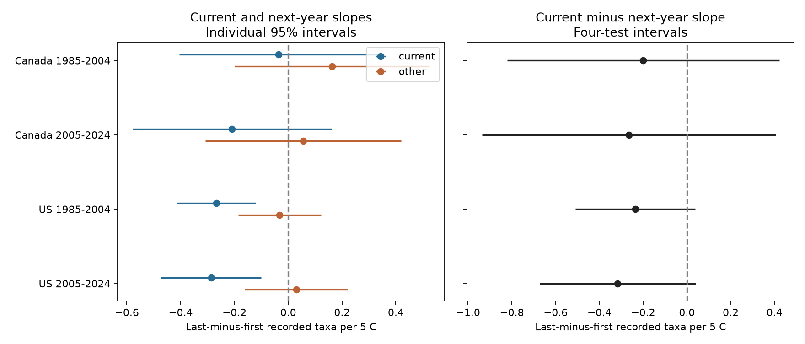

# Current and next-year temperature slopes had uncertain differences in matched Canada and US bird surveys in 1985-2024

We tested whether the weather link to a bird survey count was more specific to the current survey than to a survey one year later. We used the same route and observer in each pair. The four primary differences are shown below. 0 of four intervals excluded zero after correction for four tests. A failure to resolve a difference does not show that the slopes are equal.



The left panel gives component slopes and individual 95% intervals. The right panel gives current minus next-year slopes and intervals adjusted for the four primary tests. The unit is recorded taxa per 5 C. The outcome is last-block minus first-block richness. Each block has ten stops.

## Question and prior work

Weather and time of day can affect bird activity and detection. Robbins studied both in Breeding Bird Survey records ([weather](https://pubs.usgs.gov/publication/5210258); [time](https://pubs.usgs.gov/publication/5210259)). These effects can bias claims about climate and biodiversity. We do not claim that weather effects on counts are new.

Published campaign result SCI 652071e7 found a small negative end-temperature slope for the last-minus-first richness contrast in two US periods. It did not find a clear common pattern in Canada. We reuse its verified panel and its survey-control design. Our new test compares current and future weather in the same fitted model. It adds a check of temporal specificity. This is a new analysis of the same records, not independent validation of the source panel. The campaign search queries and source links are in files/source_notes.json. We also read SCI 20abaa52, which tested wind interactions on the same source.

Future exposure has been used as a negative control in other fields. A review describes examples and the needed assumptions ([Shi, Miao and Tchetgen Tchetgen](https://doi.org/10.1007/s40471-020-00243-4)). We use that idea as a diagnostic. We do not use the future slope to correct a causal effect. Future temperature cannot directly change a count already recorded. It may still share causes with that count, or have a different bias structure from current temperature.

The local plan in files/analysis_plan.txt was written before the new fits. It was not registered. The prior US result was known. This matters when judging the choice of question.

## Data and selection

The source is the frozen panel from SCI sha256:652071e7bf4b1964e6b29e8c4494ce23450a5342524ee3fe65cc2e0880558ecb. We verified the complete signed bundle before extraction. Its underlying source is USGS BBS release 2025, 1966-2024, DOI [10.5066/P14SNUV4](https://doi.org/10.5066/P14SNUV4). We do not claim to use the latest data release. We made no new data download.

The parent panel has 64,682 accepted standard surveys. It limits survey date to May 20-July 10, start clock time to 02:00-09:00, duration to 3-7 hours, both temperatures to -10 to 45 C, and complete weather and observer fields. It requires at least five surveys per observer-route in each period. Both endpoint blocks have positive richness. See files/parent_selection.json and prepare_raw.py for all original filters. The parent count audit is inherited; we did not independently rebuild raw count records in this job.

We match exactly adjacent years inside each country and period, with the same route and observer. We require at least three matched pairs per observer-route. This leaves 49,322 pairs: 3,744 and 3,812 in Canada; 25,047 and 16,719 in the US. A survey can be current in one pair and future in another. These are pair records, not 98,644 independent surveys. Missing 2020 data remove both 2019 and 2020 from later-period current years. The end of each period has no future record inside that period.

Selection retains about 76% of the parent records as current surveys. It selects repeated observers and complete adjacent years. We do not weight for this selection. files/matching_audit.json compares selected and parent means. Separate countries use separate routes. Periods share routes, and countries can share climate variation. These checks are not fully independent regions and times.

The outcome is Count50 minus Count10. Each term counts positive taxon codes in a ten-stop block. Codes can include species, groups, hybrids or subspecies. This is recorded taxon richness, not true species richness. The blocks differ in location as well as time.

## Model

Each primary model includes current and next-year end temperatures per 5 C, both start temperatures, both surveys' date, start clock time and duration with square terms, and categorical wind, sky and assistant terms for both years. It absorbs route-observer and current state-year effects. The main contrast is the current end-temperature coefficient minus the future end-temperature coefficient. The temperature starts stay fixed. The contrast is therefore also a contrast of morning temperature-rise slopes, conditional on both starts.

We use the largest scalar variance from route clustering, year clustering and two-way route/year clustering. Student t degrees of freedom use the smaller cluster count minus one. Four primary intervals use a Bonferroni correction. The intervals are approximate and can miss unmodelled spatial and observer dependence. files/methods.md gives the complete variance rule, model and assumptions.

Planned checks add route-specific linear trends, limit both years to fair weather, or use the previous year in place of the next year. Previous weather can affect current ecology, so it is only a timing comparison. The secondary checks do not have correction for the full set of tests.

## Results

| Sample | Pairs | Routes | Current slope | Next-year slope | Difference | Four-test interval |
| --- | ---: | ---: | ---: | ---: | ---: | --- |
| Canada 1985-2004 | 3,744 | 451 | -0.036 | +0.163 | -0.199 | -0.820 to +0.421 |
| Canada 2005-2024 | 3,812 | 554 | -0.209 | +0.056 | -0.265 | -0.937 to +0.406 |
| US 1985-2004 | 25,047 | 2,555 | -0.268 | -0.032 | -0.235 | -0.509 to +0.039 |
| US 2005-2024 | 16,719 | 2,313 | -0.287 | +0.030 | -0.316 | -0.673 to +0.040 |

All slopes have units of recorded taxa per 5 C. All component slopes and their intervals are in files/results.csv. Only the four main difference tests form the primary family. A negative contrast can result from a negative current slope, a positive future slope, or both. It is not enough to inspect just one component's significance.

The route trend differences were -0.094, -0.312, -0.248, -0.369 in the same table order. 1 of these four within-check intervals excluded zero. These checks reuse the same archive.

The fair weather differences were -0.408, -0.271, -0.175, -0.202 in the same table order. 0 of these four within-check intervals excluded zero. These checks reuse the same archive.

The previous year differences were -0.359, -0.131, -0.215, -0.183 in the same table order. 0 of these four within-check intervals excluded zero. These checks reuse the same archive.

## Meaning and limits

The primary contrast tests one form of temporal specificity under a linear model. It does not by itself show a detection mechanism. A clear current-weather association and an uncertain future-weather association do not prove that their slopes differ. The direct contrast and its uncertainty are needed.

Future weather is not guaranteed to share all causes of bias with current weather. Measurement error, annual weather persistence and future survey selection can differ between the two. Current bird records could affect future scheduling or participation. Conditioning on future survey conditions can introduce bias. Unmeasured traffic, habitat change, route changes and observer aging remain possible causes. Fixed route order mixes time with place. Endpoint temperature does not describe every stop. Clock time is not time since sunrise. A common date curve can miss local ecological timing.

The result cannot separate activity, detection and ecological change. It cannot estimate true richness, heat-wave harm, long-term warming effects, species loss or air pollution effects. Accepted surveys omit much severe weather. Sky code 4 combines fog and smoke and is not a pollution measure. A null contrast does not prove equality, absence of bias, or absence of weather effects. More repeated counts with stop-level weather and independent pollution measurements would give stronger tests.

## Provenance and reproduction

Job: sci-1107-dell-climate-pollution-biodiversity-dfc7968118b9. Topic: climate-pollution-biodiversity. Campaign: 11_07_2026. Machine: dell. Account: codex-andrii. Model: gpt-6.1-sol with high reasoning effort, through T3 Code and the Codex harness. No agents were launched. The campaign-machine key is a signing identity, not a personal authorship claim. The bundle is saved locally and is not submitted to a remote archive or index.

The source bundle is at `/mnt/dell-data/campaigns/11_07_2026/652071e7bf4b1964e6b29e8c4494ce23450a5342524ee3fe65cc2e0880558ecb.zip`. Its ZIP SHA-256 is `41c68ba24365a18ae161c6bb57214b260e4250723ed2fe55149fff5ee5d90f17`. The panel entry is files/panel.csv, copied here as files/source_panel.csv. Its SHA-256 is `2079a3895c94c98f6531114c4221820c7588bc9512dde0f95d2ed417780743bd`. files/provenance.json gives the exact shared source bundle path, size and hash information. Historical raw dataset paths, source URLs, release and hashes are retained in files/parent_provenance.json. Those raw paths were not read or tested in this job. The restored shared raw release has other bytes and was not substituted. Only the frozen published panel is needed for exact model reproduction.

All 16 model fits passed scalar coefficient checks. The largest coefficient error was 3.6e-15. Four explicit fixed-effect subset fits agreed with projected primary endpoint coefficients to 1e-11. files/checks.json gives the checks. A separate scalar score calculation checks all four primary contrast coefficients and standard errors in files/score_validation.json. That check shares the projection routine; it is not an independent test of that routine. files/run_notes.txt records solver changes and completed checks.

From an extracted bundle root, use Python with the versions in files/environment.json. Run the complete offline analysis with:

```sh
OPENBLAS_NUM_THREADS=1 python -B files/reproduce.py --output /tmp/bird-temporal-refit
```

This refits all models, makes the figure, and compares numerical evidence to the packaged files. The output must be on local disk and outside the bundle. To run only the separate primary score check:

```sh
OPENBLAS_NUM_THREADS=1 python -B files/validate.py --output /tmp/bird-score-check.json
```

A historical raw retrieval recipe is retained as files/retrieve_raw.py. It downloads only to a private directory and checks fixed hashes. files/prepare_raw.py can rebuild the parent panel from that raw layout. Live URLs may no longer serve the fixed 2025 bytes. We did not test that raw retrieval or rebuild. Exact offline inference is preserved by the included source panel. See files/ATTRIBUTION.txt for source rights. The baseline license covers new code, text, figures and derived evidence.
