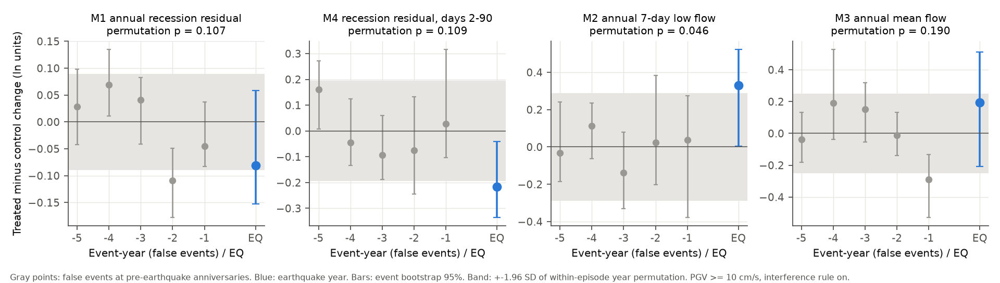
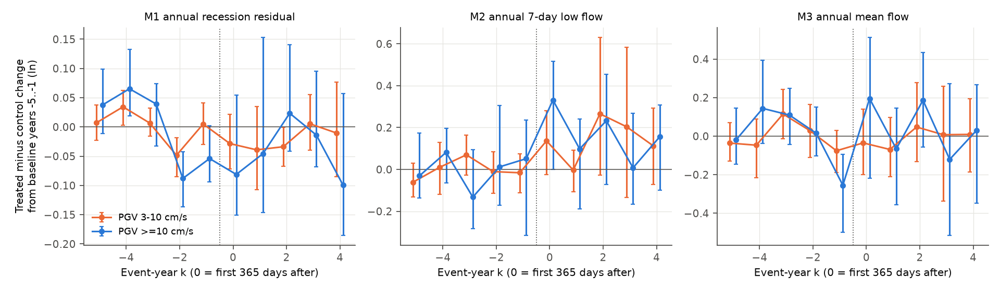
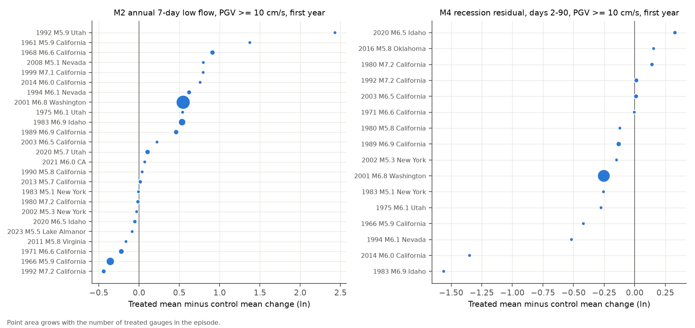

# Strong earthquake shaking did not make baseflow recession faster at United States stream gauges (PGV of 10 cm/s or more, 1960-2026); a first-year low-flow increase is not confirmed

Provenance. Job sci-1107-dell-earth-and-ocean-sciences-e8812ed1e53c. Topic earth-and-ocean-sciences. Machine dell. Model claude-opus-5-5 (Claude Code). Campaign 11_07_2026. The signing identity is a campaign-machine key. It is not a personal authorship claim.

## Summary

Earthquakes can increase stream discharge. Two earlier campaign studies examined the first 30 days after United States earthquakes (`sci:sha256:960bb4a1...`, `sci:sha256:11bb393c...`). The first study found more gauges with a rise at strong shaking. It could not measure a recovery time. Two physical explanations are frequent. (1) Shaking increases the permeability of the ground, so catchments drain faster. (2) Shaking releases water from storage, but the drainage properties do not change. Manga (2001) found that the baseflow recession rate did not change at a few streams with large responses. This supports explanation (2).

We tested this for many gauges and for longer times. We asked: after strong shaking, does baseflow recession become faster, and do low flows change, in the following months and years?

We used 367 ComCat earthquakes (M 5 or more, conterminous United States, 1960 to 2026) with a USGS ShakeMap. We merged sequences into 155 episodes. We took the ShakeMap peak ground velocity (PGV) at each USGS stream gauge. Treated gauges had PGV of 10 cm/s or more. Control gauges had PGV below 1 cm/s, in the same episode, and within 200 km of a shaken gauge. For each gauge, we compared each year after the earthquake with the 5 years before it. Then we subtracted the control change from the treated change (difference in differences). We wrote the plan before we downloaded discharge data (`files/PREANALYSIS.md`).

Main results (PGV of 10 cm/s or more, first 365 days, planned interference rule):

1. **Recession rate did not become faster.** The change in the annual recession residual (M1) was -0.08 ln units (95 percent event-bootstrap interval -0.15 to +0.06; 22 episodes, 105 treated gauges). A within-episode year-permutation test gave p = 0.11. With equal episode weights the change was 0.00 (p = 0.83). A positive value would mean faster drainage. Thus the data do not support a lasting increase in drainage efficiency. A first-year change of more than about +0.1 ln (10 percent faster recession at the same discharge) is not consistent with the data.
2. **Recession in the first 90 days was slower, not faster.** The early recession residual (M4, days 2 to 90) changed by -0.22 ln (-0.34 to -0.04; 16 episodes, 57 treated gauges). The permutation p was 0.11 with gauge weights and 0.005 with equal episode weights. This is a secondary metric. Two single-gauge episodes have the largest values: Borah Peak 1983 (Idaho) and South Napa 2014 (Sonoma Creek). A slower apparent recession agrees with an added water supply that sustains discharge. It does not agree with faster drainage.
3. **First-year low flow was higher, but the evidence is weak.** The 7-day minimum flow (M2) changed by +0.33 ln (+0.00 to +0.52; 25 episodes, 106 treated gauges). The planned test gave p = 0.051 and Holm p = 0.10, so the planned test failed. The permutation p was 0.046. Without the 2001 Nisqually episode (41 of the 106 treated gauges) the change was +0.20 (-0.06 to +0.50). Without the interference rule it was +0.17 (p = 0.22).
4. **No clear change after the first year.** For years 2 to 4, M1 was -0.04 (-0.12 to +0.08) and M2 was +0.16 (-0.04 to +0.32). At PGV 3 to 10 cm/s, all first-year changes were small (M1 -0.03, M2 +0.14, M4 0.00).
5. **The planned bootstrap intervals are too narrow.** At false events (anniversaries 1 to 5 years before the earthquake), 4 of 20 false-event intervals did not include zero. The expected number is 1. Thus we use the within-episode permutation test, which compares the earthquake year with the false years of the same episode, as the better measure of uncertainty.

Conclusion: across many United States gauges, strong shaking did not make baseflow recession faster over the following year. This agrees with Manga (2001) and with a source of extra water rather than a lasting increase in drainage efficiency. The increase in low flow and the slower early recession are possible signs of this extra water. They are not confirmed.

## Relation to other campaign work

- `sci:sha256:960bb4a1dfbff9d17d6edc024941d90d49297037888d9b55a7c7fff7489689c8` found that more gauges rose within 30 days at PGV of 10 cm/s or more. It did not find a decay by day 30. Our M4 result (slower apparent recession for 90 days) agrees with a sustained excess. Our M1 result shows that the excess does not come with faster drainage. We reused its GAGES-II reference-gauge list (`files/data/gages_ref_from_960bb4a1.csv`, SHA-256 `10765a49...06e6`).
- `sci:sha256:11bb393c8865d0a13337a06dd8e0227508ae0a6fbf781f5bb9b7dbfdc3443751` used a rain filter for 1980 to 1990 and found no median change in the first days. It had few strongly shaken gauges.
- We did not repeat the 30-day response test. We downloaded our own data.

## Data and provenance

| Source | Use | Retrieved | Evidence in bundle |
| --- | --- | --- | --- |
| USGS ComCat FDSN event service, `minmagnitude=5`, 24-50 N, 126-66 W, 1960-01-01 to 2026-11-01, `producttype=shakemap` | 367 earthquakes | 2026-11-08 | `files/data/comcat_conus_m5_shakemap.csv` |
| USGS ShakeMap `grid.xml` (preferred ShakeMap product of each event; 257 of 367 are ShakeMap Atlas products, 110 are network products) | PGV, PGA, MMI at gauges | 2026-11-08 | `files/data/shakemap_manifest.tsv` (URL per event), `files/provenance/SHA256SUMS_raw.txt` |
| USGS NWIS site service (`waterservices.usgs.gov/nwis/site`, parameter 00060, data type dv, all states, `siteStatus=all`) | 23,554 stream gauges | 2026-11-08 | `files/data/sites.csv.gz`, hashes in `SHA256SUMS_raw.txt` |
| USGS NWIS daily values (`waterservices.usgs.gov/nwis/dv`, 00060, statistic 00003) | Daily mean discharge, event date +-5 years, 11,499 gauge windows | 2026-11-08 | `files/provenance/nwis_dv_manifest_sha256_url.tsv` (231 requests, URL and SHA-256 of the gzip bytes) |
| GAGES-II reference list via campaign bundle 960bb4a1 | Reference-gauge check | 2026-11-08 | `files/data/gages_ref_from_960bb4a1.csv` |

We used no file from the shared `datasets/` store, because it had no streamflow or ShakeMap data. Raw downloads (about 1.2 GB ShakeMap XML and 151 MB NWIS gzip files) are not in the bundle because of the size limit. Their URLs and hashes are in `files/provenance/`. USGS can revise approved data and ShakeMaps, so a new download can differ from the hashes.

## Method

Plan: `files/PREANALYSIS.md` (written before discharge data; Amendment 1, also before discharge data, merged sequences).

- **Episodes.** Events within 30 days and 150 km of the first event of an episode were merged. Exposure is the maximum PGV over the episode. Day 0 is the local solar date of the first event.
- **Pairs.** Treated: PGV of 3 cm/s or more, analysed in bins (primary: 10 cm/s or more). Control: PGV below 1 cm/s, same episode, within 200 km of a gauge with PGV of 3 cm/s or more. Interference rule: we removed a pair if another episode gave PGV of 3 cm/s or more at that gauge within 5 years.
- **Event-years.** k = floor((date - day 0) / 365.25), k = -5 to +4. Baseline: k = -5 to -1, with at least 3 valid years.
- **M1, recession residual.** Recession days are in declining runs of 5 days or more, after the first 2 days, with a drop of 0.5 percent or more. Values with Ice, Eqp and similar codes, and estimated values, are excluded. We fit ln(-dQ/dt) = ln a + b ln Q on the baseline points of each pair. M1 is the median residual of each year (20 points or more). Positive means faster recession.
- **M2.** ln of the minimum 7-day mean discharge of the event-year (330 valid days or more). Gauges with zero flow in a baseline year are excluded.
- **M3.** ln of the mean discharge of the event-year.
- **M4.** Median residual of recession points on days 2 to 90 after day 0, minus the median residual of points on the same calendar days in the baseline years (10 points or more each).
- **Estimator.** For each episode, the mean change of treated pairs minus the mean change of control pairs (3 controls or more). Episodes are weighted by treated pairs. Intervals: 2,000 episode-bootstrap replicates. Primary tests: M1 and M2 at k = 0, PGV of 10 cm/s or more, Holm over 2.
- **Post-hoc checks (not in the plan).** False events at anniversaries k = -5 to -1, with the baseline made from the other 4 baseline years. A within-episode permutation test: in each episode, one of the 6 years (the earthquake year and 5 false years) is drawn as the "earthquake year", 20,000 times. Equal episode weights. Removal of the episode with the most treated gauges.

## Results

Table 1. First-year effects (k = 0), PGV of 10 cm/s or more. Units are ln. "Perm p" is the post-hoc within-episode permutation test.

| Metric | Episodes | Treated gauges | Control gauges | Effect | 95 percent bootstrap interval | Bootstrap p | Perm p | Equal-weight effect (perm p) |
| --- | ---: | ---: | ---: | ---: | --- | ---: | ---: | --- |
| M1 recession residual (primary) | 22 | 105 | 770 | -0.081 | -0.151 to +0.055 | 0.28 (Holm 0.28) | 0.107 | -0.002 (0.83) |
| M2 7-day low flow (primary) | 25 | 106 | 1,109 | +0.331 | -0.000 to +0.518 | 0.051 (Holm 0.10) | 0.046 | +0.354 (0.031) |
| M3 mean flow | 32 | 162 | 1,734 | +0.195 | -0.220 to +0.514 | 0.44 | 0.190 | +0.282 (0.046) |
| M4 early recession residual | 16 | 57 | 346 | -0.217 | -0.340 to -0.042 | 0.011 | 0.109 | -0.274 (0.005) |



Figure 1. The earthquake-year effect (blue) and the same estimator at five false events before the earthquake (gray). The gray band is the 95 percent range of the permutation null. Several false events have bootstrap intervals that do not include zero, so the bootstrap intervals are too narrow.

Table 2. Checks for the first year, PGV of 10 cm/s or more (from `files/results/did_results.csv` and `posthoc_false_events.csv`).

| Check | M1 | M2 | M4 |
| --- | --- | --- | --- |
| No interference rule | -0.034 (-0.114 to +0.083), 40 episodes | +0.174 (-0.070 to +0.367), 46 episodes | -0.179 (-0.262 to -0.055), 35 episodes |
| Reference gauges only | +0.069 (-0.013 to +0.143), 7 episodes, 7 gauges | -0.076 (-0.631 to +0.276), 5 episodes | +0.024 (-0.163 to +0.211), 4 episodes |
| Without 2001 Nisqually | -0.016 | +0.195 (-0.057 to +0.496) | -0.167 (-0.409 to -0.006) |
| Leave one episode out, range | -0.099 to -0.016 | +0.195 to +0.427 | -0.237 to -0.167 |
| PGV 3 to 10 cm/s | -0.028 (-0.072 to +0.022), 81 episodes | +0.137 (-0.025 to +0.282), 74 episodes | +0.003 (-0.092 to +0.105), 61 episodes |
| PGV 10 to 30 cm/s | -0.081 | +0.366 (+0.032 to +0.546) | -0.217 |

Table 3. Recovery, PGV of 10 cm/s or more.

| Metric | Year 1 (k = 1) | Years 2 to 4 (mean) |
| --- | --- | --- |
| M1 | -0.046 (-0.146 to +0.153) | -0.044 (-0.122 to +0.081) |
| M2 | +0.098 (-0.187 to +0.241) | +0.158 (-0.039 to +0.323) |
| M3 | -0.066 (-0.355 to +0.146) | +0.055 (-0.226 to +0.260) |



Figure 2. Treated minus control change for each event-year. Years -5 to -1 are the baseline. Their spread shows the noise level from climate differences between treated and control gauges.



Figure 3. Episode-level differences for M2 and M4 in the first year. The 2001 Nisqually episode has the most treated gauges. Borah Peak 1983 and South Napa 2014 have the most negative M4 values. Each has one treated gauge with enough recession points (Big Lost River near Arco, Idaho, which is regulated; Sonoma Creek at Agua Caliente, California).

Only 16 to 32 episodes and about 100 treated gauges remained in the primary analyses. Of 592 pairs with PGV of 10 cm/s or more, 220 failed the interference rule. Many others did not have 3 valid baseline years, enough recession days, or 3 controls. No episode with PGV of 30 cm/s or more and a valid control set remained for M1 and M2 in the first year.

## Interpretation

The plan said: "A positive M2 without M1 change supports added storage or release without conductivity change." The M1 result agrees with no change in drainage efficiency. The M2 and M4 results point in the direction of added water, but neither passed a planned test. Thus our firm conclusion is limited to M1: faster recession is not a general effect of strong shaking over the following year. This agrees with Manga (2001), with the Nisqually network study, and with the unchanged lateral permeability reported after the 2010 Maule earthquake. It does not exclude faster recession at single gauges, such as the case reported after the 2016 Amatrice earthquake.

## Limitations

- **Small effective sample.** About 100 treated gauges in 16 to 32 episodes. The Nisqually episode supplies 39 percent of treated gauges in M1 and M2.
- **Climate noise.** Treated and control gauges are in different parts of a region. Their year-to-year climate differs. The false-event spread (Fig. 1, Fig. 2) shows this. No rain data was used.
- **Bootstrap intervals are anticonservative.** We report permutation p-values as a post-hoc correction. With 5 false years per episode, the permutation test has limited resolution.
- **Exposure.** ShakeMap PGV for old events comes from ground-motion models (atlas products), with large uncertainty.
- **Regulation.** Most gauges are not reference gauges. Reservoirs and diversions add noise. The reference-gauge subset had only 4 to 7 episodes.
- **Recession metric.** The fixed recession exponent b and the use of daily data mix quick flow with baseflow. NWIS rounds low flows. Estimated values are excluded from recession points.
- **Interference rule.** It removed 37 percent of strongly shaken pairs, mainly in California. Results without the rule are in Table 2.
- **Annual windows.** A change that lasts only weeks is diluted in M1, M2 and M3. M4 covers 90 days.
- **Multiplicity.** Many secondary results; only the two primary tests were corrected.

## Files

- `files/PREANALYSIS.md`: plan and Amendment 1.
- `files/code/`: steps 01 to 10. `00_list_campaign_titles.py` lists campaign bundle titles (used to find prior work).
- `files/data/`: earthquakes, gauge table, PGV for all 34,091 event-gauge pairs (`pairs_all_pgv.csv.gz`), selected pairs, per-pair yearly metrics, M4 and M4 false-event metrics, NWIS request list, ShakeMap URLs.
- `files/results/`: all estimates (`did_results.csv`, `primary.csv`, `posthoc_*.csv`, `episode_*.csv`, `leave_one_out.csv`).
- `files/figures/`: Figures 1 to 3.
- `files/provenance/`: SHA-256 of raw ShakeMap, site and ComCat files; URL and SHA-256 of each NWIS request.

## Reproduce

Python 3.12 with `files/code/requirements.txt`. Run from an empty folder that has `raw/`, `derived/` and `scripts/` (copy `files/code/*.py` to `scripts/`).

```
curl -o raw/comcat_conus_m5_shakemap.csv "https://earthquake.usgs.gov/fdsnws/event/1/query?format=csv&starttime=1960-01-01&endtime=2026-11-01&minmagnitude=5.0&minlatitude=24&maxlatitude=50&minlongitude=-126&maxlongitude=-66&producttype=shakemap&orderby=time-asc"
python scripts/01_get_shakemaps.py            # ShakeMap grid.xml per event (gzip transfer)
# gauge inventory, per state ST in AL ... WY:
#   https://waterservices.usgs.gov/nwis/site/?format=rdb&stateCd=ST&parameterCd=00060&hasDataTypeCd=dv&outputDataTypeCd=dv&seriesCatalogOutput=true&siteStatus=all  -> raw/sites/cat_ST.rdb
#   https://waterservices.usgs.gov/nwis/site/?format=rdb&stateCd=ST&parameterCd=00060&hasDataTypeCd=dv&siteOutput=expanded&siteStatus=all                      -> raw/sites/exp_ST.rdb
python scripts/02_sites.py
python scripts/03_pgv_at_gauges.py
cp files/data/gages_ref_from_960bb4a1.csv raw/
python scripts/04_select.py
python scripts/05_fetch_dv.py 4               # 231 NWIS dv requests
python scripts/06_parse_dv.py 6
python scripts/07_metrics.py 8
python scripts/08_analysis.py
python scripts/07b_m4_placebo.py 8
python scripts/10_posthoc.py
python scripts/09_figures.py
```

To inspect without raw data, start at `08_analysis.py` with `files/data/pairs_selected.csv.gz`, `metrics_year.csv.gz`, `metrics_m4.csv.gz` and `metrics_m4_placebo.csv.gz` (unzip into `derived/`). Bootstrap and permutation seeds are fixed in the scripts. On a loaded host, step 07 took about 10 minutes with 8 processes.

## References

- Manga, M. (2001). Origin of postseismic streamflow changes inferred from baseflow recession and magnitude-distance relations. Geophysical Research Letters 28(10), 2133-2136. doi:10.1029/2000GL012481
- Mohr, C. H., Manga, M., Wald, D. J. (2018). Stronger peak ground motion, beyond the threshold to initiate a response, does not lead to larger stream discharge responses to earthquakes. Geophysical Research Letters. doi:10.1029/2018GL078621
- Mohr, C. H., et al. (2017). Regional changes in streamflow after a megathrust earthquake. Earth and Planetary Science Letters (Maule 2010; unchanged lateral permeability from recession analysis).
- Nisqually 2001 gauge-network study (Oregon State University seminar): https://wpg.forestry.oregonstate.edu/sites/default/files/seminars/Nisqually.pdf
- Valigi, D., et al. (2020). Amatrice 2016 spring and stream recession change: https://research.unipg.it/retrieve/e3aa200f-11d9-ebae-e053-6605fe0a5b79/Valigi%20et%20al.2020.pdf
- Wang, C.-Y., Manga, M. (2021). Water and Earthquakes. Springer. doi:10.1007/978-3-030-64308-9
