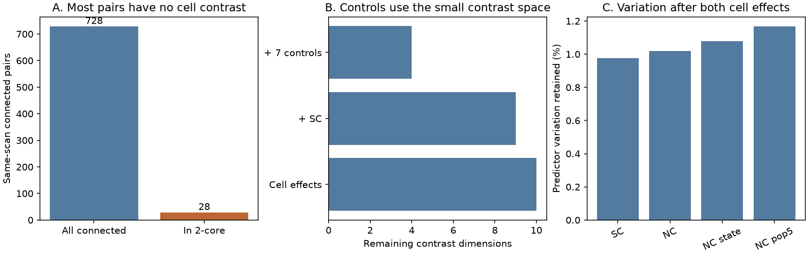

# Only 28 of 728 connected same-scan MICrONS pairs support additive comparisons that control for both cells

## Main result
In one MICrONS mouse, 728 connected same-scan excitatory neuron pairs leave only 10 independent contrast dimensions after separate source-cell and target-cell effects. Only 28 pairs can contribute to those contrasts. These include three of the 63 multiple-contact pairs. This is an exact design result for a released sample. It is not evidence that shared activity has no relation to contact number.

We first asked whether shared trial-to-trial activity predicts multiple synaptic contacts among already connected neurons, beyond movie response similarity, proximity and cell properties. Before fitting an outcome association, a graph check showed that this sample leaves very few comparisons. We changed the main output to an audit of this design limit. The local plan and change are in files/PLAN.md. No outcome slope was fitted or selected.

## Data and prior work
Ding et al. (2025, doi:10.1038/s41586-025-08840-3) tested functional wiring rules. The MICrONS Consortium (2025, doi:10.1038/s41586-025-08790-w) linked calcium imaging and electron microscopy in the same mouse. The consortium includes the Allen Institute.

We reused the verified same-scan table from SCI publication e9455e37a00547b613cd8ac12ee466cdd4b5cbc7b7684413cb08d05a9e0ab1dd. That study tested contact counts across connected and unconnected pairs. Its table contains 24,330 pairs from 13 scans. We kept positive contact counts and positive axon and dendrite proximity lengths. All 728 connected pairs passed these length rules. No duplicate ordered pair was present.

SC is correlation of repeat-averaged movie responses. NC is correlation of trial residuals. NC_state removes measured behavior effects. NC_pop5 also removes five population modes. The earlier study calculated these measures from DANDI 000402 repeated movie calcium data in 0.5 s bins. We did not extract or validate NWB traces again. We use published derived measures. The exact graph result needs only cell IDs and contact counts.

SCI publication 8a590e728fd86661a1ec13978f22ab06ca9465111c259538d17a946b40263cae tested multiple contacts in 8,128 connected pairs without the same-scan rule. It used graph rank and leaf pruning to find informative pairs. We apply that method to the smaller sample needed for trial-residual correlation. We add a separate bridge audit and a projection check. The graph principle is established; the new result is the exact design limit in the same-scan sample. This result does not refute either earlier study.

## Method and proof
Make a bipartite graph with one vertex per source role and one per target role. A cell with both roles has separate vertices because the model has separate additive effects. Each pair is an edge.

For E edges, V role vertices and C connected components, the cell indicator matrix has rank V-C. Thus E-V+C dimensions remain after cell effects. Multiplying target columns by minus one gives the oriented incidence matrix. Within each component its only column dependence is a constant potential. The orthogonal complement in edge space is the cycle space.

A bridge has zero projection into that space. Remove a bridge to split a component. Sum the zero-divergence equations over one resulting vertex set. The bridge contrast must be zero. It cannot support a linear slope after both cell effects. Repeated degree-one pruning removes edges with the same property, but a core can still contain bridges. We checked bridges separately.

We constructed an orthonormal cycle basis Q after pruning and placed zero rows at deleted edges. We checked BQ=0 and Q'Q=I. For a pair predictor x, Q'x holds the variation left after cell effects. We report its squared norm divided by the centered sum of squares of x. All projections use ordinary Euclidean weights and additive linear effects.

Independent validation removed each edge in turn and checked whether the component count increased. Sparse least squares with explicit cell indicators reproduced the projections with maximum errors below 1e-12. Control rank agreed at relative singular-value tolerances from 1e-6 to 1e-12. Files/validation.json gives the checks.

## Findings
| Panel | Edges | Sources | Targets | Components | Dimensions after cell effects | Nonbridge edges |
|---|---:|---:|---:|---:|---:|---:|
| Connected, same scan | 728 | 118 | 675 | 75 | 10 | 28 |
| Connected, full v1 | 8,128 | 148 | 4,811 | 2 | 3,171 | 5,158 |
| All candidates, same scan | 24,330 | 148 | 8,123 | 13 | 16,072 | 21,699 |

These panels overlap. They are design comparisons, not independent biological replications. Trial-residual correlation requires simultaneous recordings. Pairs recorded at different times cannot replace them.

In the primary panel, 700 edges are bridges. The degree-pruned core also contains exactly 28 edges. Here the core and the nonbridge set coincide. The contact counts are 665 pairs with one contact, 51 with two, eight with three, three with four, and one with six. Of 63 multiple-contact pairs, only three lie in the core. The other 60 have no linear contrast after both cell effects.

Cell effects retain 0.975% of centered SC variation, 1.019% of NC variation, 1.080% of NC_state variation, and 1.167% of NC_pop5 variation. These fractions describe the unweighted design. They are not measurement reliabilities.

Adding SC leaves nine dimensions. Log dendrite and log axon proximity lengths leave seven. Their separate squares leave five. Log soma distance leaves four. The same-field indicator adds no further rank. Thus the seven stated controls use six dimensions. Adding one independent NC predictor would leave three residual dimensions. We did not use this small residual space to report an effect or a biological null.

## Meaning and limits
A numerical contact-multiplicity coefficient is possible. Its support comes from very few comparisons under this adjustment. We do not estimate power, impose a universal sample-size cutoff, or prove that a coefficient must be unstable. The 10 contrast dimensions are not 10 independent animals or trials.

The result applies to connected-only linear comparisons with separate additive cell effects. Other models can borrow information through partial pooling or biological priors, with conclusions that depend on those assumptions. Positive weights do not change incidence rank, but they change projection fractions.

The original analysis that included unconnected pairs does not have only 10 dimensions. Its larger support graph leaves many more contrasts. Filtering to existing connections can remove most of the comparisons needed to control for both cells. This is the central design warning.

There is one selected mouse and cortical volume. Proofreading, proximity selection, scan inclusion, missing edges and synapse labels can affect the graph. Activity measures are inherited and have finite repeat reliability. No causal, cross-animal, cross-region or behavioral generalization follows. This audit does not test fast spike synchrony.

For future data collection, target measured pairs that close cycles. Adding an edge within an existing component increases E-V+C by one. Adding a leaf with a new vertex does not. Two source cells connected to both of two target cells give a simple informative cycle. This is a graph design rule, not a promise that such connected pairs can be found. Audit the support graph before choosing many controls.

## Provenance and reproduction
No shared data were changed or downloaded. We read the raw edge table at /mnt/dell-data/shared_datasets/microns-funconn-ding2025-v1-edge-data/edge_data_v1.pkl. It is the BossDB node_and_edge_properties v1 release, 201,511,086 bytes, SHA-256 efcd387233960026464f285597fd5bc1c3a00432e4d62570bc578149a9707bbb. The code checks this hash before unpickling. The node table was not used.

The inherited same-scan parquet is included without changes. Its SHA-256 is b11f54b7b58dafd2c9b2ff6e0dd839b27249a054c19ebd3a061164709d7bed15. Files/provenance.json records URLs, paths, versions and hashes. Files/source_provenance.json preserves the earlier study's DANDI asset provenance. Files/full_connected_graph.csv gives the IDs and counts used for the full-panel comparison.

Use Python 3.12 with numpy, pandas, scipy, matplotlib and pyarrow. Exact installed numerical versions are in files/summary.json. From the files directory, run:

    python analyze.py --pairs pairs_same_scan.parquet --edge-csv full_connected_graph.csv --out rerun
    python validate.py

The first command repeats tables and the figure offline. The second independently checks the primary graph and projections. To rebuild the full connected graph from raw data, replace --edge-csv with --edge /path/to/edge_data_v1.pkl. Retrieve the exact BossDB URL in provenance.json into scratch if needed and verify its hash. To recover the inherited parquet, use sci read on the cited local bundle with --file files/derived/pairs_same_scan.parquet and --output pairs_same_scan.parquet. Its source code and raw-data recipe remain in that cited bundle.

Credit: Zhuokun Ding and colleagues, the MICrONS Consortium, DANDI contributors and the cited campaign studies. Reused data retain source attribution duties. The baseline license covers our text, code and figures; it does not remove those duties.

## Campaign record
Campaign 11_07_2026. Job sci-1107-dell-neural-structure-and-computation-961c9ce0ec14. Topic neural-structure-and-computation. Machine dell. Account codex-andrii. Model gpt-6.1-sol with high reasoning effort through T3 Code and the Codex harness. One worker, no child agents. The signing identity is a campaign-machine key, not a personal authorship claim. The bundle stays local and is not submitted to a remote archive or index.
