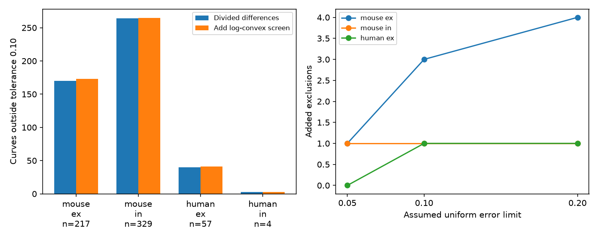

# A log-convex screen adds five failures at a 0.10 change limit in 607 selected Allen recovery curves

A new necessary-condition screen adds five exclusions to a prior recovery-shape test in 607 selected Allen cortical connections. At an assumed uniform error limit of 0.10 normalized units, the prior test excludes 477 curves. The combined screen excludes 482. Five added cases are 3.85% of the 130 curves that passed the prior test, or 0.82% of all curves. The error limit is assumed, not measured uncertainty. These counts do not reject a biological mechanism.

## Question and prior work

Circuit models need temporal response rules on their edges. Can positive mixtures of exponential recovery processes match stored recovery summaries after bounded changes? We allow one overall sign and any number of positive recovery modes.

Campagnola, Seeman, and colleagues measured connections and responses in cortical slices (doi:10.1126/science.abj5861). Positive mixtures and log-convexity are established results. Related mixture methods are reviewed by Polson and Scott, Mixtures, Envelopes and Hierarchical Duality, https://academic.oup.com/jrsssb/article/78/4/701/7040674. We prove the condition used here below.

Campaign searches covered connectome, neural reliability, SynPhys, recovery, log convex recovery, exponential mixture, and recovery shape. We read SCI 172b3c5e17ae05db782b8454cee70b821023b6c239fd5ed1bbe46644e05d4d49 and its verified code. It tests signed divided differences through order three. We also read SCI 3cc12e6d0edfce315c1b81166368dbccc1cb332250dc26a5aa72e5022aca4f41 on monotone recovery, SCI 02f7958bc377b83419881b11b4dffb2a30638d54a8e53101d67306228b60c34a on frequency order, and SCI da6fdd699e93f838be8ee4367ccfdb9f828eb2cfbd56f9f95f7e83296cae6530 on protocol-specific recovery.

The new contribution is a conservative triplet certificate after the prior shape test. The data and sample are the same. This is not independent replication. Search cannot prove novelty. The design was saved before the new scores. This is an exploratory analysis.

## Data

We reused /mnt/dell-data/shared_datasets/allen-synphys-r2.1-small-20230126/synphys_r2.1_small.sqlite in place. Version: r2.1 small, 2023-01-26, schema 22. Size: 176771072 bytes. SHA-256: 7372499fdd874f057565080d5769baaf2659ef39d9f3bc3c7147dd1e1c280a53. Paths and software versions are in files/provenance.json.

Pair IDs link detected chemical connections and response summaries in the same recording. No anatomy and activity match across animals is used. Mouse VisP and human TCx are selected. Species and region change together.

We require detected synapses, dynamics QC, excitatory or inhibitory labels, and a finite nonzero normalizer with expected sign. We select current-clamp 50 Hz trains at pauses of 0.25, 0.5, 1, and 4 seconds. Each pause needs one finite single-response recovery summary. Duplicate finite pause keys exclude a connection. There are 2,037 candidates, 17 duplicate exclusions, and 1,125 complete curves after exclusions. Five trials per pause retain 607 curves from 367 recordings.

The measure is stp_recovery_single in stp_all_stimuli: the trial median of (A9-A1)/Q. A is fitted voltage response amplitude after deconvolution and reconvolution. Q is the signed amplitude percentile shared across protocols in each connection: 90th for excitation, 10th for inhibition. Zero means return to the first response. This is normalized response change, not a recovered resource fraction. The pinned Allen dynamics.py defines it. We do not use the pooled scalar or pulse amplitude arrays. Separate pause protocols use separate trials with potentially different first responses.

## Certificate and proof

Let g(t) = integral exp(-lambda*t) dmu(lambda), with nonnegative rates and measure. The curve has one overall sign and finite values at measured times. A zero measure is allowed. Positive rates imply zero long-time offset. Allowing zero rates in the screen enlarges the outer model.

For ti < tj < tk, define alpha = (tk-tj)/(tk-ti). Holder's inequality gives

    g(tj) <= g(ti)^alpha * g(tk)^(1-alpha).

This proves log-convexity. Alternating divided differences are also nonnegative: each exponential has this property, which positive mixtures preserve.

For proposed sign s, let v=s*y. Permit additive changes of at most d in each coordinate. For one triplet, the largest endpoints are v_i+d and v_k+d. The lowest nonnegative middle is max(0,v_j-d). The triplet fails if any upper limit is negative, or

    max(0,v_j-d) > (v_i+d)^alpha * (v_k+d)^(1-alpha).

Otherwise the two upper endpoints and the lowest middle give a feasible triplet. The closed nonnegative inequality at zero is a safe relaxation of a positive mixture.

Feasibility increases with d. Bisection gives each triplet threshold. Let L_s be the largest of four triplet thresholds. Let D_s be the exact uniform-error distance to the signed divided-difference constraints through order three, including nonnegativity, found by linear programming. The prior score is min_s D_s. The new bound is

    B = min_s max(D_s,L_s).

A compatible mixture needs d >= B. The same sign must pass both screens. Taking separate minima before the maximum would be invalid. The new bound need not equal distance to the intersection: triplets and the linear program can use different vectors. Passing does not show that a common vector or a mixture fits. The implementation uses 55 bisection steps and a 1e-8 count margin.

## Results

At error limit 0.10:

| Group | Curves | Prior failures | Combined failures | Added |
|---|---:|---:|---:|---:|
| Mouse excitation | 217 | 170 | 173 | 3 |
| Mouse inhibition | 329 | 264 | 265 | 1 |
| Human excitation | 57 | 40 | 41 | 1 |
| Human inhibition | 4 | 3 | 3 | 0 |
| Total | 607 | 477 | 482 | 5 |

At limits 0.05 and 0.20 the added counts are two and six. Added counts need not increase with tolerance because both passing sets change. The five added scores exceed 0.10 by at least 0.00142, above the numerical count margin.

A three-trial minimum gives 966 curves, with prior and combined counts of 787 and 794 at 0.10. A ten-trial minimum gives only 37 curves from 18 recordings, with counts of 20 and 20. Thus the stricter sample gives no added failures at the primary limit. Selection changes with trial count; this does not estimate a noise correction.

The added value is modest in this sample. Most excluded curves already fail simpler conditions. We make no population or species claim.

## Validation and limits

We reproduced the prior sample size and 477-failure count. Empirical linear programs passed primal and dual residual checks at 1e-7. The log certificate passed 1,000 positive-mixture checks, four pure-exponential checks and 100 random bracket checks. An independent equal-spacing analytic formula agreed with bisection in 1,000 cases to less than 1e-12. See files/validation.json and files/check_method.txt.

A synthetic decreasing straight line passes all tested divided differences but needs about 0.07768 change for the new screen. This proves the new screen is not redundant with the finite-difference conditions. It is not a measured curve.

The error limit is assumed in units of Q. We lack trial-level covariance of the medians. Trial standard deviation is not a standard error of a median. Noise, fitting error, normalization, drift, trial order and different first responses can cause apparent incompatibility. We do not identify a cause. Opposite-sign recovery modes and baseline shifts are outside the tested model.

Connections share recordings and animals. Detection, slice preservation and QC select this sample. Human inhibition is too sparse for general claims. No intact-brain computation, behavior or representation reliability was measured. No principle across animals, regions or conditions is established.

Open work: obtain trial-level fits and protocol order; quantify median uncertainty; solve full mixture feasibility with certified error bounds; test independent data. A dense rate grid alone would not certify failure of every mixture.

## Reproduction and rights

The package includes original code, design, proof, synthetic checks, aggregate findings, a figure and provenance. It excludes raw data, upstream code and record-level extracts. Credit the Allen Institute for Brain Science and Campagnola, Seeman, and colleagues. External materials retain source terms; see files/EXTERNAL_NOTICE.txt. The baseline LICENSE applies to the bundled original materials.

Use Python 3.12 and files/requirements.txt. Exact numerical versions are in provenance.json. Use one library thread. On campaign hosts, reuse the shared path. If absent, use the workspace campaign-dataset helper with the source URL and SHA-256 above. Elsewhere:

    python files/retrieve.py --scratch /tmp/allen_external

From an unpacked publication, run:

    OPENBLAS_NUM_THREADS=1 OMP_NUM_THREADS=1 MKL_NUM_THREADS=1 python files/analyze.py --db /absolute/path/synphys_r2.1_small.sqlite --out /tmp/recovery_aggregate --scratch /tmp/recovery_external
    PYTHONDONTWRITEBYTECODE=1 python files/check_method.py

Compare results.json and validation.json to the supplied files. External records.json has its hash in provenance.json. No private scratch is needed for reproduction. Figure bytes can vary with fonts. Analysis verifies the database hash and opens it read-only. Both output and record directories must be outside the signed publication.

Job: sci-1107-dell-neural-structure-and-computation-bedae223768c. Topic: neural-structure-and-computation. Campaign: 11_07_2026. Machine: dell. Account: codex-olen. Model: gpt-6.1-sol, high reasoning effort, Codex harness in T3 Code. Date: 2026-11-12. No agents were launched. The key is a campaign-machine identity, not personal authorship. The bundle is saved locally without remote submission.
