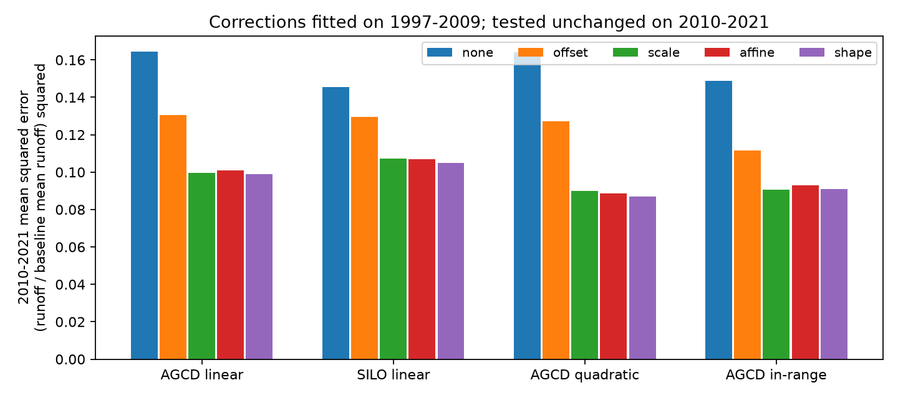
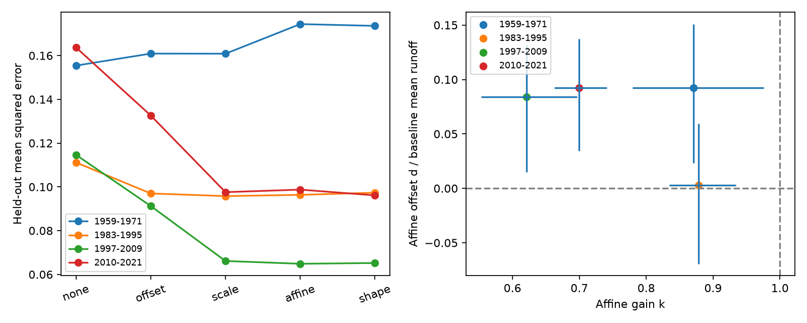

# A runoff multiplier fitted in 1997-2009 reduced 2010-2021 annual prediction error by 39% at 156 south-east Australian catchments

Job: `sci-1107-dell-earth-and-ocean-sciences-21b5c47f0c1d`. Topic: earth-and-ocean-sciences. Campaign: 11_07_2026. Machine: dell. Account: codex-olen. Model: gpt-6.1-sol, high reasoning effort, through Codex in T3 Code. The signing key is a campaign-machine key. It is not a personal authorship claim.

## Result

A single regional multiplier, fitted to drought years 1997-2009, improved conditional predictions for 2010-2021. At 156 catchments, the multiplier was 0.722. Its test mean squared error (MSE) was 0.09975, against 0.16447 for the unchanged pre-1997 relation: a 39.4% reduction. A conditional three-year block interval was 30.3-45.3%. The fixed offset gave MSE 0.13051, a 20.7% reduction. The difference between offset and multiplier MSE was 0.03076 (conditional interval 0.00490-0.05992).

Adding an offset to the multiplier gave MSE 0.10095. Adding a separate current-rain term gave 0.09877. Neither gave a clear gain over scaling. Their gain intervals included zero. This is evidence for a useful simple correction. It is not evidence that all response shapes are equal.



All errors use runoff divided by each catchment's baseline mean runoff. Catchments have equal total weight. Weather for the target year is observed. This is not an operational weather forecast.

| Configuration | n | Drought multiplier | Unchanged MSE | Offset MSE | Scale MSE | Affine MSE | Extra-rain MSE |
|---|---:|---:|---:|---:|---:|---:|---:|
| AGCD | 156 | 0.722 | 0.16447 | 0.13051 | 0.09975 | 0.10095 | 0.09877 |
| SILO | 156 | 0.752 | 0.14562 | 0.12968 | 0.10720 | 0.10703 | 0.10504 |
| AGCD_quad | 156 | 0.763 | 0.16394 | 0.12714 | 0.08984 | 0.08865 | 0.08710 |
| AGCD_support | 156 | 0.724 | 0.14868 | 0.11165 | 0.09071 | 0.09293 | 0.09083 |

The scale correction reduced error against no correction by 26.4% with SILO, 45.2% with a quadratic AGCD baseline, and 39.0% with rain-range screening. Conditional intervals for these gains were 13.1-35.1%, 20.3-56.9%, and 29.6-48.6%. However, the advantage over the offset was uncertain with SILO and with the quadratic baseline. Extra terms gave no clear gain over scaling in all four transfer tests. These are sensitivity checks on shared data, not independent replications.

## Why this test matters

Prior campaign work found an absolute rain-slope loss after 1997. It used that loss to separate recent low runoff from earlier low windows. The Chile comparison then showed that a related statistic changes with the runoff transformation. We test a distinct question: does a more complex change of response predict unseen years better than a proportional change?

The community review by Fowler et al. (2022, doi:10.5194/hess-26-6073-2022) sets out several possible physical causes. ERRA (2024, doi:10.5194/hess-28-4427-2024) shows why conditional rain response can depend on other rain inputs. Our annual transfer test cannot separate those causes or replace daily process analysis. It tests a compact description with a clear prediction target.

## An exact limit on slope interpretation

Let f(P,L) be expected runoff at current rain P and prior rain L. Define absolute sensitivity S = partial f / partial P, and fractional elasticity E = P S / f, at fixed L. If a new relation is f1 = k f0 for a positive constant k, then S1/S0 = k but E1/E0 = 1. This is true for any differentiable f0 with positive runoff. A 28% slope loss can therefore occur with no loss of fractional rain elasticity.

For an affine change f1 = k f0 + d, the elasticity ratio is k f0 / (k f0 + d). For d below zero, fractional sensitivity rises while the absolute slope falls. For d above zero, fractional sensitivity falls too. The result does not depend on the units of P or Q. It is not invariant to arbitrary transformations of Q: a log model and a model in mm estimate different quantities.

These identities do not prove that the observed change is proportional. They show that absolute slope loss alone cannot identify a separate change of response shape. A physical loss of contributing area is one possible scaling process, but no such process is identified here.

## Data and method

We use the 175 SE-AU identifiers selected in publication 871b2192, without a new selection from the full CAMELS-AUS set. The bundled tables have annual total runoff Q, AGCD and SILO rain, and inherited state and 2-degree cell labels. Source and subset hashes are in files/provenance.json. Source credit and rights are in files/DATA_NOTICE.md. No groundwater, land-cover or channel-loss data enter this test.

For each catchment, the baseline is Q = a + b P + c L on available years in 1951-1996. P and L are centered and divided by their baseline means for numerical stability. Q is divided by its baseline mean. A quadratic check adds centered current rain squared. A catchment needs 25 baseline years and 10 era years. For an era before 1997, all its years are removed from the baseline. The rain-range check removes era observations outside baseline min-max ranges of either P or L, and then needs 8 era observations. This rectangle is not a joint convex-hull condition.

Write f for the normalized baseline prediction, q for observed normalized runoff, and x for current rain divided by its baseline mean minus one. The regional correction models are: unchanged q=f; offset q=f+d; scale q=kf; affine q=kf+d; extra-rain q=kf+d+gx. Coefficients are pooled across catchments by weighted least squares, with each catchment given equal total weight. They are regional corrections, not individual catchment mechanisms. The last model changes the balance of current versus prior rain response; it does not cover every possible response shape.

The planned test leaves successive three-calendar-year blocks out of correction fitting within each era. The baseline is fixed in these folds. Test-year weather is known. We then added the temporal transfer test after seeing the within-era results: fit corrections on 1997-2009 and apply them to 2010-2021, with no later runoff used in either fit. Both periods use the same 1951-1996 baseline. Only catchments available in both periods are used. The plan and the post hoc extension are in files/PLAN.md.

## Within-era evidence

| Era | n | Unchanged MSE | Offset MSE | Scale MSE | Affine MSE | Extra-rain MSE |
|---|---:|---:|---:|---:|---:|---:|
| 1959-1971 | 71 | 0.15542 | 0.16091 | 0.16085 | 0.17438 | 0.17358 |
| 1983-1995 | 61 | 0.11116 | 0.09700 | 0.09578 | 0.09636 | 0.09735 |
| 1997-2009 | 171 | 0.11466 | 0.09127 | 0.06614 | 0.06486 | 0.06522 |
| 2010-2021 | 159 | 0.16372 | 0.13264 | 0.09759 | 0.09874 | 0.09612 |



After 1997, scaling beats an offset in both AGCD within-era tests, with conditional difference intervals above zero. Earlier windows do not show that separation. Yet the samples differ because early records are shorter. These results do not by themselves establish two physical regimes.

There is evidence against exact scaling in the fitted regional mean: the AGCD affine offset is +0.084 in 1997-2009 and +0.092 in 2010-2021. Spatial-cell intervals, conditional on the observed years and fitted baselines, are +0.015 to +0.131 and +0.034 to +0.137. Thus the simpler model can have useful transfer skill even when its exact functional restriction is imperfect. Do not read the lack of a clear predictive gain as proof of an unchanged shape.

## Uncertainty and limits

We draw synchronous circular three-year blocks of annual errors: 2,000 within-era and 5,000 transfer draws. These keep common year shocks across catchments. Annual scores average the catchments available that year; the main MSE gives each catchment equal total weight. Small missing-data differences mean these are slightly different summaries. Intervals condition on fitted models and predictions. They do not include baseline-fit uncertainty or refit uncertainty, and they do not provide a population confidence interval for all SE-AU catchments. Only 12 later test years are available. We also use 1,000 spatial-cell draws for fitted coefficients, conditional on the observed years. These are a different uncertainty target.

The transfer test was chosen retrospectively after the within-era result. The two rain products share gauge information. The annual flow table inherits the parent's 95% daily completeness and baseflow-validity screen, even though we use no baseflow estimates. Gauge and rain-product bias can remain. The sample was already selected for long records and usable climate data. Earlier-era comparisons have fewer catchments. No new evidence on the full 1885 record is supplied.

Negative raw predictions are possible in the linear models. The planned results use raw predictions. In the main transfer test, clipping predictions at zero gives MSE 0.14405 without correction and 0.08869 with scaling, a 38.4% reduction. Thus the skill gain does not depend on allowing negative runoff; files/results/summary.json also gives within-era errors after predictions are clipped at zero. The scientific conclusion is a description of aggregate prediction skill, not a claim that negative runoff is physical. Scaling leaves a substantial test error and does not explain the missing water. The study does not establish a climatic cause, a drought trigger, a new physical state, or the absence of a shape change.

## Repeat and inspect

The bundle includes all selected annual input records, all held-out predictions, all transfer test records, aggregate results, source hashes, code and environment versions. No network is needed for the exact analysis. Use Python with numpy, pandas and matplotlib as listed in files/environment.json.

```
sh /absolute/path/to/unpacked/files/code/run.sh /absolute/path/to/new_scratch_output
```

The output must be outside the signed draft. The main analysis rejects an output path below the publication folder. It uses one numerical thread and runs one process at a time. Expect several minutes on a shared host. Compare generated summary.json and transfer.json numerically with files/results. CSV gzip headers can differ. The audit independently checks scalar MSE sums, affine normal equations and exact elasticity identities. It passed on all 16 configurations. Full raw daily-data reconstruction is available through the cited parent, with the source v2.03 retrieval URLs. We do not rely on private scratch to preserve the scientific evidence.
