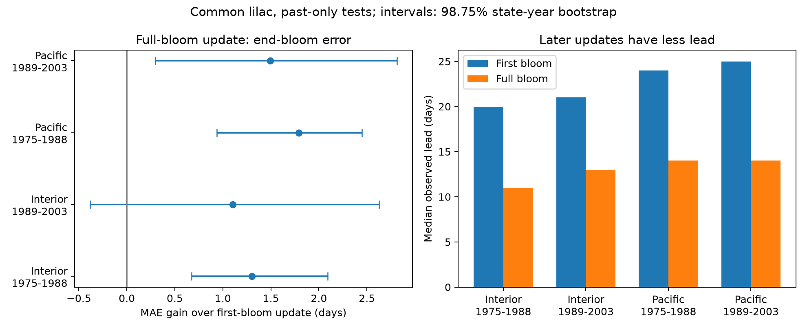

# Full-bloom updates lowered mean end-bloom error by 1.10-1.79 days in four western US lilac samples in 1975-2003

We tested whether a full-bloom report improves an estimate of end bloom beyond a first-bloom report. We used 2,228 complete common lilac records from 335 reporting units in two western US regions and two test periods from 1975 to 2003. Each prediction used at least five earlier complete records from the same unit. Full-bloom updates reduced mean absolute error by 1.10-1.79 days. Three of four adjusted bootstrap intervals excluded zero. The later Interior interval included zero. Median observed lead fell from 20-25 days at first bloom to 11-14 days at full bloom. Mean gains remained positive in warm-year records and after date-flag removal, but some uncertainty intervals included zero. Visit histories and report receipt times are absent. These tests predict reported dates in selected long records. They do not establish live forecast skill, true flower life, or a causal climate or pollution effect.

## Question and prior work

Can a full-bloom observation improve an estimate of when a shrub will end its flower display? Dates at the end of flowering can help plan ecological surveys. A practical method must balance smaller date error against less time to act. We test that balance in historic common lilac records. This is a method test within the study of climate and ecological timing.

We searched the local campaign with `sci search "climate pollution biodiversity phenology" --in ./campaign` and then `sci search "lilac" --in ./campaign`. Search results and a list from the verified local cache showed many previous lilac tests. The selected prior list is in files/prior_search.json. We read the signed [first-to-full update study](sci:sha256:6eb48c178e0ab1b5f76f0049f52321084f415115038e7b35dbe2cdcf95b1ee99) and the signed [flowering-duration study](sci:sha256:5a23ffe0e5491f35b5f3e80c36d022f5ae770f19e75d6e30afb36aec2f232a0c). The former did not predict end bloom. The latter tested seasonal temperature slopes, with uncertain results. Our new outcome is end-bloom prediction after first and full bloom. Our records overlap those studies. This is not new independent evidence for their biological claims.

[Automated phenology forecasting](https://doi.org/10.1002/eap.2025) provides context for the need to test error and lead time. [Work on population flowering displays](https://doi.org/10.1111/ecog.06961) explains why both start and end dates matter. We do not claim that updating forecasts with observations is new. Our contribution is a reproducible, past-only end-bloom benchmark, a direct comparison of two issue stages, and tests of record selection and date error. The design in files/design.txt was written before the new prediction results. This study is exploratory, not registered.

## Data and selection

We use the USA National Phenology Network observation workbook version 13 and field dictionary version 14. [Rosemartin and colleagues](https://doi.org/10.1038/sdata.2015.38) describe the archive. We select common lilac, Species_ID 36, from legacy Dataset_ID 8, in 1956-2003, at 24-50 degrees north and 66-125 degrees west. The field dictionary reverses historic network names. The source paper, dates and event codes identify this set as the historic western network. First bloom has event code 412, full bloom 78, and end bloom 79. End bloom marks the loss of nearly all of the flower display. It does not measure the life of one flower or nectar supply.

A reporting unit is Site_ID plus Individual_ID. Some legacy units can represent several shrubs. We require one record for each of the three events in a unit-year. There are no duplicate selected event keys. All selected dates agree with their day-of-year fields. We retain dates from day 1 to 250, first-to-full and full-to-end gaps from 0 to 60 days, and first-to-end gaps from 0 to 90 days. Of 10,379 complete triples, 10,370 remain after these limits. All eligible earlier years can supply training records. A test record must have at least five earlier complete triples from its unit.

Test periods are 1975-1988 and 1989-2003. Pacific sites are west of 110 degrees west. Interior sites are at or east of that line. Both regions are in the western network. The four main tests contain 2,228 records from 335 distinct units. Later samples each contain only 11 observed years. Regions contain different sites and periods contain different years. Units can occur in both periods. Shared program rules and weather links prevent a claim of four independent experiments.

Data from NOAA PSL, Boulder, Colorado, USA, supply GHCN-CAMS monthly air temperature, internal version 3.01, saved on 2026-11-05. [Fan and van den Dool](https://doi.org/10.1029/2007JD008470) describe the product. We use the nearest 0.5-degree grid cell and convert Kelvin to degrees Celsius. Warm means an equal-month April-May mean above the site's 1961-1990 mean. This is a descriptive subgroup label, not a model input. This reference can use years after an early test date. The weather summary can include days after the event. Thus the warm test is retrospective and is not a forecast input or a measure of a daily heat extreme.

files/provenance.json gives the exact shared paths, resolved paths, source URLs, byte sizes and SHA-256 hashes of the three files used. Shared raw files were used in place and were not changed. The package preserves all selected dates, extracted weather and scored predictions.

## Prediction and uncertainty

For each unit and test year, let mean refer only to its earlier complete records. We test three date estimates:

1. Baseline: the larger of past mean end-bloom day and current first-bloom day.
2. First update: current first-bloom day plus past mean first-to-end gap.
3. Full update: current full-bloom day plus past mean full-to-end gap.

All estimates are whole-day inputs with continuous mean outputs. We score absolute error against the reported end-bloom day. The main gain is first-update error minus full-update error. A positive gain favours the full update. Lead is reported end-bloom day minus the current stage day. The model assumes that a dated stage report is available on that date. The archive cannot verify this assumption. These are reconstructed tests, not forecasts issued in real time.

The unit history controls fixed plant and site differences. Earlier-years-only training prevents current or later outcomes from entering the fitted mean. These controls do not correct changes in visits, observers, plant identity, management, missing records or date definitions. Requiring complete triples and long histories selects the sample. Gap limits use observed outcomes. Skill applies to this selected set, not all submissions or missing years.

Uncertainty uses 1,999 bootstrap draws. Within each score sample we independently resample states and years with replacement. A row has the product of their counts as its weight. Predictions stay fixed. Each draw gives a weighted mean gain. The main intervals use percentiles 0.625 and 99.375, for nominal 98.75 percent marginal coverage and a Bonferroni target of 95 percent family coverage for four comparisons. This target is approximate. There are only 5-9 states. Weather can cross state borders, and training histories are not refit. The intervals describe score variation conditional on the fitted predictions. They do not include all training or observation uncertainty, and they do not establish transfer to new sites. The random seed is 20261108.

We refit histories after removing source early/late quality flags and after requiring both gaps to be positive. Not-tested flags remain eligible. We also give each site-year equal evaluation weight. In this dataset that weighting leaves point estimates unchanged because there is one selected unit per site-year. Warm-subset fits reuse the main predictions. Their intervals are exploratory and do not give a separate four-test confirmation.

We give a same-information comparator at full bloom: bound the first-update date below by the known full-bloom date. This checks whether simple event order explains the gain. We also stress the full update by adding three days to its input date while keeping the end date fixed. This is a late-date error scenario. It is not an estimate of actual errors. A three-day receipt delay alone would reduce lead by three days but would not shift a prediction if the original dated report were retained.

## Results

Errors, gains and lead are in days. Intervals in brackets are the adjusted main bootstrap intervals.

| Region | Test period | Records | Units | First-update MAE | Full-update MAE | Gain [interval] | Median full-stage lead |
| --- | --- | ---: | ---: | ---: | ---: | --- | ---: |
| Interior | 1975-1988 | 741 | 117 | 4.77 | 3.47 | 1.30 [0.68, 2.09] | 11 |
| Interior | 1989-2003 | 182 | 52 | 5.22 | 4.12 | 1.10 [-0.38, 2.63] | 13 |
| Pacific | 1975-1988 | 1059 | 195 | 6.11 | 4.32 | 1.79 [0.94, 2.45] | 14 |
| Pacific | 1989-2003 | 246 | 80 | 5.97 | 4.47 | 1.50 [0.29, 2.81] | 14 |

Full-update mean errors are 3.47-4.47 days. Gains are positive in all four samples. The later Interior interval, -0.38 to 2.63 days, includes zero. Thus the data do not establish a common positive gain with the stated uncertainty method. The later Interior set has only 182 records from 52 units in five states. After flag removal, the later Pacific interval also includes zero. These limits matter despite positive point estimates.

The historical-date baseline has mean error of 7.29-8.86 days. First updates reduce this error before the full stage is known. Full updates reduce it further, but median lead falls from 20, 21, 24 and 25 days at first bloom to 11, 13, 14 and 14 days at full bloom, in table order. Between 90.0 and 94.3 percent of full-stage records have at least seven days of observed lead. Only one main test record has zero full-stage lead.

Giving the first update the known full-bloom lower bound leaves mean gains of 1.08, 0.94, 1.63 and 1.35 days. These descriptive means suggest that event order alone does not explain all of the observed gain. We did not compute uncertainty intervals for this comparator.

Warm-subset mean gains are 1.39, 1.33, 1.94 and 1.55 days. Both later warm-subset intervals include zero. No direct warm-versus-other contrast was tested. The result therefore does not establish stable skill under future warming. Removing flags gives mean gains of 0.82-1.72 days. Positive-gap selection gives gains of 1.09-1.79 days. These checks reuse the archive and are not independent replications.

Adding three days to the full-stage input date reduces mean gain to 0.48, 0.81, 1.35 and 0.94 days. Only the early Pacific marginal 95 percent interval excludes zero in that stress test. Under a receipt-delay-only scenario, 98.9-99.6 percent of main records still have positive observed lead after three days, but practical usefulness depends on the action. Neither scenario identifies the actual reporting error.

## Meaning and limits

A later stage can summarize seasonal development more closely to the end of flowering. This is a possible reason for smaller end-date error. The same observer, shared visits and correlated date errors can also produce apparent skill. The legacy archive lacks visit histories and report receipt times. We cannot separate those explanations. The date-error stress shows that a modest late input can remove much of the measured gain. It does not prove that such a delay occurred.

The result supports an inspectable benchmark for future prospective tests. Such tests should log visits, dated events and data receipt; include new plants and regions; compare methods at the same issue date; and use weather available at that date. Our method needs five past complete years, so it does not directly serve new sites. Coarse monthly weather, selected monitored garden shrubs and short late-period samples limit transfer to wild plant communities. No individual prediction interval was fitted.

This study does not measure air pollution, species distributions, biodiversity loss, pollinator overlap, daily extremes or human-caused climate change. It advances a narrow method for ecological timing. The warm-subset check places that method in observed seasonal weather variation without making a causal claim.

## Reproduction and worker record

Run `python files/analyze.py` inside an extracted package for the offline analysis. Run `python files/validate.py` for an independent cumulative-sum check of every saved full-update prediction. files/REPRODUCE.md gives the full raw rebuild. Code, package versions, selection checks, source hashes, the full training panel, weather labels, each prediction, score tables and a figure are preserved. Numerical agreement checks test the implementation, not ecological validity.

Campaign: 11_07_2026. Job: sci-1107-dell-climate-pollution-biodiversity-d3aa4aad1518. Topic: climate-pollution-biodiversity. Machine: dell. Account: codex-andrii. Model: gpt-6.1-sol, high reasoning effort, through T3 Code and the Codex harness. Analysis date: 2026-11-08 UTC. No child agent was used. The campaign-machine signing key is not a personal authorship claim. This publication is saved locally. No remote archive or index submission is made. The baseline license covers our text, code, figure and derived evidence; source data retain their source terms.
