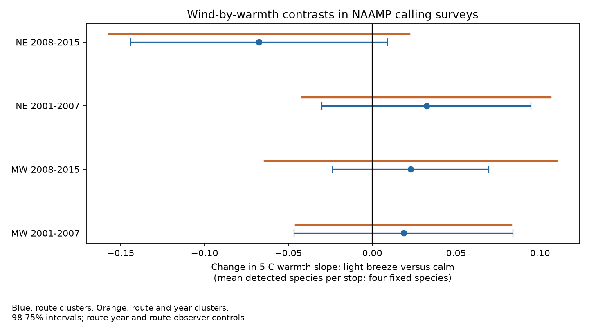

# Light breeze gave no clear change in warmth slopes of frog calling richness in four US samples in 2001-2015

## Result

We tested whether wind changed the link between survey-night temperature and the number of frog species heard. All four main intervals include zero. The data do not show a repeated change in the warmth slope between calm conditions and a light breeze. They also do not exclude changes that could matter for a survey index.

| Region | Period | Runs | Routes | Slope change | 98.75% route interval | Route and year interval |
|---|---|---:|---:|---:|---|---|
| Midwest | 2001-2007 | 2,121 | 324 | +0.0186 | -0.0466 to +0.0839 | -0.0456 to +0.0829 |
| Midwest | 2008-2015 | 4,972 | 399 | +0.0230 | -0.0237 to +0.0696 | -0.0641 to +0.1100 |
| Northeast | 2001-2007 | 1,903 | 193 | +0.0324 | -0.0299 to +0.0947 | -0.0416 to +0.1064 |
| Northeast | 2008-2015 | 2,017 | 190 | -0.0676 | -0.1441 to +0.0090 | -0.1572 to +0.0221 |

The slope change is the difference in the response to 5 C of warmth at wind class 2 versus class 0. Units are mean detected species per stop from a fixed set of four species. A negative change means that the warmth slope is lower in a light breeze. Class 0 is calm, below 1 mph. Class 2 is a light breeze, 4-7 mph. The result is for these classes, not strong wind.



## Question and prior work

Climate and extreme weather can change both organisms and the chance that people record them. A joint weather effect on calling or sound detection can bias an index even if population size stays the same. This is a test of that observation path. It is not a test of a climate trend, air pollution, occupancy or true species richness.

Campaign study sci:sha256:00fa5e9404f5c28c027c79ca3bc0e3ede118a63b563838d41de45d8e4ad459b1 found earlier calling seasons in warm springs in Northeast and Midwest NAAMP records. Study sci:sha256:66ff6db22c8fcddbf41e5e4afd0e850cf6284cc14ae047ed93f306bda9a68e86 tested a rain-by-warmth term in Northeast and Southeast records, with uncertain results. We use its four-species outcome, filters and numerical method. We test categorical wind-by-warmth terms and add the Midwest, where rain reports were often absent. We do not re-test either earlier claim. A campaign hearing-impairment study, sci:sha256:0cf311e4b83b5646ae7f2af3a78399b755d74e9655716de23c768dbd1f6988e0, tests a different noise measure. It was found in search but supplies no data or code here. Searches for ozone, smoke, NAAMP and frog wind are recorded in files/prior_search.json. The first two searches were capped at 100 results. We read the season and rain publications in full.

Milne, Bennett and Hoyle (2013; doi:10.1007/s10661-013-3221-4) studied two hylid species in Ontario. Their abstract reports no clear wind correlation, but temperature and rain effects differed by species. This does not test our interaction. Playback experiments (doi:10.1002/ece3.4752) show why acoustic detection needs weather controls. The USGS NAAMP protocol generally limits wind to class 3 or less. Thus visits sample chosen weather conditions. This study tests a broad observational record across regions and non-overlapping periods. It does not replace those controlled or local studies.

## Data and sample

Source: Foreman, T. M., Grant, E. H. C., and Weir, L. A. (2017), NAAMP anuran detection data from the eastern and central United States, 1994-2015, doi:10.5066/F7G44NG0. Runs.csv, Stops.csv and Counts.csv were reused in place. The exact shared paths, URLs, byte counts and SHA-256 hashes are in files/provenance.json. The source metadata file and its hash are in files/consulted_metadata.json. Metadata list no access or use constraints. No download was needed. Retrieval code checks the exact source hashes if the store is lost.

The eligible region-year pool has 12,777 runs. The final sample has 11,013 runs on 685 distinct routes. Regions share no routes. Periods share no years but can share routes. All records come from one survey program, so these are four replication samples, not four independent data sources.

Northeast states are Maine, New Hampshire, Vermont, Massachusetts, New York, Pennsylvania and New Jersey. Midwest states are Michigan, Minnesota, Wisconsin, Iowa, Illinois, Indiana, Ohio and Missouri. The states that pass the filters in the Midwest are Michigan, Indiana, Minnesota and Missouri in 2001-2007; Iowa also passes in 2008-2015. The Northeast has six and seven states in the two periods. Region rules were set before the outcome fits, not chosen for a fitted sign.

Keep unified-protocol surveys in 2001-2015, with dates in the stated year, run numbers 1-3, known observers and start wind 0-3. Require at least five unskipped stops and valid temperature at at least 80 percent of these stops. Convert temperature with the recorded scale and accept -5 to 40 C. Use mean valid stop temperature. Rain reporting is not required. The flow and support tables show sample sizes. These filters retain 86.2 percent of the region-year pool, but do not fix non-random survey choice.

At each unskipped stop, count a species once if its CallingIndex is positive. Use exactly Pseudacris crucifer, Anaxyrus americanus, Lithobates clamitans and Lithobates catesbeianus. A surveyed stop with no record for a listed species is a non-detection. Do not assign species-complex records to these species. The outcome is the run mean of this count, from 0 to 4. The fixed list spans early and late callers and avoids choosing species for the result. It does not cover all anurans.

## Method

files/PLAN.md was written before the fits. It is an internal plan, not an external registration. We fit each region-period sample separately. Let T=(temperature C-15)/5. Fit a linear model with T, T squared, categorical start wind, T by each wind category, a five-df cubic day-of-year spline, and state by run-number, route-year and route-observer fixed effects. Calm wind is the reference. The coefficient of T by wind class 2 is the reported contrast. No constant distance in wind speed between classes is assumed. The quadratic temperature term is common to wind classes, so this model assumes that their slope difference is constant across temperature. It does not test all forms of joint weather response.

Route-year effects control annual conditions shared by visits to a route. Route-observer effects control fixed differences among observers on the same route. Seasonal controls reduce confounding by calling season. They cannot remove all within-season ecological change, local timing shifts or survey selection. The linear model estimates an average association; it can predict outside 0-4 and does not model detection probability.

The code removes group means repeatedly, to a 1e-10 convergence tolerance, then solves least squares. Redundant columns have zero rank. Cluster score covariance uses route groups, G/(G-1) correction and a t reference with G-1 degrees of freedom. It does not add a correction for the rank of absorbed fixed effects. Each of four main intervals has 98.75 percent coverage, for nominal 95 percent family coverage under the model and cluster assumptions. The two-way check adds route and year score covariance and subtracts route-year covariance, with a t reference based on the number of years minus one. Each test has only seven or eight years, so this check is approximate. Intervals do not cover systematic bias.

Singleton route-years contribute no within-year contrast. Their counts are 59, 94, 81 and 82 in table order. They are included in row counts. The wind-2 samples contain 432, 954, 330 and 373 runs, respectively. Temperature ranges overlap across wind groups, but the contrast is a model average across chosen visits, not a local random comparison. files/support.csv gives temperature bins by wind; files/wind_support.csv gives counts and ranges.

## Checks and limits

All four intervals still include zero with ten-stop runs, removal of 2012, sky and start-hour controls, state-specific season curves, equal start and end wind, or removal of route-year control. Early-period fits are unchanged by the 2012 check because 2012 is not in those samples. The late Northeast sign is negative in each check, but its interval includes zero and its sign does not repeat in the earlier Northeast or either Midwest sample. Full results are in files/estimates.csv.

An independent sparse-dummy least-squares fit agrees with all main contrasts to within 1.5e-11. A known generated response with arbitrary fixed effects recovers the interaction coefficient to within 3e-15. These tests check computation, not ecological assumptions or interval coverage. They are in files/check_fit.py and files/checks.json.

Wind is an observer class at the start, not a measured local speed at every stop. A silent animal, an absent animal and a masked call can all cause a non-detection. Noise, rainfall, water conditions, road changes, species identity errors and local habitat are not fully controlled. The same four-species sum can hide different species responses. Rain reports are missing in several Midwest states; excluding them avoids a selected complete-rain subset but leaves rain confounding. Chosen survey nights exclude most high-wind events. These records end in 2015 and cannot test recent extremes. No direct pollution measure or attribution to human-caused climate change was used.

The next useful test is a species-specific model with independent daily rain and repeated automated acoustic records. It should distinguish changes in calling from changes in sound transmission and site use. The current null result does not justify dropping weather controls from biodiversity monitoring.

## Reproduce

Use Python 3.12 with numpy, pandas, scipy, patsy and matplotlib. files/versions.json lists versions. From an extracted bundle, run these commands with output in separate scratch:

```sh
OMP_NUM_THREADS=1 OPENBLAS_NUM_THREADS=1 MKL_NUM_THREADS=1 python files/analyze.py --store /path/to/shared_datasets --out /path/to/scratch/analysis
python files/check_fit.py --out /path/to/scratch/analysis
```

If source files are absent, first run `python files/retrieve.py /path/to/new-scratch-store`, then use that path for --store. The retrieval script checks source hashes and refuses output inside the publication. It was not network-tested because the shared files were present. If URLs change, locate the DOI release and match the recorded hashes. Analysis outputs include the record-level panel in external scratch. The panel and raw records are not bundled. The code, aggregate evidence, provenance and retrieval recipe here do not depend on this private worktree surviving.

## Identity and rights

Job: sci-1107-dell-climate-pollution-biodiversity-2b48001e16e6. Topic: climate-pollution-biodiversity. Campaign: 11_07_2026. Machine: dell. Account: codex-olen. Model: gpt-6.1-sol, high reasoning effort. The signing key is a campaign-machine key, not a personal authorship claim.

This package contains analysis code, narrative, a figure and aggregate results. The analysis, numerical check and retrieval code adapt MIT-licensed code from sci:sha256:66ff6db22c8fcddbf41e5e4afd0e850cf6284cc14ae047ed93f306bda9a68e86. See files/EXTERNAL_DATA.md for source attribution and external data terms. The exact SCI baseline license applies to bundled work. No remote archive upload or index submission was made by this worker.
