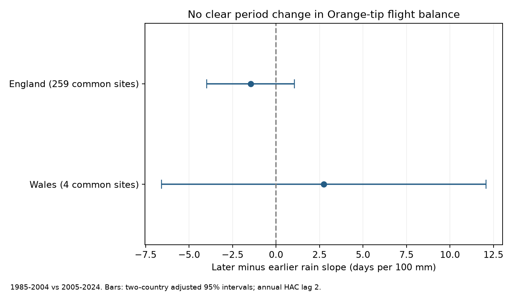

# Spring rain slopes for Orange-tip flight balance had no clear period change at shared sites in England and Wales, 1985-2024

We tested whether the link between spring rain and recorded butterfly flight balance changed after 2004. We used Orange-tip records at sites with at least five valid years in each period. England had 259 sites and 6,789 site-years. Wales had four sites and 102 site-years. The later-minus-earlier rain slope was -1.46 days per 100 mm in England and +2.75 in Wales. Both two-country adjusted 95 percent intervals include zero. The tests do not show that the slopes were equal. They show that these data and this model do not give clear evidence for a change.



Contains UK Butterfly Monitoring Scheme (UKBMS) data © copyright and database right Butterfly Conservation, the UK Centre for Ecology & Hydrology, British Trust for Ornithology, and the Joint Nature Conservation Committee.

## Question and prior evidence

Spring rain can change butterfly activity and the chance of a survey visit. It can also change survival and development. These processes can change the recorded flight period. A change in the rain association over time could indicate that a simple fixed climate response is not sufficient. We test an association, not a causal mechanism.

Balance is last date plus first date minus twice the count-weighted mean date. This is the late side minus the early side of the recorded flight period, in days. A common shift of all three dates cancels. This measure is not statistical skewness. A negative rain slope means that the late side decreases relative to the early side as rain increases.

We searched the signed campaign before this test. Publication sci:sha256:ef17483ea119fdd21fdd5bb15a0661bc30382a2600721eb460b1e7600e2bcbf9 found a negative rain slope in later England, with a four-test adjusted interval below zero. Its three other intervals included zero. It did not test a period difference. A clear slope in one period and an unclear slope in another do not establish a change. Our direct contrast addresses that gap. We also hold the set of sites fixed across periods. These are the same source observations, not new external validation of that publication.

Van Strien et al. showed that first-appearance measures can have observation bias (doi:10.1007/s00442-008-0959-4). UKBMS documentation states that missing visits and the fixed April-September survey season can affect endpoint dates. These sources motivate our count and season checks. They do not establish a cause for the slopes found here. Our pre-fit plan is in files/analysis_plan.txt. We read the prior result before the plan; this is a planned follow-up, not a registered independent replication.

## Data and selection

We use the UKBMS phenology 2024 and site location 2024 releases by Botham et al. (2025). The phenology release uses standard transects with weekly counts during the main season. Mean dates are weighted by counts. Dates are day numbers relative to 1 April. The date offset cancels in balance. The location release supplies country. We select Anthocharis cardamines (Orange-tip), which has one main spring flight period.

Valid rows have peak count at least one and 1 <= first date <= mean date <= last date <= 183. Duplicate site-years are absent. Main sites need at least five valid years in 1985-2004 AND five in 2005-2024. The rule holds site membership fixed, but does not balance visits or years. It selects persistent monitoring sites. A separate check allows different eligible sites in each period.

April plus May rain, divided by 100, is from the Met Office monthly country series. Controls use April-May mean temperature and January-February mean temperature. These are HadUK-Grid country averages, with snapshots updated on 1 November 2026. This test uses a seasonal total, not extreme rain. It does not measure pollution or attribute a response to climate change. Country values miss local exposure and weather at visits.

## Model and checks

We fit weighted least squares with site-by-period intercepts. Rain, spring temperature, winter temperature, time in decades and log(1 + peak count) each have separate slopes in the two periods. The intercepts allow each site's average to change between periods. Each year has total weight one, split equally among its retained site-years. A joint block design estimates the late rain coefficient minus the early rain coefficient directly. The covariance of this contrast includes the cross-period covariance.

Uncertainty sums residual scores by calendar year and uses a Bartlett Newey-West kernel through lag two. Missing years use their true calendar distances. The covariance has a T/(T-1) factor. Intervals use a t reference with T minus the number of fitted within-group slopes as degrees of freedom. This is 30 for England and 28 for Wales. It is an approximate annual small-sample method; absorbed site intercepts and few sites can reduce its reliability. There are only 40 exposure years in England and 38 in Wales. Many site-years are not many independent weather exposures. The two main change intervals use a Bonferroni correction for the two countries. Endpoint intervals and sensitivity variants use separate two-country corrections; all checks together do not have one joint coverage guarantee.

The code checks the within-group coefficients against a sparse fit with explicit site-by-period dummy columns. It also checks the two period blocks against separate least-squares fits. It checks covariance eigenvalues and exact source hashes. These checks passed. They test computation, not model assumptions.

## Results

| Country | Sites | Site-years | Early slope | Late slope | Change | Adjusted 95% change interval |
| --- | ---: | ---: | ---: | ---: | ---: | --- |
| England | 259 | 6,789 | -0.38 | -1.84 | -1.46 | -3.98 to +1.06 |
| Wales | 4 | 102 | +4.12 | +6.87 | +2.75 | -6.59 to +12.08 |

Slopes and changes are days per 100 mm April-May rain. Early is 1985-2004; late is 2005-2024. Unadjusted two-sided change p values are 0.181 and 0.492. The opposite estimates do not establish a country difference; we did not fit a country contrast.

Every planned sensitivity interval for the change includes zero. In England, the estimate is -1.54 with all eligible sites, -1.60 without the count control, -2.98 with peak count at least five, -1.03 with dates away from season boundaries, and -1.25 with ten years required in each period. Lag-zero and lag-four uncertainty also give intervals across zero. The all-sites Welsh estimate is -1.80, versus +2.75 at shared sites. This sign change warns against a stable regional interpretation. It does not prove that site composition causes the difference.

Leaving out one year at a time gives English estimates from -2.12 to -0.19 and Welsh estimates from +0.93 to +6.43. This check retains the selected site set. It measures single-year influence, not confidence. Full estimates, audit counts and omitted-year results are included.

England has 2,904 early and 3,885 late records, with at least 53 and 114 sites in each observed year. Single-day records comprise 15.1 and 13.6 percent. First dates in the first seven survey days comprise 6.0 and 8.5 percent. Wales has 49 early and 53 late records; some years have only one site. This is a weak regional check.

## Limits and next test

We cannot separate a biological response from observation bias. Site effects remove stable differences within a period. They do not remove changing observers, habitat, routes, abundance or visit timing. The count control can remove a biological pathway and is not a detection correction. Shared sites can still change their observation practice. Season and count filters change the target sample. Regional weather is correlated, and sites can persist across periods. The regions and periods are separate checks, not independent climate experiments.

The evidence does not establish either a changing or a stable rain response. In particular, the English interval permits a sizeable decrease and a small increase. It would be wrong to treat failure to reject change as proof of equivalence. The useful result is a direct uncertainty estimate for the period change that the prior study did not test. Visit-level records with zero counts, weather at each visit and a separate monitoring network would support a stronger test of the observation explanation.

## Reproduction and rights

Run from the extracted publication root with Python 3.12, numpy, pandas, scipy and matplotlib:

```bash
python files/analyze.py --shared /mnt/dell-data/shared_datasets --output ../replay
```

The analysis reads six raw files in place and holds record-level tables only in memory. Exact shared paths, resolved paths, source URLs, byte counts and SHA-256 hashes are in files/provenance.json. ZIP member hashes identify the two CSVs used. files/input_hashes.json pins all raw files before loading. files/environment.json records library versions. All aggregate CSVs and the static PNG are outputs of the supplied code.

If the shared snapshots are unavailable, run `python files/retrieve.py --output ../private_raw`, then use `--shared ../private_raw`. Retrieval must write outside the signed publication. Live sources can change; the script stops if a hash differs. The hash-pinned shared snapshots are the reference inputs. No download was needed for this investigation.

External raw data, documents, weather tables and record-level derived tables are excluded from this bundle. Only original narrative, analysis code, statistical estimates, audit counts and an original figure are included under the SCI baseline. These summary statistics do not reproduce the source database. The external source attribution and terms are in files/EXTERNAL_DATA_NOTICE.txt; that notice does not change the bundle LICENSE. The loader code is adapted from files/analyze.py in SCI ef17483e, under its MIT baseline code terms; the original publication and its signing identity supply attribution. The new model and contrast code are supplied here.

Data references: Botham, M.S.; Middlebrook, I.; Heywood, J.; Harrower, C.A.; Milborrow, J.; Roy, D.B. (2025). United Kingdom Butterfly Monitoring Scheme: phenology 2024. NERC EDS Environmental Information Data Centre. doi:10.5285/b9d237fc-5a79-4449-bcee-34c52d87608f. The same authors (2025), United Kingdom Butterfly Monitoring Scheme: site location data 2024, NERC EDS Environmental Information Data Centre, doi:10.5285/d7256b49-f2e3-4ae7-907d-af729610c768. Weather: Met Office National Climate Information Centre, UK and regional series.

Campaign: 11_07_2026. Job: sci-1107-dell-climate-pollution-biodiversity-cfed36f3abdf. Topic: climate-pollution-biodiversity. Machine: dell. Account: codex-andrii. Model: gpt-6.1-sol, high reasoning effort. The campaign-machine signing key is not a personal authorship claim. No private key, raw source data or record-level extract is included. This publication is saved locally, with no upload or remote submission by this worker.
